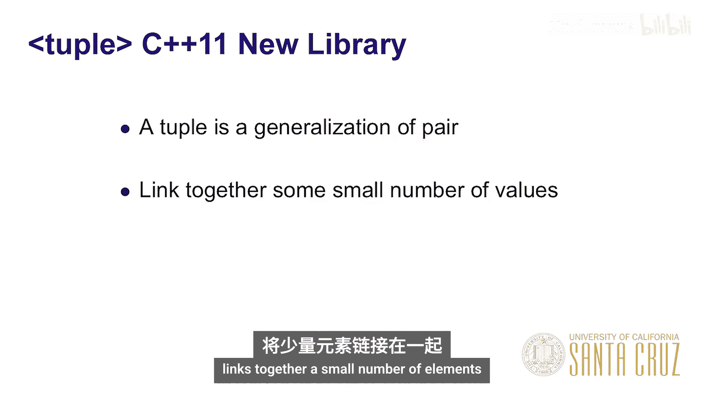
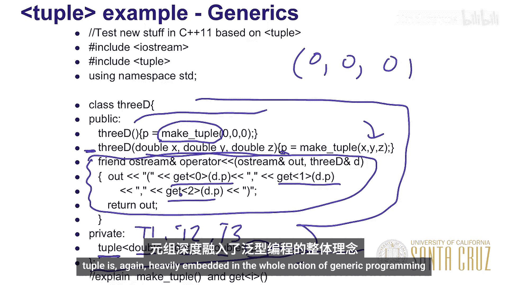
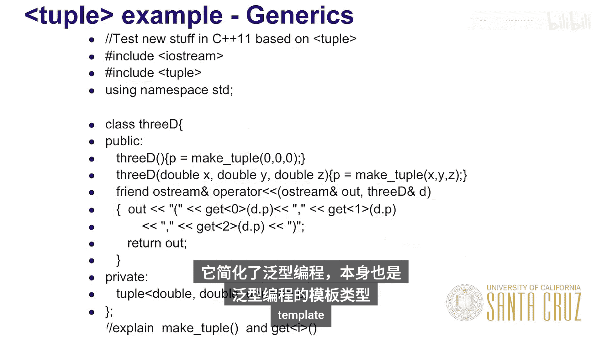
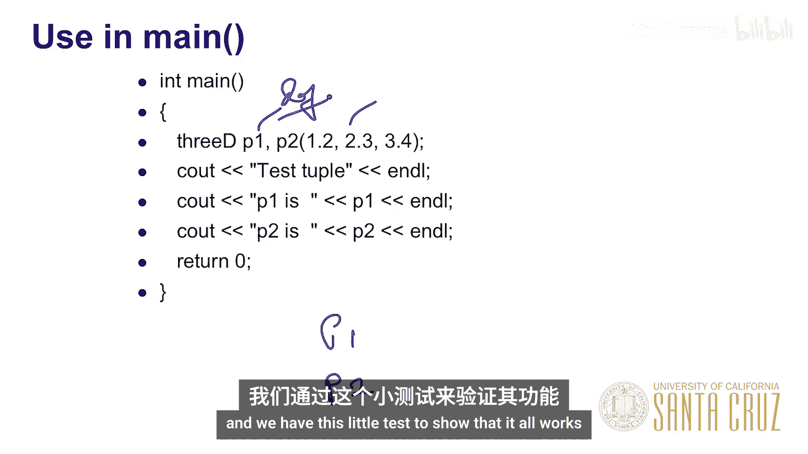
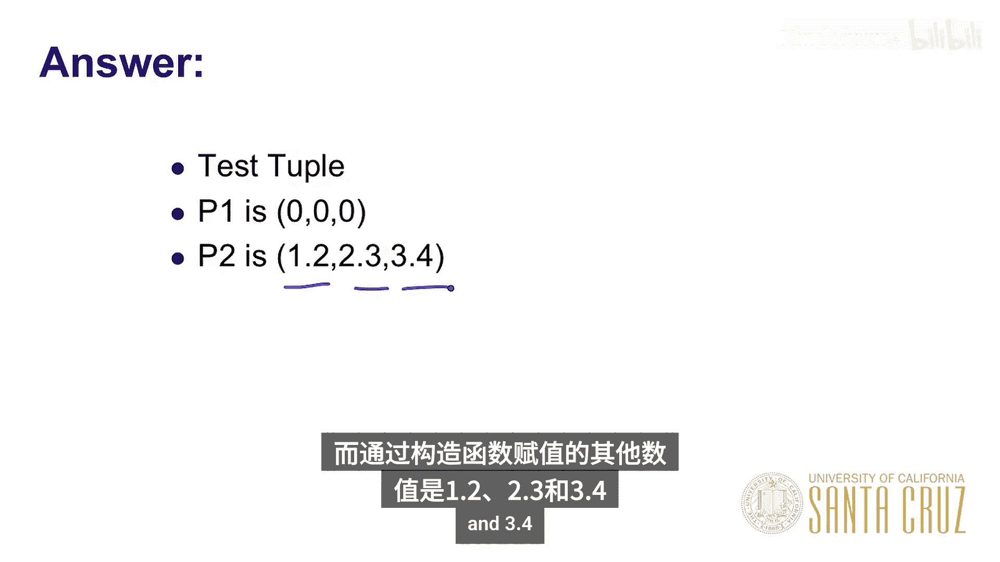
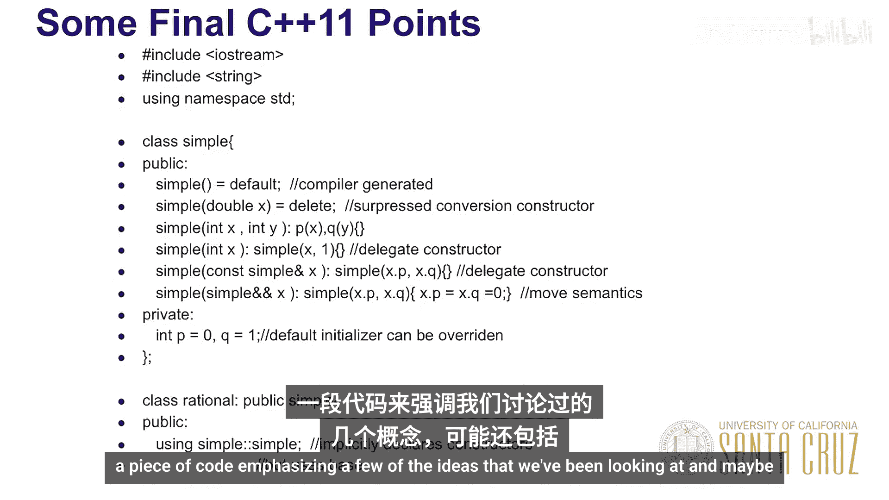
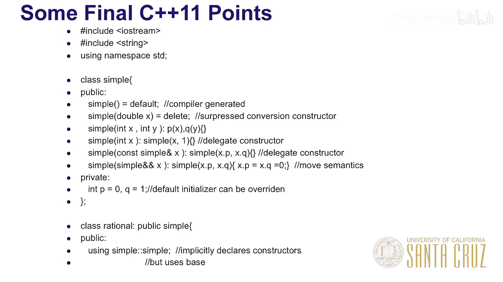
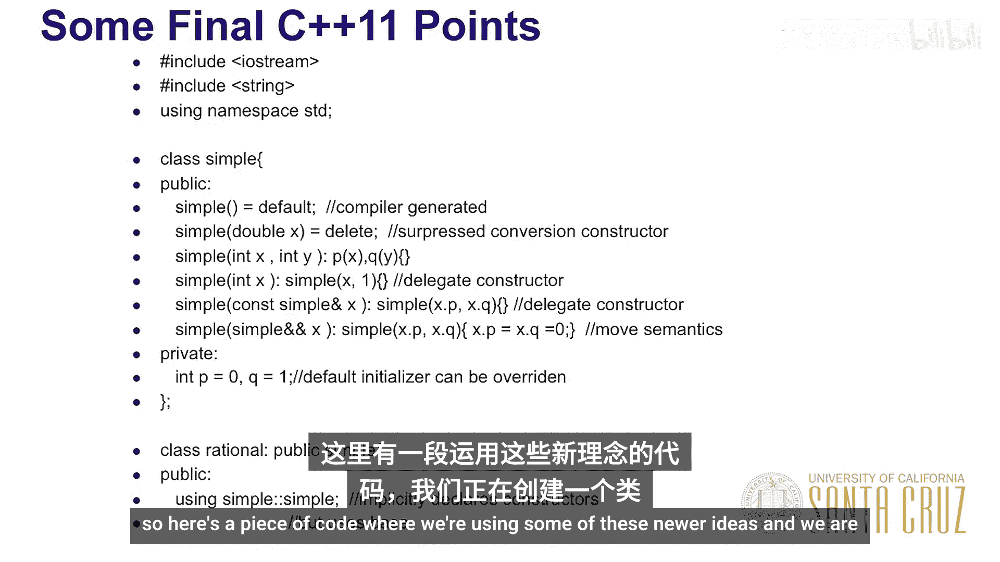
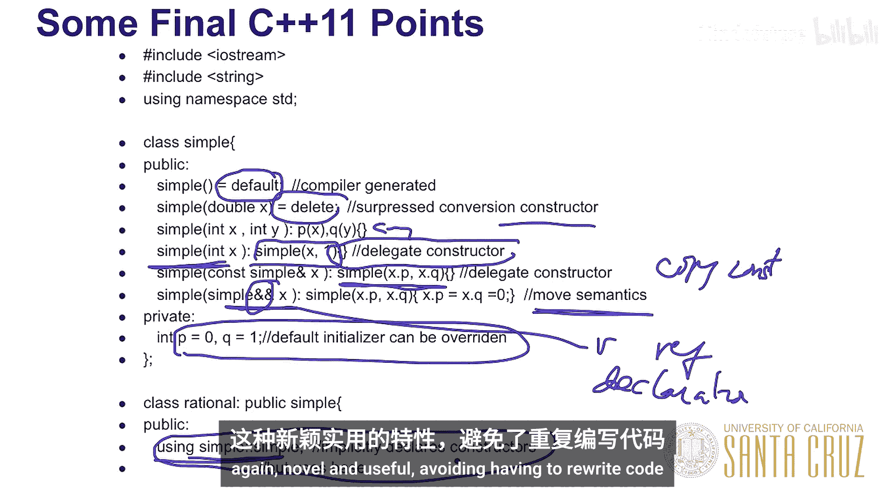

# 053：元组-C++11新库

在本节课中，我们将学习C++11标准库中一个非常实用且易于使用的组件——**元组（tuple）**。元组是`std::pair`的泛化，它允许我们将多个（通常是不同类型的）值组合成一个单一对象，这在需要从函数返回多个值或聚合少量数据时非常方便。

---



## 元组的概念与用途

上一节我们介绍了C++11中一些复杂的库（如线程库），本节我们来看看一个简单得多的库——元组。

元组的基本思想是将少量元素链接在一起。它是对已存在一段时间的`pair`的泛化。在编程中，我们经常需要包含多个值的东西。例如，你可能想从一个函数返回多个聚合在一起的值。虽然可以用数组实现，但当元素数量较少时，元组提供了一种更自然的方式来聚合它们。

元组的一个关键特性是它**不需要元素类型相同**。元组中的每个参数可以来自完全不同的类型集合，这些类型可以各自独立实例化。

以下是元组的一个典型应用场景：考虑在三维空间中绘图。一个三维点包含X、Y和Z坐标。我们可以分别处理这些坐标，但元组提供了一种自然的功能，使得实现这样的三维点变得非常容易。

## 元组的实现与使用

以下是使用元组实现一个简单3D点类的示例。实现方式有很多种，元组并非唯一选择，也不一定带来显著的效率优势，但它展示了如何自然地整合这一功能。

```cpp
#include <tuple>





class Point3D {
private:
    std::tuple<double, double, double> p; // 元组存储三个double值



public:
    // 默认构造函数：将点设置在原点 (0,0,0)
    Point3D() : p(std::make_tuple(0.0, 0.0, 0.0)) {}

    // 带参数的构造函数
    Point3D(double x, double y, double z) : p(std::make_tuple(x, y, z)) {}

    // 友元函数，用于输出点的坐标
    friend std::ostream& operator<<(std::ostream& os, const Point3D& point) {
        os << "(" << std::get<0>(point.p) << ", "
                  << std::get<1>(point.p) << ", "
                  << std::get<2>(point.p) << ")";
        return os;
    }
};
```

在这个类中：
*   `p` 是一个包含三个`double`类型参数的元组。
*   构造函数使用 `std::make_tuple` 来创建元组并存储值。
*   输出操作符使用 `std::get<N>` 来访问元组中特定位置（索引）的值。`get<0>` 获取X值，`get<1>` 获取Y值，`get<2>` 获取Z值。

元组深深植根于**泛型编程**的概念中，它本身就是一个模板类型，使得泛型编程变得更加容易。



## 示例代码运行





让我们看看如何使用这个`Point3D`类：



```cpp
int main() {
    Point3D p1;          // 使用默认构造函数，坐标为 (0, 0, 0)
    Point3D p2(1.2, 2.3, 3.4); // 使用带参构造函数

    std::cout << "P1 is " << p1 << std::endl;
    std::cout << "P2 is " << p2 << std::endl;

    return 0;
}
```

这段代码的输出将是：
```
P1 is (0, 0, 0)
P2 is (1.2, 2.3, 3.4)
```

## C++11 其他新特性示例

为了更全面地理解C++11带来的改进，我们最后再看一段代码，它集中体现了多个新特性：

```cpp
class Simple {
    int p, q;
public:
    Simple() = default; // 指示编译器生成默认构造函数

    explicit Simple(int x) : p(x), q(x) {} // 显式构造函数，防止隐式转换
    Simple(const Simple&) = delete; // 禁止拷贝构造函数（抑制转换）

    // 委托构造函数：一个构造函数复用另一个构造函数的代码
    Simple(int x, int y) : Simple(x) { q = y; }

    // 移动构造函数（右值引用），实现移动语义
    Simple(Simple&& other) noexcept : p(other.p), q(other.q) {
        other.p = other.q = 0;
    }

    // 成员默认初始化
    int a = 10;
    double b = 20.5;
};

class Derived : public Simple {
public:
    // 使用声明，从基类继承构造函数
    using Simple::Simple;
};
```

这段代码展示了以下C++11特性：
1.  **`= default`**： 指示编译器为类生成默认的特殊成员函数（如构造函数）。
2.  **`= delete`**： 禁止编译器使用某个特定的函数（如拷贝构造函数），常用于防止不希望的隐式类型转换，避免潜在的运行时错误。
3.  **委托构造函数**： 一个构造函数可以调用同一个类中的另一个构造函数，避免代码重复。
4.  **移动语义与右值引用**： 通过 `Simple(Simple&&)` 实现高效的资源转移，这是C++11的一个重要改进。
5.  **类内成员初始化**： 在声明类成员时直接提供默认值。
6.  **继承构造函数**： 使用 `using Base::Base;` 语句让派生类自动继承基类的构造函数，无需重写。

这些特性大多是实用性的改进（移动语义相对更激进），它们共同使C++代码更安全、更简洁、更高效。

---



本节课中我们一起学习了C++11标准库中的**元组（tuple）**，了解了它如何将多个可能类型不同的值组合成单一对象，并通过一个3D点类的例子掌握了其基本用法。此外，我们还回顾了C++11中其他一些重要的新特性，如默认/删除函数、委托构造函数、移动语义和类内初始化等。这些特性代表了C++语言的现代化改进，有助于编写更清晰、更健壮的代码。