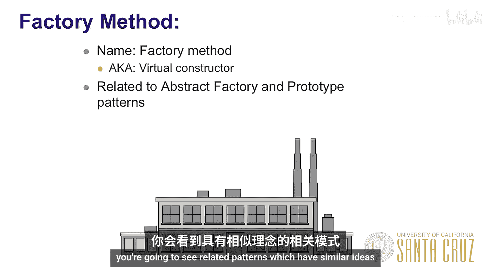
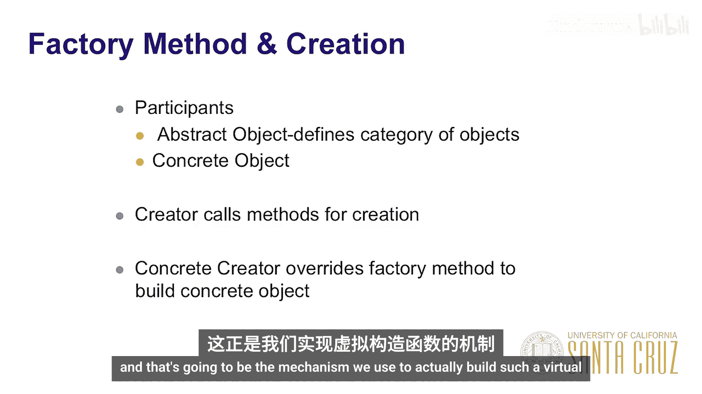
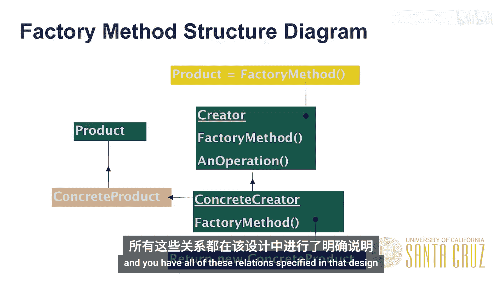
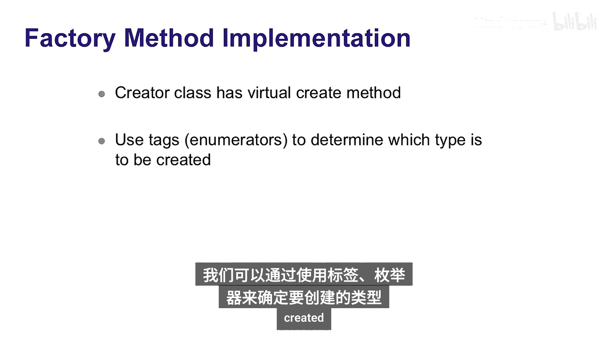

# 055：工厂方法模式

在本节课中，我们将学习如何在C++代码中实现工厂方法模式。我们将探讨其动机、适用场景以及具体的实现方式。

## 动机与概念

上一节我们介绍了工厂方法模式的基本概念。本节中，我们来看看其具体的动机和为什么它会频繁出现。

代码通常知道一个抽象基类，但不知道具体的子类。因此，需要将对象的创建推迟到具体的子类中。这意味着创建过程被延迟到运行时，当实际知道需要什么时才进行。

一个替代方案是使用该类型的通用对象，但这可能过于庞大和昂贵，并且缺乏多态性。

## 模式名称与适用性

“四人帮”在设计模式命名上非常巧妙。他们没有使用“虚拟构造函数”这个名称，因为它与C++的`virtual`关键字绑定，而该概念不应局限于特定语言。他们选择了“工厂方法”这个易于记忆和检索的名称。

该模式的适用性在于，它支持在运行时创建对象，并由子类负责创建对象，而不是在基类中创建。

## 结构蓝图

如果你查阅“四人帮”的原著，你会看到以UML风格绘制的图表，展示了设计中不同代码块之间的关系。

以下是参与工厂方法模式的典型角色：
*   **具体产品**：需要被创建的对象。
*   **具体创建者**：重写工厂方法以构建具体产品。

在面向对象社区中，使用Rational Rose等工具绘制此类文档非常普遍。你可以从代码中抽象出这些关系。设计图中会指定工厂方法、创建者、具体创建者以及返回新产品之间的所有关系。

## 实现方式

那么，我们如何实现它呢？

创建者类需要一个多态的创建方法。虽然我们不能有虚拟构造函数，但可以有一个方法来模拟虚拟构造函数。

一种实现方式是通过使用标签或枚举器来确定要创建的类型。

## 总结

本节课中，我们一起学习了工厂方法模式在C++中的实现。我们了解了其核心动机是**将对象创建延迟到子类**，探讨了其命名缘由和适用场景，并概述了其结构组成和一种通过**多态方法**和**类型标识**来实现的基本方式。这种模式有助于构建可扩展的系统，例如在不知道未来所有窗口类型的情况下设计一个窗口系统。