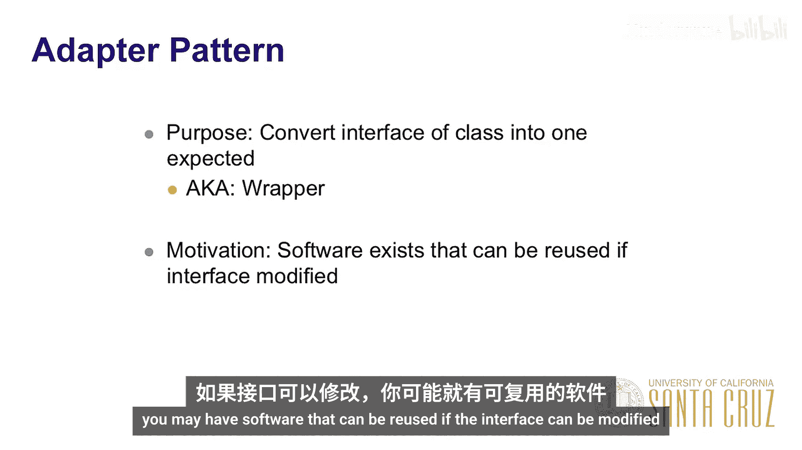
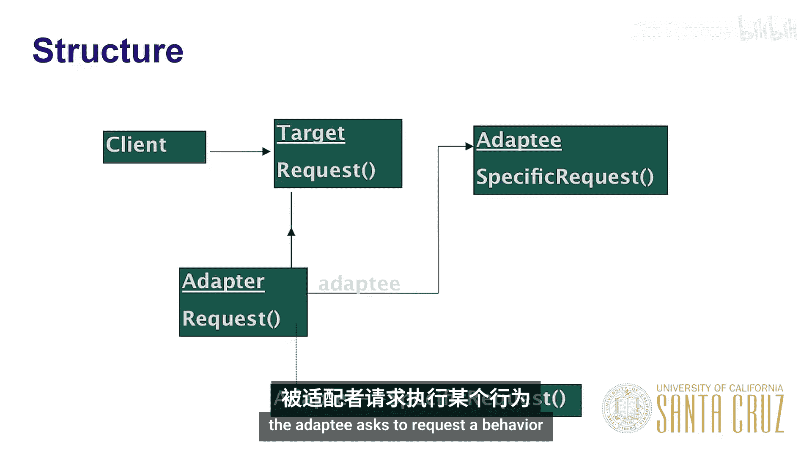
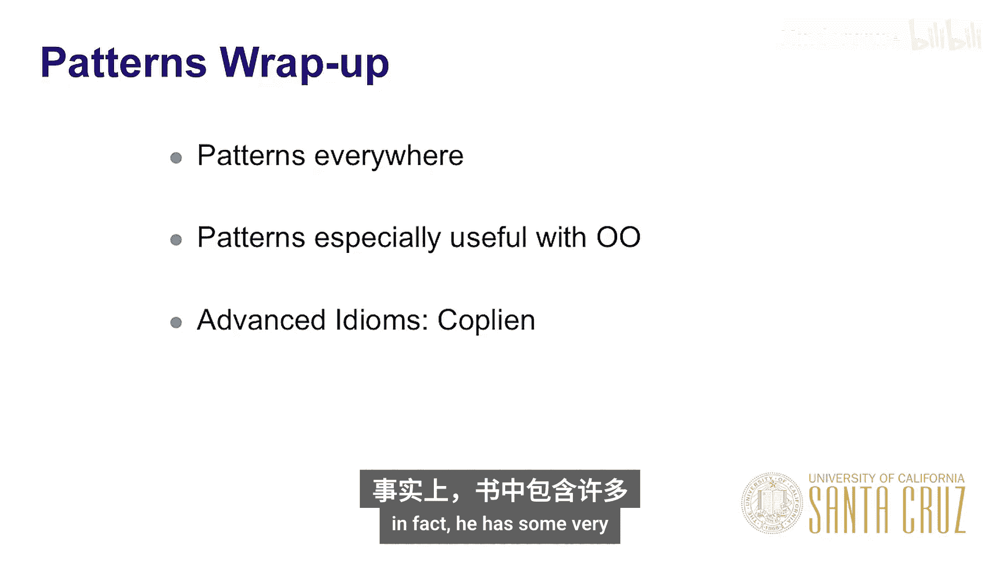
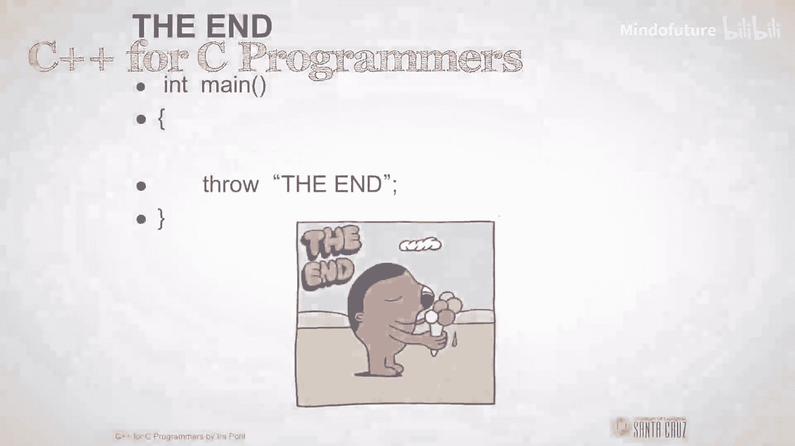
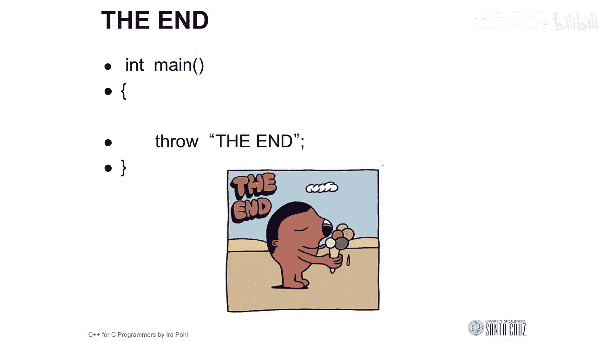

# 057：适配器模式 🧩

在本节课中，我们将要学习设计模式中的适配器模式。我们将了解它的基本概念、在C++标准模板库（STL）中的具体应用，以及它在构建大型、可复用软件架构中的重要性。

## 适配器模式简介

适配器模式是一种结构型设计模式。它的核心目的是将一个类的接口转换成客户期望的另一个接口。这种模式也被称为**包装器（Wrapper）**类。

上一节我们介绍了设计模式的重要性，本节中我们来看看适配器模式的具体应用。当现有软件的接口可以被修改以适应新环境时，适配器模式能促进代码的复用。

## 适配器模式的工作原理

以下是适配器模式中各个角色的协作方式：
*   **目标（Target）**： 定义客户所期望的接口。
*   **适配者（Adaptee）**： 拥有一个需要被适配的现有接口。
*   **适配器（Adapter）**： 对适配者的接口进行包装，并将其转换成目标接口。

其协作流程是：客户端调用适配器对象上的操作，然后适配器调用适配者的操作来执行请求。

## C++ STL中的适配器模式

在C++标准模板库中，适配器模式有非常直接的应用，就像迭代器模式一样。一个显著的例子是`std::stack`的声明。

`std::stack`是一个容器适配器。它本身并非独立的容器实现，而是通过适配（包装）另一个支持特定操作的底层容器来实现其功能。这个底层容器必须支持栈操作，例如`push_back`、`pop_back`和`back`。

`std::vector`是能够轻松支持栈操作的容器之一。这种适配器（或外观）的概念意味着：与其使用`vector`的全部通用功能，不如约束它，使其看起来像一个栈。栈需要执行`push`操作，而`vector`提供了`push_back`操作，只要这种能力存在，就可以进行适配。

如果你使用过`stack`这个适配器类，现在应该能理解其背后的宏观设计思想了。

## 知识巩固与延伸

为了加深理解，我们可以思考一个简短的问题：哪些STL容器可以被适配成栈？

`std::stack`本身不是独立的代码，它实际上是包装了标准库或你的库中支持特定操作集的某个其他容器。

答案是：`deque`和`list`都支持`push_back`和`pop_back`操作，因此可以被适配为栈。而`map`不支持这些操作，因此不能。

## 设计模式的普遍性与价值

模式无处不在。自“四人帮”（Gang of Four）撰写了包含大约40个模式的经典著作以来，人们已经在代码库中发现了数百甚至数千种模式。

专业程序员乐于发现新的模式。其中一些模式被广泛接受。例如，智能指针（Smart Pointers）就是一种可以在许多地方使用的模式，并且已被包含在C++的标准库中。

模式在面向对象编程中尤其有用，但并不局限于面向对象。在拥有辅助函数、类和协作类等元素的大型架构构建中，模式至关重要。它极大地推动了整个软件开发方法论的发展，使模式方法成为程序员的常规工具。

关于C++中设计模式，有一本非常经典且讨论深入的书籍：James O. Coplien的《Advanced C++ Programming Styles and Idioms》。这本书提供了优秀的示例代码，例如包装器代码，清晰地展示了这些思想的强大之处。

## 课程总结 🎯

本节课中我们一起学习了适配器模式。我们了解了它的定义是**将一个接口转换成另一个接口的包装器类**，并探讨了其在C++ STL（如`std::stack`）中的具体实现。我们认识到，掌握设计模式是迈向精通C++等语言、编写更大规模、更可复用代码的关键一步。设计模式是构建健壮软件架构的重要工具，值得每一位开发者深入学习和运用。