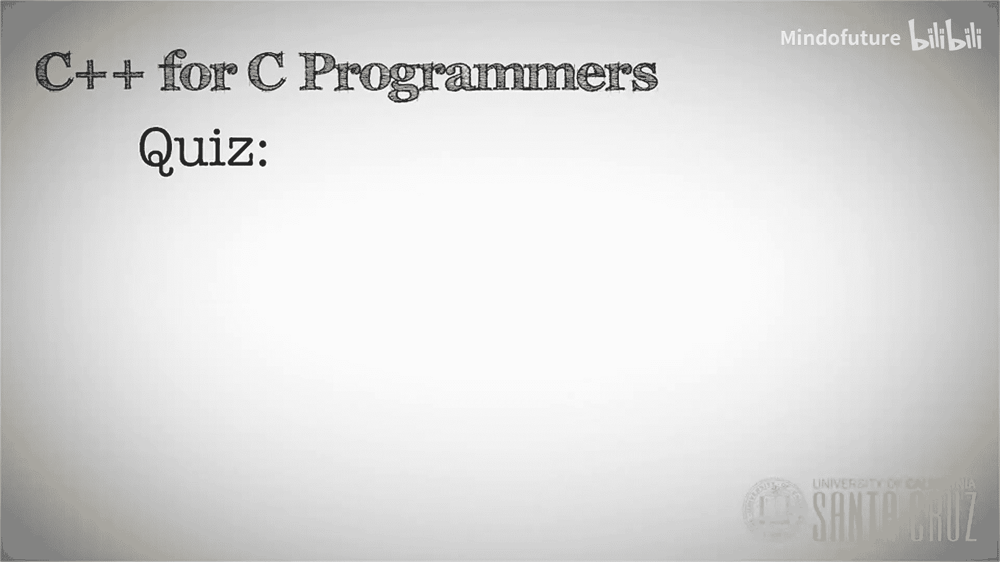
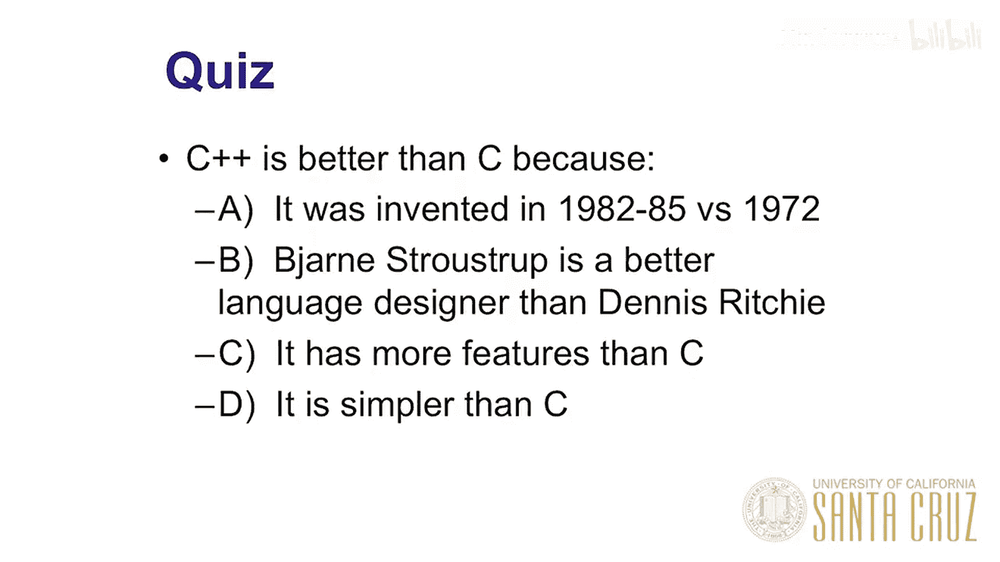
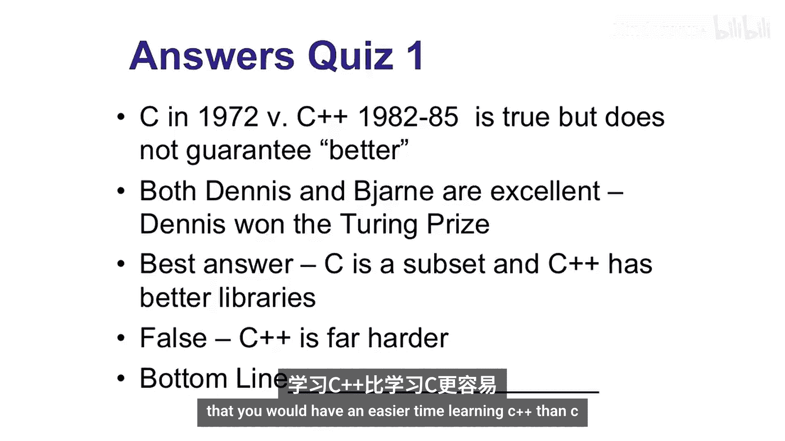
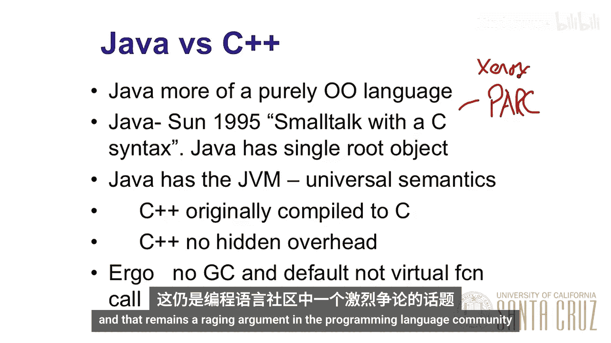

# 【加州大学】C++编程-｜-C-Plus-Plus-A-p01-P01_1-1-概述与课程组织_01_01_02--BV1p2ejzREUQ_p1-

🎼ふ。🎼，🎼はん。🎼Wee。I'm Professor I Ra Pole of the University of California， Santa Cruz。

And I'm going to be your instructor for the next。Number of weeks where we're going to do C++ for C programmers。

Going to explain a little bit about what the course is going to do for you。

The course is organized in two， four week segments。

The first segment is going to take you through the basics of C++。诶。

Today we'll get through C++ as a better C， we'll even try to understand what better means。

I'll also be assigning you homework today in your first homework assignment。

 which will be due in a week。Will be to convert some C code that'll be posted。To C plus plus code。

 so you'll be able to do that right after our discussions today。The next two are。

Graph theory programs。Now。I will explain these algorithms。One is the shortest path algorithm。

 and the other is a minimum spanning tree algorithm。

But I am expecting the people in this class to already have a year's experience。

 both in programming and detail and see。Or an equivalent language。

And roughly the background that you would get。In freshman's sophomore year of computer science。

 so there we would expect。You to understand elementary data structures， things like lists and stacks。

 and to have some of the basics。In studying algorithms。

 including probably some of what we will be implementing， so for many of you。

 this may be revisiting something you've already seen in your student days。

 but by the end of the first four weeks，诶。You should be proficient。

At a professional level in using the C++ language， if you already came in。Knowing C。

Now for getting through the coursework， we're going to have quizzes that'll be at the end of some of my recorded segments。

 and then there'll be one final。Okay。So let's start。

What does it mean for one thing to be better than another thing？It's not really that simple an idea。

Was Willie Mays better than Nickckey Manll to remember Candlesstick Park， San Francisco， May 5， 1966。

 Claude Auseen pitched and there it went。512 home round of Willly's legendary career。

In an epic 7 game struggle， Arch Fs the Yankees and Dodges battle for the World Series pro。

 Mickey Manttle climax the season in which he won the triple batting crown。

 when I was a kid growing up in New York， we had three great centerfielders。

 Mays was a center fielder for the then New York giants。 mantle for the New York Yankees。

 and people probably forget the third center fielder。 He was Duke Sder， the Duke of Brooklyn。Now。

 arguably， Maize and Mandauk two of the greatest players who ever played。

All day long in the various bars and coffee houses in New York， there would be the discussion。

 would I rather have maize or would I rather have mantle？We also have ideas on food。

 you can use butter， or you can use margarine in some context， if frequently interchangeable。

 which is better， what would that mean？And then finally。

 the question we're going to try to answer in the class is C++。Better， is it better than。

 for example， Java？So quiz。

Why don't you see what you think？In what sense is Margarine better than butter or vice versa。

 why don't you think about that and write in an answer？🎼，🎼え。

So here are some of the things you might have thought about。Calories， well， roughly speaking。

 if you look it up， mostly it's a T， margarins tend to be 35 calories that may be surprising。

 they don't typically save you anything on butter。Some margarines are healthier。They have no。

Thatat's in them。Some margarines contain no chlorreol， whereas butter is made from animal fat。

 So if there's a health factor， if you have something like diabetes or heart disease in your background。

 it might even be prescribed by your doctor to have certain kinds of margarine。 But as we know。

 going to a nice French restaurant。It's going to be butter， butter is better， chefs like butter。

Buttter has more vitamins。Bottom line， not an easy question。A lot of context。Okay。

 so let's now return to our main subject。C++。It originated with C， as we said earlier。

Most of you have programmed in C or an equivalent language for at least a year and you're competent that's an expectation in the class。

 C has a deep history。It's been around for quite a while。C， traditional C。

 as you can see in this slide。Was invented by Dennis Ritchie。

And Dennis Ritchie was working with Ken Thompson。And they were working on something that most of you will know about。

 the UniX operating system in。They both invented the UniX operating system and received the highest award that you can get as a computer scientist。

 namely the Turing prize for this work。So they were a two person project at Bell Las， 1972。

 and they were writing an operating system。And they had originally been writing it in a language called B。

 and B， it come from another language called BCPL and so on back to Algore。

 which is a foundational language invented in 1968 by international group of computer scientists as a standard for algorithmic languages and probably in some ways the most influential single language in the history of programming languages。

Now。Dennis and Ken just had this language for their particular project don't we call such a language。

 a systems implementation language。It wasn't really meant for wider use。

It was meant almost as a personal language and you'll see or you'll know。

That there are many obscure things in C notation。Well。One of their guiding principles was。

Type as little as possible。So the language was incredibly terse。It had many。Strange operators。

 those operators conform form to the operating system and the architecture of the small microprocessor they were working on。

 it was a PDP。Now， that was such a successful project that people wanted to expand on it。

And Brian Knegan and Richie then wrote up the language， and that's called KNRC。

 and that's one of the most influential programming books again， in our profession。CanN RRC。

 which was fairly primitive， it had relatively little type safety。

 morphed into something called NCC in the 80s， so as people expanded the use of sea。

Especially professional use of C。There were standardization committees and there were major improvements made NCC。

 which showed up around 1985。Remains in wide use。Later。

 the committees continued to meet and there is a newer version of the standard。But。

I would say the bulk of sea work still done in industry。

Is basically the 1985 standard and that 1985 standard is documented in Carnegan and Richie edition to。

 which many of you might have。So why go to C++？Where we have such a successful and important language。

 C plus plus。Was a language。Written by。Beyond Strstrip。And he was also at Bell Labs。Now。

Swstr had come from a tradition。In Denmark of object oriented programming。

He had learned his programming in a language that was developed by Norwegian computer scientists called Sim Sim 67。

And he just felt that was a better methodology。But that wasn't going to be supported at Bell Labs。

 if you wanted to do work at Bell Labs， you worked in C。ItWas okay to extend sea， so there were many。

What you might call preprocessors that added， extended。

A version of C with ideas from other communities。So there was， for example。

 a form of sea that had a lot of concurrency called concurrency。It had concepts taken for me。

So Bjorn， in that tradition invented something he called initially see with classes。

And he added that on with a preprocessor， and it got very successful， just like Cd。

 and so it escaped its roots， which was， in effect， this very vibrant。啊。Basic research laboratory。

 Bell Labs and AT&T。And so Bell Labs decided it would support。诶 诶。

Industry product and allowed Bjorn to strip to ship and support C++ version one。

And that was 1985 and the language developed much as the language like C developed with support from industry and with。

AnC standard committees modifying the language， building it and improving it。And so by 1996。

 when there was a major AI standard， the language grew to be fairly large。

 so C versus C++ C is small， C is primarily a systems implementation language， C++ is large。

 C supports imperative programming， sort of classical programming where you write little functions and functions are the way you can compartmentalize your programs。

 and C++ is what you might call the Swiss Armyni of programming， it has a tool for every occasion。So。

It also supports two very important forms of programming， object orientation。Again。

 you might want to think similar。And it supports something called generic programming。

 which I'm going to make a big deal about。So。You probably won't have a lot of experience with generic programming。

 and that's one of the benefits that you're going to learn in going over the material over the next few weeks。

So。I'd like you all to think about from what you know at sea。And C+ plus so far， very little。啊。

What might you think？Makes C++ better than C after all， this is our first topic。So A。

It was invented later， so it comes up 10 years later。B。

Beyondrn Strewstrep is a better language designer than Dennis Ritchie。They both wear Bell labs。C。

C++ has more features than C。D。Simpler。What would be your choice？Give you a minute。

Well， programming languages， some people think AlgL 68 was one of the best languages ever invented。

 and that's 60， AlgL 60， excuse me or AlG GoalL 68。Another language that was very elegant language。

It's not always true that better comes later。诶。Dennis and Brn are both excellent computer scientists。

 Dennis won the Turing Prize， but he won it mostly for EX。The answer I was expecting。

 what I would consider the best answer is a sort of semiological answer C is a subset of C++ and C++ has more in it and has better libraries。

If you want to think more is better， not everybody thinks more is better。

That would be the general argument。And it certainly is not that C++ is easier， C++ is far harder。

 even the proponents of C++ would not make the case that you would have an easier time learning C++ than C。

A more interesting comparison is Java versus C++ Java shows up in 1995。Java is invented at sun。

The sun people have great affinity for another old language called small talk。

 small talk was a language invented at park。Which is a very famous。Xerox lab。And among other things。

 probably is the source of inspiration for the Mac。呃。

Lots of things connected with the personal computer， the graphical user interface。

 they all come from Park。So。Small talk， which was a pure object oriented language。Inspired Java。

 which also has a C connection。 It has C like syntax， unlike small talk。But。C+ plus。

Has this inherently imperative。啊。Methodology coming from C system implementation language。

 low level and Java is meant to be purely O0 and high level。 So the inventors chiefly gosling at。Sun。

Just felt that。They could do better。Java has a JVM， a virtual machine。

 and Java provides universal semantics， so the old thematic thing was write once run everywhere。

 that's a good thing in industry， much less in development costs。

 you don't have to do everything individualized to the platform。C++ originally compiled to C。

 so C what's this very efficient SIL。And it had。Different compilers。

 depending on the platform and indeed had slightly different semantics depending on the platform。

 so it could be tuned to the platform， so it was frequently the most efficient higher level language that existed on a platform C++ wanted to maintain that advantage。

So there's no hidden overhead。So。One of the benefits for Java is you get garbage collection。

 you don't have to manage memory， memory leaks go away more or less。Whereas in C++。

 you have to have a sophisticated notion of memory and memory management。But you don't get a hit in。

Runtime costs。So you have a very interesting comparison between Java and C++。

 and that remains a raging argument in the programming language community。

