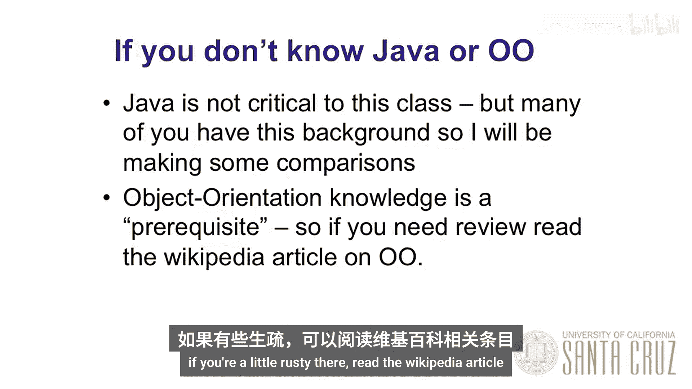
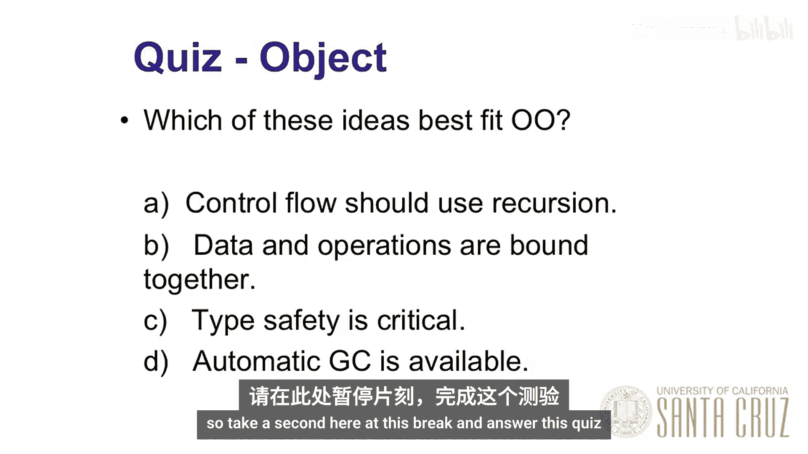
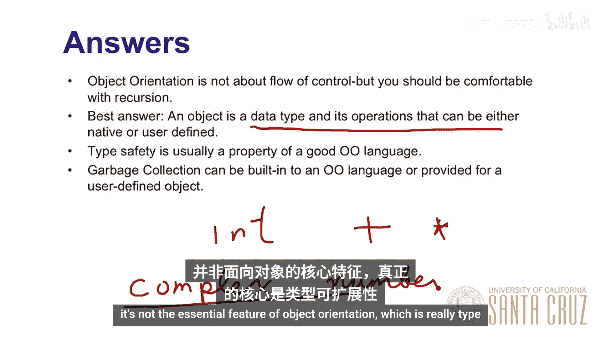

# 【加州大学】C++编程-｜-C-Plus-Plus-A-p02-P02_1-2-入门_01_01_03--BV1p2ejzREUQ_p2-

Now I do expect you to know some of the basics of OO， you don't have to know Java。

 though some of you are coming from knowing Java， so knowing Java is a positive in the sense that lots of stuff in C++ that's soO looks very much like Java。

But you do have to be careful， some of the stuff that looks almost the same。

Has important differences。You must keep in mind that when you learn the C++ version。

 even if the syntactic construction looks the thing。

 you have to make sure you know what the runtime semantics are for the C++ construct。

Object orientation knowledge is something I'm expecting。A little rusty there。

Read the Wikipedia article， it's a very good article on the basics of OO but。

How we intend to develop our software， one of the key methodologies we will be using in the C++ community。

Okay。Quz。From what you know about object orientation， which of these ideas best fit？Oh oh。

Is OO mean that you're using recursion， does ZO mean data and operations are bound together？

Does Zul mean that type safety is critical？Does ZO imply that automatic garbage collection is available。

 so take a second here at this break。

And answer this quiz。So。Let's discuss the answers， object orientation is not about flow of control。

But of course， your background should have led you to use of recursion， so again。

 you should be comfortable with using recursion。The second answer was what I consider a best answer。

 an object is a data type。And it's bound up with its operations。

And think of a data type that you have in the base language you have something like in。

And in the base language， you have operations like plus。And times。Now， in。

An O language like C++ there are things you just have a certain set of basic native types and a crucial thing that makes O languages so powerful is they allow type extensibility that allows you to program naturally with the new types。

 so if you think about C++，There isn't a native type there。But。In the standard library。

 you can get a complex number type。And the compact number type， once it's included in language。

 once it's built properly。alows for operations like plus and times in a natural way in somebody who works in a community such as a physicist or an engineer that uses complex numbers will just routinely use that complex number package very effectively。

 and an O type could be a windowing system。So you could have。

Somebody write a window and then have natural operations on window like making them larger。

 making them smaller， putting them in background， allowing for text mode。

 adding in things like menus。So it's a nice way to build software。

 one of the things in programming language history。When people tried to have universal languages。

 what they invariably ran into was either they made the language so big that it was unmanageable or unlearnable。

Or inefficient or they couldn't they couldn't。Track everything that was useful。

So the early attempts to have universal languages such as PL1。

 while they were remarkable languages and systems， PL1 being invented in the mid-1960s by IBM。

 were essentially failures， largely failures。And that then led to object oriented languages as well。

 actually first。Data abstraction languages such as modular and Ada were quite successful as well。

 They share a lot with object orientation。 and these languages， let you have a， a coherent。Colonel。

So in C++'s case， that coherent kernel is C in S 67's case， the coherent kernel was Algal 60。

And you could be a proficient programmer in C or in the AlgL 60 case。

 and then readily extend the language to a new domain such as complex number。

 that's what's meant by object orientation。Type safety is usually a good property。

 is a good property of many languages including old languages， so it doesn't define them。

 and the same thing can be said about garbage collection。

 it can be built into an object oriented language， it's very useful。

 it's also in languages such as lisp and common lisp and scheme， but it's not a requirement。

 it's not the essential feature of object orientation， which is really type extensibility。

