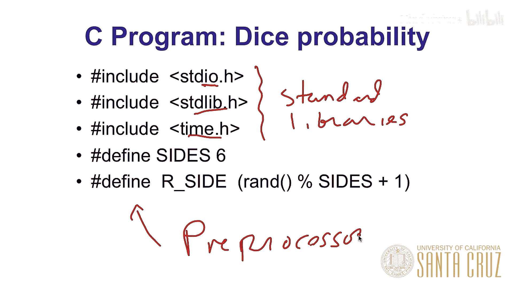
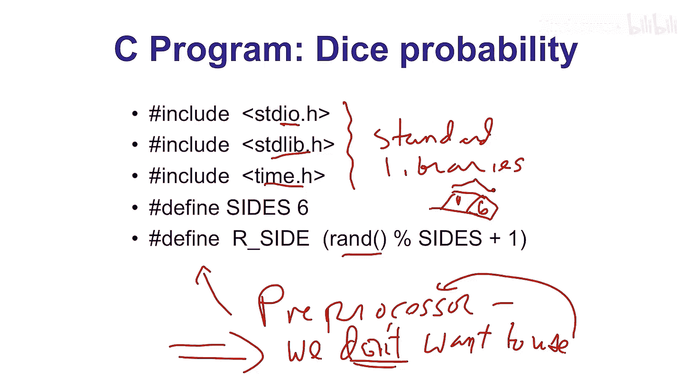
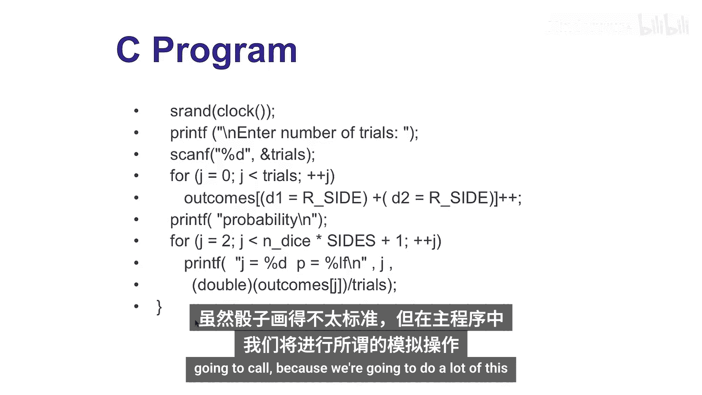
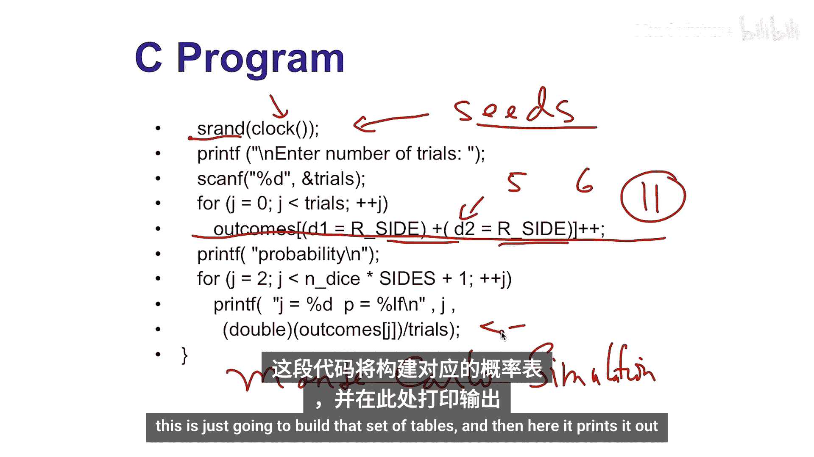
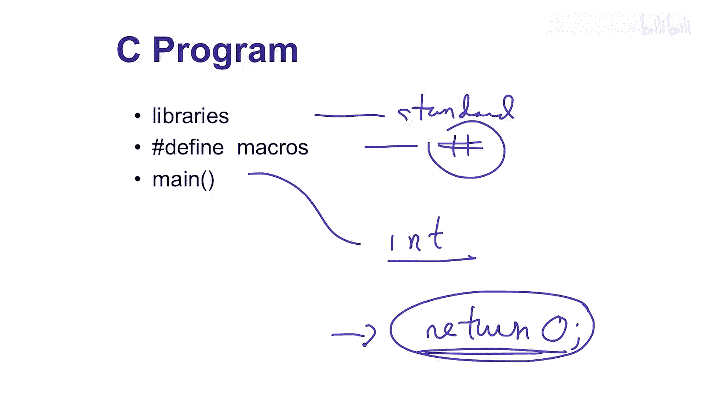

# 【加州大学】C++编程-｜-C-Plus-Plus-A-p03-P03_1-3-将C程序转换为C++_01_01_04--BV1p2ejzREUQ_p3-

Okay。So in this next segment。We're going to show you a C program and this is a C program that if you like to play craps。

 which you can do legally in Las Vegas。This lets you properly compute the odds of getting various dice outcomes。

So we're going to compute probability as a C program and then what we're going to do is show you how to convert it。

To C plus plus program。 So this is your first hands on stuff that you're going to actually。

Come away with， you're going to already be a C++ programmer after this little lesson。And again。

 I'm expecting everybody here to be a C programmer。

So among the things you should know are standard libraries。Anytime a standard library has a function。

 that's the function you should use。That's what the community expectation is I'm going to be talking a lot about community expectations good programmers fulfill community standards。

 community expectations。So we need IO， this is the IO library。

We need some basic functions like the random number function that's going to come in here and we need some timing functions as well from the standard timing library。

All of these commands are what are called preprocessor commands。

One of the things we're going to find out is that。Wei。😔，We don't。Dong。Want to use。

We want to use the preprocessor less， and we're going to explain why， but for the moment。

This should all be familiar。Here's your use of the random number function， a dice has six sides。

 right， we have the little dice that we're rolling， it has pips on it。Between one and six。

And two dice give us。Outcomes between2 and 12。

Not a great drawing of a dice， but。In our main program。

 we're going to do what I'm going to call because we're going to do a lot of this。

So this program is prototypically a simulation。And。With simulations。

 we want to do things that are random， we don't want the simulator to always be working in the same way。

 we don't want it determinly。Well， there's a little contradiction there。

A computer is a deterministic device， how do you get to simulate？Randomness。

That's actually a deep theory， my neighbor Don Canth down the road at Stanford。

 World Authority on it， he wrote a whole book on semi numerical algorithms。

 talked at great length about writing，Code that。Looks random。

 so there's a whole deep theory of randomness。 We're not going to worry about that。

 We just are taking some expert code， which is a pseudo random number generator。And。Figuring that。It。

In effect。Looks like what would otherwise be a true random process。One of the things we do。I。

We call on the system clock and this sees the random number generator。

We don't want the program running the same way each time it'd be like going to Las Vegas。

 starting on a slot machine and always seeing the same outcomes。The casino doesn't want to see that。

 so it has to have a mechanism for starting at a different point in the sequence each time that mechanism is to call the seating function。

 call a systems clock and the clock is going to be a readout at different times a day that'll have different numbers。

 so it'll start you at a different place in the sequence。

And then we're going to run a whole bunch of trials。I'm going to leave this to you。

 you can run the code at home。On a C compiler or a C plus plus compiler。 But in effect。

 all the outcomes are going to be stored in here， and these outcomes are going to be dice 1 and dice 2。

 So if dice 1 is a5 and dice 2 is a6。You're going to get an outcome for。

Getttting 11 so if you want to know traditionally when you first roll dice in craps。

 if you get a7 or 11 you win and if you wanted to know how many outcomes or the likelihood of getting 711 to know what the payoff should be for that。

You can run the simulator and look at the outcomes for 11。

 look at the outcomes for seven and get a sense of that probability。

 this is just going to build that set of tables and then here it print it out。

So what did we get in the C program？We got standard libraries。We got macros。

And we had this special symbol。That introduced the preprocessor commands。And then we saw。

The special function main。While Maine is not a key word。It is reserved for starting the program。

We always have a main function， that's where the program will start。

 that's where the threat for the program will start。And Maine， by the way， and C and C++。Is an int。

And if it's otherwise not specified。Implicitly return zero。Depending on your company's style guide。

 you may want to always have an explicit return zero meaning。

The program terminates correctly and passes a zero value back to the operating system。So that's seat。

