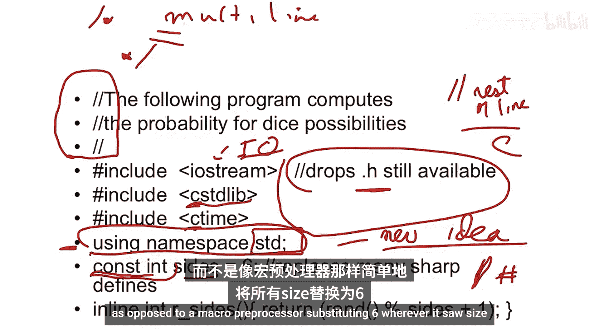
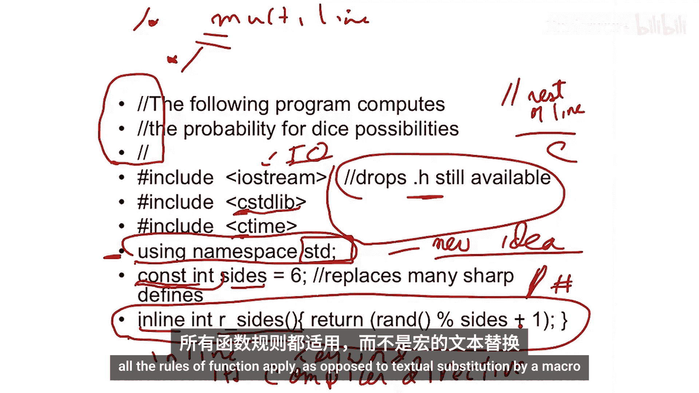

# 【加州大学】C++编程-｜-C-Plus-Plus-A-p04-P04_1-4-使用C++代码_01_01_05--BV1p2ejzREUQ_p4-

Okay， so in this next segment， we're going to see how to do C++ so here's your first C++ code。

 and this should be just transparent， as I say， you should jump off right after。And do problem one。

So。Ignore the dots。In my C++ version， I'm going to have rest of line comments。In the sea community。

We generally had initially。Multiline comments。The thing about restt the line Commons is they're more flexible。

And they're generally a little safer。Now。I have to give you a little warning here。What's the warning？

Some of you are going to say，Wai a minute。I use this kind of comment and see already。And yes， indeed。

 in the C standards that exist now， comment that comment style is now available。

But when the languages started up。啊。This was novel to C++。So it's C plus plus style。

 so there is a little bit of。Slurrring over what the differences in the two languages are。

 many of you are going to be using the Gnu compiler， the Gnu compiler combines both CC++。

 and it's not always clear where one starts and the other stops。So。

What I am going to be talking about is more classically what was C versus what is C++。Now。Again。

 we have standard libraries。And in the C++ community。

 we tend to drop the dot H dot H was a notation reminiscent of meaning that you had a header file and C++ we just give the name。

 so IO streamream is the IO package。And then if I see。

A little C in front these mean import what would also be a library in C。

 so C++ again superet C++ can use all the C stuff and if you need a C library， a classic C library。

 it's available in the standard libraries for C++ and it's generally written as C。

With the same name taken from the Sea library。Now we have something called namespaces。No idea。

A namespace is again， a context an encapsulation。Let's say I'm IBM and I'm writing software。

And I have special stuff， that's IBM stuff。I may wrap it up in a namespace and call it IBM。

 my namespace。This namespace is STD。SDD stands for the Standard Library。

But IBM could be using Naspace IBM， where IBM wants to have its own libraries。

And you can mix and match so you can have different namespaces involved in the same program development。

 you could have the Oracle libraries， the IBM libraries and the standard library。

 or you can have your personal programming libraries， so namespace is another context。

 it's again a naming convention that's on top of the existing naming conventions of the C language。

Okay。And then this using directive， this using statement just lets the。Program， no。

That the expectation is， I'm going to be using。The namespace STD。

And I'll explain in a second why that's a convenience。

Now here we replaced in the other program a sharp include， what was a macro。So in that other thing。

 we had sides being six， but that was a macro， and this is a definition。

 and this definition uses a keyword constant。So。We are saying that。This is a constant。Of type end。

And now this designation， this identifier name。Has typing。And it again， has。Context。

So that the compiler can。Check everything with language rules。As opposed to。

A macro preprocessor substituting six wherever it saw size。

 and that substitution is a textual substitution that is independent of the language rules and again。

You have to take my work for it programming methodologists when they've studied the use of textual substitution as opposed to language context。

Find that more errors are made when you allow preproor textual substitution。

 so this replaces a preprocesor textual substitution with a language rule， a language declaration。

For the same purpose， similarly， where we had macros for a little。Inline coding segments。

 we now have a keyword inline， so inline is a new keyword。It's a compiler directive。

And what it's telling the compiler is， hey， I have some function called our sides。

And here's its code。But I don't want function call。

 why don't I want function call because function call costs me money。

It has runtime characteristics where the code has to go to the stack， has to initialize a stack。

And has to call some complicated machine level instruction， which is maybe some milliseconds。

So I can replace that by pure inline code， that's exactly what the macro was intended for。

 but here again we're now using the language so we get language characteristics enforced all the rules of function apply as opposed to textual substitution by a macro。

