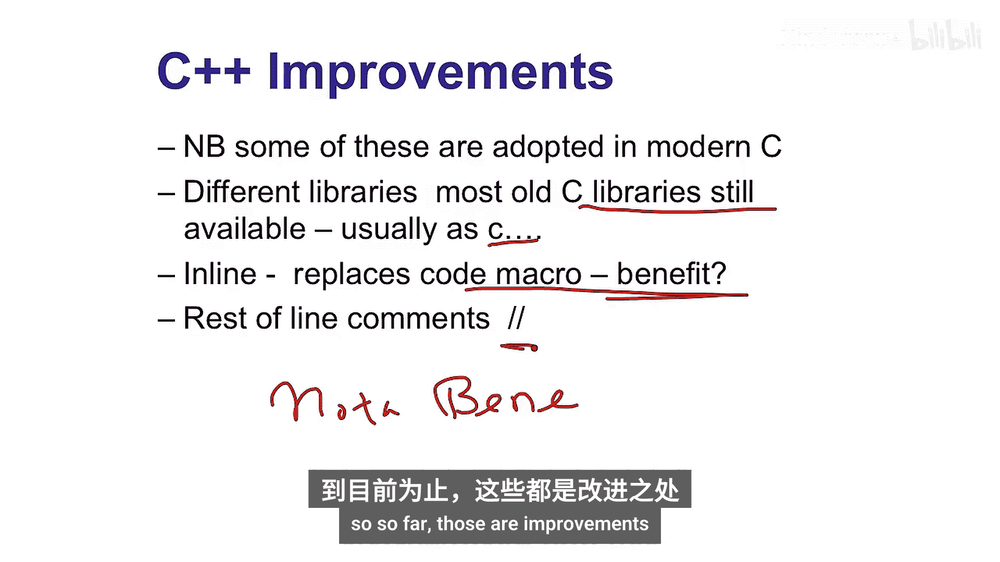
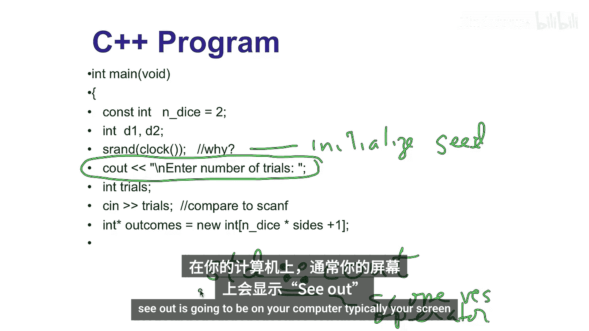
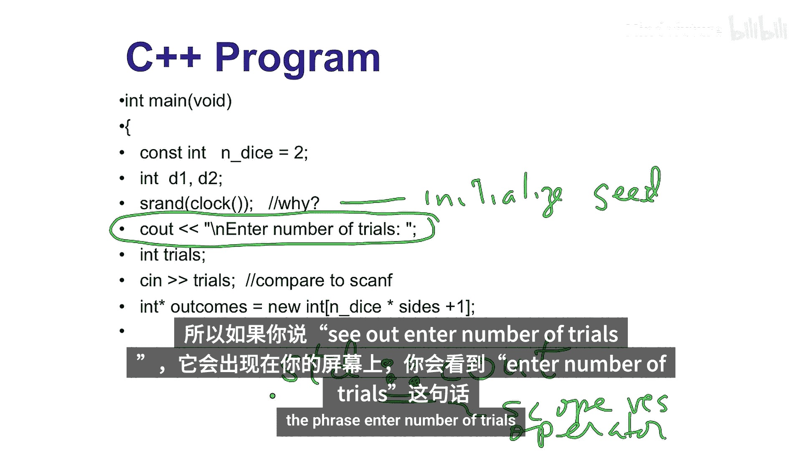
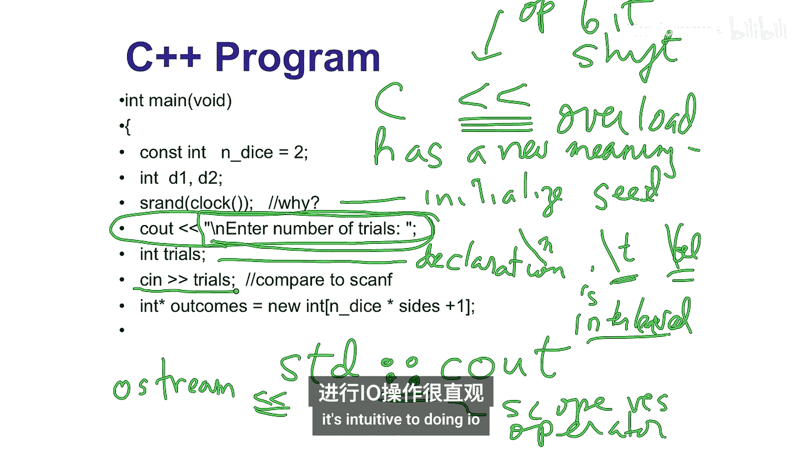
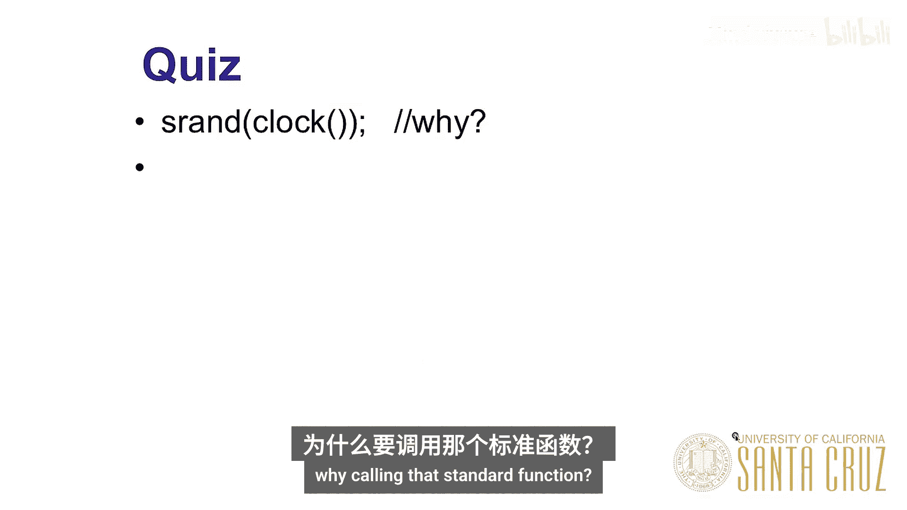
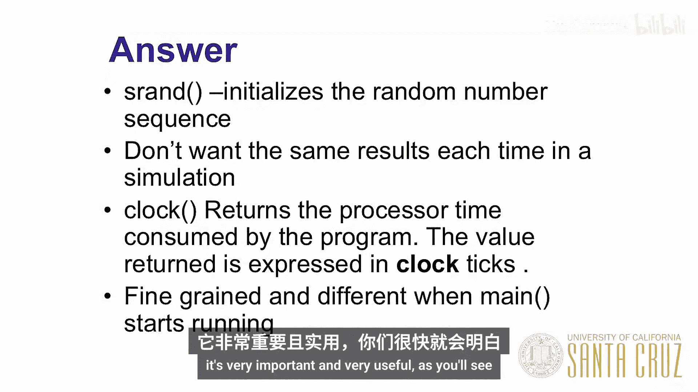

# 【加州大学】C++编程-｜-C-Plus-Plus-A-p05-P05_1-5-C++改进_01_01_06--BV1p2ejzREUQ_p5-

So what were the C++ improvements？Now here's my sales job selling this。In terms of yarn。

Note to Benny， Okay， so it's just。Semierite term， meaning note well， note well， no to many。

Some of these are adopted in modern C99。Again， so bought that， I'm aware of that so the differences。

There's been some convergence。As things have proved themselves really worthwhile and C++ that don't necessarily change the structure of C。

 a few of these things have been adopted。Almost all the old Sea libraries are still available。

 usually with that。C lead in。Inline replaces code macros and you've got to again。

 be a program methodologist or read the literature about where mistakes get made。

 but macros are a big place where mistakes get read and then we've also seen。Less aligned comments。

So so far， those are improvements。

Now let's look at the main part of the program。If we look at the program。

 it looks somewhat like the C program。Again。Why。This is initializing。

Seeding the random number generator。And now we see another thing that I want you to the big takeaway。

Instead of print F， there is。Its see out。See out。If I hadn't had。The using directive。

Would have could also be written this way。This is。The scope resolution operator。So again。

 this is one of the new things in C++ gives。More context than C gives you。

It allows you to use multiple libraries from different namespaces。But because of using。

 I don't need that， so using， I always throw in using the standard library because in most cases that's what I'm going to use and in most cases I don't want to have to type in all those extra characters。

See out is going to be on your computer， typically your screen。

So if you say see out， enter number of trials popping up on your screen。

 you'll see the phrase enter number of trials。 What's this funky little。

Backslash n that's a new line。So if you recall， that's the same in C， anytime you have a backslash。

 that's an escape and then backslash and backslash T， it a taps。Tap character。

 there's backslash bell where you can ring the bell on your。Computer。So。See out has。

The syntax that uses。This operator， this operator。In the sea community。Is a bit shift。But in C++。

 it retains bit shift。Only when the arguments to it make it be bit shift。

And these arguments see out is what's called an O stream， so we have an O stream。

Followed by this operator。And this operator is what's called overloaded， overloaded meaning。

Has a new meaning。So one of the things we're going to be able to do in C++ is function and operator overloading。

Key new idea， an interesting idea well see what its value is， here's one of its values。The IO system。

 NC++ expects bit shift to be used in terms of IO。Because it tends to not be used very often for bit shift。

So this is saying。Look at a string value the double quotes means this is a string value。

It knows that it's a string value and it knows how to print a string value。Later。

 we're going to give it values that are integer or float and we'll know how to print those as well。

Another thing we see here that's new is an interlea declaration that's not at the head of the block。

So this declaration。Is interleaved。Starting to really。Use all of this screen space。It's okay。

And then we have an input statement which can be compared to scanf。

 except that the input statement says。Take from， in this case， the keyboard。

 so you'd type in at the keyboard。How many trials you want in a simulation， and that's a CN again。

This is a much easier scheme， it's type safe， it's convenient， it's easy to understand。

 it's intuitive。To doing I。

Okay。Let's take a little quiz， a very trivial quiz。 We've already heard this。Again， why SRand。

 why calling that standard function？

S Rand initializes the random number generator。Don't want the same results each time in the simulation。

 the clock returns a process time in terms of number of clicks， it's a large unsigned number。

It's fine grained and different when Maine starts running。Again， during this class。

 I'm going to show many different simulation programs， so I am going to expect。

That you will get a fair amount of familiarity with this kind of Monte Carlo processing。

 it's very important。And very useful， as you'll see。

