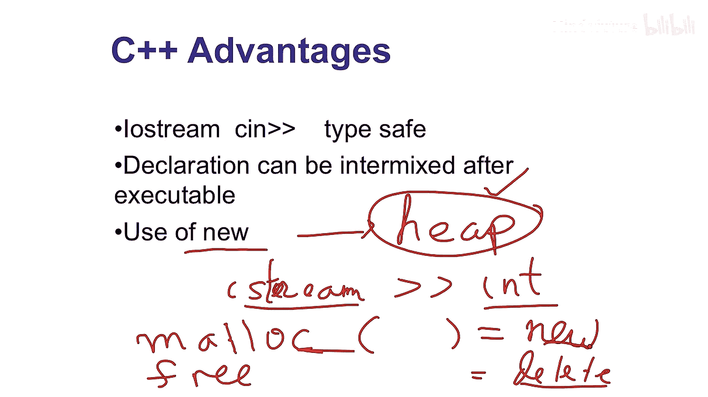
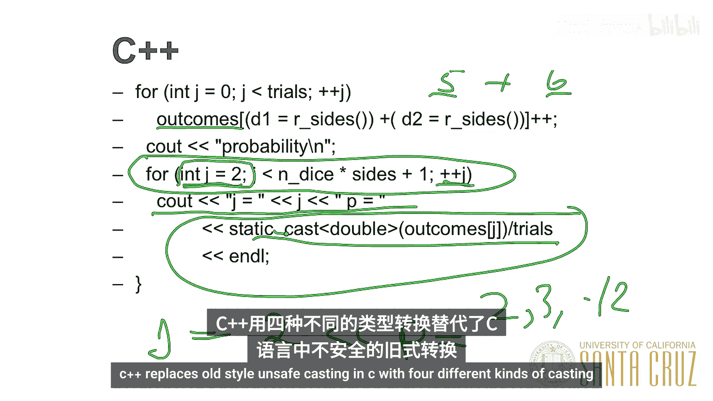
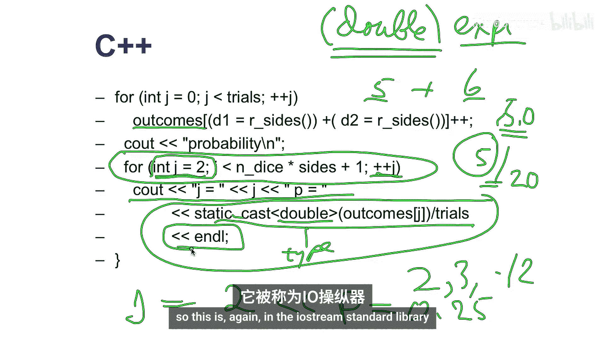
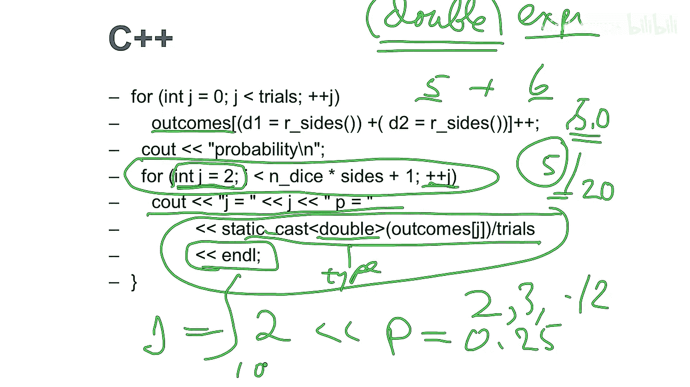
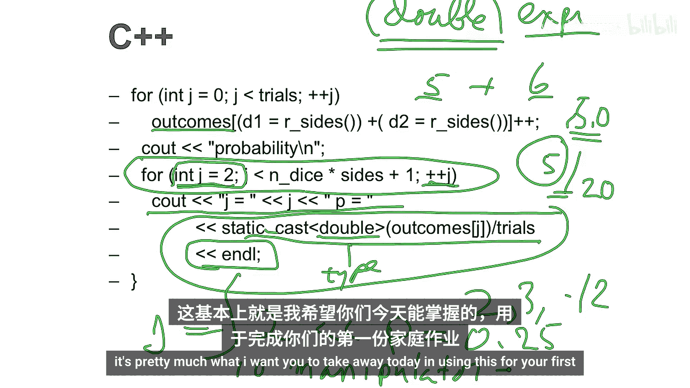
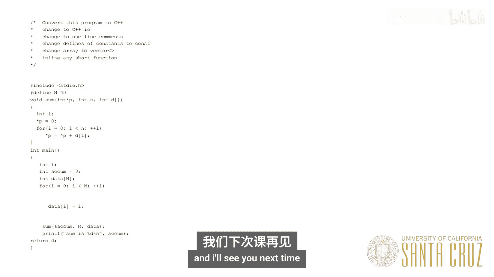

# 【加州大学】C++编程-｜-C-Plus-Plus-A-p06-P06_1-6-C++优势_01_01_07--BV1p2ejzREUQ_p6-

Okay， so let's summarize some of the C+ plus advantages。Type safety。When I say CN trials。

What is known is that。CN is an eye stream。And trials is an in。So the language understands。

 the compiler understands。FromC， the standard input， which is the keyboard normally。

I'm expecting some typing that is going to be interpretable as an integer， otherwise I have an error。

But I don't have to put any formatting characteristics， so there's built in implicit type safety。

 type safety is always a good thing in programming， it's a way at runtime to catch errors。

Notice we had mentioned in that previous slide that there were declarations that could be intermixed with the executable。

 that doesn't mean I want you necessarily to not put declarations at the head of a block。

That's still a very useful style guide， however， when you're writing longer programs。

It's useful to have your declaration near to where it's used that just makes the program a little more readable。

So。If the code is a small amount of code。I would stay。

 stay with the idea of putting all your declarations at that。

 at the head of a block and commenting them right there。

But if you have a more lengthy thing and you have a need for putting something right near where it's used。

 that is a very。Useful idea and frequently makes longer pieces of code more readable。 There was also。

 though I didn't go over it in that last slide， the use of new。And if you review that， new。

Is a memory management。The memory it's getting is he based memory， so again。

 most of you should have one to two years of computer science background either professionally or at school。

When you are running a program in which， for example， you have main and you're allocating variables。

 you allocate them off the stack， so when you declare a simple int，The head of Maine。

That memory allocation is automatic。And the allocations automatic。

 it comes off what we call the stack。However， when you don't know what kind of memory you need yet has to be part of a calculation at runtime。

Then we use an alternate memory allocation strategy and that's called memory allocation off the Heap and there's separate memory。

 a global chunk of memory that can be used to take memory off the heap and return memory to the heap。

And there in C， if you remember。It was。A term or a standard。Function called Malc。

And there was also a function called free。 These are replaced by new。And delete。And again。

 we will see because of things like type safety， there is more implicit information available to the C++ compiler in using these new operators。

 these are keywords rather these are keywords built into the language rather than standard functions that come from the standard library and it does provide improvements。

So here's C+ plus。Here's the rest of that code。Again， this is where we're。Computing if we。

Roll5 plus6， that would be our outcomes for 11， we would get a probability for it。

And then I have a funky little thing sitting here that you won't have noticed as well。

And I have an interesting piece of code here， so let's look at those two pieces of code because they're also relatively new。

If you've never programmed in C++， so this is what you call your standard iterative statement your。

 this is your idiomatic。For state。It says。Iterate。With a variable J starting at value 2。

Where J is less than a certain number of dice times sides， so we have two dice， six sides。

And then each iteration is plus one， so we're going to go from two。2。Two， three， up to 12。

And do this calculation。But。This initialized segment of the force statement allows for the declaration of。

A local iterative variable。So that's nice， that's new。Because。

We generally don't really care about our I and js being global if we're just using them for iteration。

 So this， again， localizes something。 Localization drives down complexity。

So this is another improvement， a small one。But another little improvement that we were allowed to have these local decorations inside for statements。

See out， which is Ts safefe。Printnce a string， so we'll see on the screen J equal and then some value。

So it might be J equals， let's say the starting value will be 2。

 and then we'll see probability P equals， and then we'll do this computation。

So this is another thing， there's something called static cast。

Static cast is what is called a safe cast。C++ replaces old style unsafe casting in C。

With。Four different kinds of casting， so C casting is deprecated， meaning obsolete shouldn't be used。

Compilr may still let you use it if you remember a CA would look something like this。Double。

Here's some expression and that would mean。Convert that expression so that it's treated in the domain double。

 That's the same thing happening here。 Here's the type that I want to convert to。

But instead of just allowing an arbitrary。Forest conversion， this is telling me only convert。

If you have a rule based conversion that you consider safe。If the conversion was not considered safe。

Then there would be an error。So this is going to protect you from。Nonstandard。Conversions。And again。

 it's an improvement。Why do I need that conversion。

 Because otherwise these two things would be integer And if they were both integer and outcomes would be less than trials。

 then all your probabilities would be would be0 and your probabilities aren't zero。

 So if there were like five outcomes out of 20。You want this to be。The number 5。0。

 and now this is no longer an integer divide and you would get 0。25。And N to L。

Is another way of saying new lines， So this is again in the IO streamream Standard library。

 it's called an IO Manipulator。

It's something that can be put in an IO stream。And it tells the IO screen to skip to the next line。

Okay。So all that shows you various kinds of improvements and it's pretty much what I want you to take away today in using this for your first homework assignment。

 these are all things that you're going to make use of in converting your first C assignment。

Let's summarize with what advantages we have。Safe cast。Like static。

There are going to be three other kinds of cast， one will be， for example， very dangerous。

 reinterpret cast， that means force the thing to look at it this way and just look at the bit pattern and whatever that bit pattern is on the local machine。

 reinterpret it。Generally speaking in most companies， you're not。

 you you're going to need manager approval for that cast。 It's something to avoid generally speaking。

 just a bad idea。 so in a way shouldn't be used， but it's there there may be some very obscure。

Critical need for it。It's available rather than have to return to， in effect。

 that's like returning to the battle days of an unrestricted seacast。

For statement can include a declaration in the initializer。

 so we frequently see things like int I or intj equals some initial value， this is most typical。

 typically start your loops with a zero and El is an IO manipulator so again those are little improvements over the C language that you can immediately use。

 and you can immediately become a C++ programmer。Now， Vjorn。He's currently a professor。Texas A&M。

 distinguished professor there， he's still working on the latest versions of C++。

And he has the classic book， defininging the language。Very， very detailed at this point。呃。

But from his perspective as the chief architect of the language。He more or less said。

I believe C++ is better because I don't think purity is a virtue to think Java as pure OO Sim。

As somewhat hybrid。Small talk as pure。And he's saying purity is not necessarily a virtue。

The single strength of C++ is exactly that it supports several effective styles of programming。

 several paradigms， and combinations of styles， often the most elegant。

 most efficient and most maintainable solution involves more than one style， Swiss Army kn。

 think Swiss Armyn。Okay， what do we learn so far more typea than see with more elegance？

And then here is your first homework assignment， this is what you need to convert。And。

I'll see you next time。

