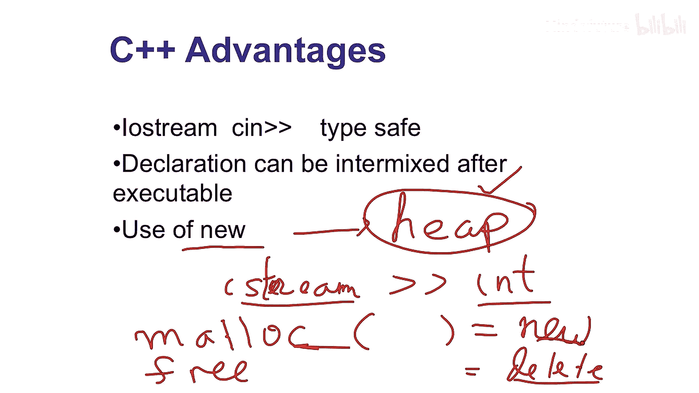
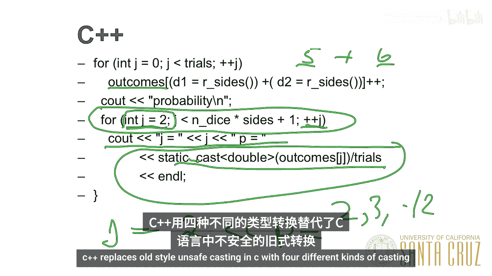
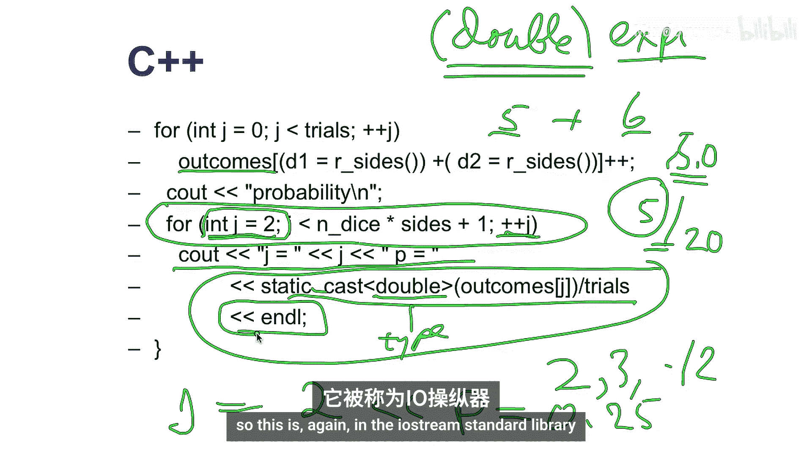
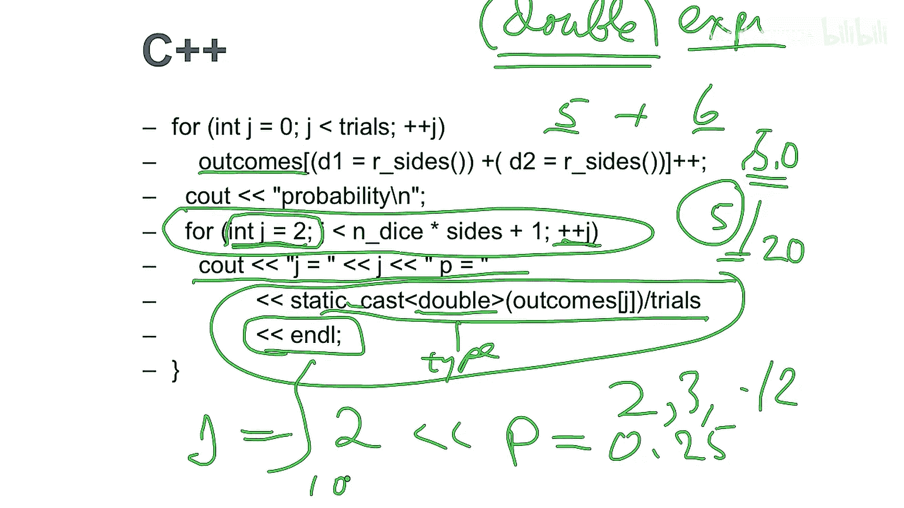
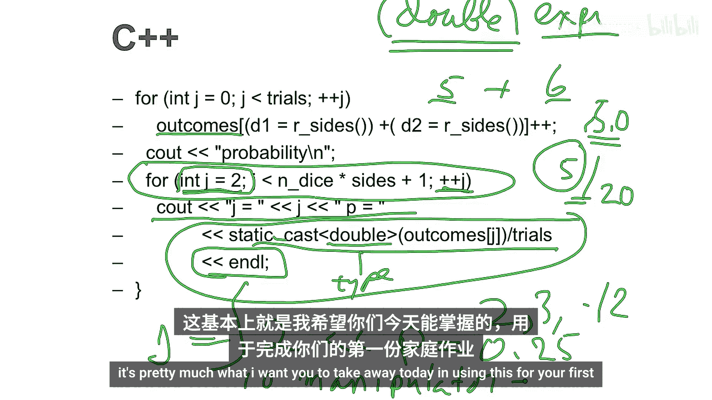
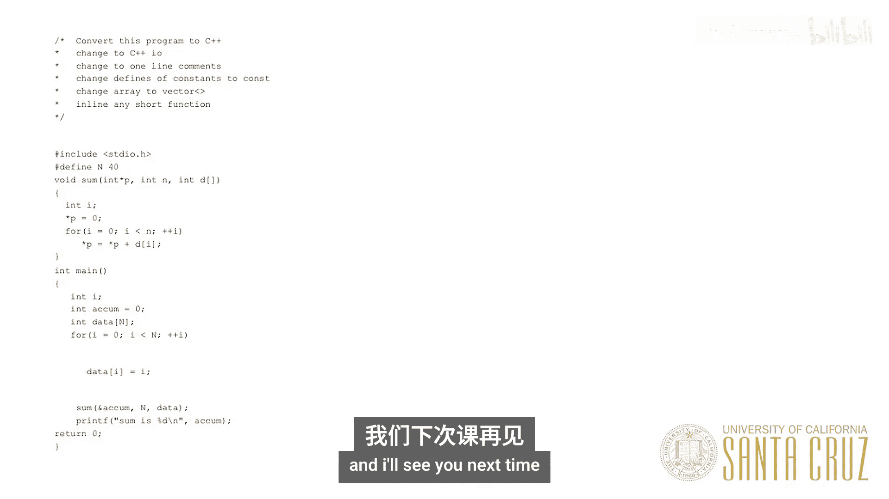

# C++编程：P06：C++优势概述

在本节课中，我们将学习C++相较于C语言的一些核心优势，包括类型安全、内存管理、循环声明以及安全的类型转换等特性。这些改进旨在编写更安全、更易读、更高效的代码。

## 类型安全与输入/输出

上一节我们提到了C++的声明灵活性，本节中我们来看看C++在类型安全方面的具体体现。C++的输入/输出流（如 `cin` 和 `cout`）提供了内置的类型安全检查。

例如，当使用 `cin >> trials;` 从标准输入（通常是键盘）读取数据时，编译器期望输入能被解释为一个整数。如果输入不匹配，程序会在运行时捕获错误，而无需程序员手动指定格式化字符。这种隐式的类型安全检查有助于在运行时发现错误。

## 变量声明的位置

虽然C++允许将变量声明与可执行语句混合编写，但这并不意味着应该完全摒弃在代码块头部集中声明的习惯。对于较短的代码，将声明集中在块首并加以注释，仍然是清晰易读的风格。

然而，在编写较长的程序时，将变量声明靠近其使用位置，可以使代码更易于理解和维护。这种做法能降低代码的复杂性。

## 动态内存管理

在C语言中，使用 `malloc` 和 `free` 函数从堆（Heap）上动态分配和释放内存。在C++中，这两个函数被关键字 `new` 和 `delete` 取代。



*   **`new`**：用于从堆上分配内存。
*   **`delete`**：用于将内存释放回堆。

由于C++更强的类型安全性，使用 `new` 和 `delete` 运算符能为编译器提供更多隐式信息，从而带来改进。它们是语言内置的关键字，而非标准库函数。

## 循环语句的改进

以下是C++在 `for` 循环语句中的一个实用改进。

```cpp
for (int j = 2; j < dice * sides; ++j) {
    // 循环体
}
```

这个 `for` 循环的初始化部分允许声明一个局部迭代变量 `j`。这种做法很好，因为如果变量仅用于迭代，我们通常不关心其是否为全局变量。将变量作用域局部化有助于降低代码的复杂性。这是C++允许在 `for` 语句中进行局部声明的一个小改进。



## 安全的类型转换

C++用四种不同的类型转换操作符取代了C语言中不安全的旧式转换。C风格的转换已被弃用，意味着它已过时，不应再使用。

```cpp
double probability = static_cast<double>(outcomes) / trials;
```

这里使用的是 `static_cast`，它是一种安全转换。它只允许编译器认为安全的、基于规则的转换。如果转换不被认为是安全的，则会产生错误。这可以保护你免受非标准转换的影响，是一个重要的改进。

为什么需要这个转换？因为如果 `outcomes` 和 `trials` 都是整数，且 `outcomes` 小于 `trials`，那么整数除法结果将为0，而概率值显然不为0。通过转换为 `double`，我们执行的是浮点数除法，从而得到正确的小数结果（例如，5/20 = 0.25）。





## 输入/输出操纵符

`endl` 是C++输入/输出流标准库中的一个IO操纵符。它可以被放入输出流中，指示输出跳转到下一行。



```cpp
cout << "Some text" << endl;
```

## C++优势总结

本节课中我们一起学习了C++相较于C语言的多个优势，让我们来总结一下：

*   **安全转换**：如 `static_cast`。C++还有另外三种转换，例如非常危险的 `reinterpret_cast`（它强制按位模式重新解释数据）。在大多数情况下，应避免使用这种转换。
*   **`for` 语句初始化器中的声明**：常见写法如 `for (int i = 0; ...)`。这通常用于从0开始循环，是一个小但实用的改进。
*   **`endl` 作为IO操纵符**：用于输出换行。

这些是对C语言的小改进，你可以立即使用它们，并开始以C++的风格进行编程。

C++语言的主要设计师Bjarne Stroustrup教授认为，C++的优势在于它不追求“纯粹性”。他认为，支持多种有效的编程风格（范式）以及风格的组合，才是C++的单一最大优势。通常，最优雅、最高效、最易维护的解决方案会涉及不止一种风格。可以将C++想象成一把“瑞士军刀”，功能多样且实用。

## 本节课总结



本节课中，我们一起学习了C++在类型安全、内存管理、循环控制和安全类型转换等方面相对于C语言的改进。这些特性旨在帮助你编写更健壮、更清晰的代码。你的首次作业将涉及运用这些知识来转换一个C语言程序。