# 【加州大学】C++编程-｜-C-Plus-Plus-A-p07-P07_1-7-C++优于C_01_01_08--BV1p2ejzREUQ_p7-

Okay， today we're going to continue with our main theme。You， as a C programmer。

 can almost instantly become a C plus plus programmer and at C plus plus。

Will improve your programming， because C plus plus。At a first take is a better sea。

The migration from some of the standard。C techniques to C++ techniques are very natural and easy。

And you saw。That our first assignment， which is to convert a C program to C+ plus。

 you'll be able to benefit by what we go through today。

To add a few other features that you can do in that conversion。So that's our chief agenda for today。

So why is C++ better？First off， C+ plus is more typea。Types are。

The critical underpinnings of a programming language。

 they're the domains that the programming language works under。So if we're in the native language。

We have types already， like int。But we also have types like double。We further have types like chair。

And we have， for example， pointer types。

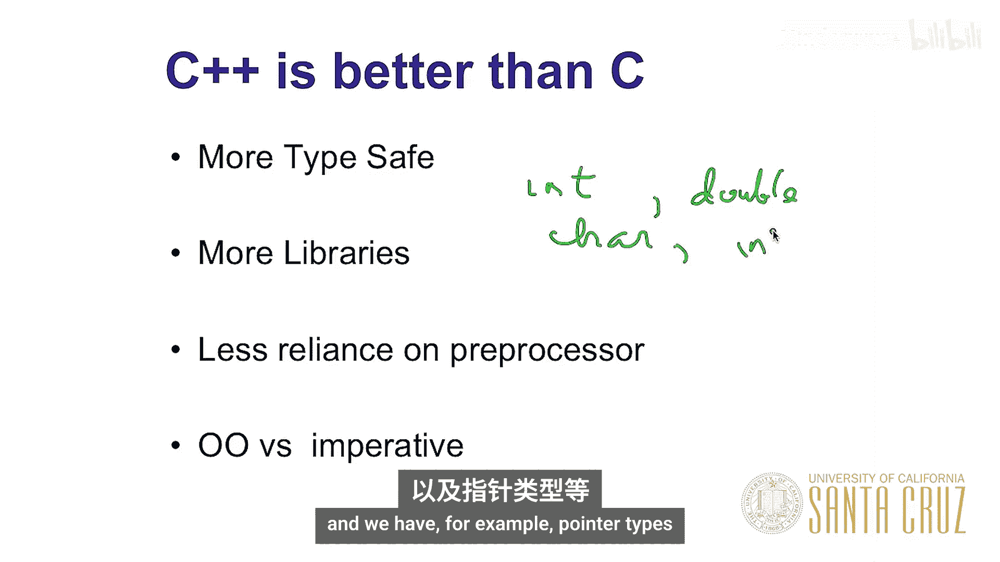

Now， when we declare a variable to be one of that。

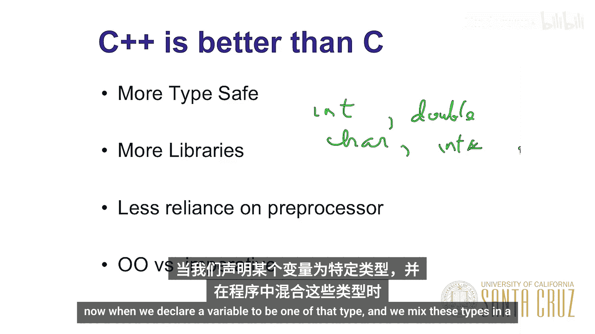

Type。And we mix these types in a program。We don't want。A double。

 which has a certain bit configuration。To be reinterpreted as a pointer or an endt。

That's just going to be terribly misleading。Now， when C was invented in 1972 as a system implementation language。

 very low level。The two programmers who were using it。Thompson and Richie。

Knew exactly what they were doing at the machine level， and they wanted a lot of efficiency。

 and they even wanted the ability to hack code readily and maybe make a transfer between domains when they knew it to be safe。

But now when we're going to C and C+ plus as general purpose programming languages。

 coding large systems， having large teams of programmers on a project。We need as much。Type safety。

As possible because type safety can be caught by the compiler using language rules that's enforcing type safety。

 So that's one dimension of improvement。In C plus pluss over C， now C has not been static。

 so some of you may know that there is a standard C99， and it has improved type safety。

But C itself was designed。To be。Compiled to a local architecture， and that architecture。A。

The language， the compiled code， could be highly optimized for that particular platform。

Because of that。The rules of the language were。A bit loose。

 It let the compiler writer for that platform choose a scheme that， again。

 could be optimized for that platform。 So at a simple example。

 an architecture on one machine might have。8 by integers and another machine。

 an integer may be naturally2 B。 The compiler writer could choose what the size。

And the range of the int was so that when you would go to run a C program across different platforms。

 you might see different behaviors， C plus plus。啊。Makes a big step towards。

A considerable amount more type safety。C plus plus has generated more libraries。

Libraries are very important。In making a language and a system。Powerful。Wai。Professional libraries。

 first off， can be very heavily tested。So they can assure that they're correct。And。

They provide instant reuse of code。Reuse。Again， is the if there is a silver bullet。In software。

 engineering development， it's reuse。

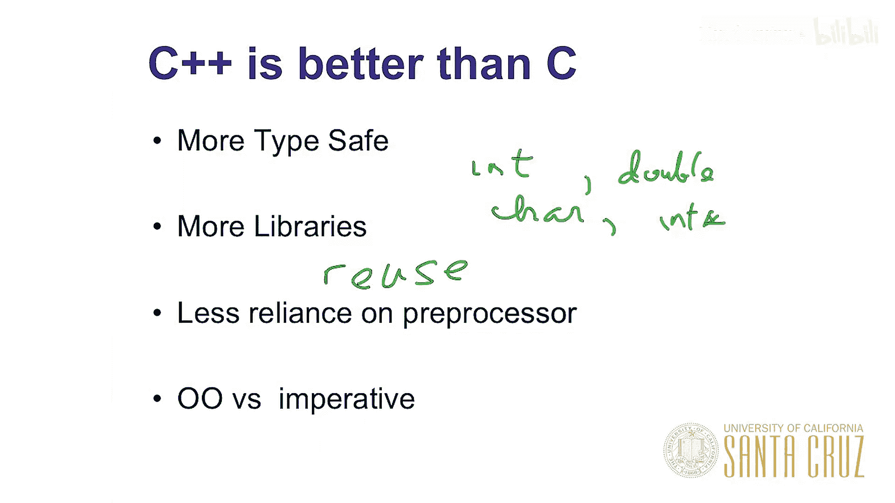

So libraries provide reuse and reuse。Is among the magic bullets If there is a magic bullet in software development。

And C plus， plus。Expands the number of libraries， the scope of the libraries。

 the domains for those libraries。And later。We will be talking a lot about the standard template library。

Which is a major addition。To the language。And gives you far more capability than you had in sea。So。

 a third。Property of C plus plus that's better than C is that it deemphasizes the preprocessor。

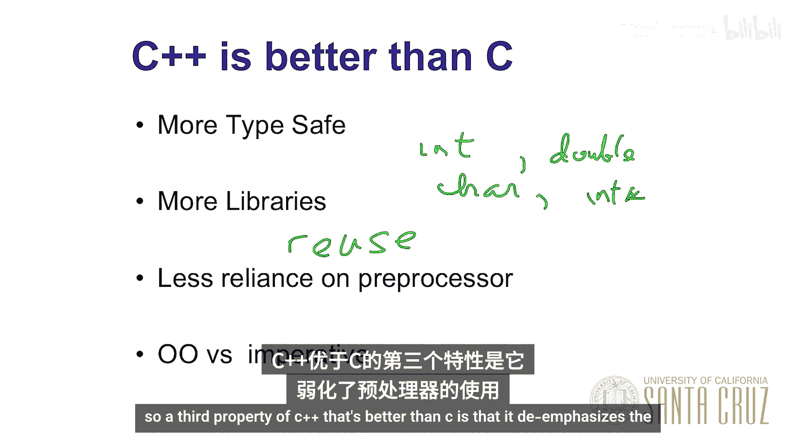

The chief use of the preprocessor in C++ is to include libraries。But other uses such as。

The sharp defines。Where in sea and in the sea community。

 it was appropriate to sharp define global constants and shark define macros goes away。

That's no longer。Good practice。In the C plus plus community。 And again， well revisit this。

 But in software engineering， software methodology， it's found that。The preprocessor。

Which does not contextually obey the rules of the language。

 but instead is something involving textual substitution。

Creates more opportunity for error than having equivalent facilities that are in the language and can be checked by the language rules。

 So， again， here's a place where C plus plus as importantly improved on C。Finally。

C was never intended as an object oriented language。

 sort of a classic language from the era of the 60s and 70s。It's a language that's small。

 which is a good thing。And it supports imperative programming， which is a reasonable thing。

 but later in doing large programs across many domains， one found that the object oriented paradigm。

Was。A critical paradigm to developing large scale software across many domains using the same kernel language。

 so object orientation is added to C in getting C++。So all of these things make C++ better。

 and all of these things can be readily learned by people with a significant C background。

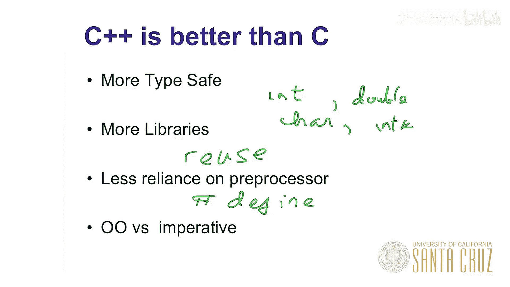

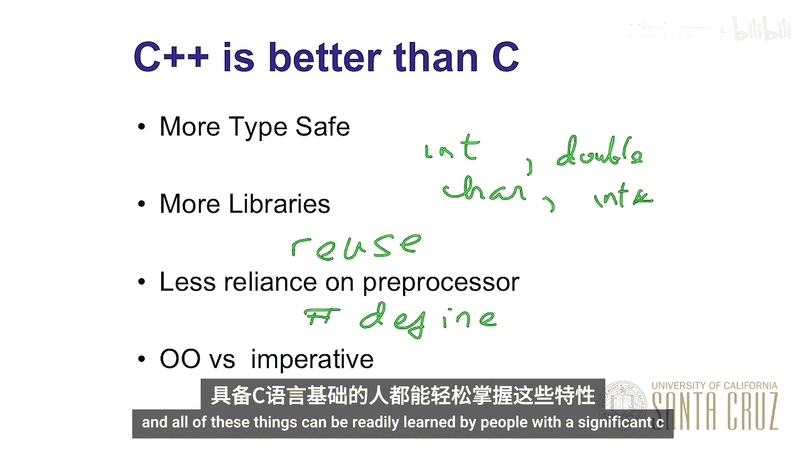

So so far we've seen。Yin。Programs we've already designed。That we've used。In line and cons。

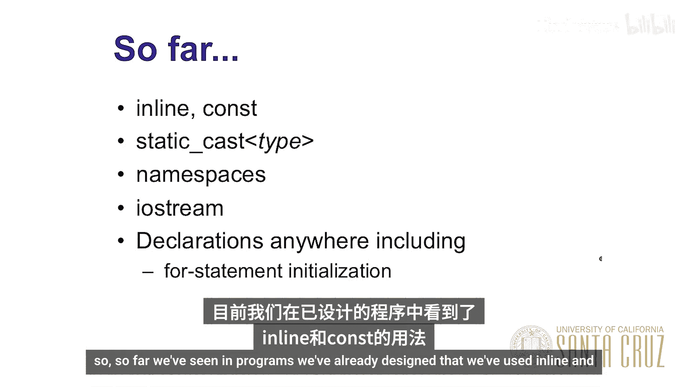

And the inline and constant。Material。Replaces。The preprocessors。Sharp defined for macro gets。

Replaced by in line as a key word that modifies a function。

And that informs the compiler that it should still retain all of the function semantics。Nevertheless。

 try to avoid function call overhead。Kans。Is again， a modifier to。A type。And。C plus plus。

Tries to inject cons into the injects cont into the typing system so that compiler can help in checking conants correctness。

 So by understanding what variables are non modifiable。Pyor again， supports correctness。

We have safe casts。In C++。It's a typical cast。

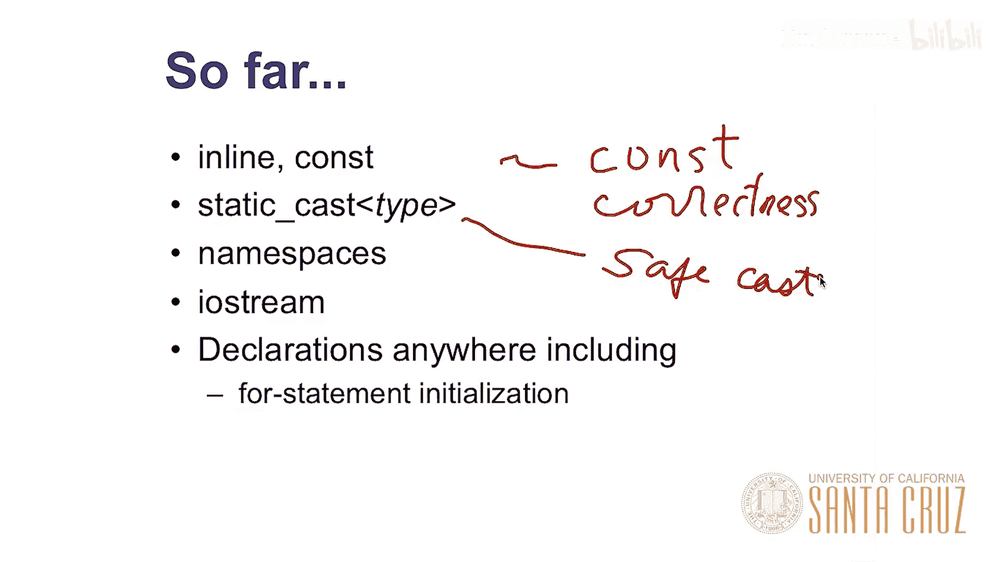

That involves an understood conversion is given the keyword， static cast type。

We have another form of encapsulation， namespace encapsulation。

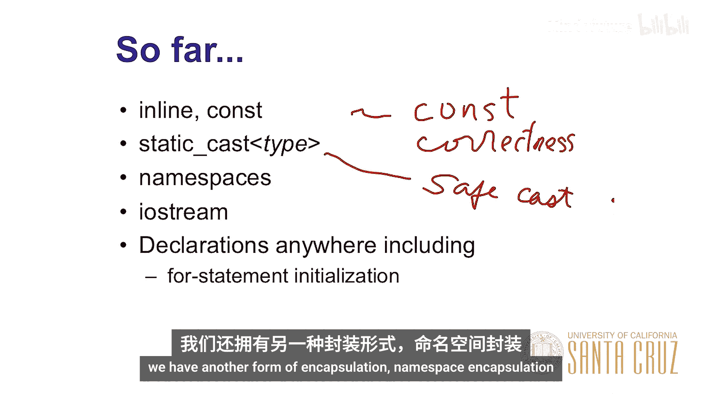

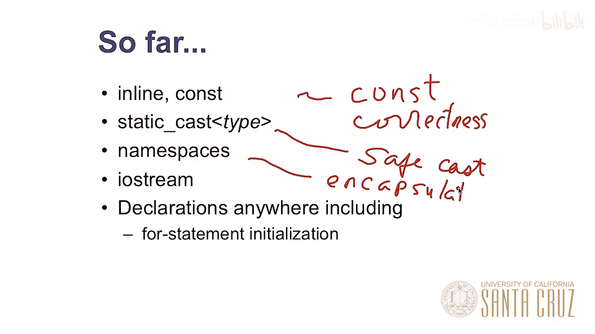

And again， in the development of programming and programming methodology。What's been discovered。

Over the。50，60 years now that there have been。Big digital computers， lots of programming。

 heavily applied。That each generation of language design provides further encapsulation tools。

Casulation means that you can build something in a self contained way。 check it out and debug it。

 and then plug it in as a module into something bigger。

 And the more effective ways that you can isolate something from its other interactions。

 the better you can design and keep the code bug free。

 And this is just absolutely vital to writing now systems that may have as much as 100 million lines of code。

 systems that weren't even thought about。When we had the earliest digital computers post World War II。

very famous quote by John Vanon Neuman， who was one of the principal founders。

Of the modern digital era。He's a great applied mathematician who worked on things like the Manhattan Project in World War II。

 and sometimes we call a modern computer a von Neumman computer because。

He was part of a team that conceived of。Storing programs along with data and executing the programs out of memory。

And Van Neumman thought。That those machines， which he viewed as scientific instruments。

 might have 20 or 30 codes。Programs， and that would be at that would be the extent of their usefulness or you could hand tune them。

 write these codes。 They wouldn't be that long。 maybe they would at most be a thousand lines。

And then you were done。And of course， that was a total misconception。

 he just couldn't foresee the usefulness， and especially the usefulness beyond numerical science application that computers would be available for。

Okay， another thing that we're going to immediately make use of is our IO stream IO again。

 that blends some convenience with type safety avoids the use of print Es and scanFs where we have to tie things up with special formats。

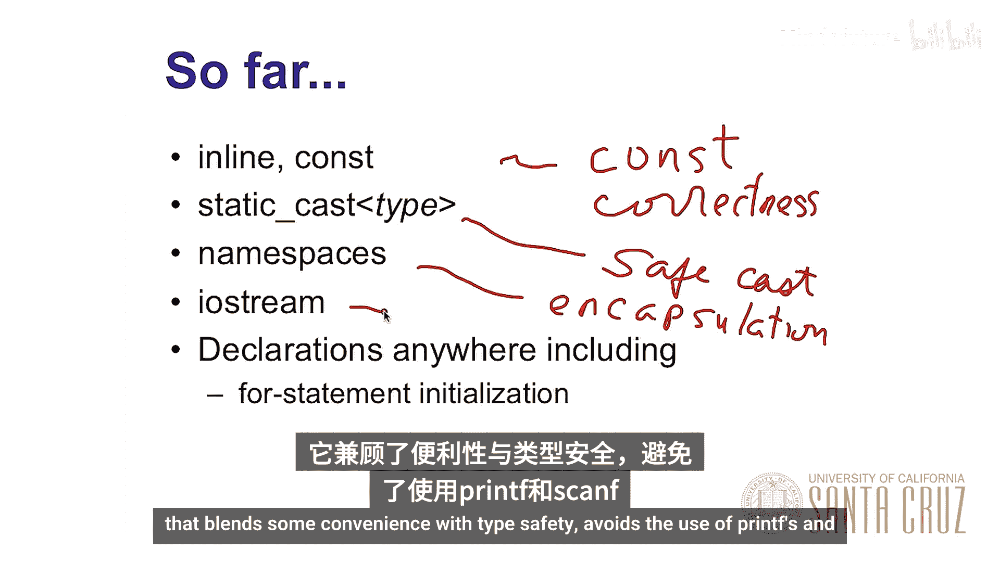

And we're going to also have the capability of declaring anywhere in a program and again the usefulness of this is。

Localization， you want something near where it's used。

Especially inside a force statement where you typically want some kind of local iterative。

Variable in the case of a force statement。You like to see something like four。And I。

And I is going to be what you iterate over in that in the vicinity of that for statement。

 And it just stays there。 Again， it's a localization， which is a good thing。

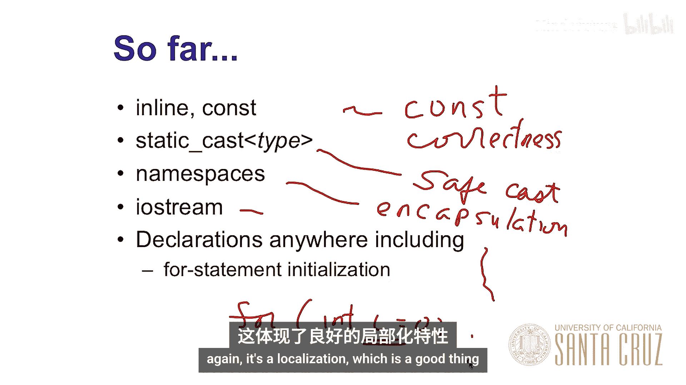

So。Take the following quiz。I'll give you a minute to look it over。

And answer these questions with conant's double pi equal 3。14159。Does true or false？

Does this create a nonmutable variable pi？Is it equivalent to sharp define of pi 3。14159。

 which is the preprocessor alternative？And see。Are both of the statements， the above statements true。

 to take a second。So。Youve filled in your quiz。

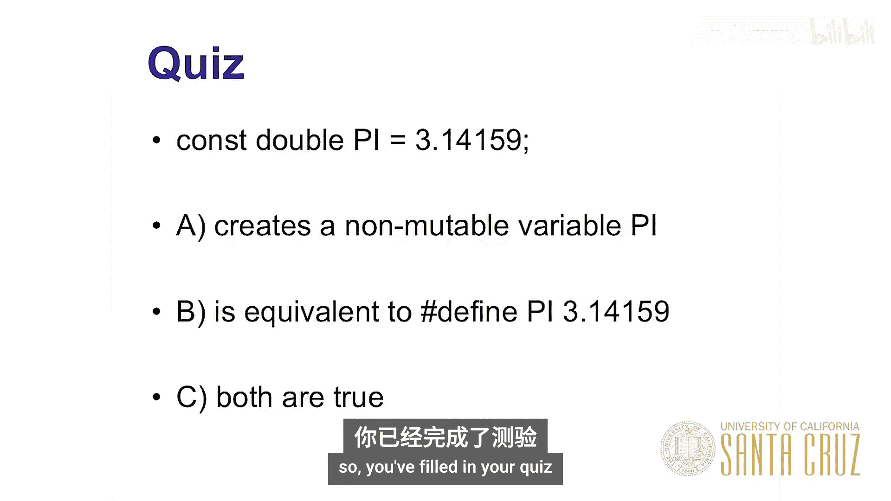

let's look at some answers。

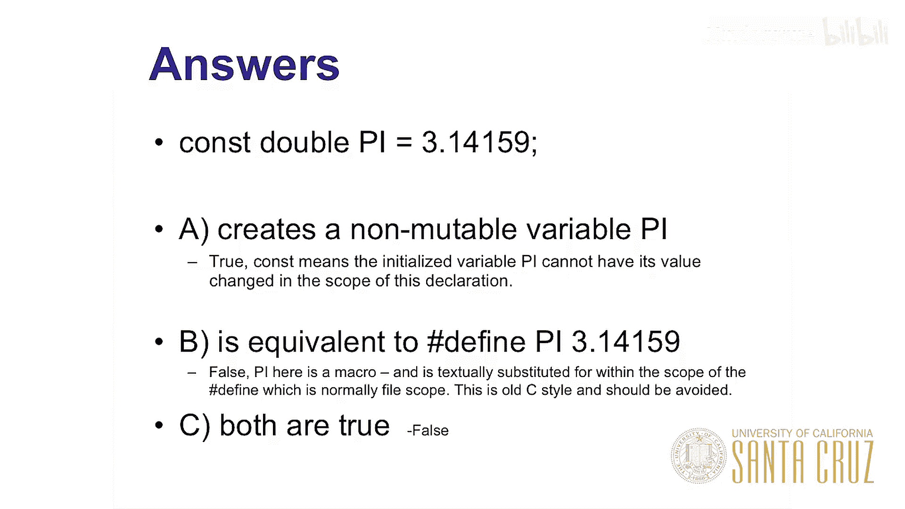

呃。Kant's double pi equals 3。14，159。 semicolon is now a declaration。That declaration has its context。

 So wherever it's been declared， the language will have its definition in that context。

 So we don't have to worry about a misplaced textual substitution。Now， this does create。Basically。

 a constantst。 constantst is a constant。 nonmutable variable。 Pi is a variable。

 It is a variable of type double。But it cannot have its value changed in that scope。

 So it's entirely safe。The old style， which is B。Is it equivalent？Well。At a superficial level。

 it's equivalent。 But the answer is false。 It's not an equivalent， Sharp define。

Means that pi is a macro。And the macro substitution is going to occur throughout Pi filecope。

So if for some strange reason。There is a pie somewhere outside of the context that you meant to use Kt will still be substituted with that 3。

14159。Again， this can lead to far more errors because the textual substitution is not matched up with。

Things like blocks and classes and functions， the context in which you are going to。

Declare a variable。So both are not true， and so that last thing is false。

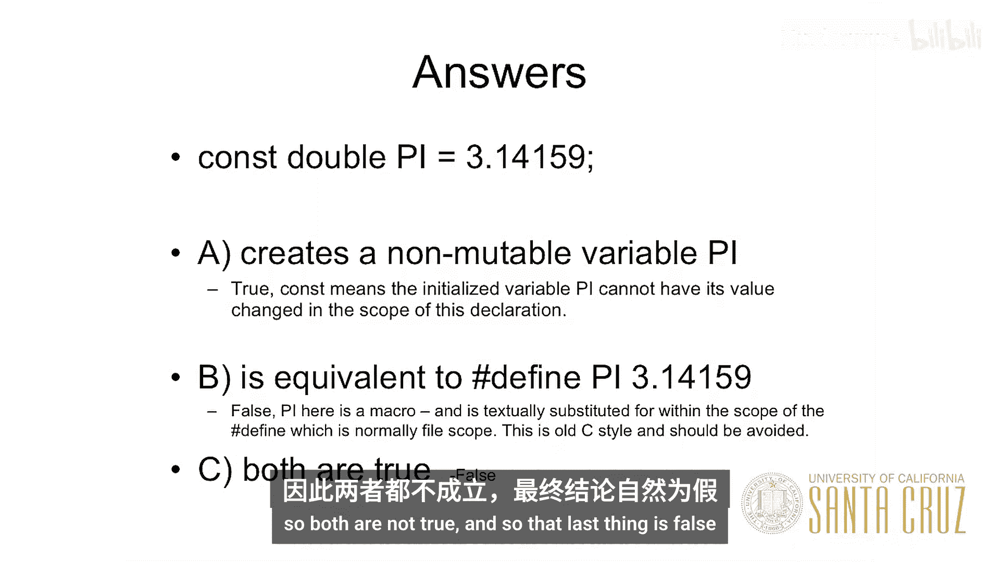