# 【加州大学】C++编程-｜-C-Plus-Plus-A-p08-P08_1-8-C++交换函数_01_01_09--BV1p2ejzREUQ_p8-

So our next topic is to show an example and see。We're going to show。An important example。

 It's going to be trivial， but still。ItIt's one of these helper functions that everybody learns to write。

And you're going to want to swap two things。 the function wants to swap two things that typically that might be two ends or two doubles or two chas。

And everybody learns as C programmers。 So again， this is reviewed to you how to do that in C。

 The critical thing is to remember， C is a call by value language。Call by value means。

That arguments passed in to a function。While they may be altered internally in the function。

 when they come out and the function。Passes control back to wherever it was called。

Are not not changed。 Those arguments are handled locally， but the actual parameter itself。

Would have been unchanged。So when we're doing a swap of an I and a J and we want the values to change in a call by value language。

 we have to use what's called indirect。Since we don't have what and well turn out to have this and C plus plus we'll have a more an easier way to do it。

 C plus plus will indeed add value here as well。 So the classic way you will have learned this and we'll see it in the code is to use pointers。

 And this is always a big stumbling book for beginners because it's a sort of metal level and you have to get used to knowing what an address is and distinguishing the address of the variable from the variable and from the variable contents。

 and that does slip people up but。This is something you should all be familiar with。

 and if you had trouble with it in the past， I think you'll appreciate that C++ makes it easier。

 but you also need to go back， experiment， make sure you fully understand。

So we'll first do this as a C program， and then we'll show you how to convert it。

So here's a classic swap。And we look at these declarations and the way you read those declarations is star。

Is a pointer。 So this really gets read as。Poiner。😔，To int。It's part of its data type。 So J is。

A pointer to endt。As is I。 So we are really passing in to addresses。 Pointers are variables。

Which can take addresses。 The addresses also have to be an address of something like an int。

 Why do they have to be an address of something， Because knowing an address still doesn't let us interpret the contents stored at the address。

 We have to understand what the bits that are stored there meaning。

And the bits will mean different things if they're from different domains。

 So doubles have a different way of being read from ints and chars。 So， again。

 this is the classic C idiom for passing parameters that need modification。

 What happens is internally， you create a temporary variable。 And then you， in this case， the。

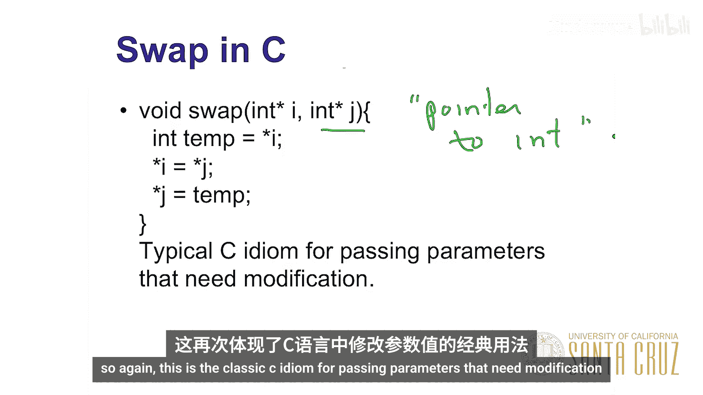

Stars。Y。Star means D reference。

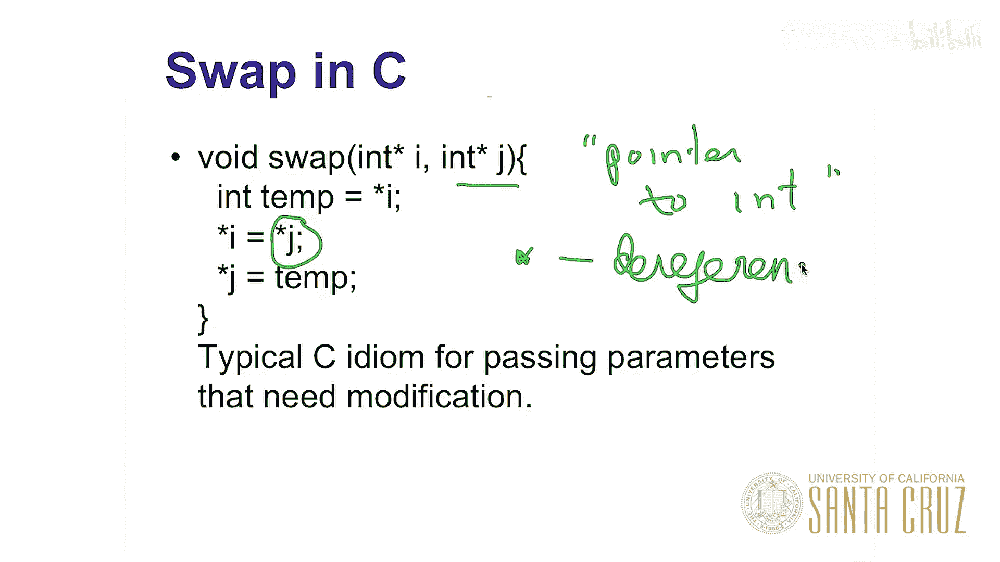

So that's saying， look at the address represented by J。Go and steal its contents。

Whatever is stored there， think of it as a letter box， whatever is sitting in the letter box。

And shove that contents in the address。That I represents。So contents is being moved between two。

Addresses。And then finally， in the standard swap。You have to keep track， you need a third variable。

 that's what tempts for。So there's an address of an item which we might call the address that I points at。

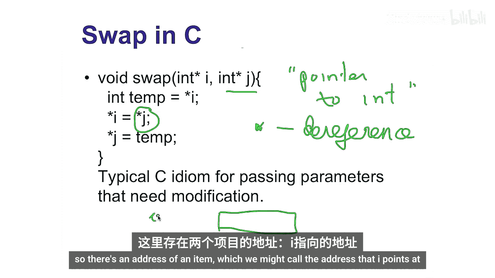

An address of an item that Jay points at。We've created a temp。

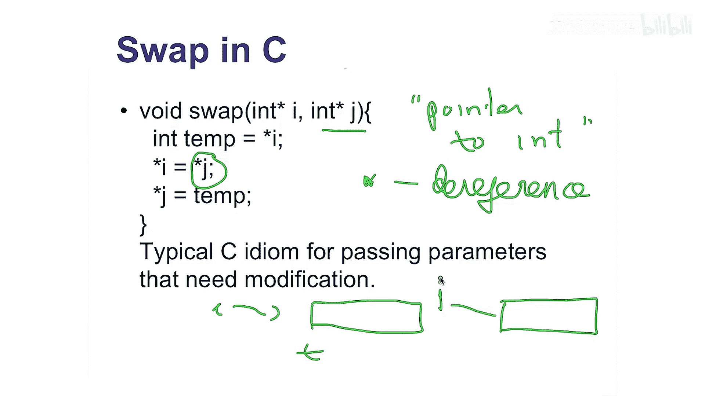

And if initially five was here。And six was there。

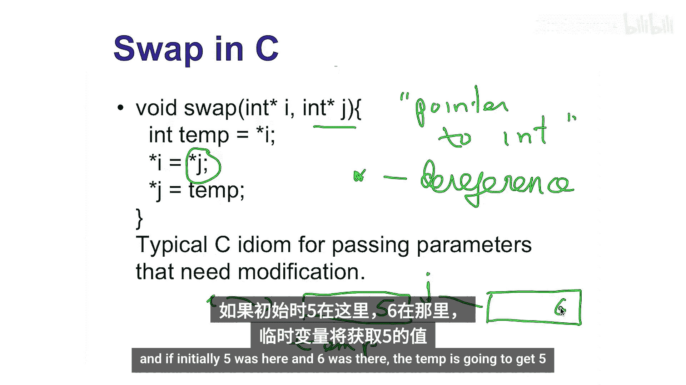

The temp is going to get five。

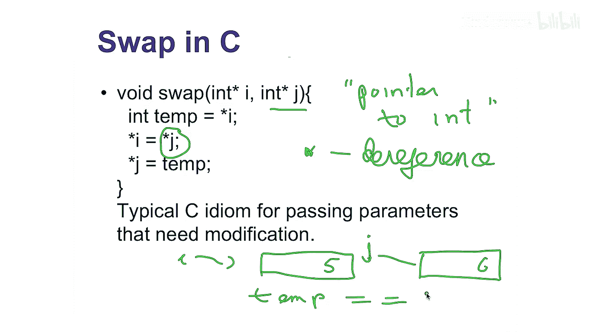

And then。6 is going to end up here。

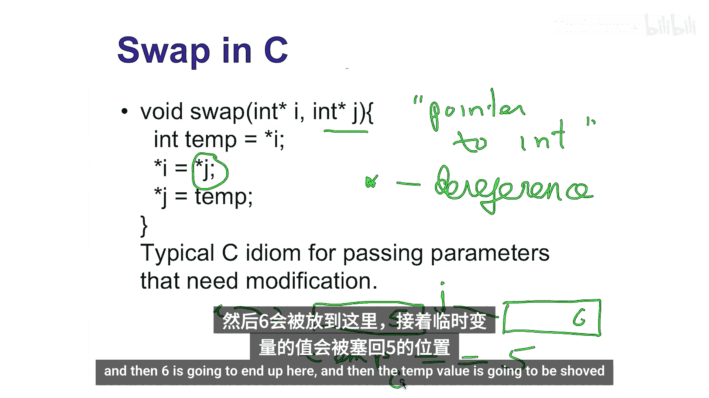

And then the temp value is going to be shoved into 5。And so， we're going to end up with。

I pointing at something containing 6 and J pointing at something containing5。

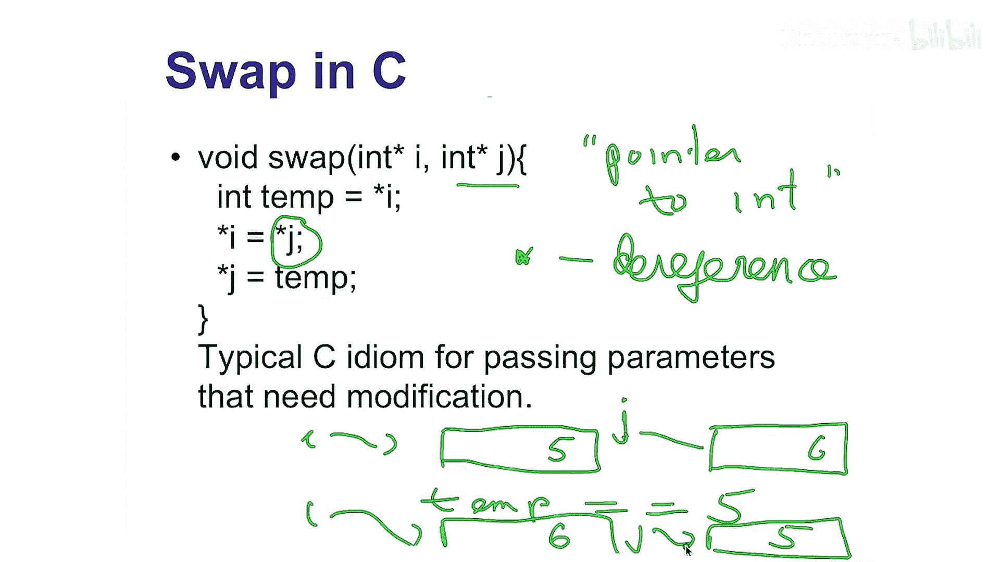

That's something， again， that should be reviewed。 So this is。

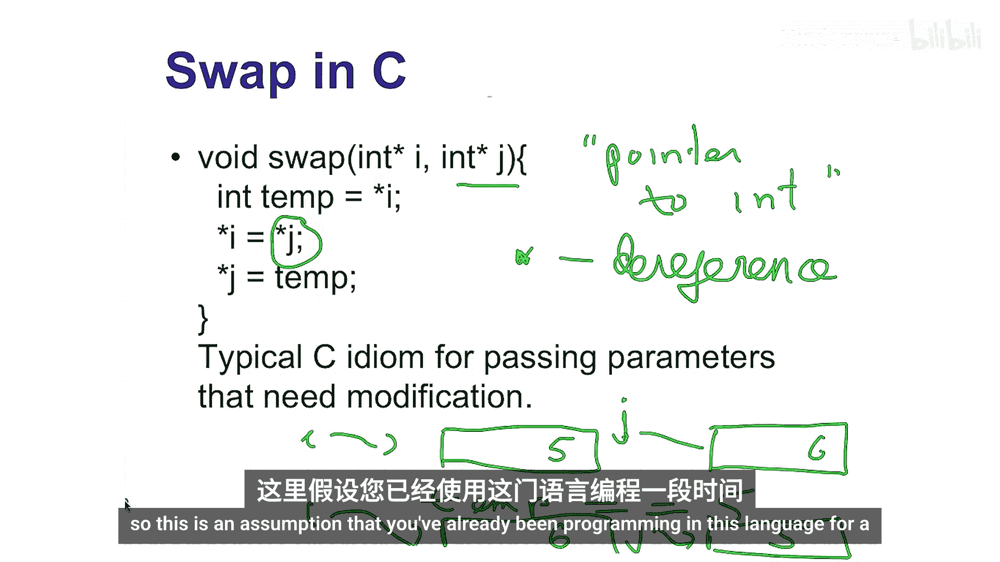

An assumption that you've already been programming in this language for a while。

 and you have facility with this concept。

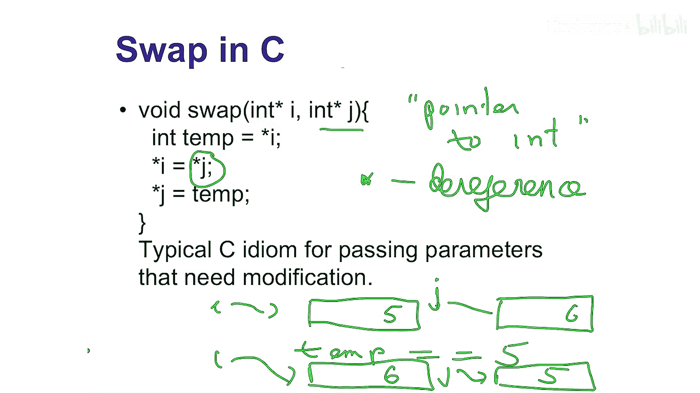

Now， what if I want to change the domain of swapping？In the C language。

If I now want instead of swapping integers， swapping double， I have almost the same prescription。

But there are a couple of things that change。One of the things that I need to make sure of。

I I have to give the swap of the double。A new name。 So I can't have it named swap。I of course。

 have different arguments。Appropriate to the domain。And then the code looks almost the same。

 except again。We have a type that's different。 So what gets changed is the function name。

Because in C。Within scope， all function names have to be unique。Otherwise。

 it would be ambiguous in the sea language。And。We have to write the code specific to the type we're going to see later on and see plus plus。

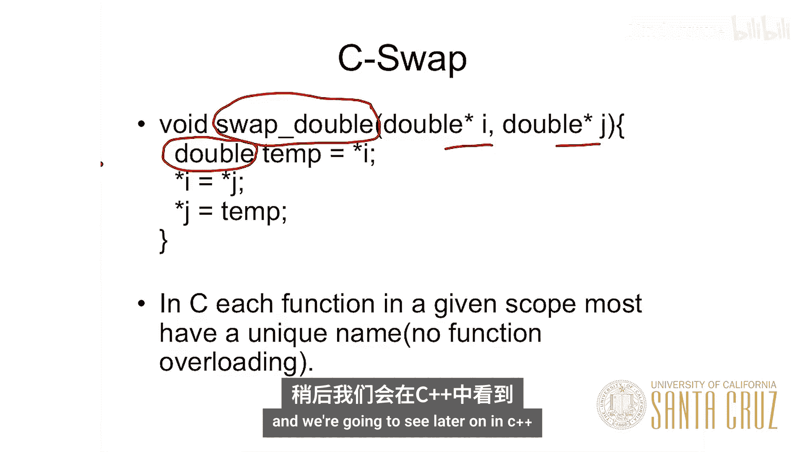

That。We have very powerful mechanisms for code reuse that allows us even to just write one swap function。

 keep that one swap function with the name swap。And have it apply to arbitrary types。

 That's going to be very powerful and won't involve any more programming difficulty。

 And in some cases， may be easier。Then what you would have to do in sea。So here's。

The use of those swap functions in a C program。And again， this is review。

 so this should be an idiom you fully understand。Here's how we print out stuff。 So here we print out。

M and N， and we need to know。Formats for it。So this is going to print five and 10。

Then we're going to perform the swap， and in the swap we use ampersand。

Which everybody should know as the address operator。So this is going to say。M is a variable。

But I need because I want an effect。Values to be changed。

Under the rigorous call by value semantics of C， I have to pass in addresses there。

 the addresses won't be changed。But the contents of what the addresses point at can be changed。

 And that was the whole business of using pointers， the underlying pointers。 So this lets。

This gets us the type we want。It's a pointer to endt。 It's an address of an object int being stored。

At the location。Representing M， similarly for N。 and then a swap occurs。

 and then if everything worked right。The resulting output would be 5 and 10。

 And then the same thing would happen with double。 And so double would have 5。3，10。6。 And again。

 with double， you're seeing that we're using long floating point these。Formats。

In order to do our I O。Again， it's something you have to learn when you're doing the C language because the C language is not necessarily type safe。

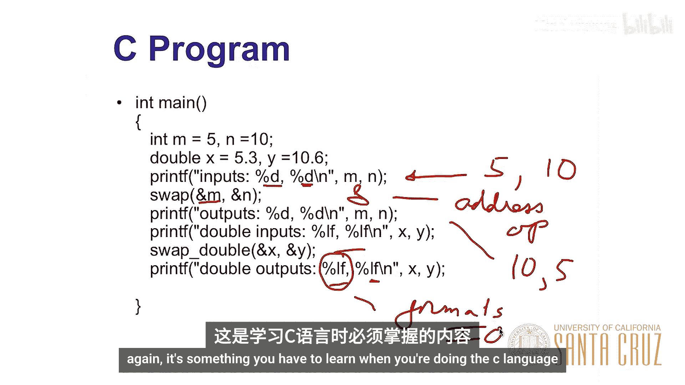

Now you can see what happened of just repeating what I just told you about， M started with5 and 10。

 swapped with called with addresses of M and N using the address operator。And then， at the end。

Using temp as the intermediary in the function call。

 you get 10 and5 you get the switch or the swap with 10 and 5。

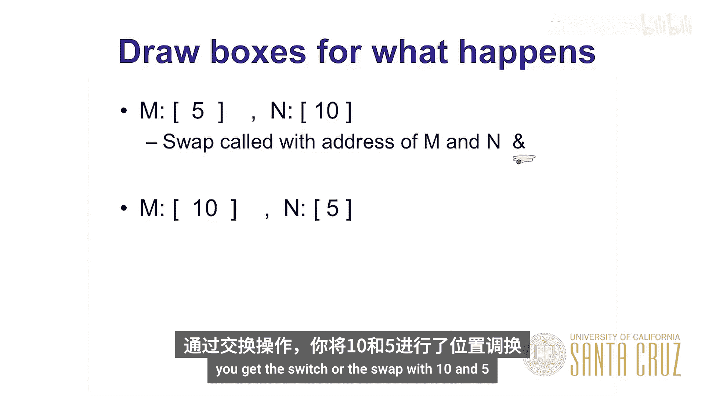

So summarizing C when you want what we might call in general programming methodology。

 call by reference rather than call by value。Has to be uses simulation with pointers。

 We have call by value， of course， but because we're using pointers in direction。

 we get the effect of。What would be called in other languages called by reference。

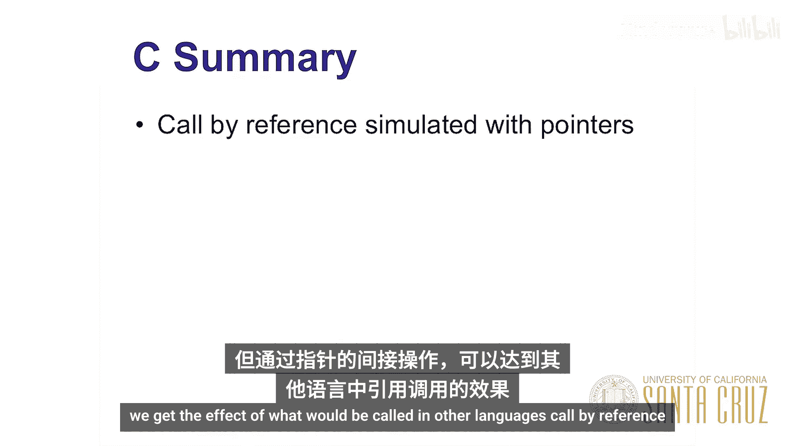