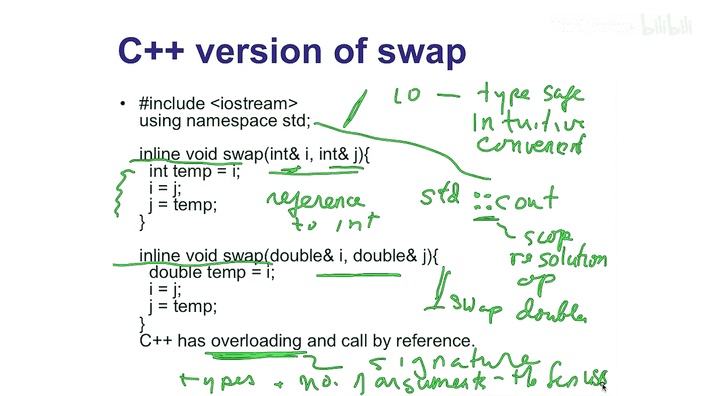
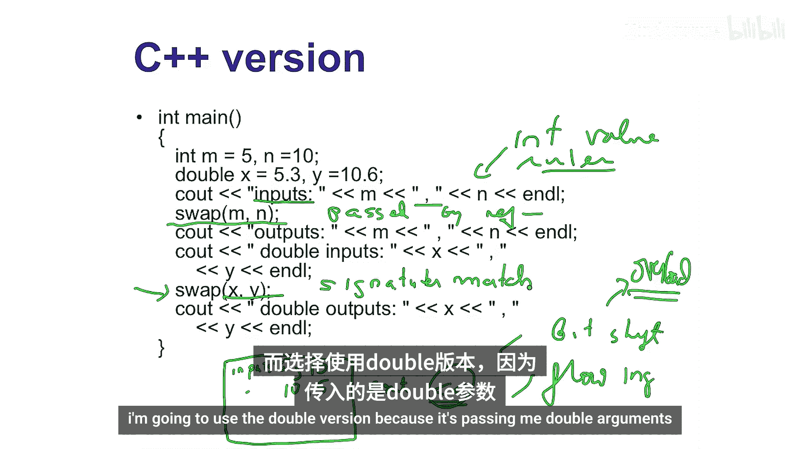
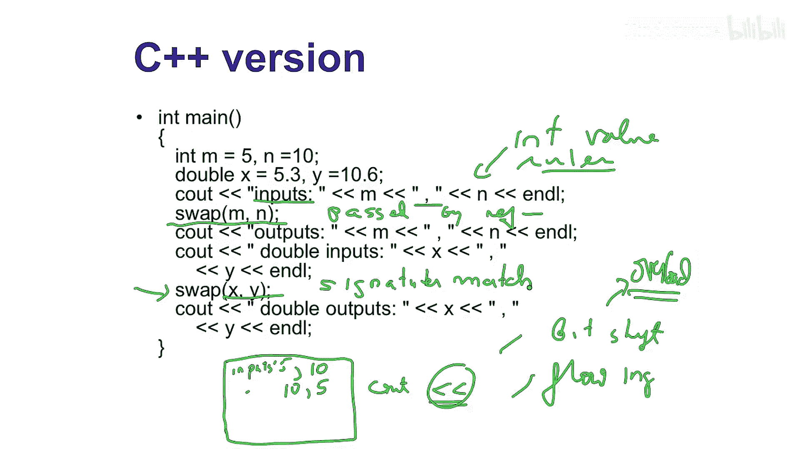
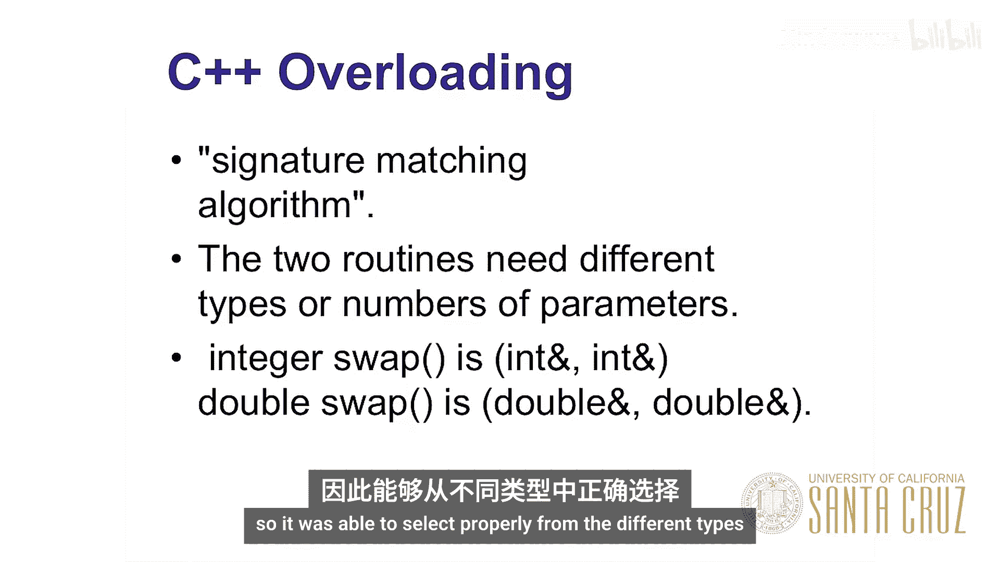
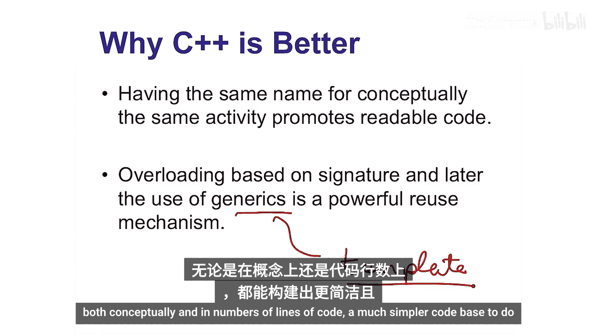
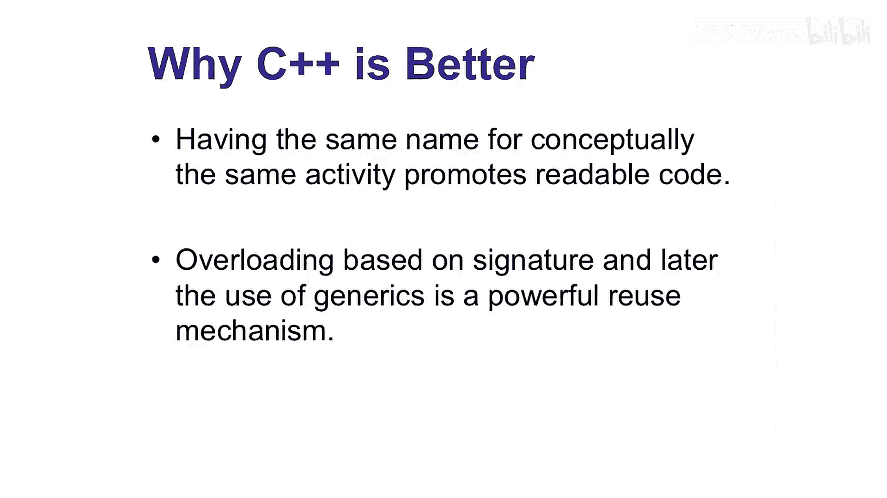
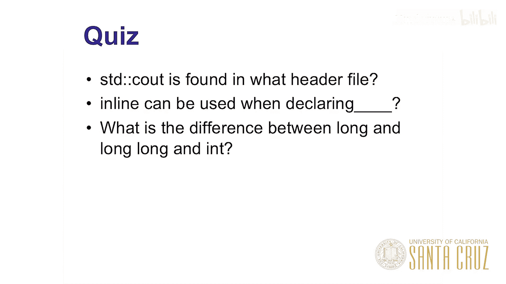
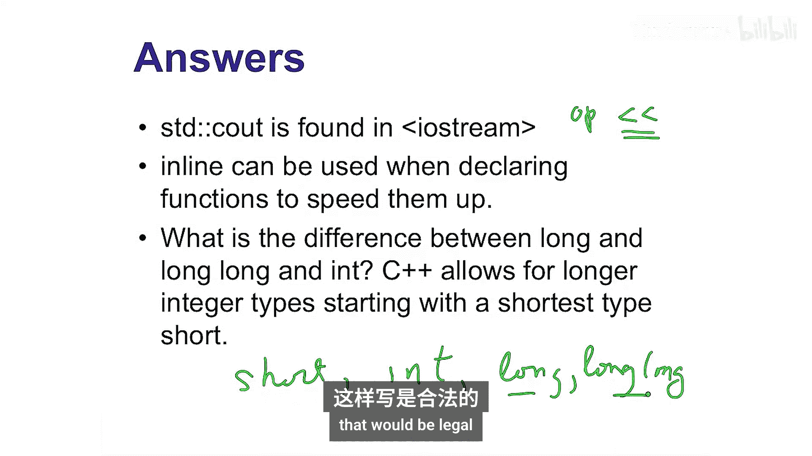

# 【加州大学】C++编程-｜-C-Plus-Plus-A-p09-P09_1-9-C中的交换函数_01_01_10--BV1p2ejzREUQ_p9-

Okay， so now I'm going to try and persuade you that the C+ plus version is a lot better。Well。

To start with C++ directly has a form of call by reference。

 so it adds to call by value with the call by reference mechanism。So we don't have to artificially。

Create call by reference。So looking。At the C++ version。

 we're going to see a number of interesting things。First off。

 in our C+ plus version we're going to use。C plus plus。Io。

And this IO is going to be type safe and convenient。Type safe。

I think you will find it to be intuitive。And convenient。

We also have this way of contextualizing where we're using a namespace and we use the namespace STD because。

Inside IO streamam are things like see out。And they've been defined inside this namespace。

And that means that their full real name is STD。This is called the scopecope resolution operator。

So that's a new thing。It's not in sea。It's just a way to get more complicated names。

And by using namespace STD， I don't have to refer to see I don't have to give you the full name。

 it knows that it should append STD in any identifier and search for it if that's available in a declaration。

 then use that。And now we have several things going on。We have in line。

So our swap is going to be efficient。New feature informed。

Compilr that we should make this highly efficient。And here is call by reference。So， this is。

To be read as。Reference。To it。Not value of it。 reference to it。And same for J。

 And so when things are passed there， they will automatically choose to use the variable locally without copy。

 And so what's passed in is actually directly manipulable and whatever happens to its contents。Wen。

You return from that function， those changes remain。

 so you get no call by value overhead because call by value implies making a local copy。

And so you sometimes get efficiency by call by reference。

 that'll be very important later on when we deal with large scale aggregates。And on top of it。

 we get to modify parameters without having to use。Dereferencing and addressing operators。So。

This looks a lot simpler， this switch。And then these values do indeed get changed。Now。

 a further interesting thing is， I don't need two names。C plus plus has overloading the fact is。

I can have more than one swap function。In the same context。Now， why won't that be ambiguous？

This would be the natural question。 Earler languages like Al Go 60 or C wouldn't allow。Two functions。

In the same context。To have the same name， it would give you a syntax error。

 would say that's ambiguous。Ah， we have what's called signature matching。So， the compiler。

Provides an automatic。An automatic means。Of differentiating between the two swaps。And it says， well。

 if I'm swapping doubles。I'm going to use this。If I were to swap ins。

 I'd use the other as long as I can make this distinction。And these things are called signatures。

So overloading involves。Discriminating by signature。And the signature is the types。And number。

Of arguments。The function uses。

Okay。Let's see how that works。Here's our main， now we're in C++。And again， lots of it looks like C。

 so it's not a huge transition， it's not like you're writing。

Vastly different code from what you wrote as a C program。But we're going to take advantage of。

What I've told you。Makes it easier to use C++ and makes it type safe。So again， we have our set of。

Varis are m's and Ns for the ns are x's and y's for the doubles。But here， instead of a print F。

 I have to see out。 and I didn't need to say I told you before， I didn't need to say standard。Colon。

 colon， scope resolution see out because the using statement。

Inform the compiler that it should look for anything with standard。In front of it。And now。

We have what looks like a natural operation。 It's sort of like think of the sea out as screens。

 So the sea out is secretly the screen。And then stuff is going to you can think of this as flowing。

Stuff is flowing to the screen。And what's flowing first there is。The text inputs。 so on the screen。

Here you're going to see inputs。That would be written now。Now this is normally。bit shift。

But this operator。Is。Given new definitions， again， via this mechanism called overloading。

And M has the value 5。So the next thing that would be printed is five， there's actually a colon here。

Then we see a comma， the string comma。And then we have n is 10。And unlike print F。And C+ plus。

The IO package in IO stream understands the type。And then has default formatting for that type。

 so it recognizes that this is an end type and since it's an in type or an in value。

 it's going to apply its rules， its formatting rules。So you don't need to give it formatting rules。

It just assumes through its knowledge of typing， which it's keeping。That。

A certain behavior is expected。Again， that just simplifies your job and in fact， avoids errors。

And then the swap function is， again， what looks like something simpler。

 You're just passing in the variables Z and N， but you're passing them by reference。 This was passed。

By reference。As opposed to passing by value。So the actual contents will be manipulated。

 and then again， you're going to see later on， as you print out here， you will see 10 comma 5。Now。

How does it know to use swap of double Well， X and y are doubles。

 so it does what's called a signature matching algorithm。Says。I don't use int。

 I'm going to use the double version， because this's passing me double arguments。

So it has no problem， there's no ambiguity。That keeps down the name pollution。

 I don't have to choose to have a whole bunch of different swap names。 If swap is strongly related。

With。Doing the same thing， but doing it with different arguments。

I can keep that name and it's much more readable code now， it's just simpler to handle。

So what we found in C++ is through the miracle of overloading and the signature matching algorithm。

 we've automated。呃。The ability。Of the compiler to select the appropriate function。

The two routines to make that to avoid an ambiguity must have different types。

 or they could have different numbers of arguments， and in this case。

 there were different types so it was able to select properly from the different types。

So summarizing。Having the same name for conceptually the same activity。 In other words。

 using overloading promotes readability。 readability is。Among the most important characteristics。

 a hallmark。It's an absolute hallmark of writing good code。

And if you're going to do peer grading of homework submissions。

You should absolutely make readability。A。The principal guideline。In assigning a grade。

Overloading based on signature and later the use of generics。

So we're going to talk a lot more about generics。And generics。

Are going to be associated with a new idea called a template。ItAgain。

 an idea and C++ that's very powerful。Will even make reuse more powerful in the language。

And give rise too。A much simpler。Both conceptually and in。Numbers of lines of code。

 a much simpler code base to do and a more powerful code base。

Okay， let's take a little quiz on what we've just talked about。

So standard scope resolution operator C out is found in what header file？

Inline can be used when declaring what。And again， a type question。

 what is the difference between long， long， long and int as types？

So。Standard C out is found in IO streamam。Along with the overloading of the operator。

Semantics for overloading operator Bich。In line can be used when declaring functions。

 and it's a speed up。By the way， in line。Doesn't always get you in lining。

It doesn't always get you inlinning because you may have a function that's too complicated for the compiler to inline。

And the compiler should inform you when that happens。But you can always ask a function to be in line。

Do you always want a function to be in line， No， not necessarily， because inlining a function。

Can lead to code bloat。And it really should be relatively small functions that get in line because the proportion of overhead from function call。

To the actual code body of a big function is very， very minimal。Most modern processors have very。

 very efficient ways to do function call。They give you a stack frame and load up the local arguments and do all of that。

Designed to make function called semantic sufficient。

So you should really stay away from it except for very， very small functions。And again。

 what's the difference between the types， long， long， long int。

 They all allow C plus plus allows for longer types than at least existed in the standard C language in 1985。

 though， I think many compilers now incorporate this feature。 So the idea in C is you have。

For example， a short， which might be your shortest in type。

 maybe a short on a standard architecture would let you look at。Plus or minus 32，000。

 and then you'd have an int， which would let you look at。A。A couple of billion。

 And then next up would be long and long， long。Which may or may not be。A critical。

Requirement is that each type B， at least。Each up the chain， each longer type。

Be at least as long as the previous type。 so there could be a compiler in which long。

 long and long are essentially the same。 That would be legal。

