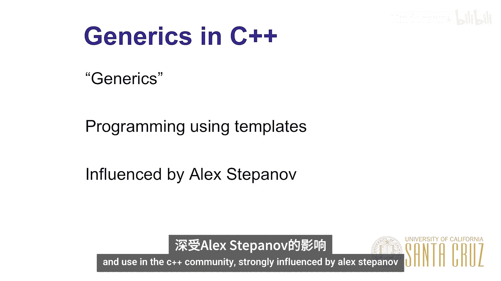
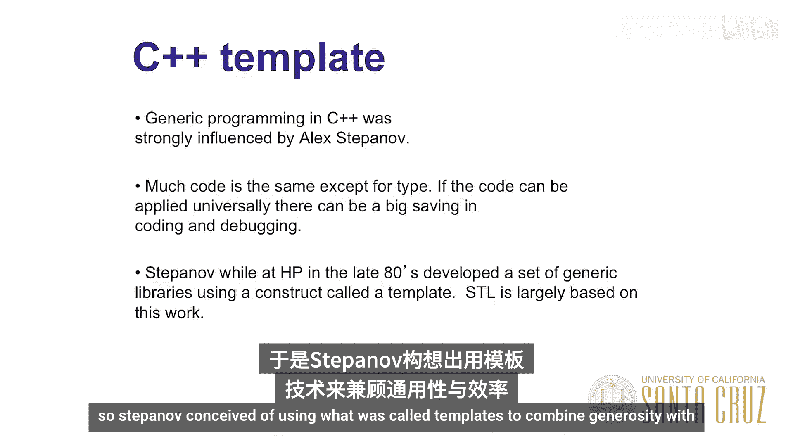
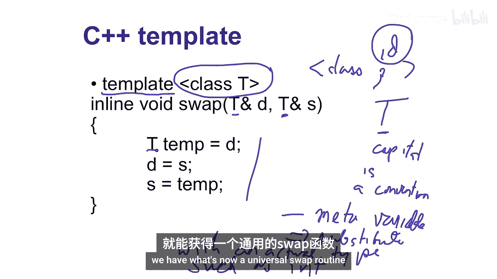
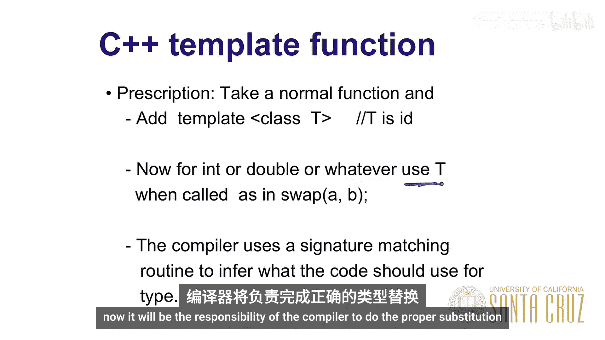
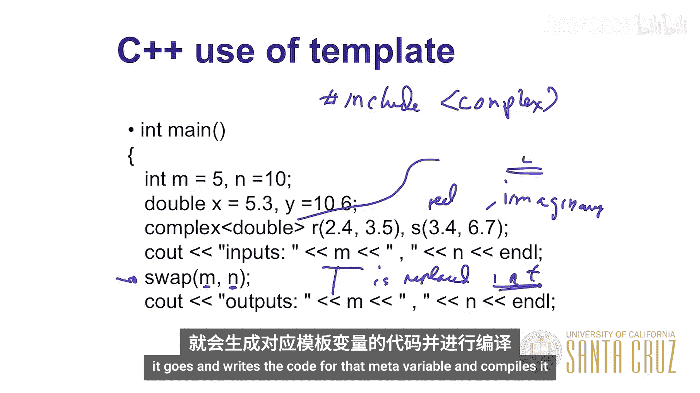
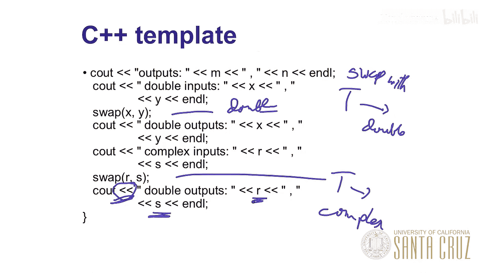
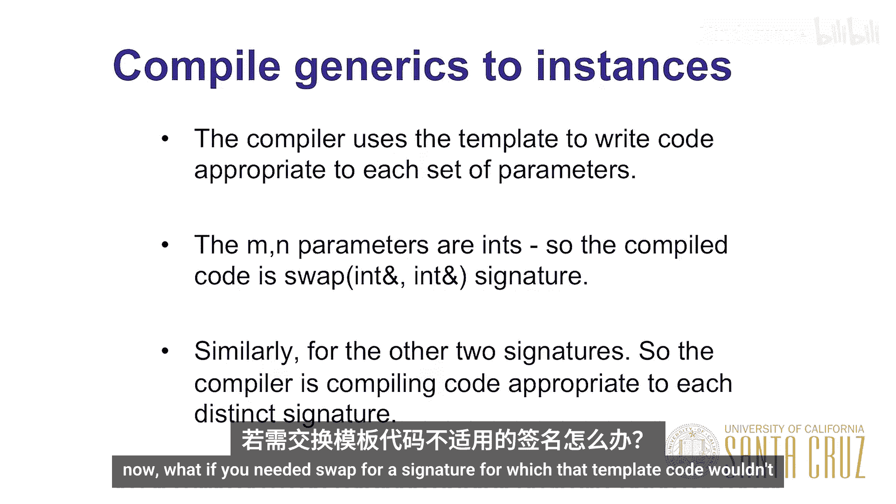
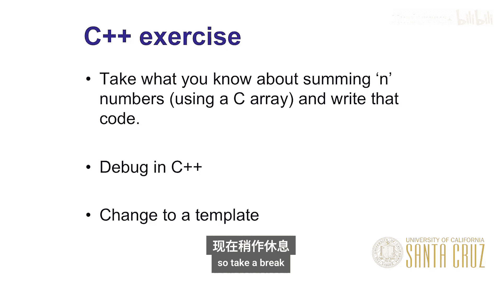
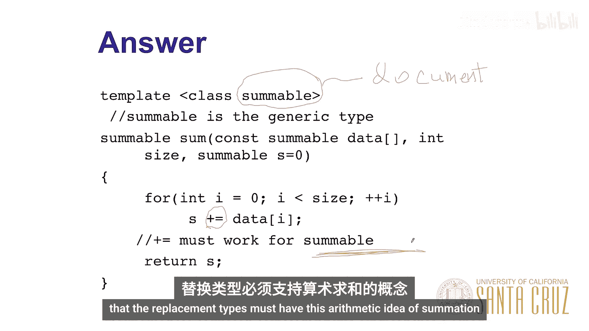

# 【加州大学】C++编程-｜-C-Plus-Plus-A-p10-P10_1-10-泛型_01_01_11--BV1p2ejzREUQ_p10-

So we're turning to our next main topic， the next place we can improve。And this gets you a。

 a lot of code reuse， a lot of code reuse。A lot of time saving， this is the use of generics。

So where have we seen generics， I've just sort of stole the dictionary definition for generics。

Relating to a characteristic of a whole group of class。Meaning general。

Being or having a non proprietary name such as generic drugs。

 so that's probably common usage we all heard to term generic drugs frequently go to the doctor。

It'll say， oh， well， you should just。Pay a lot less and here's the generic。嗯。

Having no particular distinction。So that's what generics in the general vocabulary means Genes in C++ means programming。

Using templates。And the critical person behind。Generic programming。

 especially generic programming and use in the C++ community， strongly influenced by Alex Stepanoff。

And Alex is a very remarkable。A person。He was originally trained as a logician。

And if you think about logic， logic tries to do things that are the most general possible。

 It likes the most general rules。 And if you've ever looked at in your background in computer science or mathematics at something like。

First order prediccate calculus， which is a very common。

Tool by both mathematical logicians and some computational theorists。

 you will see statements that say for all X， there exists Y， such that the following is true， know。

 canonically if you。Try to。Go back to the Greeks， you hear a little。Tutologies， like。

All men are mortal， Socrates is a man， what can you infer。

 you can always infer that Socrates is mortal。So somebody studying these very sort of。Grand。

Notations that can be applicable to anything。Was wondering why in a programming language like a Fortran in an early day or an algal or a Pascal or an Ada or then a C。

 why were you always rewriting code？That was almost the same except。It's sort of like a recipe。

 you would have a recipe and you could have the recipe for chicken。

 but you could also do exactly the same kind of cooking on beef。Or duck。

So why not just say this is a recipe for boiled meat？

And then just whatever that particular main ingredient was。

 you have that one recipe now you can use it for again。

 lots of people fry fish and they're not so worried about。Frying fish， whether it's trout or bass。

 they just know， well you fry fish。 and if it's this thick， then you have to fry it for so long。

 And if it's set， that you fry it for less。And if you cook it。

 you want to put a little lime or lemon juice on it。 So everything。

 except for what the main ingredients are， stays the same recipe。

 And that just makes that recipe more generically applicable。 That's where generic comes in。

So stepping off was looking for mechanisms that allowed you to code generically。Now， historically。

 you could do generic coding in many of these languages， especially languages like。

The AI language list。LISsp was in some ways a typeless language。

 and so is the responsibility of the coder。To know that they were manipulating things properly and so that they wouldn't get anything wrong in terms of type and they could write code that could act on anything Ls had this very。

Fancy data structure， the linked list built into it， and then you could do a lot of processing。

 storing things in these linked lists。And so it was very powerful and very concise。

 it was especially useful in the AI community starting in the '60s when it was invented by John McCarthy。

So people who used it really wanted advantages of it in these high performance languages like C。

But the problem is that C required typing information， so you have an efficiency problem。Li。

Where you get generosity in a language like this is you sacrifice some amount of low level efficiency。

So that was the tug that was going on in Stepoff's mind。 How can he keep。

The universality of a generic recipe。And still make it efficient。Because。

Most people especially in the non research community， the business community need efficiency。A。

Professor McCarthy used to say， oh， I'm not going to worry about efficiency。

 I'll just wait a few years， and the machines are going to be half as expensive and 10 times as fast。

And at some level， that seems to be right。Whatever you're doing。

 the next generation wants to do something 10 times larger。

 So there's nothing like enough machine speed。 It's never that way。

 It's always something more you want to do。 and you can always。啊。Overstress。

You're a machine with something bigger。So stepping off conceived of using what was called templates to combine generosity with efficiency。

So here's a very simple example。And we're going back to our swap。

 and we're going to see why this is such a powerful concept。We have the new keyword。Template。

Along with that keyword。We use angle brackets。A keyword called class。And then。An identifier。

And conventionally， at least when we talk pedagogically about templates。

 we'll typically use something like T or if we have more arguments。

 we might use something like T1 and T2， and it is by convention something we capitalize doesn't have to be。

 but that's。Capital is a convention there。Because it alerts us to the fact。That this is what I call。

Ameta。Variable。It's going to be substituted for。The substitution is going to be with an actual type。

Such as int。And we look at the code body and it looks。

The same as what we wrote in those earlier swaps。Inline void swap。And here we would have said int。

 int。And here we would have said， and everything else is the same。So basically。

 for very little effort， that's this extra line of code。We have what's now a universal swap routine。

So here's our prescription， here's how we write these generic， these generic routines。

You take a normal function。So what I want to have you do in programming。In trying this out。Is first。

 take a function you already know that works。And you know it works for whatever you think is a canonical type that you need。

 for example， you want to sum something， maybe you want to sum an array of integers。Well。

 you also might want some an array of shorts or an array of doubles。So you take that specific type。

 the one you're comfortable with。Write it out。And then。

What you do is you change it in a very minimal way once you see that that function runs。

You add this template class T and substitute T wherever the type is a meta variableable。

Now it will be the responsibility of the compiler。

To do the proper substitution。So let's look of it， let's see how Maine changes。

Once we have templates。So we had overloading already。

 and now we're having this new feature Genesity templates。

And I'm going to show it with three different types， in fact。

 one of the types itself is going to involve a template。

So C plus plus being object oriented and generic。Allows us to do coding that wasn't available in C。

And one of the things we can do in C++ is。Typically in a library， and indeed， there's this would be。

We would include the library sharp。Include。Standard library for complex numbers。So。In this example。

 I'm going to swap integers， I'm going to swap doubles， and I'm going to swap complex numbers。

And the complex numbers themselves are a template。And their argument to a template is the type double。

And why is that because there could be other numerical bases for complex number。

 think of a complex number as a real。An imaginary part as normally what it is。

And I really am not going to expect you to go revisit high school algebra or college calculus。

 but as some of you may remember， you use this little I notation for an imaginary number and some of you said。

 oh， I'm not going to deal with mathematics anymore once I saw that。

But it's just for purposes of the example， it just shows。

How powerful C++ is that it naturally adds complex arithmetic， and indeed。

 there are languages in which complex arithmetic is basic modern Fortran。

 because it's so heavily used in scientific computing while the original Fortran didn't have complex numbers as a basic type later standard fortran added complex numbers to the basic type。

 but C as a systems implementation language never had any reason raised on the etra。

a purposeurse to add complex numbers， but numerical scientists。

 once they saw the ability to add types， new domains。

 jumped on C+ plus as a powerful language and added lots of new numerical packages with their underlying domains and their underlying types。

So again， it makes perfect sense to swap things and what swap well。The compiler says， well。

I have a definition， a template definition is a swap， so these are two integer types。

 so the compiler writes out this code。Replacing T T is replaced by。Ent。

And then the code for that type is compiled， so every time the compiler sees a signature。

That matches up。With the matter。Variable T。It goes and writes the code for that meta variableable。

And comp it。So one thing to keep in mind is you might get what's called codelo。

 you might get a whole bunch of routines。

For as many times as you need to write code for swap。

You're only doing that because you needed it anyway。So this is automating what otherwise would be。

Your work， and it's automating your work in a very powerful way in a way that hopefully is going to lead to far fewer errors as well。

So again， we have。See out， properly overloaded。And here's our double and the same thing is going to happen。

Swap is going to be rewritten with tea。Becoming double。Compilr is going to do that。And here。

 same thing， but T is going to become complex。And。See out。Also knows see out this operator。

 also knows。Because of type safety and the semantics that were put in the library。

 how to properly write out complex numbers as well。

 so we get that benefit immediately once we understand how to use C+ plus templates。

 how to use C++ IO， and the fact is we get it in a meaningful typeafe way so that really makes all of this more convenient and more powerful。

The compiler uses the template the write code appropriate to each set of parameters。

The parameters are int， the compile code becomes swap in int。

The same thing would happen for the other two signatures。

 Each distinct signature is going to be mapped into。A template now， what if you needed swap？

For a signature for which that template code wouldn't work。

Let's say you needed to augment something where you were doing a swap。Of two strings。

 and for whatever reason that wouldn't work because you needed something that would use in effect a string copy。

And not just a kind of assignment。You can specialize and have a specific function for that swap。

 The specific non template function takes precedence。 So if the compiler。

That just is ordinary overloading。So you can use ordinary overloading specific instances of signatures along with generic instances。

Okay。Here's a quick exercise if you understand all these ideas。Show you how powerful it is。

Take what you know about summing。N numbers using a C array。Try and write that code， for example。

 for En double。The bug。And C+ plus。And then change it to a template and make sure that it all runs。

So。Take a break。

So here is the generic version of writing a routine that can sum。Any kind of array。

 the ray name is data。And in this case， we use as our。Variable for the generic summable。

We're not using。Tea， which is very common。And we're using sumable because as with any kind of identifier。

 it provides documentation。And it's telling us。That。Z。Type that we replace sum ofable with。

Has to allow for。This operation， this operation must work。

What can it mean if that operation doesn't work， Well。

 if that operation is not defined with a particular type， let's say you have some。

Fancy type of string， and you did not define a plus equals。Operator overloaded on that string。

Then what is going to happen when the substitution of the code for that type occurs？You will get。

An error。Now。It should be a syntax error because the error will be。

That it detects that it has no available operation， that's the best kind of error。

The unfortunate kind of thing is what if it's a plus equals that isn't the intended arithmetic use of summation？

Then it's going to work and then you're going to get something at runtime。That's what you。

 that's what you've got to be afraid of with。With templates。

 they can be overly general and if the code makes sense， something will run。

 and this is a reminder you use sumable here to remind you that the replacement types must have this arithmetic idea of summation。

So templates are very powerful。Templates。While they generic。

 that generosity doesn't necessarily mean that every possible type under the sun can use it。

 It means that the types that you should use it for should reflect。

Should be meaningful in terms of the code you're writing。Some things are going to be near universal。

 The notion of swapping two things is probably going to be near universal。

 But the notion of adding things means that things have to be sumable。So again。

 if you want to go back to your analogy of， whatever your basic recipe book is， yes。

 certain recipes can use arbitrary fish in frying them。

 but then you wouldn't want to use the same recipe on lettuce。

Some other ingredient where that kind of ingredient would be damaged by the recipe would lead to something that was unexpected。

