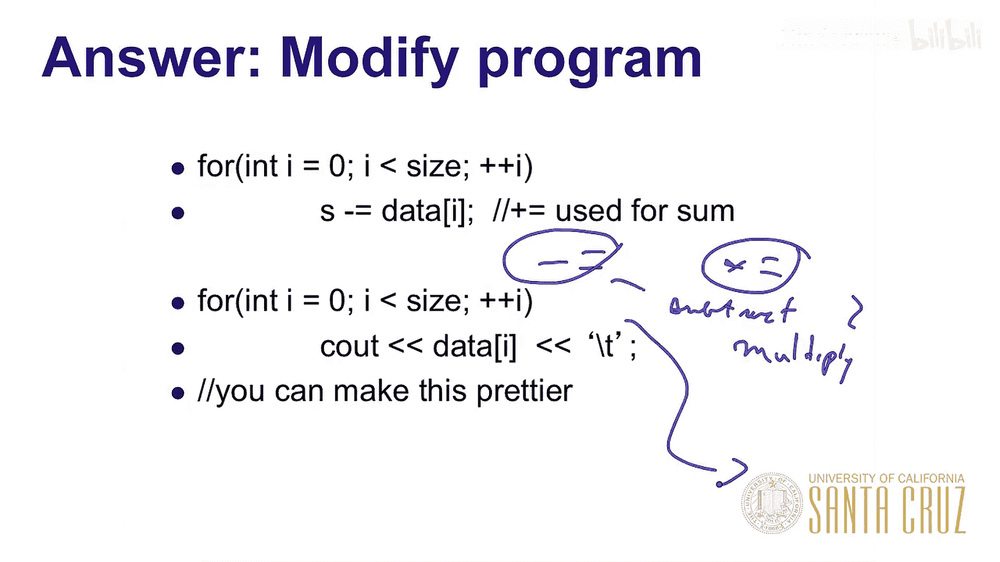

# 【加州大学】C++编程-｜-C-Plus-Plus-A-p11-P11_2-1-C++泛型和函数_02_01_02--BV1p2ejzREUQ_p11-

。🎼う。🎼，So we're going to take up C++ functions and generics。And then。

Our other big topic is going to be graph algorithms。And。Grph algorithms are， if you haven't。

Study this in your。Background， if you recall， I said， most of you should have， at least。

The equivalent of one year of computer science， especially data structure topics。

 and graphs are one of the critical data structures in all of computer science。

And the critical homework in this class is going to involve homework on graphs。

 So that's going to be how we learn our C plus plus。 we're going to learn C plus+。

 but we're going to learn some interesting computer science ideas， or at least for many of you。

 you probably already know these。 So it'll be review。

 So it'll make it easier for you if you already have a background in which you understand。

The minimum spanning tree algorithm or。The Dyster shortest path algorithm。In any case。

 those will all be reviewed。And。There are also many sources in which you can go to and read carefully about them。

 notably the Wikipedia。So here's some of the new stuff we've had。We have。

Default parameters and C plus plus。We have variable argument lists in C plus plus。

We have the use of cont and C++， including cont as part of the signature for function parameters。

So far， when we've looked at generics， we've only。TheOur recipes。

 our generic recipes have had a single。Meta meta variable。

 typically of T that we get substituted for， but it's also possible to have generics that are far more complex and can involve multiple types in the generic recipe。

And while I've alluded to operator overloading， especially the notion of overloading。

The bit shift operators to be。I O operators。I'm going to also begin to explain how you do your own operator overloading。

So this is new stuff。We're going to see。So a little review。

How and see did you write a function to some， for example。An array of doubles。

And we've seen ci function in C。A couple of things that we notice is。Here's a signature for an array。

Alternatively， that could have been written in pointer notation。So this also would have worked。

Heer one。It's basically in the sea community。诶。Arays are just base pointers。

Now we have an initialization。OfThe summing variable。This is going to be the loop variable。And again。

 this is just a very standard idiom for handling a rays idiom。For a raises。

 we have a size that gets past them。That tells us how many elements to sum。

So just to remind you again， of the dictionary definition。Generics relate to entire group or class。

 It's general。 some sense that's what we're using here。

 It's just a general style of programming biology， it means very specifically relating to a genus。

 not having a brand name is another designation where we can have generic soap。

And that's very often used。In the pharmaceutical industry where you mean something non proprietary。

And then finally， it in grammar， it refers to neither masculine or feminine gender。 So， again。

 there's a little bit of universality。 So generic programming is somehow a universal kind of programming。

Writing code that can use an arbitrary type or types。And C plus plus done with a template。

 And we saw it in the one argument situation。So here again is。

 let's see how you would do that for the generic sum of an array。

That was what we were asking you to do as a little quiz assignment。And we typically。

 when we're summing something like an array， we want the summing variable to start at zero。

 but we will also see that we might want to generalize that。For example， we might have two data sets。

And we want to pass in one data summit。And then whatever its value， its summable value is。

 for example， here would have been 24 in data set1。

 we want to continue with data set 2 and sumit as well， starting at 24。

How would we do this generically。Here we see some of those C++ features， Here we see ideas。

That are very standard。 and E C programmer could manage this。 But immediately。

 you get a lot more power in C plus plus。 So again。We have this meta variableable T。Possibly。

 I should have called it。Some of all that may be a better name。Keep in mind。That。

It won't work universally。 It'll work。When we see this operation working properly。Now， we have here。

A default value。And what this means。Is。Whatever that type is， the summing， where we're summing S。

Well。Ordinarily， the usual case， the usual suspects， the usual case。

So this means I don't have to specify things when it's the usual case。

 it's going to be assumed to be zero， but if it's not the usual case。

 I will have to substitute an actual parameter for this formal parameter。And here also。

 we see this other idea in C plus plus， where we can localize to the force statement。

Through a declaration in this component of the fourth statement， a local counting variable。So。

We have in C plus plus the concept of default parameter。

We also have in C++ the concept that we can use。呃。Kant's correctness。So we can't do this in C。

 but in C plus plus by specifying contre。That means any data sitting in that array is not mutable。

That means the compiler。Can presumably check that that criteria is met。

So that youre don't inadvertently in this program。Mess with your array contents。So again。

 that's good practice if I leave cost off， nothing changes。Nothing changes。

 So constant is really a little added documentation。

And something the compiler can automatically check。Now， with a default parameter。

We are allowed to have two different signatures。Here。

 the actual parameter would mean S started at 58。Here， by default， because things got left out。

S switch started at 0。So again， we have to in C+ plus really understand what we call the signature matching algorithm。

 Its selection mechanism。 The compiler uses it and uses it to properly choose and write code。

We could， by the way， have had a default to size。 We could use more than one default in the argument list。

 So let's say most of my data sets。Our size 100 for whatever reason。So then if I wanted to。

 this could be defaulted。Now， it turns out you might want to think about it。

I can have a bunch of arguments。But if I have default arguments with default values。All the defaults。

There can't be a default that skips over an argument。

Because there's no way of positionally determining。What。Is the default value for an argument？Okay。

 you can play with that， if you didn't understand what I said， think about it。

Here's the main program。In that main program， we're going to use that template。

There are two different。Types of arrays。 This is an array event。And this is an array of double。

And then。The compiler knows what to select。And in both cases。There was a default。 In this case。

 it was the sum S equals 0 in this case。It's also going to be S equals 0。

 but this is going to be in the double domain。 you might want to。It might realize that that。

Notationally is really 0。0。 It's better thought of a 0。0。

 and the compiler will write that code for you。 So again， it shows you the power of templates。

 the power of generic programming。Elements of the array source are not to be modified。

 that's the meaning of K's correctness， simple parameters such as size are typically called by value and cannot be modified by the calling routine。

So we didn't declare size to be because。There's no need to。 That's just a standard called by value。

 and it would be redundant。And this concept is called Kant's correctness and is emphasized throughout the C++ language。

All right。As an exercise， take that code。And instead of iterating over addition。

 iterate over subtraction。And as a further exercise。

 to show that you really can manage templates and see their power。

Write a template function that instead of using an arithmetic operation。

Does output of the array elements？And I'll leave that for an exercise for you。

So the answer is to provide。A different operation here。And we could provide arbitrary operations。

That。This would be repeated。Multulipplication。In this case， we。

Provide a subtraction that would have been the answer。

And here is a different form of processing entirely， pretty simple again。

We've chosen to use a very standard idiom for processing arrays。

 and then in that idiom we can choose whatever we need to do when we handle the array contents and templates become very powerful because if those are universal methods。

 methods necessary for the contents of an arbitrary array。

 the template just means we can write at once thebu it on a standard type。And， and then。

Stick it away in our library for use whenever。

