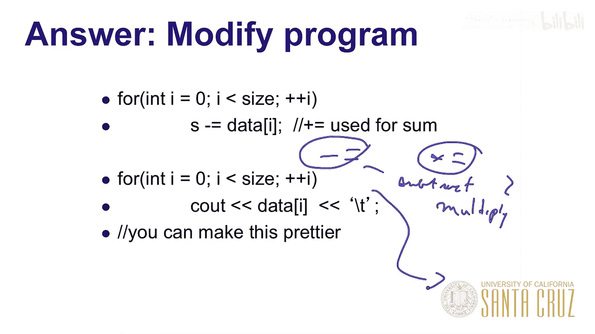

# C++编程：P11_2-1：C++泛型与函数


在本节课中，我们将学习C++函数和泛型编程。我们还将探讨图算法，这是计算机科学中关键的数据结构之一。本课程的核心作业将涉及图算法，我们将通过它来学习C++。

## 📚 概述

我们将讨论C++中的新特性，包括默认参数、可变参数列表、`const`关键字在函数签名中的使用，以及更复杂的多类型泛型。此外，我们还将开始讲解如何实现自定义的操作符重载。

上一节我们回顾了C语言中的函数，本节中我们来看看C++如何通过泛型等特性增强这些功能。

## 🔧 C++函数与泛型基础

在C语言中，对一个双精度浮点数数组求和的函数可能如下所示：

```c
double sumArray(double arr[], int size) {
    double sum = 0.0;
    for (int i = 0; i < size; i++) {
        sum += arr[i];
    }
    return sum;
}
```

或者使用指针表示法：

```c
double sumArray(double *arr, int size) {
    double sum = 0.0;
    for (int i = 0; i < size; i++) {
        sum += arr[i];
    }
    return sum;
}
```

这是一种处理数组的标准模式：传入数组和其大小，通过循环进行累加。

## 🧬 泛型编程概念

“泛型”一词意味着与整个群体或类别相关，具有通用性。在编程中，泛型编程指的是一种通用的编程风格，允许编写能够处理任意类型的代码。在C++中，这是通过模板实现的。

## ⚙️ C++泛型求和函数

以下是一个使用C++模板实现的通用数组求和函数：

```cpp
template <typename T>
T sumArray(const T arr[], int size, T s = T()) {
    for (int i = 0; i < size; i++) {
        s += arr[i];
    }
    return s;
}
```

这个模板引入了元变量`T`。函数包含以下C++特性：
1.  **默认参数**：`T s = T()`。这表示求和变量`s`有一个默认值，即类型`T`的默认构造值（对于数值类型通常是0）。在通常情况下，调用者可以省略此参数。
2.  **`const`正确性**：`const T arr[]`。这表示数组`arr`的内容是不可变的，编译器会确保函数内部不会修改数组元素。这是一种良好的实践，为代码增加了安全性和文档性。
3.  **循环内局部变量**：可以在`for`循环的初始化部分声明局部计数变量`i`。

默认参数允许函数有不同的调用签名。例如：
*   `sumArray(myArr, 10, 58)`：求和从58开始。
*   `sumArray(myArr, 10)`：求和从默认值0开始。

编译器使用签名匹配算法来选择合适的函数版本。需要注意的是，如果参数列表中有多个默认参数，不能跳过中间的参数来为后面的参数指定值，因为编译器无法通过位置来确定意图。

## 🧪 使用示例

以下是如何在主程序中使用上述泛型模板：

```cpp
int main() {
    int intArr[] = {1, 2, 3, 4, 5};
    double doubleArr[] = {1.1, 2.2, 3.3};

    int intSum = sumArray(intArr, 5); // 使用默认起始值0
    double doubleSum = sumArray(doubleArr, 3); // 使用默认起始值0.0

    return 0;
}
```

编译器会根据数组类型实例化相应的`sumArray`版本，分别处理整数和双精度浮点数，并应用对应的默认值。

## 💡 练习与扩展

为了加深对模板力量的理解，可以进行以下练习：

以下是两个练习建议：
1.  修改上述代码，将循环内的加法操作改为减法操作。
2.  编写一个模板函数，其功能不是进行算术运算，而是输出数组的所有元素。

答案的核心在于修改泛型函数内部对数组元素的操作。例如，将`s += arr[i];`改为`s -= arr[i];`即可实现减法。对于输出功能，则需将累加操作替换为输出语句，如`std::cout << arr[i] << " ";`。

通过使用处理数组的标准模式，并在其中定义需要对数组内容执行的操作，模板变得非常强大。如果某些操作是处理任意数组元素的通用方法，那么模板允许我们为一种标准类型编写一次代码，然后将其存入库中供随时使用。

## 📝 总结

本节课中我们一起学习了C++中函数与泛型编程的核心概念。我们了解了如何通过模板编写处理任意类型的通用代码，探讨了默认参数、`const`正确性等C++特性如何使代码更安全、更灵活。我们还通过示例看到了泛型函数的具体应用，并提出了扩展练习来巩固理解。掌握这些知识是运用C++进行高效、通用编程的基础。



