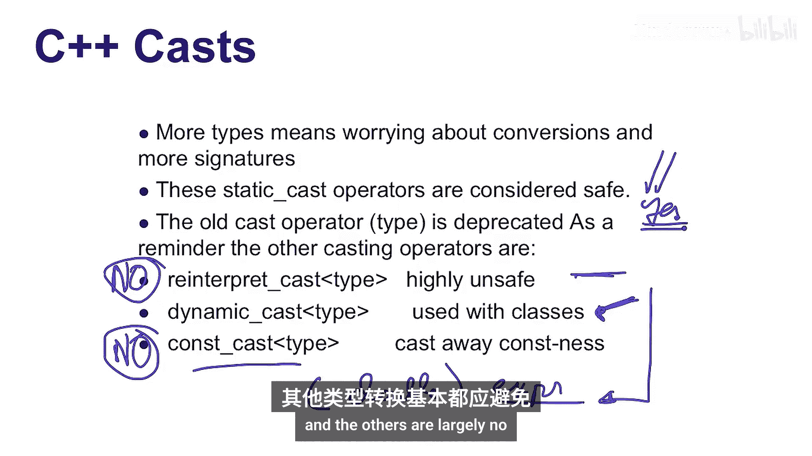

# 【加州大学】C++编程-｜-C-Plus-Plus-A-p12-P12_2-2-多个模板参数_02_01_03--BV1p2ejzREUQ_p12-

So， templates。So far have been templates of one meta argument， but there's actually no restriction。

But keep in mind that most of what you want to do is templates of one argument。

Once you start multiple argument templates you get into。Horrenddous complexity。

 unneeded complexity in most cases。It's a prescription for doing fairly dangerous things。

That are unanticipated， but in some cases they're useful and so it's desirable to know how to use it and when to use it。

So again， warning， be careful。You really have to understand。When you need more of these。

Typically metas， but let's see a situation where maybe that would be reasonable。

Here is code with the two templates。And。呃。It's a copy routine。So we want to copy some source。

Some source data into some destination data。And we don't necessarily want。We could have this as。

All T。But that would mean that the copy would have to be， for example。

An integer array copied to an integer array。Let's notice a couple things about this code。First off。

 in the signature。The source argument is Kant， so we have a little bit of Kant's correctness。

We're indicating to the user， to the reader， to the compiler。Don't modify the sorcery。

Not true for the destination array， obviously that's what we want done。

 we want the destination array to have a copy of the sorc array。And again， we have a variable size。

 that's how much to be copied and for the moment。It's conceivable that we would have a default。

 but it's probably not that useful to have a default in this。嗯。

There wouldn't be some standard default that would be used more than some。Very specific value。

It would not make sense to say size here is 100。That would be unusual。

And then the other critical thing here we're doing is the safe casting。And this is what。In my mind。

 makes this。A not unreasonable routine。Because。If I don't have a safe cast for type T1。Cas。呃。

Casting the object of type T 2。Then when this code runs。It is going to be an era。If no。Safe cast。So。

Or the compiler will recognize that it doesn't have a safe cast opportunity and provide you a compile time error in any case。

The code。Won't。Work。And it won't work in a manner that will be easily detected。

And in cases in which it will work。We know that we have a safe way to massage the source contents into the destination contents。

 so what would be a safe thing if I had integer data and I wanted to turn it into double data that would be perfectly reasonable here or vice versa。

Both kinds of conversions， one is called a promotion。

 taking the data in the integer domain and turning it into double， and the other is called a Dmotion。

 but both are conventionally well understood。Handleable by the safe conversion routines。

And largely portable。Program， as it should work。Regardless of。

What computer system that's being run on？So here is a multiple use of template arguments。

That is not unreasonable。This brings up the。Question of casting。Again。Type safety。

 that's a big improvement in the sea world in the C++ world over the sea world。

And one way that the sea world was very loose with types is。In that world。You could say things like。

Double with some kind of expression。Now， whatever this expression was。The C compiler said。

Force that expression to be interpretable。As a double， whether that was。Portable or not portable。

Since there were different characteristics and C++， actually， C++ is a wider range of programming。

Including object or programming and which。Certain types and type hierarchies。In the O community。

 these are called polymorphic types， inheritance structures。

Have other kinds of conversion opportunities that are well understood。 You get into a much。

Ricer sense of conversion opportunities in the C plus plus world。

 We have to be far more careful about it。 So C plus plus defines four basic types of conversion。

The safe cast type is static cast。But then highly unsafe is reinterpret casts。

 That's sort of what's going on here。Sort of that's。Corresponding。

But it's alerting you to the fact that geep。For whatever reason， which is probably a hack， which is。

 in my view， something you shouldn't do。 So if I was your manager， this would be a no。

You would really have to convince me that you want that theres a good reason to do a reinterpret cast I would be。

Extraordinarily reluctant to be using that。And then。Again， in most instances， for me。

 this is also a no。 you can cast away constantness。

 Sometimes you want something that was said to be constant to not be constant。

 so you would make it modifiable， but in my sense，You're mixing up two characteristics。

 Why did you make it cost in the first place， So you're really saying。Oh。

 make that thing mostly cost。 I don't want pie to all of a sudden change。 I don't want to say， gee。

 it's going to be pie， but there may be some time I want to tweak that。

 It's just not how I'm going to think。 So again。Most of these other kinds of casts。

You'd basically be thrown out of your repertoire。Safe casting is okay。

The old style casting while available in many compilers is deprecated， deprecated means don't use it。

A compiler writer is at liberty of actually denying its use。

And then there are some special cases where class hierarchies involved dynamic casting。

 where when you're doing some very fancy object or programming， this may be required， but again。

I'm not a fan， so I would say safe casting， yes。And the others are largely no。

