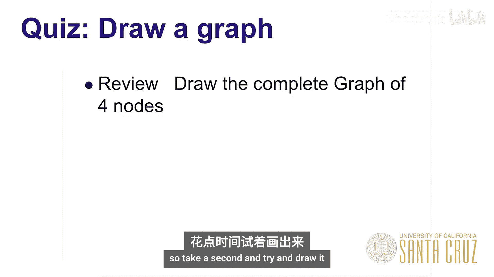
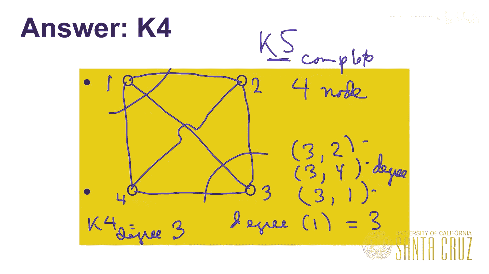

# 【加州大学】C++编程-｜-C-Plus-Plus-A-p13-P13_2-3-图论算法_02_01_04--BV1p2ejzREUQ_p13-

So the other thing that we're going to emphasize in this course。Is algorithmic graph theory。

 That's going to be the domain we're largely going to use， for examples。

And there are several reasons for it。 It turns out that graph theory is an underpinning to a lot of the discrete problems of interest in computer science。

It shows up all over the place。In artificial intelligence。

 there are search algorithms that are foundationally graph theory algorithms。In。

Your GPS devices where you're asking your。Card to find you a root。

You're doing basically very efficient。Very complex graph theory calculations。

 when you're working on the Internet。And you're connecting packets between。Machines over the many。

Hundreds of millions of nodes now on the internet。You're basically doing graph theory。

 so this is a great topic， it's foundational in computer science。

It requires a lot of careful thought in the use of data structures。 It's not。Typically。

An ordinary computer language。A built in data type。 It's not a native data type。

 So one of the things we're going to find with graph theory is。

Thinking about how to implement graph as a data type。 that's going to be part of our。

Understanding of using C++ as an object oriented language。And hopefully， you have some of that。

Background， so you should。Have some notion of what object orientation is。

 Maybe you even have experience with a language like。

Javo or Python that has object orientation built in。And that experience will stand you in good stead。

 but you'll still have to see how C++ use it。 again。

 graph theory by itself is just a very important topic。And。

Computational science and applicable all over。So。The first thing I want you to do。

 since to some extent， I'm hoping this is review for you。His draw the complete graph of four nodes。

And I'll give you a definition， a complete graph if you've forgotten。

Is a graph in which every edge exists。In that graph， in that map。 So if you have。San Francisco。

 Los Angeles， San Jose and Salinas as cities that would be。For nodes。Then， there's a direct。

Pathath from each city to。Every other city in that graph。 And that would be called a complete graph。

 So take a second and try and draw it。

So I'm going to draw it for you。 And we're going to assume。That we are using undirected edges。

 So there are。Directed edges and undirected edges in graph theory。

 but most of what I'll be doing will be using。Direct undirected edges and undirected edges are like roads that are two way roads。

 You can go in either direction。So。Here is。City1 to city2。Here's city，2。City 3， city 3 to city 4。

City 4， back to city1。That's not complete yet。I can also go from city1 to city3。

And I can also go from city2 to city4， I'll do it with a little crossover。

Are there any other connections that can be made between these， no。

So you'll notice a certain property here。Now， in the graph theory world， this is called K4。

 and you should be able to。If you want to do K5 now。That would be5。5 nodes， all edges and five nodes。

 K 6 and so on。 K is just。A notation， meaning complete graph。So we have four nodes。

I'm going to label them one。2。😔，Ri。😔，4our， we could have labeled them as well， ABCD。

 or you could have labeled them San Francisco， Seina， San Jose， Los Angeles。

And then the other property I want you to know about or other definition is look at node 3。

 It has three edges out。 It has an edge。Betweenwe three。And2。Goodner。Notationally。

 write that in between parentheses。 It has an edge between 3 and 4。And as an edge between3 and one。

So it has three edges， and this is called degree。So， the degree。Of any of these nodes， in fact。

 they all have three edges。 So degree。Of。For example， node1。Is3， In fact。

 the degree of any of them is three， in fact。If I have the graph K 4。

Then the degree of each node is one less than4，3。 And for K5， what do you think？It would be four。

The degree of K5 would be four and the degree of K10 would be9。Ggrree of K a million with the 999999。

 though， that's going to take quite a while to draw。 So I'm not going to ask you to draw K a million。

Anyway， that's why we have computers， so this is our answer。

I just want to give you a little flavor of where the salt came from。So this came from in some ways。

 a fancy problem， almost a real world problem， actually。

 and graph theory was invented by a very famous mathematician， Euler， Leonard Euler， 1735。

Earer was incredibly prolific， maybe the most important mathematician of the 18th century。

And he was studying a problem in his region。And it was called the seven bridges of Koisburg problem。

And in trying to solve that problem。He uses mathematical genius to figure out an abstraction that let him logically approach this problem of crossing seven bridges。

 So let me。Show you what that problem is。 It was a city， Conorsburger。There was a river in the city。

Several forks in it。 And there were 7 bridges crossing the river。

 and they're shown here in the slide。And the the typical Sunday afternoon stroll。

So if you were young lovers and you wanted to do something on a Sunday afternoon。

You decided to stroll in a way that got you across all seven bridges。

And that got you into every area of the city。The conundrum for the strollers was。

 can I go and cross every bridge once and only once and cover all of these sections of the city。

 Is there a way to do this。And nobody knew how to do it。And indeed。

 by converting it into an abstract problem。Ouler was able to show that no such path existed that later path like that was later called an Eer path in his honor。

 that's the origins。 a good story。 Those are the origins of graphph theory。

 Graph theory was a mathematical concept useful for many years。Used by mathematicians。But。

Not that important to real world applications until the 20th century， in the 20th century。

 coupled with computers， many computational problems， including optimization problems。

 including deduction problems， including matching problems， including looking things up in databases。

 all could be seen that you could get incredible insights into these problems。

 by representing these things as graph as graph theory problems。

