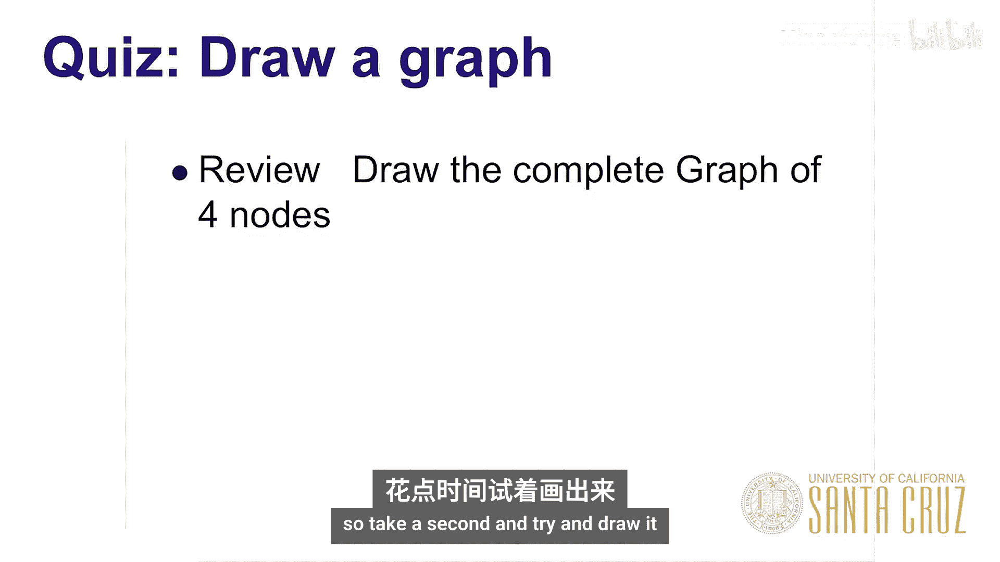
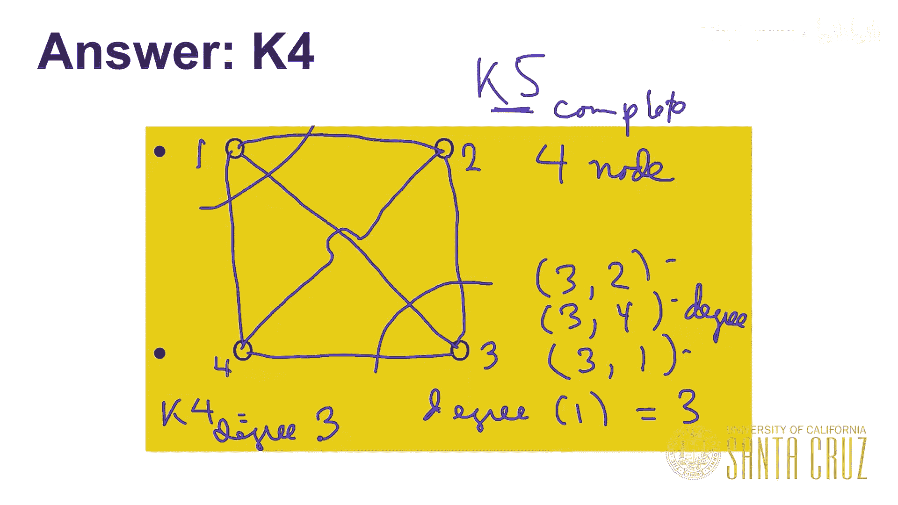

# C++编程：P13：图论算法入门

在本节课中，我们将学习图论算法的基础知识。图论是计算机科学中许多离散问题的基石，广泛应用于人工智能、路径规划（如GPS）和网络通信等领域。由于图并非编程语言的内置数据类型，我们将探讨如何在C++中将其实现为一种数据类型，这有助于我们理解C++的面向对象特性。

## 图论基础概念

上一节我们介绍了图论的重要性，本节中我们来看看图的一些基本定义和属性。

一个**图**由**节点**（或顶点）和连接节点的**边**组成。边可以是**有向的**（单向）或**无向的**（双向）。本课程主要讨论无向边，它们类似于双向道路。

### 完全图

一个**完全图**是指图中每对不同的节点之间都恰好有一条边相连。

以下是绘制一个4节点完全图（称为K4）的步骤：
1.  画出四个节点，可以标记为1、2、3、4。
2.  在每对节点之间都画上一条边。

最终，每个节点都与其他三个节点相连。

### 节点的度

在无向图中，一个节点的**度**是指连接到该节点的边的数量。

在K4中，每个节点的度都是3。推广开来，在具有n个节点的完全图Kn中，每个节点的度是 **n-1**。

## 图论的起源：柯尼斯堡七桥问题

了解了图的基本概念后，我们来看看图论的历史起源。这源于一个著名的实际问题——柯尼斯堡七桥问题。

18世纪，数学家莱昂哈德·欧拉研究了这个难题。柯尼斯堡城有一条河，河中有两个岛，七座桥连接着不同的陆地与岛屿。问题是：能否从某地出发，恰好经过每座桥一次，并最终回到起点？

欧拉将陆地抽象为**节点**，将桥抽象为**边**，从而将实际问题转化为一个图论问题。通过数学推理，他证明这样的路径（后来被称为“欧拉路径”）对于柯尼斯堡的桥是不存在的。

这个故事展示了图论如何通过抽象来分析和解决复杂的现实问题。在20世纪，随着计算机的出现，图论在优化、搜索、匹配和数据库查询等众多计算领域中变得至关重要。

## 总结

本节课中我们一起学习了图论算法的入门知识。我们定义了**图**、**节点**、**边**、**完全图**和**节点的度**等核心概念，并用公式 **度 = n-1** 描述了完全图中节点的属性。我们还回顾了图论起源于欧拉解决柯尼斯堡七桥问题的历史，理解了将现实问题抽象为图模型的重要性。这些基础为我们后续在C++中实现图数据结构并应用各种图算法奠定了基础。