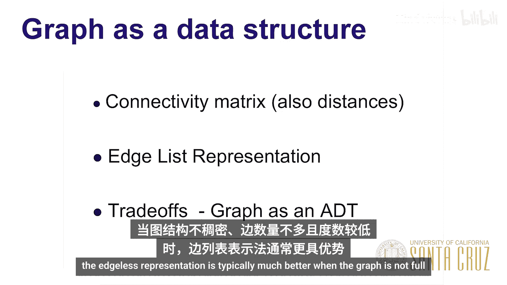
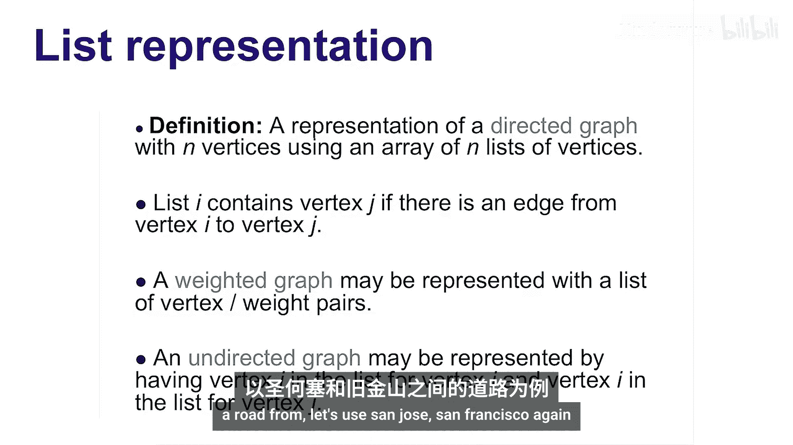
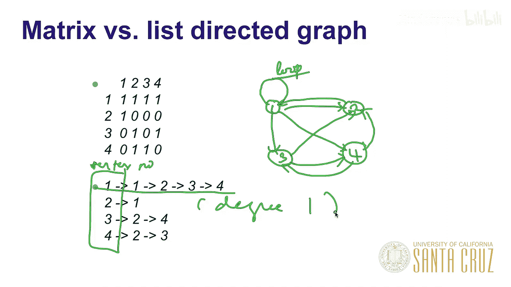
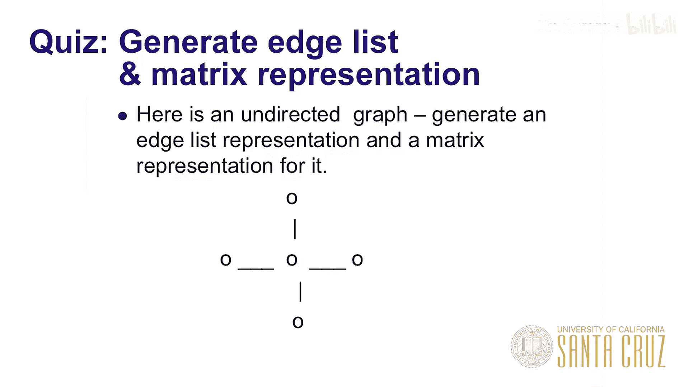
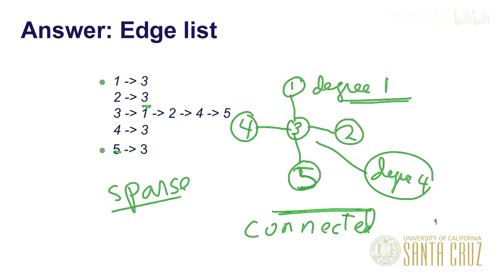

# 【加州大学】C++编程-｜-C-Plus-Plus-A-p14-P14_2-4-作为数据结构的图_02_01_05--BV1p2ejzREUQ_p14-

So when we use graphs on computers。We need to create an internal structure。

 a data structure for representing that graph。Such as trying to represent K4。

while we've discovered in computer science， and again， I hope for many of you， this is a review。

If it's trivial， you can move on。Theres two major representations。

 one's called a connectivity matrix， and the other's called an edgeless representation。

 and there are trade offs。With data structures， there are always trade offs。

 So for some algorithms and for some graphs。One representation。

Would have strong benefits over the second representation。 The typical trade offs involve。

How much data you need to store？And。How efficient the algorithm is。

 so it may indeed be that one representation requires too much storage for a particular problem。

And another representation might require too much processing。

 so we find that both are extremely useful and sometimes in the same problem， we want to use both。

 but。A。Overall。For those of you who are trying to review this。

 probably if you've had experience largely with the edgeless representation。

 the edgeless representation is typically much better when the graph is not full when there's not large numbers of edges。

 high degrees。

So if you have a graph of like size 100， meaning there are 100 vertices or nodes。

And the average degree in that graph is maybe4。So for the100 nodes。

 you're going to have something like 400 edges。 that would be considered sparse。

But if you had a graph in which there were 100 nodes and the average degree was 50 or 60。

Then you would have a huge number of edges， and that would be dense。And typically。

 the rule of thumb is dense graphs matrix representation is frequently better。 sparse graphs。

 edgeless representation is better。 Most real world problems are relatively sparse。

 A representation of a directed graph with n vertices can use a list。For example。

 an array of endless a vertices so that in list I， you're representing for an。

A node eye that you've labeled with。The number。i。Each vertex that's directly connected。

 each vertex that can be reached from I to vertex J。

And then some other terminology is you may also want in that graph to have not only edges。

 but a weight on the edge or cost on the edge。 So think about going from San Francisco to San Jose。

 roughly speaking， we're talking 60 miles。It may be a little off there。

 but I think it's somewhere between 60 and 80 miles。And that would be a cost。

 you're going to drive in a car， you're going to have to drive 60 miles。

That's one way to measure that versus going from San Francisco to Marin， which maybe is two miles。

So if you have an opportunity to go to one place or the other for some kind of vacation day。

And that cost figured in， you're likely to go to Marin， rather than。To Sanan Jose。And indeed。

 in route finding， when you try to find your onboard computer and your car tries to find you a route。

 it's generally trying to find you a least costly route， either based on time or based on distance。

So that's a weighted graph。 an undirected graph。 Any time you have was what we were doing with K4。

 any time you have。A road from。Let's use San Jose， San Francisco again。

 anytime you can go from San Francisco to San Jose， you can use the same road and go back。

So a lot of the problems because we just want to avoid the directed case。

 but it's not that much harder to deal with the directed case is we're going to think of two way roadads。

But analogously， one one rate roads are perfectly fine。

 and all of the algorithms I will be talking about could readily be adapted to the directed case。

So here's a matrix versus a list。Of a graph。They're actually the same graph。A。

And let me draw directly on here。What cl is being represented？I'm going to have nodes one。Nots 2。

Out three。😔，And nodes 4。And in this matrix case， it says one linked with one。 There is a road。

 So that is a special road。 I'm going to usually not。Worry about that。 That's a loop。

Most of the graphs I will be talking about will be loop free because loops aren't particularly interesting。

 The fact I'm in San Francisco， and I can drive around in San Francisco as a loop。Is also from one。

 a road to 2。 There's also from one， a row to 3 is also a road from one to 4。

 So all those one entries。Mean that。I was able to drive in this direction。Between 1 and 2，1 and 3。

1 and 4 now 2。Has uniquely。A。1 edge。It's  two to one。Three has two edges， three can go to two。

And three can go to four。4 can go to2。And4 to go to 3。

So that's the graph that's being represented here。And you can see in the edge representation the list。

 the edge list， the same information。I now have four lists。These are these are the vertex numbers。

 the node numbers。And then this is what one is linked to。 It's linked to one。 That's the loop。

 It's linked to 2。 It's linked to 3。 It's linked to 4。2 only has。Is a degree one node。Okay。

So you should be able to do what I've just done， you should be able to。Generate from a graph。

 Here's a graph。I've actually drawn it here， we were drawing it in real time。

 not a great cho of graphs。呃。But。You see how the model is。 And indeed， you should be able to。

Take a graph of this kind and produce either of those two representations。

So that's an important skill set。

So here's a quiz。Here is undirected graph， meaning that each edge can go in either direction。

Generate an edgeless representation and matrix representation for it。

So it has four edges and five nodes。The little crisscross graph。Take a second。

And the answer is， here is。A matrix representation。And let's see if this provides it。 Now。

 notice in this case， we have symmetry andm going to have。Wan。呃。Do。3。

I think I'm going want to put three in the middle。 I'm going to put three in the middle。

I'm going to do five。Okay。I think it's so work。So I have one length to three。

And notice I have three linked to one as the symmetry。1 length to3。3 linked to one。2， linked to3。

Four linked to three，5 linked to three， and then three， there's no loops。 and it's also linked to1，2。

3， and 4。So that's exactly what we just saw。 So all of you should have been able to draw that once you saw。

The graph in the， in the previous slide。And here is the same thing。

And I don't have to change my drawing， but it's just the。Edgelist。Which now。

 since this is what we might call a sparse sparse。Graph。There's degree one for each of these nodes。

 each of these nodes is degree one。Notice， by the way， that this graph is what we call connected。

 and'll be a nice property。 that'll be of interest to us when we start working on our algorithms。

And here's3，3 has。3 has a degree of four。All the other have degree of one。

 and these are the undirected case。

