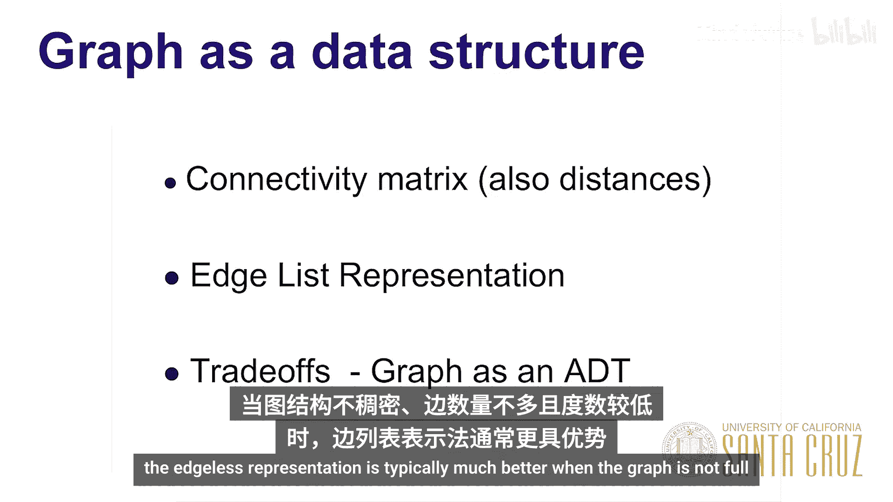
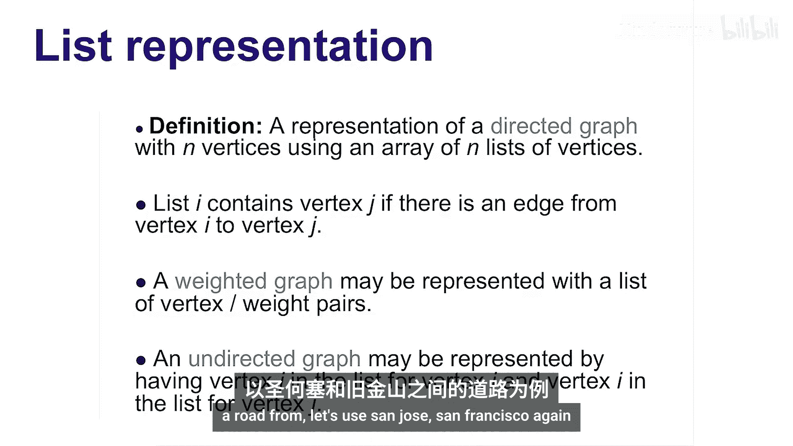
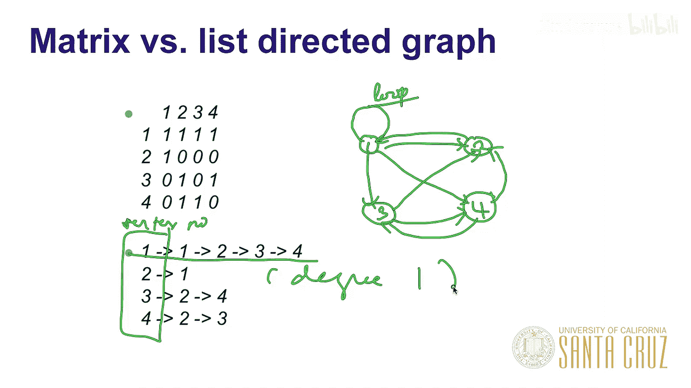
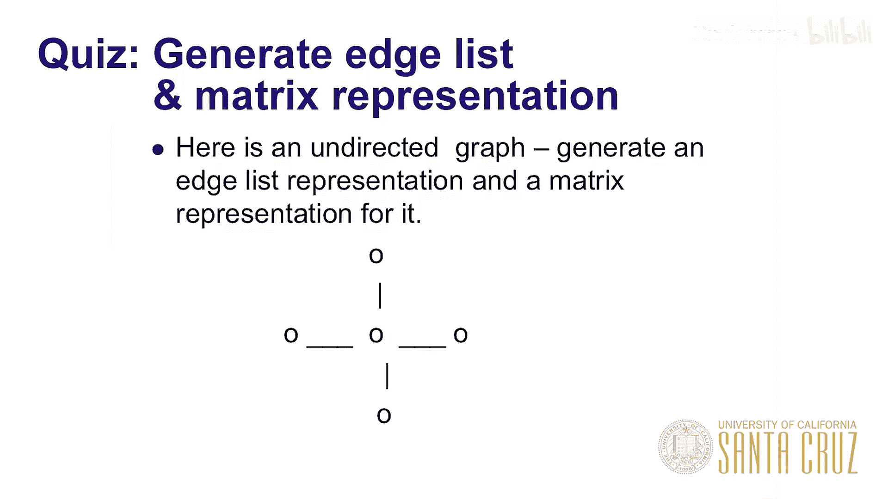
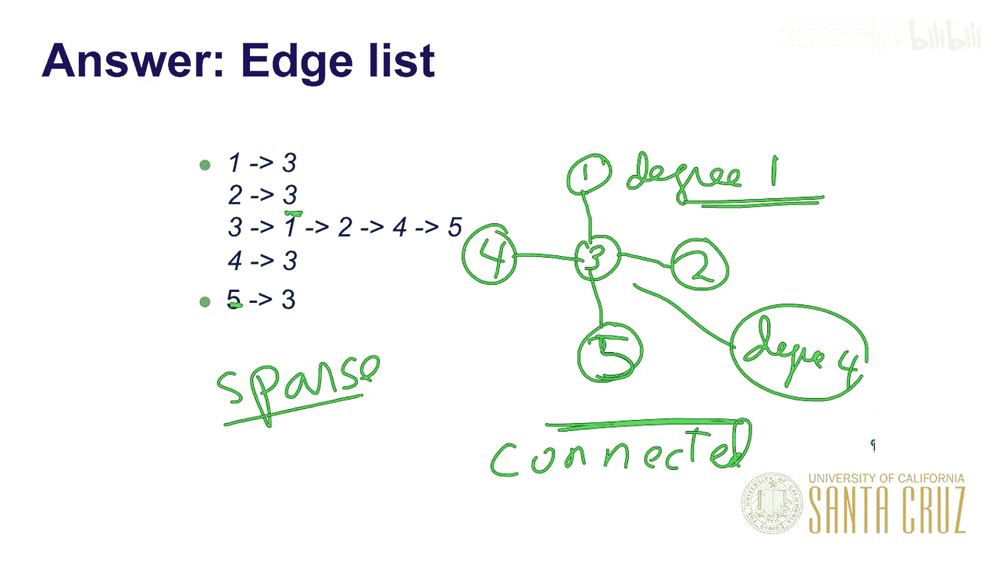

# 数据结构与算法：P14：作为数据结构的图

## 概述
在本节课中，我们将学习如何在计算机中表示图这种数据结构。我们将介绍两种主要的表示方法：邻接矩阵和邻接表，并分析它们各自的优缺点和适用场景。

---

## 图的计算机表示
当我们在计算机上使用图时，需要创建一种内部数据结构来表示它。例如，尝试表示一个完全图K4。

在计算机科学中，有两种主要的表示方法。一种称为邻接矩阵，另一种称为邻接表。这两种方法各有优劣。对于数据结构而言，总是存在权衡。对于某些算法和某些图，一种表示方法可能比另一种具有显著优势。典型的权衡涉及**需要存储多少数据**以及**算法的效率如何**。因此，确实可能存在一种表示方法对于特定问题需要太多存储空间，而另一种表示方法可能需要太多的处理时间。我们发现这两种方法都非常有用，有时在同一个问题中，我们可能希望同时使用两者。

总体而言，如果你主要熟悉邻接表表示法，那么邻接表通常在**图不是完全图**、**边数不多**、**节点度数不高**的情况下表现更好。

## 稀疏图与稠密图
假设你有一个大小为100的图，意味着有100个顶点或节点。如果该图的平均度数大约是4，那么对于100个节点，你大约会有400条边。这被认为是**稀疏图**。

但是，如果你有一个100个节点的图，平均度数为50或60，那么你将拥有大量的边，这将是**稠密图**。

通常的经验法则是：对于**稠密图**，矩阵表示法通常更好；对于**稀疏图**，邻接表表示法更好。大多数现实世界的问题都是相对稀疏的。

## 邻接表表示
一个有n个顶点的有向图可以用一个列表来表示。例如，一个包含n个列表的数组，其中列表`i`表示标记为数字`i`的节点`i`所能直接连接的每个顶点，即从节点`i`可以到达的每个顶点`j`。

此外，在图论术语中，你可能不仅需要边，还需要边上的**权重**或**成本**。例如，从旧金山到圣何塞大约60英里，这可能是一个成本。而旧金山到马林县可能只有2英里。在路径规划中，你的车载计算机通常会尝试为你找到基于时间或距离的**成本最低**的路线。这就是**加权图**。

## 无向图
对于无向图，例如我们之前讨论的K4，任何时候你有一条从旧金山到圣何塞的路，你都可以使用同一条路返回。许多问题我们只考虑无向图以避免有向图的复杂性，但处理有向图并不难得多。我们将双向道路视为无向边，而单向道路则是有向边。我将讨论的所有算法都可以很容易地适应有向图的情况。

## 矩阵与列表对比
以下是同一个图的矩阵表示与列表表示。

这是一个包含四个节点的图：节点1、节点2、节点3、节点4。

在矩阵表示中：
*   条目`(1,1)`表示一个自环（通常我们不关心自环）。
*   条目`(1,2)`、`(1,3)`、`(1,4)`表示从节点1到节点2、3、4有边。
*   节点2只有一条边连接到节点1。
*   节点3有两条边，分别连接到节点2和节点4。
*   节点4有两条边，分别连接到节点2和节点3。

在邻接表（边列表）表示中，我们有四个列表，对应四个节点：
*   节点1的列表包含：1（自环）、2、3、4。
*   节点2的列表包含：1。
*   节点3的列表包含：2、4。
*   节点4的列表包含：2、3。

你应该能够做到我刚才所做的事情：从一个给定的图生成这两种表示中的任何一种。这是一项重要的技能。

## 小测验
以下是一个无向图，意味着每条边可以双向通行。它有5个节点和4条边。请为其生成邻接表表示和邻接矩阵表示。

以下是答案。

**邻接矩阵表示**：
矩阵是对称的，因为图是无向的。
*   节点1连接到节点3。
*   节点2连接到节点3。
*   节点3连接到节点1、2、4、5。
*   节点4连接到节点3。
*   节点5连接到节点3。
*   没有自环。

**邻接表表示**：
由于这是一个稀疏图（大多数节点度数为1），邻接表很简洁。
*   节点1的列表：3
*   节点2的列表：3
*   节点3的列表：1, 2, 4, 5
*   节点4的列表：3
*   节点5的列表：3

注意，这个图是**连通图**，这是一个当我们开始设计算法时会感兴趣的性质。节点3的度数为4，其他所有节点的度数均为1。

---

## 总结
本节课中，我们一起学习了图的两种核心计算机表示方法：**邻接矩阵**和**邻接表**。我们了解了它们的区别，并分析了在**稀疏图**和**稠密图**中如何根据存储空间和算法效率进行选择。我们还通过实例练习了如何根据给定的图生成这两种表示，并接触了**加权图**、**有向/无向图**以及**连通图**等基本概念。掌握这些表示方法是理解和实现图算法的基础。