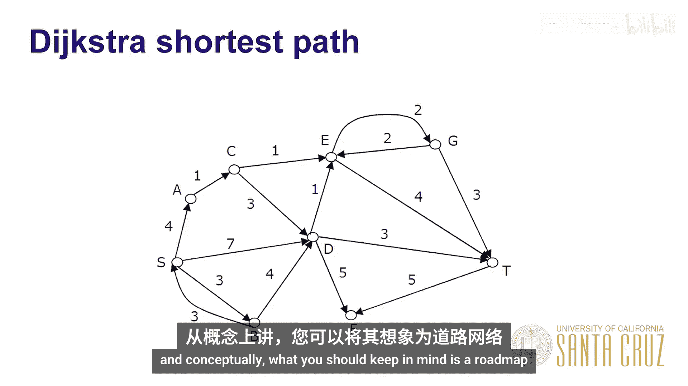
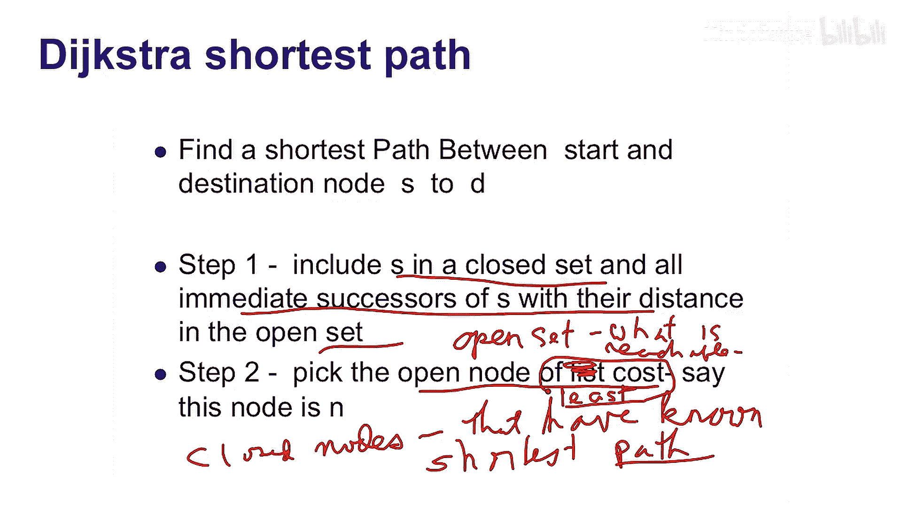
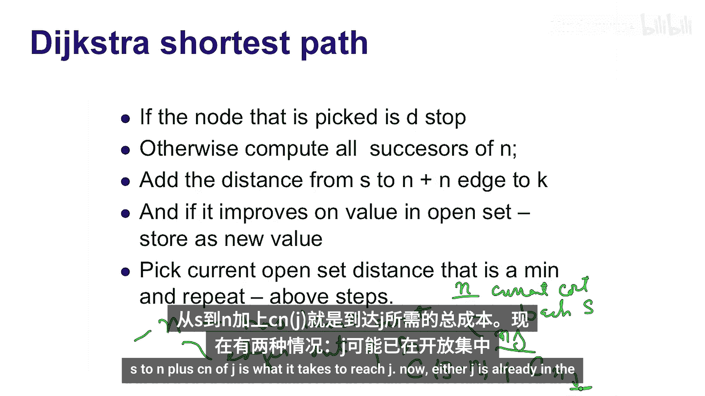
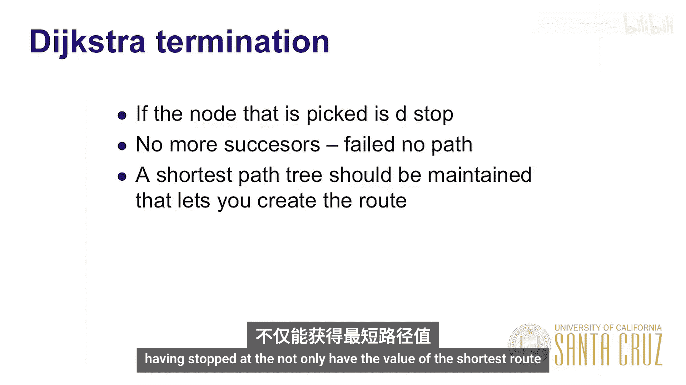
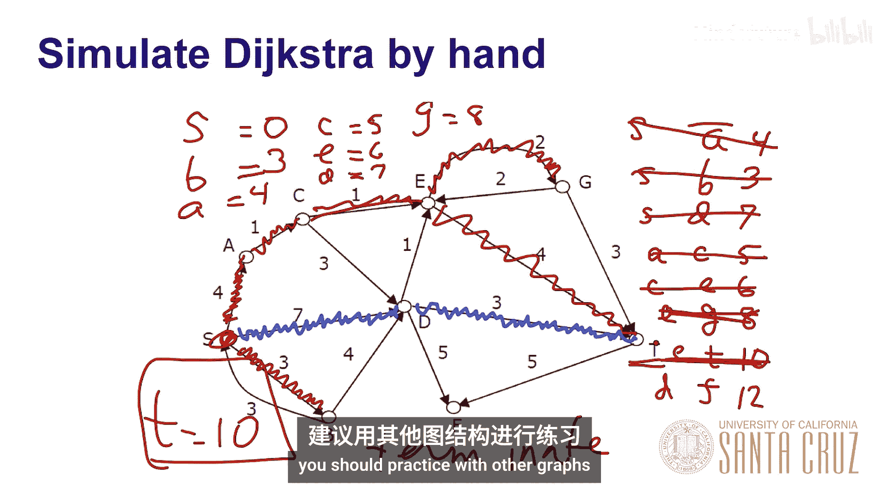
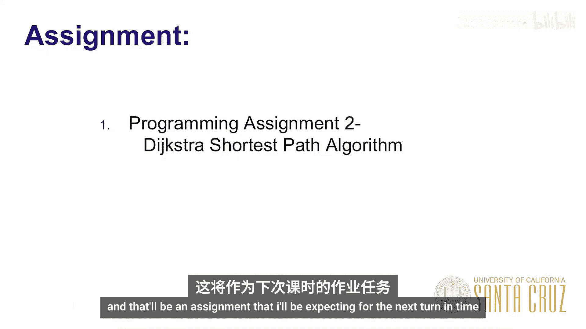

# 【加州大学】C++编程-｜-C-Plus-Plus-A-p15-P15_2-5-迪杰斯特拉最短路径_02_01_06--BV1p2ejzREUQ_p15-

Oh， now we're going to describe one of the most important algorithms in computer science。

 the diyke'stra shortest path algorithm。Edririck Dktra is a Dutch computer scientist。

And is one of the most important figures in modern computer science。 He was involved in。

Computer language design， ideas in compiling， ideas in the semantics， correctness of programming。

And he invented a number of very， very clever and important algorithms。嗯。Dyextra started his career。

In the Netherlands。At the mathematical cent， and later became a professor。

At the University of Texas in the United States。 and he's also one of the very first people to win the Turing Award。

 which hopefully most of you know about， but if you don't。

The people who've won the Turing Award are what the analogy is。MaArthur Prizes or Nobel Prizes。

 We don't have such things in computer science， per se。 And the touring award is。

Considered our Nobel Prize。So in the diyketra short as path algorithm we're going to describe。

 we're going to use undirected graphs with weightings with costs。

 the costs are going to all be non negative。And。Conceptually。

 what you should keep in mind is a roadmap。

And the canonical problem is finding a shortest route from one place to another。

 So if you're looking for a road trip and you're going between Chicago and Los Angeles and you want a shortest path。

 you have a very big map。 Lots of roads， You typically might go to AaA and get some。

Specific assistance， or nowadays you could just use your onboard。

Triip computer and they indeed in some important sense。

 embed the ditra algorithm we're going to learn。How to program this critical algorithm。

 and indeed it's going to be。Our next programming assignment。

So the idea is we have a source and a destination。Chicago。To Los Angeles。And。

Between the source and destination。We want to find a shortest path。

The critical steps and the extra algorithm。Are to maintain what I call two sets。

One is a set of closed nodes。The closed nose。I know that。Have have known。Shortest distances。

Now if we're starting from Chicago。What do we know right off the cuff。

 We know the shortest distance from Chicago to Chicago。 That's zero。That's like the trivial case。So。

The algorithm would start with the source node being put in the closed set。

And that source node would have value0。And then， in the open set。

We would look for immediate successors of S and place their distance in the open set。

 So the open set。I's what's reachable。And any time in the open set。

 we have what's reachable and we have a calculation based on the edge cost。From。

Things in the close set。And what we do， our major iterative step is we pick the open node in that list whose cost is lease。

 Pick the open node。Who has least cost。Whoops list cost， Not this cost。Race cost。Confusing。

 list and least。K。

If in this iterative step， we pick a node that is the termination node if we。

Are moving along from Chicago， and we've reached Los Angeles and Los Angeles gets thrown in the close that we can stop。

The algorithm guarantees that when the destination node。Is placed in the close set。

 calculation is provably a shortest distance。If。The destination node is not the node picked as the next lease node from the open set。

We compute all the direct successors from that node。So， if that node。Zi。And as least cost。

We look at the edges。Out of end。And they have a cost。 They might be cost of。Andja。

Where NJ are the determiners of the edge。And n will have a value， which is its value。

OfThe cost from S from the source。 So n has some cost。Some current。Cast。Back to S。And that costs。

 whatever that is。As to N。Plus。CNF J。Is what。It takes to reach Jay。Now。

 either J is already in the open set。

We have like three cases。 J is in the close set。 If J was already in the close set。

 we don't need to bother with it because we already know by the nature of the Dster' algorithm that we have a shortest path to J。

If J is not in the open set or the closed set。Then we put it in the open set。 We now have a new path。

 a way to get to J。 So we're somewhere past Chicago， maybe we're。Approaching Kansas City。

And we haven't yet reached Kansas City in any kind of path that we've calculated。

 And we see we can get to Kansas City that would be placed in the open set with whatever its value is。

 trace back to Chicago。In the last case is， we already had an alternative route。

 We had a pre computed route。 So J or Kansas City， in this case， was already in the open set。

 but this new route improves on the old route。Because we're trying to search for least costly paths。

 in that case， we update the path， so we have three conditions。Open set。A possibility for updating。

 or it's already in the close set。And then if the node D is picked， we stop。

There's no further need to look for successors。 or if there's no more successors， we can't get to D。

 So if we tried to go from Chicago to Honolulu。We would find all sorts of paths that places like Seattle and El Paso and God knows what else Los Angeles。

 but we would have no。Road route to Honolulu。 So we would exhaust if we had tried to put into our。呃。

Travel computer。Find me a road from Chicago to Honolulu， it would stop。And otherwise。

 some shortest path tree is maintained in the calculation， and that lets us when it's done。

 having stopped at the not only have the value of the shortest route。

 but be able to trace back the shortest route。

So I'm going to simulate Dktra by hand。And I'm going to simulate it on this next map。

And I'm going to draw things in red， and I'm going to start with this。

And I'm going to want to get us to tea。In this case， I'm doing it in。A directed graph。

 This was just a case that I。I've manufactured and I'll show it to you in the direct case。

But it shouldn't be any different in the undirected case。So initially in the open set。S has value 0。

And then， S can reach a。So。This is the close set。And。Its value is4。S can reach B。And its value is 3。

S can reach。D。😊，And its value is 7。And that's it。The out degree edges of s are3。

So now we look at the open set。We pick S equals B。So B comes into the closed set。With value 3。So。

 in some sense。The Etras algorithm has picked out this。And now B becomes the node we expand from。

And so we search B now B can go back to S。But that's not a value since that is in a closed set。

And B can go to D。 So we have to check if B went to D， it would be 3 plus 4。

But we already have D at7， so there's no reason to update it。And that's the only two ways we can go。

 so there isn't anything new in the open set。So we would come back and we would get as our lease value。

 a。Whose value is4。And so now。Our Dyketra's shortest path tree would be。At this point。

 in the second iteration。Also， S going to a with four。 Now， a has some new things we can go to。

 So from a， we can go to C。The value was 4 plus  one。 So now it's 5。And that's the only thing。

A can go to。But5 is indeed， the best value。So we put in。C in the close set。With C's value equal5。

And C can reach E。With value 6 and C can reach D。And that would be value。8ight。

Eight doesn't improve on seven， so we don't update that。But we can go C E， and that's value 6。

 So now we cross out this。We get E， we get it equals 6。We go back and we find we can go to E。Oop， no。

 he already went to6。 Excuse me。 We go back。And E is now in the open set。E has to be expanded。

So we we can look at。E to D。 Now， he can't go to D directly。 That's the wrong direction。

 But E can go to G and G。Is value 8。And he can go to tea。So it can go to G for evaluate8。

 can go to T。And that's value 10。Now， just because it can reach tea， which is our destination。

 the terminus。Doesn't mean we go there because this is still in the open set。

 The only time we're guaranteed a best or least costly path is when something's been stored in the in the close set。

 and there's still values less than 10。 So they have to be explored。

 The next value that needs to be explored is S going to D at 7。

 So S going to D at 7 X D equals 7 in the close set。And then we have D can go to F。So7 plus5 is 12。

D from here can go to。T， so that's。7 plus three， which is 10， but theftTA hasn't improved the value。

 so we don't update anything。And D can go to E， but E is in the closed set。

 so we don't do anything with that either。So here we go back。We look， we got an E going to G at 8。

And from8， we can go back to E。 E's already in the close set。 We can go from G to T。

 but 8 plus 3 is 11。 We don't improve on 10， So we leave it alone。We're done with the updates。

 We come back， select the node， and now we find E to T， which is value 10。And eat a tea。So。

 T equals 10。We can terminate。And if we keep our。Backlink。In this map。

 we can even find the shortest path。 Now， notice it wasn't unique。

 We could have found the shortest paths， which would have been S to D and D to T。

 That would have also been 10。 So this doesn't guarantee any kind of uniqueness。

 but it does guarantee that we get a least costly path。You should practice with other graphs。

And the assignment I'm giving out now is that you will try to do a diketra short as path algorithm。

 which will mean that you need to decide on a representation。啊。

My recommendation is the list representation， it's a little more flexible。

 but it's perfectly okay if you do the。Matrix representation or even do both。

 depending on how ambitious you are， and that'll be an assignment that I'll be expecting for the next turn in time。

