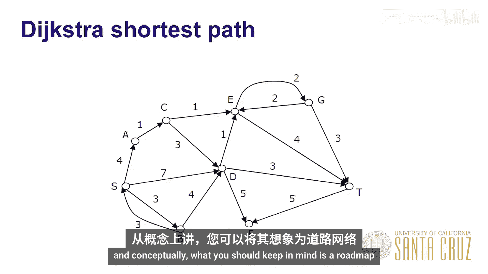
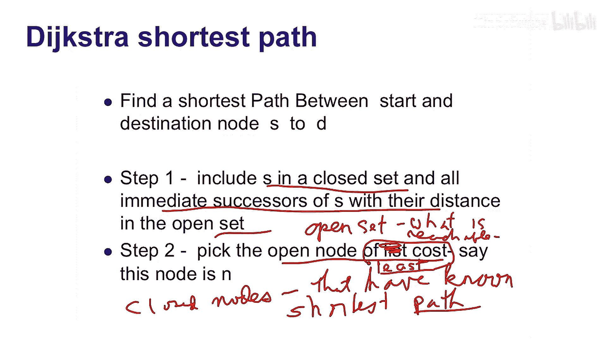
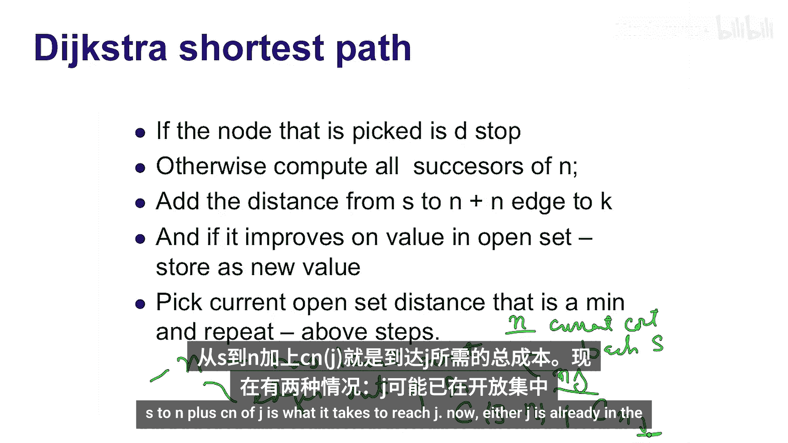
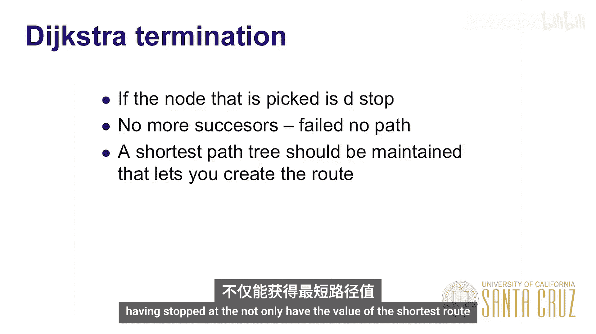
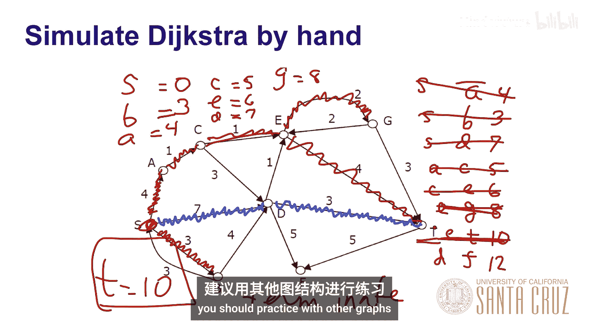
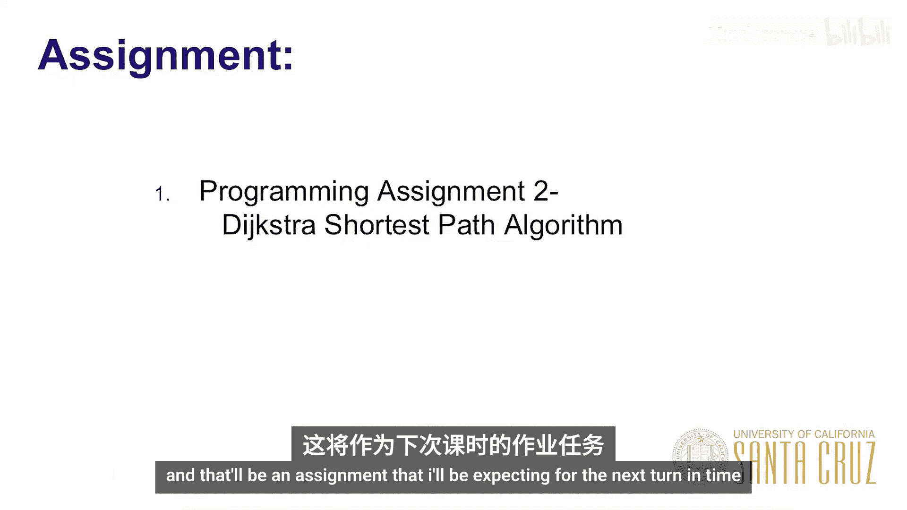

# C++编程：P15：迪杰斯特拉最短路径算法详解 🧭

在本节课中，我们将学习计算机科学中最重要的算法之一：**迪杰斯特拉最短路径算法**。我们将了解其发明者、核心思想，并通过一个手算示例来演示其工作原理。最后，我们将讨论如何将其应用于编程作业中。

---

## 算法背景与发明者

上一节我们提到了迪杰斯特拉算法的重要性，本节中我们来认识一下它的发明者。

艾兹赫尔·迪杰斯特拉是一位荷兰计算机科学家，也是现代计算机科学领域最重要的人物之一。他参与了计算机语言设计、编译思想、编程语义和正确性等领域的研究，并发明了许多非常巧妙且重要的算法。

迪杰斯特拉的职业生涯始于荷兰的数学中心，后来成为美国德克萨斯大学的教授。他也是最早获得图灵奖的人之一。图灵奖在计算机科学领域的地位，类似于麦克阿瑟奖或诺贝尔奖。

---

## 算法核心概念与问题

了解了发明者后，我们来看看这个算法要解决什么问题。

在迪杰斯特拉最短路径算法中，我们使用带有权值（成本）的无向图，且所有权值均为非负数。其核心概念可以类比为**寻找地图上的最短路线**。

一个典型的问题是：找到从芝加哥到洛杉矶的最短行车路线。你有一张包含许多道路的大地图。如今，车载导航电脑在某种程度上就嵌入了我们将要学习的迪杰斯特拉算法。

算法的目标是：给定一个源点（如芝加哥）和一个目标点（如洛杉矶），在它们之间找到一条成本最低的路径。

---

## 算法核心步骤

明确了问题，接下来我们深入算法的核心机制。

迪杰斯特拉算法的关键步骤是维护两个集合：
*   **封闭节点集**：其中的节点，我们已经**确知**了从源点到该节点的最短距离。
*   **开放节点集**：其中的节点，我们已经找到了从源点到达该节点的**一条**路径及其距离，但这**不一定**是最短距离。

算法开始时，源点 `S` 被放入封闭集，其距离值为 `0`。然后，算法查看源点的所有直接后继节点，将它们及其通过 `S` 到达的成本放入开放集。

以下是算法的主要迭代步骤：

1.  **选择**：从开放集中选取**成本最低**的节点 `N`。
2.  **终止检查**：如果选中的节点 `N` 就是目标节点 `D`，则算法结束。此时，`D` 的成本值就是最短距离。
3.  **扩展**：如果 `N` 不是目标节点，则将其从开放集移至封闭集。然后，检查 `N` 的所有直接后继节点 `J`。
4.  **更新后继节点**：对于每个后继节点 `J`，计算一条经由 `N` 到达 `J` 的新路径成本：`cost_to_J = cost_to_N + cost_of_edge(N, J)`。根据 `J` 的当前状态，分三种情况处理：
    *   如果 `J` 已在**封闭集**，则忽略它，因为到 `J` 的最短路径已知。
    *   如果 `J` 不在**开放集也不在封闭集**，则将 `J` 加入开放集，并记录其成本为 `cost_to_J`。
    *   如果 `J` 已在**开放集**，但新路径成本 `cost_to_J` 小于其当前记录的成本，则用更小的成本值更新 `J`。

5.  **循环**：重复步骤1-4，直到目标节点被选入封闭集，或者开放集为空（表示目标不可达）。

在计算过程中，算法会维护一个“最短路径树”，使我们能在算法结束时，不仅知道最短距离的值，还能回溯出具体的路径。

---

## 手算示例演示

理论步骤可能有些抽象，让我们通过一个具体的手算例子来巩固理解。

假设我们有以下有向图（算法同样适用于无向图），目标是找到从源点 `S` 到目标点 `T` 的最短路径。图中边上的数字代表成本。

（此处应有图示，描述节点 S, A, B, C, D, E, F, G, T 及连接边的权重）

**初始状态**：
*   封闭集：`{ S(0) }`
*   开放集：`{ A(4), B(3), D(7) }` （从S可直接到达）

**迭代过程**：

1.  开放集中最小成本节点是 `B(3)`。将其移入封闭集。
    *   扩展 `B`：后继 `D` 的成本为 `3+4=7`，不比开放集中已有的 `D(7)` 更优，无需更新。
    *   封闭集：`{ S(0), B(3) }`
    *   开放集：`{ A(4), D(7) }`

2.  开放集中最小成本节点是 `A(4)`。将其移入封闭集。
    *   扩展 `A`：后继 `C` 的成本为 `4+1=5`。`C` 是新节点，加入开放集。
    *   封闭集：`{ S(0), B(3), A(4) }`
    *   开放集：`{ D(7), C(5) }`

3.  开放集中最小成本节点是 `C(5)`。将其移入封闭集。
    *   扩展 `C`：后继 `E` 成本 `5+1=6`（新节点，加入）；后继 `D` 成本 `5+3=8`，比现有的 `D(7)` 差，不更新。
    *   封闭集：`{ S(0), B(3), A(4), C(5) }`
    *   开放集：`{ D(7), E(6) }`

4.  开放集中最小成本节点是 `E(6)`。将其移入封闭集。
    *   扩展 `E`：后继 `G` 成本 `6+2=8`（新节点，加入）；后继 `T` 成本 `6+4=10`（新节点，加入）。**注意**：虽然发现了到 `T` 的路径，但成本 `10` 并非当前开放集中最小，不能保证是最短，故继续。
    *   封闭集：`{ S(0), B(3), A(4), C(5), E(6) }`
    *   开放集：`{ D(7), G(8), T(10) }`

5.  开放集中最小成本节点是 `D(7)`。将其移入封闭集。
    *   扩展 `D`：后继 `F` 成本 `7+5=12`（新节点，加入）；后继 `T` 成本 `7+3=10`，与开放集中 `T(10)` 相同，不更新；后继 `E` 在封闭集，忽略。
    *   封闭集：`{ S(0), B(3), A(4), C(5), E(6), D(7) }`
    *   开放集：`{ G(8), T(10), F(12) }`

6.  开放集中最小成本节点是 `G(8)`。将其移入封闭集。
    *   扩展 `G`：后继 `T` 成本 `8+3=11`，比现有的 `T(10)` 差，不更新。
    *   封闭集：`{ S(0), B(3), A(4), C(5), E(6), D(7), G(8) }`
    *   开放集：`{ T(10), F(12) }`

7.  开放集中最小成本节点是 `T(10)`。**这就是我们的目标节点**。算法终止。

**结果**：从 `S` 到 `T` 的最短路径成本为 `10`。通过回溯路径树（本例中路径为 `S -> A -> C -> E -> T`），可以得到具体路径。注意，最短路径可能不唯一（例如 `S -> D -> T` 成本也是10），但算法保证能找到其中一条。

你应该用其他图进行练习以加深理解。

---

## 编程作业与应用

掌握了算法原理，最后我们来看看如何将其付诸实践。

接下来布置的作业，就是要求你实现迪杰斯特拉最短路径算法。这意味着你需要决定图的表示方式。

我的建议是使用**邻接表**表示法，它更灵活。但使用**邻接矩阵**表示法也完全可以，甚至可以根据你的积极性两者都实现。这将是下次需要提交的作业。

---

## 总结

本节课中我们一起学习了迪杰斯特拉最短路径算法。我们了解了其发明者迪杰斯特拉教授的贡献，明确了算法解决的是带权图中的单源最短路径问题。我们深入剖析了算法通过维护开放集和封闭集来逐步确定最短路径的核心步骤，并通过一个详细的手算示例演示了整个过程。最后，我们指出了在编程实现中需要考虑的图表示方法。这个算法是许多实际应用（如网络路由、地图导航）的基础，理解其原理至关重要。