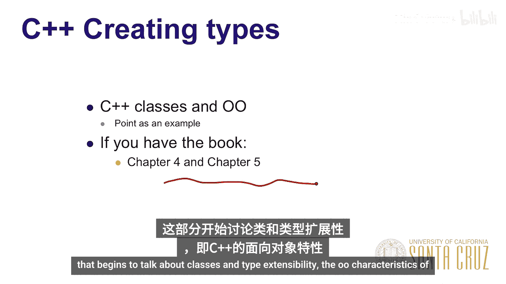
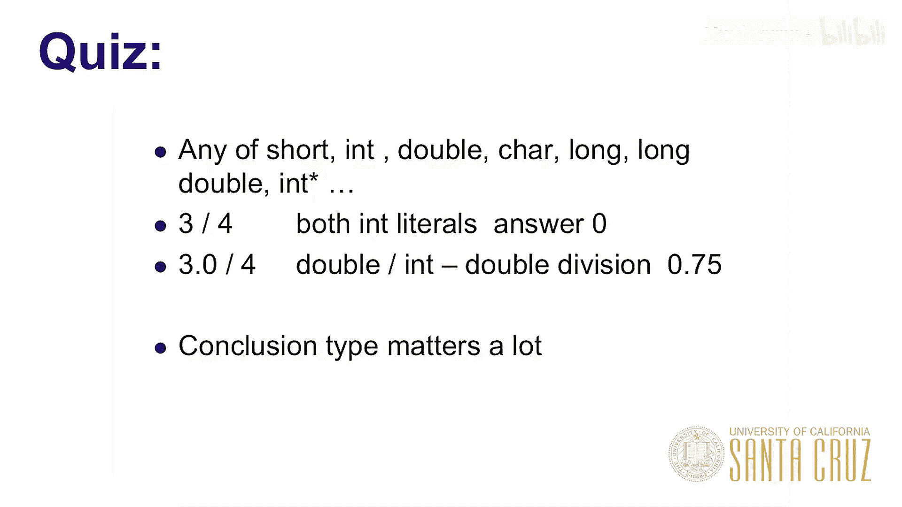
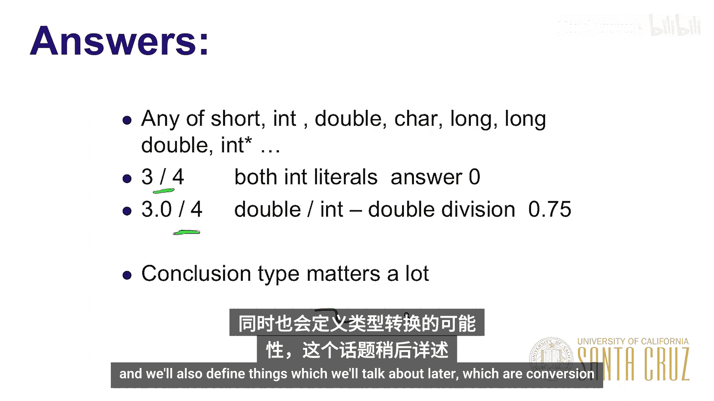
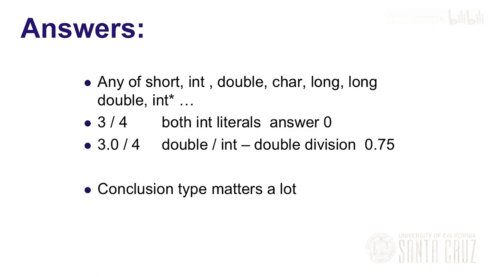

# 【加州大学】C++编程-｜-C-Plus-Plus-A-p16-P16_2-6-C++创建类型_02_01_07--BV1p2ejzREUQ_p16-

Okay， today we're going to get to。A critical topic in object oriented programming。

So C+ plus so far has been a better C。And as a better see。It still can be used， much as。

Old standard Carnegie and Richie C was used。An imperative systems implementation language。

 nothing changes。We just have improvements。 so far， we've emphasized those improvements。

But in today's。Lectures， where you're going to talk about how you can become an object oriented programmer using the methodology that was pioneered by the small talk people at park。

In the 80s。 and then when。Pushed by Bjorn Strstrip。At Bell Labs in the mid 85。

Release of the first form of C++， which caught on immediately。

 it just changed industry's perspective。On。Using one language effectively for most problem domains。

 So oh， oh， lets us。Vastly expand the usability。Of the C language。

And we're going to take as an example， a very， very simple example of why we're doing that is because it's something that you'll。

Intuitively understand， it's a point in the X Y plane we've been working with points ever since grade school。

So that's a natural object to talk about。And then if you're following along in the text。

 the point at which you should be reading now is chapters 4 and5。

 that begins to talk about classes and type extensibility， the O0 characteristics of C plus plus。

So let's review your C programmers。You need to keep this in mind when you go over to O0。

So I'd like you to name three native types in C。And then if you have the expression，3。

 divide symbol 4。What is its value， This is all in the context of C。

And if you have the expression in 3。0， divide for， what is its value。

 So all of you are C programmers， this should be。Trivial。Yeah。Okay。

See， the native types， the native types of the C language， and therefore。

 the native types of the C plus plus language include short int， double char， long， long。

 double in star， all sorts of。Basic pointer types。啊。

So these are any of the essential native types of language， anything involving those types。

 you just declare them with those keywords that determine those types。

 and then you can use the language。Relatively easily and efficiently， if those types。

Are expressive of the problem domain。Three divide four is zero， and this always is a gotcha。Why。

 because。Divide when it sees two interteger arguments。It does enter your division。

So the full part of it， it does。 It just falls off。 It has to be in the next answer，3。0， which is a。

Double literal。 It's a constant in the double domain。And when you divide a double by an in。

 then you're in the double domain， and then you get the。Possibly intuitive answer three quarters。

So what we're learning from the C native types is type matters， type matters in very important ways。

And。We have to be very careful。About use of types， Because use of types will also define the character。

Of。How the operator。Is determined。And we'll also define things which we'll talk about later。

 which are conversion opportunities。

All this gets more complex than C plus plus， because in C plus plus we add。To the native types。

 we extend the native types。 That's the heart。Of object oriented programming。

