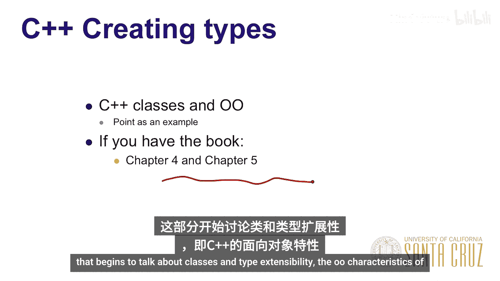
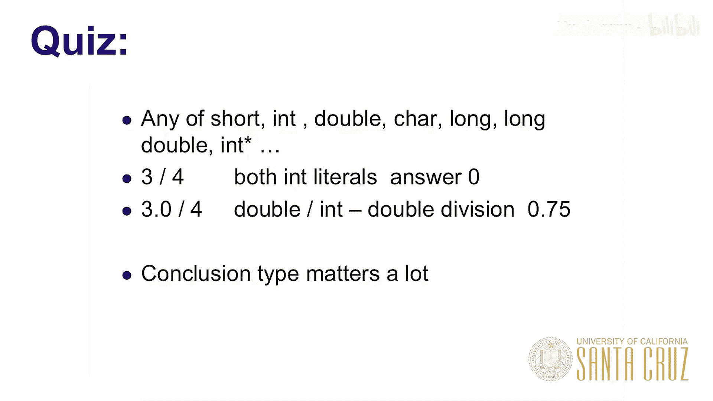
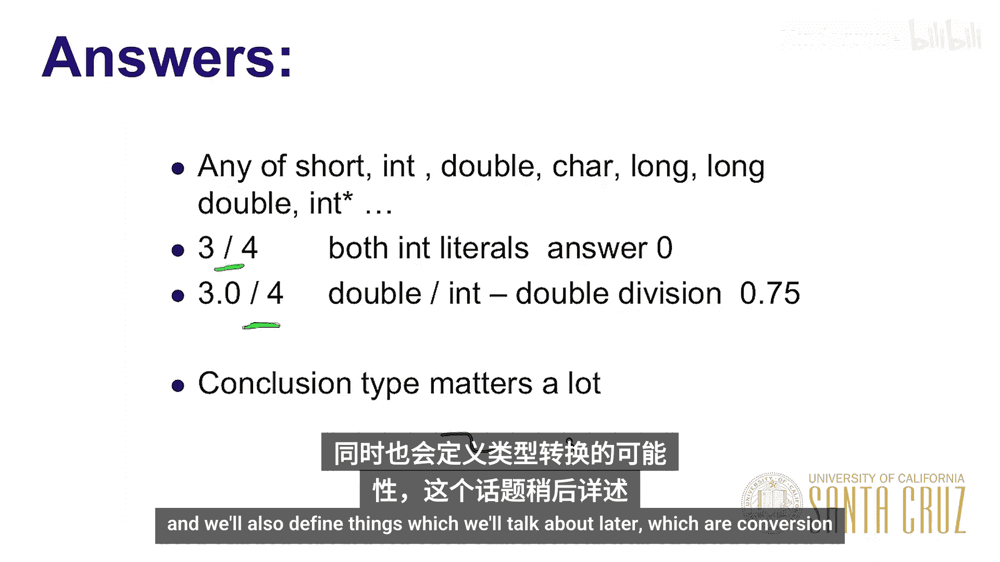
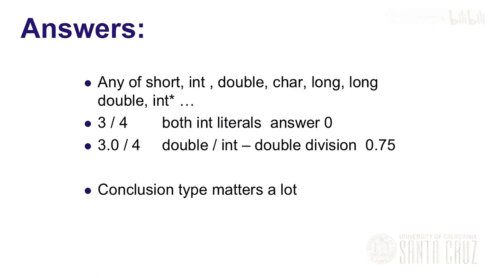

# C++编程：P16：C++创建类型

## 概述

在本节课中，我们将学习C++面向对象编程的一个核心主题：类型扩展。我们将从回顾C语言的基础类型开始，理解类型的重要性，然后探讨C++如何通过引入“类”的概念来扩展语言的内置类型，从而实现面向对象编程范式。

---

## 从C到C++：类型的演进

上一节我们回顾了C++作为“更好的C”的特性。本节中，我们来看看C++如何超越C，成为一个支持面向对象编程的语言。

C++最初被设计为“更好的C”。作为一个系统实现语言，它保留了C语言的所有能力，同时增加了许多改进。到目前为止，我们主要关注了这些改进。然而，从本节课开始，我们将探讨如何使用C++进行面向对象编程。这种方法论最初由施乐帕克研究中心在80年代的Smalltalk语言中开创，随后由贝尔实验室的比雅尼·斯特劳斯特鲁普在1985年推出的C++中推广。C++的出现立即改变了工业界对使用单一语言有效解决大多数问题领域的看法。

C++允许我们极大地扩展C语言的可用性。我们将以一个非常简单的例子来说明这一点：二维平面上的一个点。我们从小学就开始接触点，因此这是一个非常自然的讨论对象。

如果你正在阅读教材，现在应该阅读第4章和第5章，这两章开始讨论类、类型扩展以及C++的面向对象特性。

---

## C语言基础类型回顾

作为C程序员，在转向面向对象编程时需要牢记一些基础概念。让我们先回顾一下C语言中的原生类型。

以下是C语言（以及C++语言）中的一些基本原生类型：
*   `short`
*   `int`
*   `double`
*   `char`
*   `long`
*   `long double`
*   `int*`（以及所有基本指针类型）

任何涉及这些类型的变量，你只需使用相应的关键字声明即可，然后就可以相对轻松高效地使用语言，前提是这些类型能够表达问题域。

---

## 类型的重要性：一个关键例子

类型在编程中至关重要，其影响方式非常关键。我们必须非常小心地使用类型，因为类型的使用也会定义运算符的行为。

考虑以下两个表达式及其值：
*   `3 / 4` 的值是 **0**。
*   `3.0 / 4` 的值是 **0.75**。

第一个表达式 `3 / 4` 的结果是零，这常常让人困惑。原因是：当除法运算符 `/` 看到两个整数参数时，它会执行**整数除法**。结果的小数部分会被直接舍弃。

第二个表达式 `3.0 / 4` 中，`3.0` 是一个双精度浮点数字面量。当你用一个双精度数除以一个整数时，运算会在双精度域中进行，因此你会得到可能更直观的答案：四分之三。

这个例子告诉我们：**类型至关重要**。类型不仅决定了数据的存储方式，还决定了对其进行的操作（如这里的除法）的行为。

---

## C++的类型扩展：面向对象的核心

在C++中，类型的重要性变得更加复杂，也更为强大。因为C++在原生类型的基础上进行了**扩展**。这正是面向对象编程的核心。

C++允许我们创建新的类型，这些新类型可以像内置类型一样被使用。这是通过 **`class`** 关键字实现的。通过定义类，我们可以将数据（属性）和对这些数据的操作（方法）捆绑在一起，形成一个完整的、可重用的抽象单元。

例如，我们可以创建一个 `Point` 类来表示二维平面上的点，这个类可以包含 `x` 和 `y` 坐标数据，以及移动点、计算距离等方法。这样，`Point` 就成为了语言中一个全新的、功能完整的类型。

---

## 总结

本节课中，我们一起学习了C++面向对象编程的起点：类型扩展。我们首先回顾了C语言中原生类型的重要性，并通过整数和浮点数除法的例子，深刻理解了类型如何决定运算行为。最后，我们引出了C++最强大的特性之一——允许程序员通过定义**类**来创建新的自定义类型，从而将数据和操作封装在一起，这正是面向对象编程的基石。在接下来的课程中，我们将深入学习如何定义和使用类。