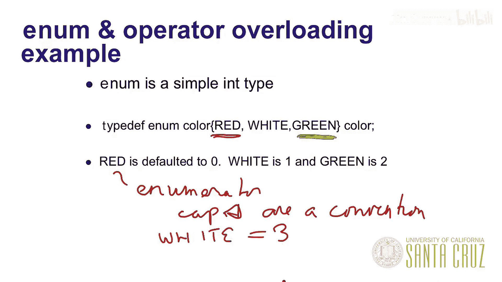
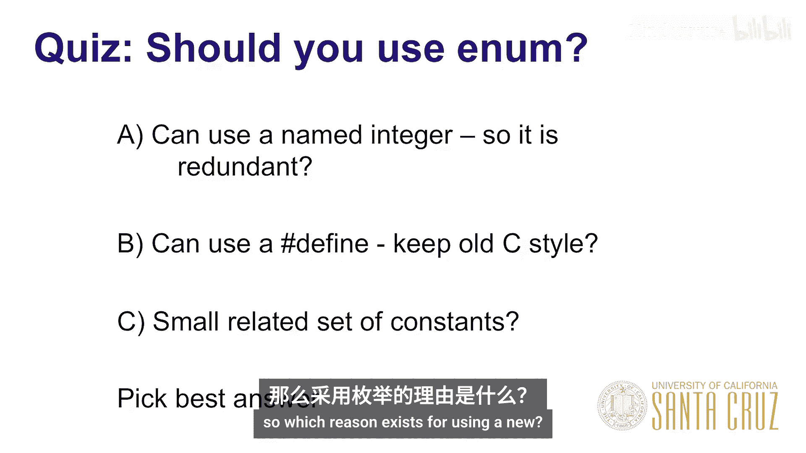
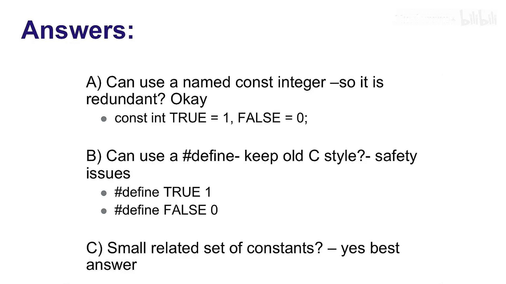

# 【加州大学】C++编程-｜-C-Plus-Plus-A-p17-P17_2-7-枚举运算符重载_02_01_08--BV1p2ejzREUQ_p17-

Object oriented programming lets us program naturally in new domains。

 domains that not necessarily have types in the native language that fit the domains， so for example。

 we might want to write programs that involve manipulation of colors。

 imagine having a windowing system。And inside your windowing system。

 you have different menu options and possibly within the menu options。

 you're using color to have different levels of expressivity。So you might want。A color type。

This is a simple form of type extensibility， typically colors。

Could be defined as a small discrete set of items。 So here we see an enumerated type。

 which is one form of type extensibility in the C plus plus language that has a color red。

A color white。And a color green。Now with these colors。

This is basically a form of simple integer type， and the reason we use capital red is that's just。

That's an identifier， that's an enumerator。It's a nuome ID。And capitalization。Our convention。

They just highlight that we're。Expressing a form of integer constant。And red。

 when no value is specified， will be automatically assigned 0。

 That's in the old grand tradition of the sea community。 Everything starts at0。

 White will be one and green will be2。 And that's what we'll do normally。

 We also will have the ability to override。These values， by being explicit。

 we could say white is three， and that would mean red it starts at zero， white starts at three。

 and then the sequence continues from three to4。

Now。Why should we use a num some of you have experience in nu a noum was added even to the C language and so you can in many other programming language there are enumerated types so multiple choice question just take a second。

Can you used a named integer instead of an enumerator type to get that kind of constant？

Can you use a sharp define， much like in the preprocessor keeping C old style for these enumerator constants like red and white？

Or is it best to have a small related set of constants so which？Reason。Exists for using。A nope。

It is quite true。That。You could just use a constant declaration， for example。

 if we wanted true and false as two related constants。

 we could say constant and true is one false is zero， and then we'd have that。

 we can also use this in old seat， but again there are safety issues。But。

Enumerated types are even better than either of these others， where there is。

A grouping of related constants where you want to think about it as type extensibility and not just arbitrary named integer constants。

