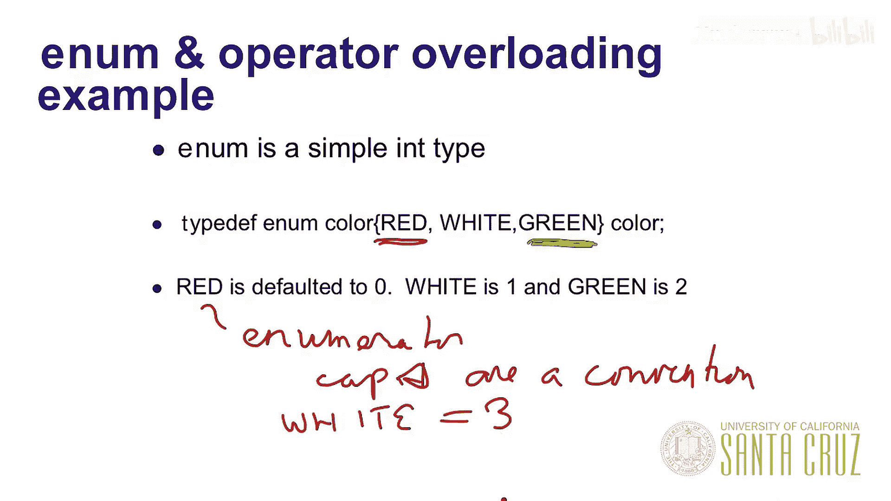
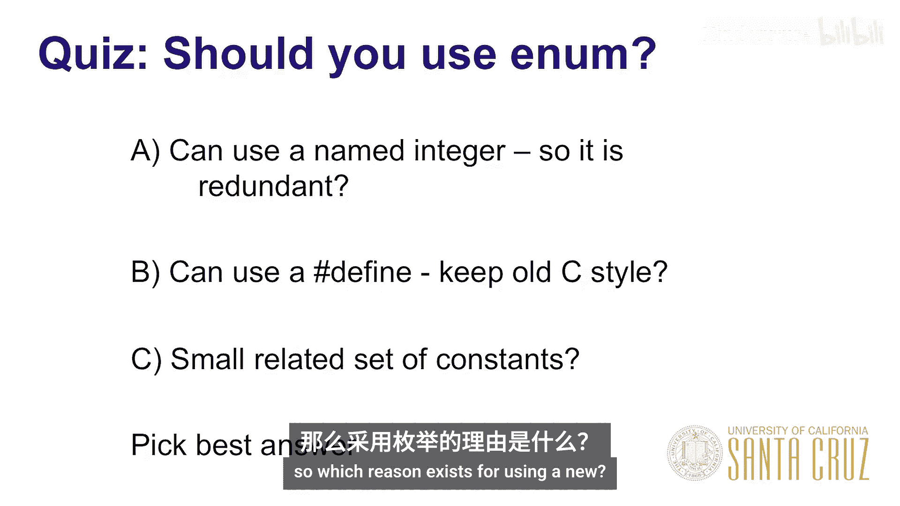
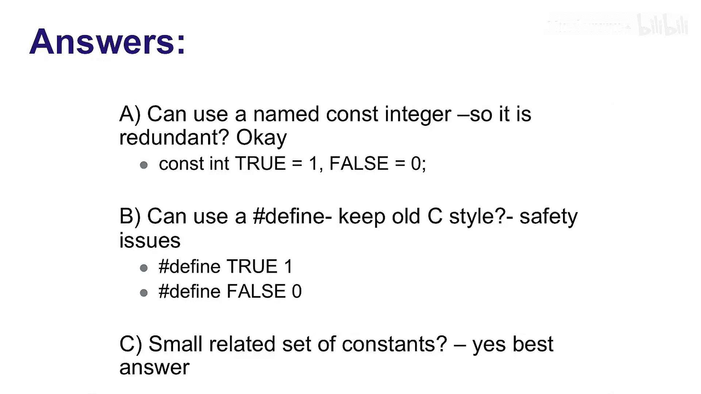

# C++编程：P17：枚举与运算符重载

## 概述

在本节课中，我们将学习C++中的枚举类型。这是一种扩展语言类型系统的方式，允许我们为特定领域（例如颜色）创建自定义的类型。我们将探讨枚举的基本概念、如何定义枚举、以及为何使用枚举优于其他定义常量的方法。

---

## 枚举类型简介

面向对象编程让我们能够自然地在新领域中编程。这些领域可能没有完全匹配的原生语言类型。例如，我们可能希望编写涉及颜色操作的程序。想象一个窗口系统，在菜单选项中，你可能希望使用颜色来表达不同的层次。因此，你可能需要一个颜色类型。

这是一种简单的类型扩展形式。通常，颜色可以被定义为一小组离散的项。下面我们看到一个枚举类型，这是C++语言中类型扩展的一种形式。

```cpp
enum Color { RED, WHITE, GREEN };
```

这里定义了一个名为`Color`的枚举类型，它包含三个枚举器：`RED`、`WHITE`和`GREEN`。这本质上是一种简单的整数类型。我们使用大写字母`RED`是因为它是一个标识符，一个枚举器。大写是我们的约定，用于强调我们正在表达一种整数常量形式。

当没有指定值时，`RED`会自动被赋值为0。这是C语言社区的传统，一切从0开始。`WHITE`将是1，`GREEN`将是2。我们通常这样做。

我们也有能力通过显式赋值来覆盖这些值。

```cpp
enum Color { RED, WHITE = 3, GREEN };
```

这意味着`RED`从0开始，`WHITE`从3开始，然后序列从3继续到4（`GREEN`为4）。

---



## 为何使用枚举？

你们中有些人有使用枚举的经验，枚举甚至被添加到了C语言中，许多其他编程语言也有枚举类型。这里有一个多选题，请花点时间思考。

你可以使用命名的整数常量来代替枚举类型吗？你可以使用类似C语言旧风格的预处理器宏定义（`#define`）来定义像`RED`和`WHITE`这样的枚举常量吗？或者，对于一组小的相关常量，使用枚举是最好的吗？那么，使用枚举的原因是什么？

---

## 枚举的优势



确实，你可以只使用常量声明。例如，如果我们想要`true`和`false`作为两个相关常量，我们可以说`const int TRUE = 1;`和`const int FALSE = 0;`。在旧的C语言中也可以这样做，但这存在安全问题。

然而，枚举类型比上述两种方法都要好。当存在一组相关的常量，并且你希望将其视为类型扩展，而不仅仅是任意的命名整数常量时，枚举是更好的选择。

枚举提供了更强的类型安全性，编译器可以更好地检查错误，并且使代码的意图更加清晰。

---

## 总结



本节课中，我们一起学习了C++中的枚举类型。我们了解了如何定义枚举来为特定领域（如颜色）创建自定义类型，探讨了枚举常量的默认赋值和显式赋值。最重要的是，我们讨论了为何使用枚举优于使用宏定义或普通整数常量，原因在于枚举提供了更好的类型安全性和代码可读性，尤其适用于表示一组逻辑上相关的常量。