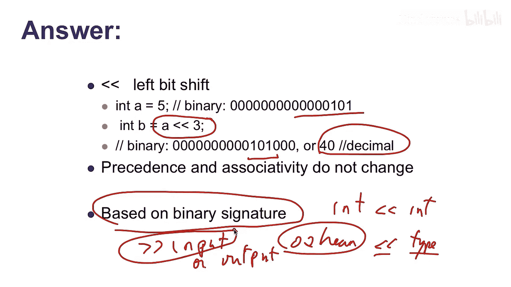

# 【加州大学】C++编程-｜-C-Plus-Plus-A-p18-P18_2-8-示例_typedef-days_02_01_09--BV1p2ejzREUQ_p18-

So enumerated types。Let you have。Small sets of related constants。And in C+ plus。

 we're going to start to see that we can do operator overloading， We can give new meanings。

To the already existing operators defined in the C language so that these。Extended types。

 these new types get to have the look and feel of the native types。

 And that's the secret to good O O programming， making your extended types。

Your type extension natural， making it seem like these types are native。Okay， so critical。2。

Creating a new type。Is to follow as your paradigm。The behaviors of。Native types。

 native types are types like ints。And floats。And you want your creative type to mimic those as much as possible。

 and what we're going to do is try to use a natural type， namely the days of the week。And make that。

A enumerated type。And this is the central lesson of object orientation。

 object orientation is a way to expand a programming language to incorporate new types that were not built into the core of the language。

In the early days of programming languages。Kitchen sink approaches to languages like P L1 tried to put every type possible that could be imagined at the time into the language。

 And now it was just very awkward and made for a ponderous language。 I be sure an。

Chaanged this and said， let's have some techniques that let us extend the existing types in such a way that it's seamless。

 they look and feel like the native types。 And that's what we're trying to achieve here。So。

Critical to that is also to be able to redefine operators， give them new definitions。

For the new types。And that's what we're going to concentrate on here。 We have an enumerator type。

The enumerated type has Sunday， Monday， Tuesday， Wednesday， which means that。The enumerator Sunday。

As explicitly value zero and by the time you get to Saturday。

 Saturday would have the explicit value6。Also， notice that we have defined within this type。

A new meaning for。The auto increment operator。Now， why did we choose the auto increment operator。

 The auto increment operator， when used on。Integer types。Changes the type by one。

 So if we had an integer type that was 100 and we ought incremented it， we would get 101。

 Or if it was 107， we'd get 1008。And here we want the same behavior。 We want to be able to。

Take a day of the week and say， what's the next day。

 Now we can imagine that this is a routine that gets us a next day。 if it's Wednesday。

 the next day is Thursday。And we're creating a calculus。On this kind of calendar object。

 which makes sense intuitively， people know what the next day is。

 what add one day to that day in the week is and what the next day is that you get。

Now let's look at this definition。We have in line， which we've seen。

We use in line because we expect in this calculus to use this operator frequently。

 and we want it to not pay a high cost and efficiency。

 And in line gets us that it tells the compiler， wait a minute。

Try to inline this code not to use it as a function call。We have a return type， which is days。 Why。

 because we want to take a day like Tuesday and return a day， Wednesday。

 We don't want to return an inter type or some other type。 We could do something like that。

 but that wouldn't make sense。 So we're taking a day and converting it to another day。

And then we have a unary argument， one argument。So anytime we have an operator。

And we do operator overloading。Giving an operator a new meaning。We are constrained。

 One of the critical constraints is what。Kind of operator。 I it。

 Is it a urary operator or binary operator， Those are the two kinds of operators you find in C plus plus。

 you're not allowed to。Overload the question mark colon operator， which is a turnernary operator。

 So you only have the urary operators and the binary operators and you can give them。New meanings。

 if。You're not using meanings on there。 You can't overload them for their existing types。

 because that would be。That would create chaos。So if it doesn't have a meaning。

 you can give it a new meaning。 You give it a new meaning by deciding and taking explicitly。

What the argument is。The other thing you can't change is you can't change the precedence order of the operator。

 so if you recall auto increment of very high precedence， that remains。

And let's see the actual semantics。 The Emen say at one。Casting it safely to an end。

 So if it was Sunday， you would add one and make it。Mday， in effect。And then， you would。

Modulo it with 7。 Why do you modo it with 7， Because the next day after Saturday is Sunday。

 So if you added one， you would get 7，7 modo7 is 0。 So that gets you Sunday。

 So you're really using modulo arithmetic when you talk about the calendar。

 So this is the right semantics。 And notice it gets the return type days。

 So it's not creating an integer。 the integer is automatically mapped back into converted into days。

Okay。Any time。We have a new type again， this is part of our object oriented design idiom anytime we have a new type。

We would also like to have。A familiar way to do IO input output。Remember。The operator。

 which in the core language is a bit shift。Is being used。In the。Output。

Of the language as a writing operator。So this is really like in the C language， a print F。

Except here， we notally want to use this。Typically， obscure， and。呃。Really use bit shift。

For perp for this other purpose， and， in fact， intuitively。

The arrows going in that direction suggest。Output。And again， you should get used to this idiom。

 so there are several things I want to point out。The return type is going to be a reference to Ostream we'll see why。

That's because we're going to want associivity in the output stream。

The operator is a binary operator so it needs two arguments。

One of the arguments is going to be an output stream。

And the second argument is going to be the type we wanted to find the output for。

 the output operation for。And again。These are traditionally make sense that they are called by reference。

 the call by reference because the O stream we don't want a copy。

 we want to directly use that O stream。For efficiency purposes。For many other reasons。

We just want a referential。Connection to the output stream。The however complicated。

 this turns out to be simple， So we could have just used call by value。 But as I say， it's an idiom。

 So keep this in mind， most commonly。Output variable is not to be mutated。So。You can't change it。

That's why we use Kst。And if it's something complex， we also want to call it by reference。

So it's not locally copied。And then you can see the semantics are very simple。

 We use the switch statement。 And again， this is amatic for switch statement。 We do a case。

 since these are an integral type， enumerators are integral types。 case of Sunday。

 lets us print out the string sunAlternativelyly， if I wasn't lazy。You might have。诶。Liked。

To print out the full name。And once you get that taste， this is the assignment to out。

And then this is what you return。You return the output stream as the value。

Of this overloaded operator。So they say normally bit shift， but bit shift is very specialized。

 so it's not very much used。 And then for any。Newly created type， new type that you extend。

 There's an expectation that you've overloaded this operator to provide a proper form of output。

 So now let's make use of all this in a main。We're using a new type D。

We're assigning it one of its enumerator values Monday， so D is Monday。

 and we have an noninitialized variable， days variable E。And now。Because we have。Extended。

The language。We've done operator overloading。 This is really a call on the procedure。Operator。Plus。

 plus。Tip。Days。It's really calling this。And recallcall the semantics。

 This is the auto increment operator。This has the right flavor。

 What does it mean to order increment Monday。Add one to Monday。 Get the next day。

 The next day is Tuesday。So we're going to take whatever the intrinsic representation is for Monday。

 which is the integral value 1。Convert it to a to。 It doesn't overflow in the sense of。

Going beyond 7，6， sexually。 So it stays 2，2 is Tuesday。

 And now notice that we're also using opera ear overloading here in that。

The first expression it gets evaluated。 Let me rewrite that ats C out。This is a binary expression。

This expression has an o stream。And it has a days type。And we've overloaded operator。A bit shift。

To have a meaning for that， the meaning for that is going to be D is Monday。

 So we're going to see in the。Stream。M， O， N printed。Then， we're going to。

This is going to return the same o stream。That O stream is the built in standard out。

So standard out gets returned and now it gets combined with。A tab character。

So now a tab is printed on the screen。 However many spaces your standard tab is， and then。

That's evaluated and again， returns CO stream standard out。

And then it's evaluated with respect to the day's variable E， which in this case is Tuesday。And then。

 again。We return the O stream， and then we'd put a new line in there so that we skippped to the next line。

 go to the next line。So we get a natural semantics， a natural semantics for our new data type。

And we've done it by overloading two operators that didn't have meaning for this。 This is， again。

 critical to idiomaticically understanding， even though this is a very simple type。

 So get it right on this simple type。 and you'll be able to carry it over to a much more complex type any time you need to do type extensibility。

 And this is a principle and object orientation。 And one of the great powers of C plus plus that isn't in all languages like Java。

 for example， Does't have it is also the ability to。Create。

New semantics for the operators in terms of however you've extended。

Whatever type extension you've undertaken。K。What native operator is。

These double less than size that should be apparent from what we've just learned。

Can the precedence of that operator be changed if I have a new type。

 maybe I want a different precedence than the underlining type。How do we know？What meaning of。

That first operator apply if we now have it overloaded for very different kinds of types and arguments。

Which one will we choose to apply？ So think about that for a sec。Well， as we mentioned earlier。

This is left bit shift。It remains left Bishop。 We cannot change meanings in the C plus plus language where things are defined for the native type。

 They remain defined that way。 So that can't be。Change， it can't be overwritten。

So if we had as an argument。An integer value shifted by3。

And if you thought of this as the binary number， that's the binary representation of five。Right。

 so that's 10，1 that's four。Nothing in the two's position in the zero in the ones position in the zero position。

 there's one。 So that's really5。Then we shifted over three。And now we have 10。

1 shift of three positions with in decimal would be 40。

So that definition remains precedence and associivity also cannot not be changed。So that。

You have to know so if in your domain you're coming from something in electrical engineering or chemistry and you're using operators that have meaning to chemists or electrical engineers。

 and there was a different precedence or a sociivity for the operator than what is in the existing C++ language。

 that's something you may have to keep in mind。And then which definition gets used is based on the binary signature。

 So here a binary signature was int， shift， shift， int。But mostly you're going to see Ostream。

B shift。Some arbitrary type。And in a case where we have O strain。

And where we've overloaded the O stream， the bit shift operator with a type， then we will have。

The appropriate。Input or output behavior in this case， of course， output。So well for input。

 we're going to。Do the same thing with。Right bit shift。

