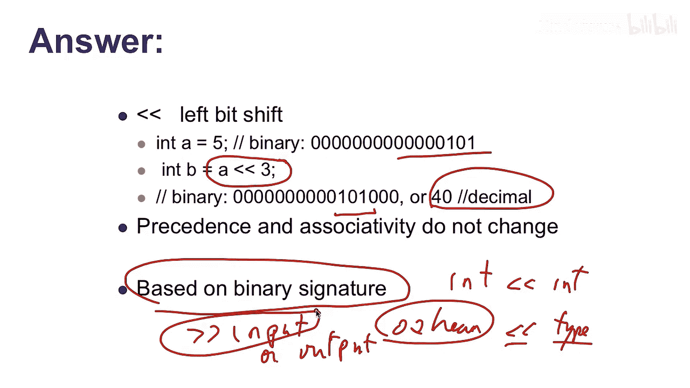

# C++编程：P18：枚举类型与运算符重载


## 概述

在本节课中，我们将学习C++中的枚举类型以及如何通过运算符重载，使自定义类型具备与内置类型相似的行为和直观的使用体验。这是面向对象编程的核心思想之一。

---

## 枚举类型

枚举类型允许你定义一组相关的常量。在C++中，我们可以通过运算符重载，为已存在的C语言运算符赋予新的含义，从而使这些扩展的新类型具备与内置类型相似的外观和感觉。这是优秀面向对象编程的秘诀：让你的扩展类型看起来自然，仿佛它们本身就是语言的一部分。

### 创建新类型的关键原则

创建新类型时，应遵循一个核心范式：模仿内置类型的行为。内置类型如`int`和`float`，我们希望创建的类型能尽可能地模仿它们。我们将尝试使用一个自然的类型——星期几——来创建一个枚举类型。

这是面向对象编程的核心课程。面向对象是一种扩展编程语言的方法，旨在将语言核心未内置的新类型融入其中。早期编程语言（如PL/1）试图将所有能想到的类型都塞进语言中，这导致语言变得笨拙。C++改变了这一点，它提供了一些技术，让我们能够以无缝的方式扩展现有类型，使其看起来和用起来都像内置类型。这正是我们在此要达成的目标。

---

## 运算符重载

实现上述目标的关键在于能够重新定义运算符，为新的类型赋予新的定义。这就是我们将要重点学习的内容。

我们有一个枚举类型`days`，它包含`Sunday`、`Monday`、`Tuesday`、`Wednesday`等值。这意味着枚举值`Sunday`的显式值为0，而`Saturday`的显式值为6。

同时，请注意我们在这个类型中为自增运算符`++`定义了新的含义。

### 为何选择自增运算符？

自增运算符作用于整数类型时，会将值加一。例如，一个整数100自增后变为101。在这里，我们希望实现相同的行为：能够获取一周中的某一天，并得到它的下一天。例如，如果今天是星期三，那么下一天就是星期四。我们正在为这种日历对象创建一种直观的运算逻辑。

### 自增运算符重载定义分析

以下是自增运算符重载的定义：

```cpp
inline days operator++(days& d) {
    d = static_cast<days>((static_cast<int>(d) + 1) % 7);
    return d;
}
```

*   **`inline`**：我们使用`inline`是因为预计会频繁使用这个运算，希望避免函数调用的效率开销。它告诉编译器尝试内联这段代码。
*   **返回类型 `days`**：我们希望接收一个如`Tuesday`这样的`days`类型，并返回`Wednesday`这样的`days`类型，而不是返回`int`或其他类型。
*   **一元参数**：自增运算符是一元运算符，因此重载时需要一个参数。
*   **运算符重载的限制**：在C++中，只能重载一元和二元运算符。不能重载三元运算符（如`? :`）。不能为运算符的现有类型（如`int`的`+`）重载新含义，否则会造成混乱。同时，不能改变运算符的优先级和结合性。
*   **语义实现**：代码将枚举值安全地转换为`int`，加1，然后对7取模。这是因为星期六（值为6）的下一天是星期日（值为0）。`7 % 7`等于0，这正好符合日历的循环逻辑。最后，返回类型是`days`，因此它创建的是一个`days`类型的值，而不是整数。

---

## 输入/输出（I/O）重载

任何时候创建一个新类型，作为面向对象设计习惯的一部分，我们通常也希望为其提供熟悉的I/O方式。

在C++中，位左移运算符`<<`被用于输出（类似于C语言中的`printf`）。直观上，箭头方向暗示了输出。你应该习惯这种用法。

以下是输出运算符重载的示例：

```cpp
std::ostream& operator<<(std::ostream& out, const days& d) {
    switch(d) {
        case Sunday: out << "Sun"; break;
        case Monday: out << "Mon"; break;
        // ... 其他 cases
        case Saturday: out << "Sat"; break;
    }
    return out;
}
```

需要指出的几点：
*   **返回类型 `std::ostream&`**：返回输出流的引用是为了支持链式调用（如`cout << a << b`）。
*   **二元运算符**：输出运算符是二元运算符，需要两个参数：一个输出流和一个要输出的自定义类型对象。
*   **参数传递**：输出流通常以引用方式传递，以避免拷贝，提高效率。自定义类型对象使用`const`引用，因为我们通常不希望在输出时修改它。
*   **语义实现**：使用`switch`语句根据枚举值输出对应的字符串（如`"Mon"`）。
*   **返回值**：返回输出流本身，以支持链式操作。

对于任何新创建的类型，重载`<<`运算符以提供适当的输出形式是一种常见的期望。

---

## 综合应用示例

现在，让我们在`main`函数中使用所有这些特性。

```cpp
int main() {
    days d = Monday; // d 是 Monday
    days e;          // e 未初始化

    e = ++d; // 调用重载的 ++ 运算符，d 变为 Tuesday，e 被赋值为 Tuesday

    std::cout << d << '\t' << e << std::endl;
    // 输出: Mon    Tue
    return 0;
}
```

代码分析：
1.  `days d = Monday;`：`d`被初始化为`Monday`。
2.  `days e;`：声明一个未初始化的`days`变量`e`。
3.  `e = ++d;`：这实际上调用了我们重载的`operator++(days& d)`函数。`d`（`Monday`，值1）自增后变为`Tuesday`（值2），然后赋值给`e`。
4.  `std::cout << d << '\t' << e << std::endl;`：这是一个链式调用。
    *   首先计算`std::cout << d`。由于我们重载了`<<`，这会输出`"Mon"`，并返回`std::cout`的引用。
    *   接着计算`返回的cout << '\t'`，输出一个制表符，再次返回`cout`。
    *   然后计算`返回的cout << e`，输出`"Tue"`，再次返回`cout`。
    *   最后计算`返回的cout << std::endl`，输出换行并刷新缓冲区。

这样，我们就为新的数据类型实现了自然的语义。这是通过重载两个原本对该类型没有意义的运算符来实现的。理解这个简单类型的正确做法至关重要，你可以将这种模式应用到更复杂的类型扩展中。这是面向对象的一个原则，也是C++强大能力之一（例如Java就不允许重载大多数运算符）。

---

## 思考与回顾

根据我们刚刚学到的内容，可以思考以下问题：
1.  **`<<`运算符的本质是什么？** 它本质上是左位移运算符。
2.  **能为新类型改变运算符的优先级吗？** 不能。在C++中，运算符的优先级和结合性是固定的，无法通过重载改变。
3.  **当`<<`被重载用于多种不同类型时，如何确定使用哪个重载版本？** 这基于函数重载的规则，编译器会根据操作数的类型（签名）来选择最匹配的重载版本。例如，`std::cout << 5`调用的是为`int`定义的内置版本，而`std::cout << myDay`调用的是我们为`days`类型重载的版本。

如果你来自电气工程或化学等领域，使用的运算符在专业领域有特定的优先级或结合性，而这与C++语言内置的不同，那么你需要特别注意这一点。

对于输入，我们将使用右位移运算符`>>`进行类似的重载，以实现输入功能。

---

## 总结



本节课我们一起学习了C++中枚举类型的定义，以及如何通过运算符重载（特别是自增运算符`++`和输出运算符`<<`）来扩展自定义类型，使其具备与内置类型相似、直观且自然的行为。掌握这种为简单类型正确重载运算符的模式，是理解和运用C++强大类型扩展能力的基础。