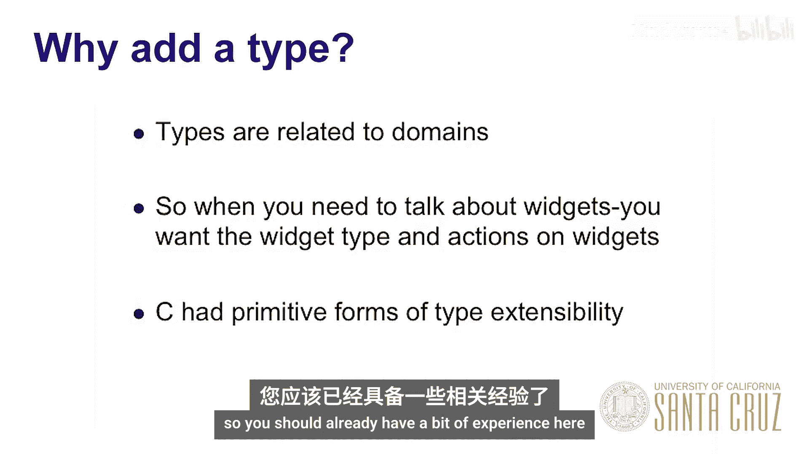
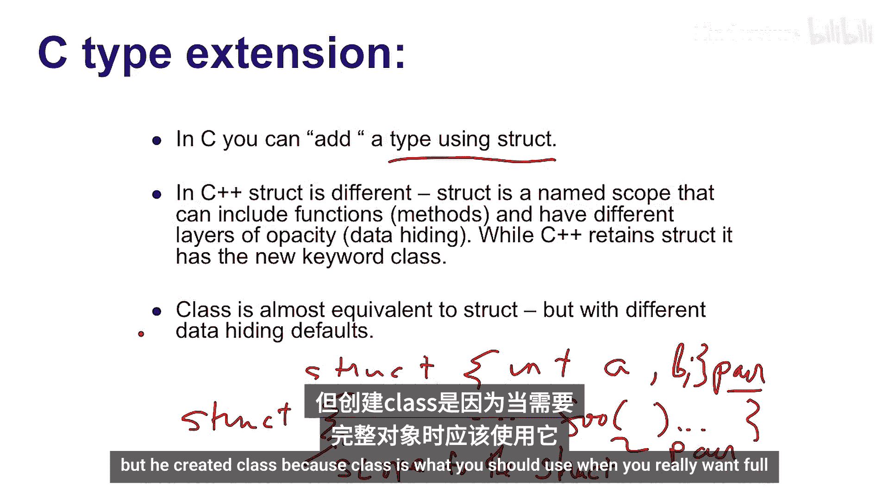
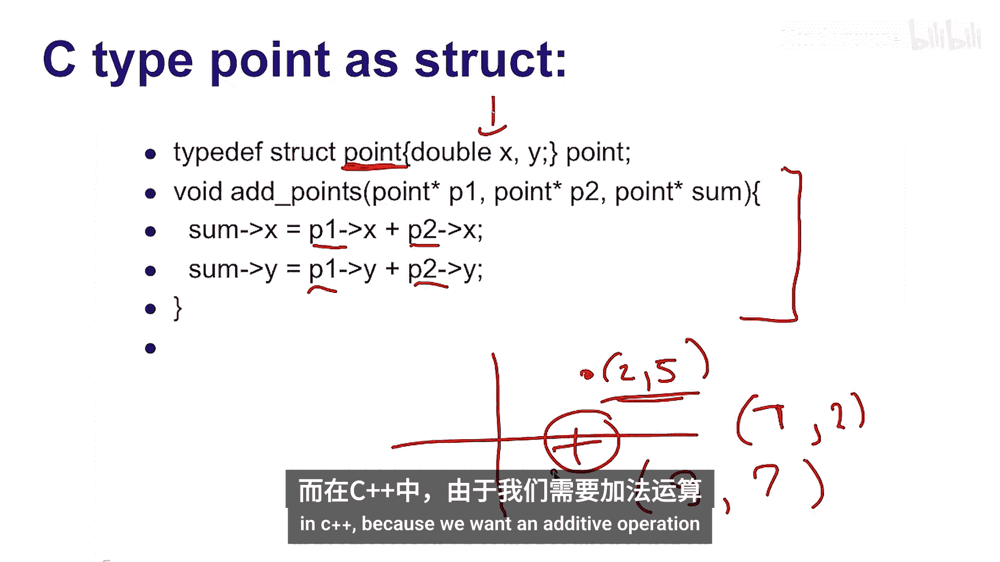
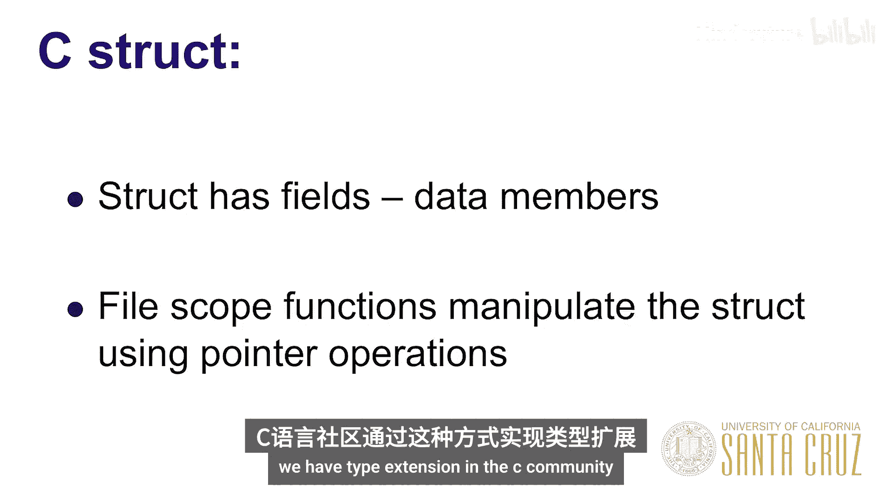

# 【加州大学】C++编程-｜-C-Plus-Plus-A-p19-P19_2-9-构建部件的自然方式_02_01_10--BV1p2ejzREUQ_p19-

So the real insight for object oriented languages is that they can be universal because you can add types that you can add efficiently。

 and so you no longer have to invent a special language。

 much like in the early days of programming languages where you went and you invented for transfer science and cobal for business and listsp for artificial intelligence Now within a language like a Java or like a C plus plus or a Python where you allow natural type extensibility and you allow it efficiently。

 you get to。Have the experts in a particular domain。

Do the type extension so that people now can conveniently and naturally program in that domain。

 and that domain could be anything。Chemists can invent a language in the cytotypes they need for chemical molecules。

 DNA people， bioinformatics people can do everything they need in relation to the genome。

 and so what we really want is to understand how for your particular widget。

 for your particular domain， how we can create a widget type。What are the rules。

 What should be the natural way to build widgets。Xi。Which you're coming from has a form。

But it's a primitive form of type extensibility。 So you should already have a bit of experience here。

 and the experience will inform you in terms of and let you compare。

To the more powerful As that C plus plus gives you when you're doing type extension。

So in C type extension。You typically。Created a new type by using the keyword struck。Struck。

Changes in C++。That was the critical insight that Bjoorn as a program language designer had， he said。

I'll stay with Struck。But I'm going to add things to what you can do with it。

And those things are going to be the critical thing is。Struck in sea。

Would let you have what are called data members who could say， oh。

 I want to struck and I want it to be two items like int A B。

And maybe they would define something we would call a pair。And now， in C plus plus。

I not only have that。But have the ability to have functions。That let me operate on pair。

And those functions will be。Inside。A scope。They will be scoped。To the struck。N C plus plus。

 because Bjorn。Started with struck。 He wanted to retain。C plus plus usage。

He created as an alternative to struck class。 So C plus plus has redundancy。

 You don't find that redundancy， for example， in Java。 Java， you just have class。

 They were willing to start more from scratch。Bjorn wanted to keep all the old sea stuff around for you。

And he extended the meanings of Struck， but he created class because class is what you should use when you really want full scale objects。

So。As a C programmer， this should be reviewed。If you had a C type point is struck。

 So what we're going to try and create here is your typical point。In the X Y plane。

 here's your X Y plane， here's some point。Often the X Y plane， we want to be able to manipulate that。

 Why would why would we want to manipulate that， Well。

 we might have geometry problems or we might be doing some drawing。

 We might be using a drawing package or wherere the creator of the drawing package。

So we have this struck。Struck has basically a struck name that's， in effect， now the new type。

And it has two data members。And now we want a method in C， this is all C， old C。

So let's say we want to do what's natural。 We have two points。 We want to add them together。

And the natural semantics for adding together is the X。

 the new X coordinate is the x coordinate of the old points， point1 and  point2 added together。

 and the Y coordinates added together。 So if we add。7，2 here。Then adding them together。

 we would get 9，7。 That would be what plus would mean。We're doing this all and see。

So notice there's no， it's sort of funky， there's no natural semantics to it。And C++。

 because we want an additive operation。

Go back to our ideas that we had when we overloaded days。

We're able to give additional semantics to the operator。 again。

 this is why C plus plus is going to be better。 We're going to be able to encapsulate point better。

 We're going to be able to give it more a more natural look and feel。So the sea struck as fields。

 the fields are only data members。In C struck， we have file scope functions。

That manipulate the truck， typically using pointer operations。 This is the classic way。

 you might say， the primitive way we have type extension in the C community。

