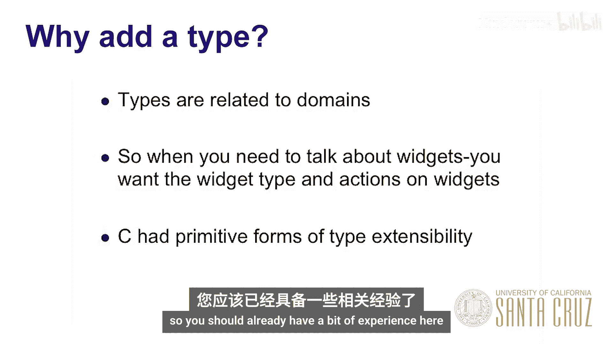
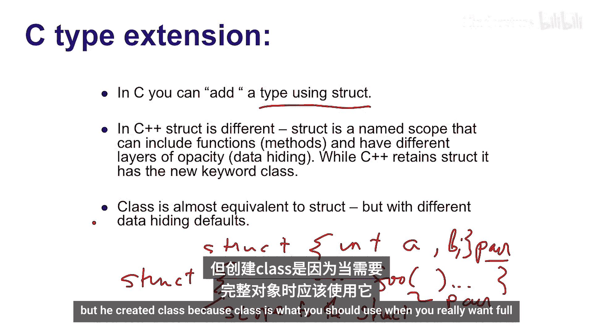
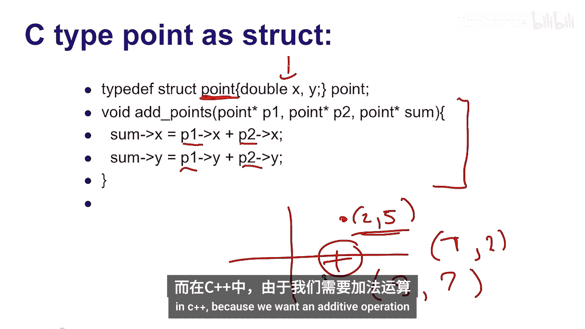
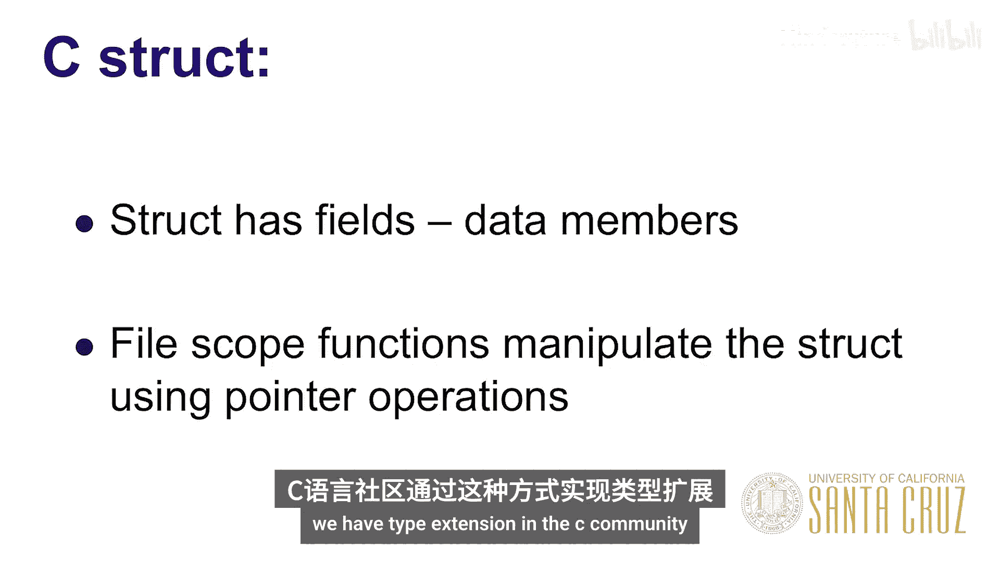

# C++编程：P19：构建部件的自然方式

## 概述
在本节课中，我们将学习面向对象编程的核心思想：如何通过高效地扩展类型，让编程语言变得通用，从而适应任何特定领域。我们将从C语言的结构体（struct）入手，理解其作为类型扩展的原始形式，然后探讨C++如何通过引入类（class）和运算符重载等特性，为类型赋予更自然、更强大的操作语义。

---

## 从C语言的结构体说起
上一节我们介绍了面向对象语言通过类型扩展实现通用性的核心理念。本节中，我们来看看在C语言中，是如何进行初步的类型扩展的。

在C语言中，创建新类型的典型方式是使用关键字 **`struct`**。

```c
struct Point {
    int x;
    int y;
};
```

以上代码定义了一个名为 `Point` 的新类型，它包含两个数据成员（`x` 和 `y`）。这可以看作是在二维平面上的一个点。

---



## C语言中操作结构体的方式
定义了结构体后，我们自然希望对其进行操作。例如，我们有两个点，希望将它们相加。

在几何意义上，两个点相加意味着其x坐标和y坐标分别相加。例如，点(2, 5)和点(7, 2)相加，结果是(9, 7)。

然而，在C语言中，没有为`struct Point`定义“+”运算符的自然语义。我们必须编写独立的函数来操作它。

以下是C语言中实现点相加功能的方式：

```c
struct Point addPoints(struct Point p1, struct Point p2) {
    struct Point result;
    result.x = p1.x + p2.x;
    result.y = p1.y + p2.y;
    return result;
}
```

在C语言中：
*   **结构体（struct）** 仅包含数据成员（字段）。
*   操作结构体的**函数**具有文件作用域，它们通常接受结构体指针或结构体本身作为参数。
*   这是一种**原始的、功能有限的类型扩展方式**，操作与数据是分离的，缺乏封装性和自然的语法。

---

## C++的进化：从struct到class
C++的设计者Bjarne Stroustrup有一个关键见解：他保留了C语言的`struct`，但为其添加了至关重要的新功能。

在C++中，`struct`不仅可以包含数据成员，还可以包含**函数成员（方法）**。这些函数被**限定在结构体的作用域内**，与数据紧密关联。



为了更清晰地表达“面向对象”的意图，并与更简单的C风格`struct`区分，C++引入了**`class`**关键字。`class`提供了完整的面向对象特性（如访问控制）。而`struct`在C++中默认成员是公开的（public），通常用于主要包含数据的简单结构。

```cpp
class Point {
public:
    int x;
    int y;
    // 可以在这里添加操作点的函数
};
```

---

## C++的强大之处：自然的操作语义
回到我们“点相加”的例子。C++的强大之处在于，它允许我们为自定义类型赋予更自然的操作语义。

通过**运算符重载**，我们可以直接为`Point`类型定义“+”运算符的行为，就像为内置类型（如`int`）定义的那样。

```cpp
Point operator+(const Point& p1, const Point& p2) {
    Point result;
    result.x = p1.x + p2.x;
    result.y = p1.y + p2.y;
    return result;
}
```

定义之后，我们就可以像下面这样直观地使用：

```cpp
Point a{2, 5};
Point b{7, 2};
Point c = a + b; // c 现在是 (9, 7)
```



与C语言的方式相比，C++的实现具有以下优势：
1.  **更好的封装性**：数据与操作它的函数可以组织在一起。
2.  **更自然的语法**：使用 `a + b` 而非 `addPoints(a, b)`，代码意图更清晰，更符合直觉。
3.  **更强的表现力**：使得自定义类型能够像内置类型一样被使用，降低了领域专家（如化学家、生物信息学家）为其领域创建专用“语言”（即类型库）的门槛。

---

## 总结
本节课我们一起学习了构建部件（即自定义类型）的自然方式。

我们从C语言使用`struct`进行原始类型扩展开始，了解了其通过独立函数操作数据的局限性。接着，我们探讨了C++如何在保留`struct`的同时，通过引入`class`和作用域内的成员函数，实现了更好的封装。最后，我们看到了C++**运算符重载**这一强大特性，它允许我们为自定义类型定义直观的操作符（如`+`），从而让代码更自然、更易读。



这种能力正是面向对象语言“通用性”的关键：它允许各个领域的专家创建适合其领域的、易于使用的类型，让程序员能够以符合领域逻辑的自然方式编写程序。