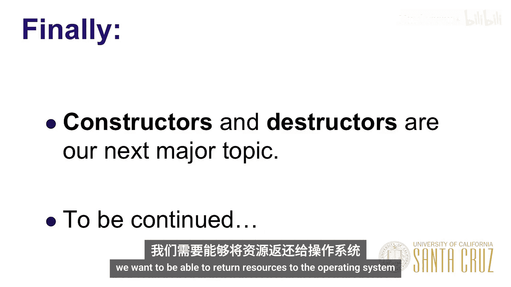

# 【加州大学】C++编程-｜-C-Plus-Plus-A-p20-P20_2-10-C++点_02_01_11--BV1p2ejzREUQ_p20-

So let's turn to C plus plus and see how much better we can create the new type point。First off。

 we're going to choose the new keyword class。Now we have point。

 we're no longer going to need that old trick， the old hack and C with tight depth。Point。

 the class name is automatically the type name。The next thing you see that's different is there's an access keyword。

That access keyword can be one of three keywords。The three keywords are listed here， public， private。

 protected。For the moment。We're going to leave out protected。

 it's part of what we call the inheritance scheme。We're going to leave inherance。For another day。

Public and private are what you really need to know for most of your programming。Again。

 this is one of those wonderful things， what I call 90% rules in programming。If you learn。

A few simple ideas， they work for 90% of what you need。

You should really concentrate on learning the basics because that's widely applicable and then the additional 10% you can learn as necessary。

So， public。And that's where protected comes in later on。

Public just says everybody should visibly see what I'm declaring。

So if I say public double X Y means everybody in the world gets to look at x and Y。

Private is just the opposite private says。Restrict the access to things that have this class as its scope。

Keep it just very limited。 What I like to do is say private。

Is part of what I call the black box principle。Hidden away in here is the private stuff。Now notice。

If you buy an apple。And you try and open it up， let's say you buy an Apple iPhone。

The warranty goes away， you try and open that and mess with it。 The warranty goes away。

 It's a black box。The manufacturer only wants their specialists。

 their authorized specialists to work with that black box。So what you get to see is a few controls。

On the surface。That's the functionality of the iPhone。

 Do you really care what operating system and what processor is running in the iPhone。

 Most 99% of the world do not have a clue as to what the processor internal to the iPhone is。

 or even that there is a processor。 They just know it as， oh。

 I have it as a phone or I have it as a mapping device or I have it as telling me roten To movie reviews。

 So they know it as Here are some apps。 Here's some phone function。 Here's some camera function。

 how that all works internally。That's a mystery。Apple doesn't want you to mess with that。

So that keeps it a lot simpler。 So again， that's a really important principle in building things hide away as much as possible。

That the non expert。The ordinary user。Doesn't need to know and just give them the public controls。

 the little knobs or whatever。Are on the face of the device。So here is。Class point。

And class point is。Where we're trying to create a new user defined object。

And some of what we want to understand is。haoouu。😔，Use the。OO technology。

 the object orient technology， what are some of its key elements？

The overriding principle in the object orient technology is to make your new data object。

Seem natural， seem compatible with the existing programming language data types such as Enfloat。

And among the principles we try to follow。Our data hiding。So。Private。Is where we hide representation。

In order for this， not to impact efficiency。Remember when。A member function or an OO speak。

 a member function is sometimes called a method。Is automatically in line。So it's automatically。

Highly efficient。And so this return of x really is just。Not involving a function call。

 It just really gets。Internal value of the variable x associated with that instance of point。

And then the set X， which is also called a mutator method。

Because it can change the value of the hidden representation。Is also efficient。

 It's really just at that。Place in the code where you're going to call that member function setX。

You just replace it by the simple assignment。Data object do x equals data object D。

Or the v value I should say， that's being called。So again， if。You want to review object orientation。

 you're supposed to have a background object orientation coming into the class。

 but you can use something like the Wikipedia to review this information。And if you follow。啊。

This template， namely。Use public for the kinds of behaviors you want your。

Object to have use private for representation。And then as we will see。

 you make this as rich and natural a set of。Class。Functions。Z。Gives you an easy time。

And using point in your normal programming。 So here we continue with the object oriented paradigm and what we need to do and some of the things that C plus plus lets us do and C plus plus。

Is。The most powerful object oriented。Language， it's actually multiparro bigmatic language。

 but it allows， for example， operator overloading， which many other。啊。Object oriented languages。

 even C based ones don't allow。And again， that gives us the opportunity to extend the semantics of even operators over to our new objects so that there's a fairly natural understanding。

Of how。That that those new data types will interact with the old data types there's an expectation that we will keep interface so here we have something called a point。

 a point as you remember from high school math is a mathematical object and if yourre。

Doing some an geometryometry， you can add two points to turn them into a third point in the way you add them in the。

XY plane。Is to take their X and Y values and combine them。Well， that's a natural operation。

 it's the operation binary plus。I have to say binary plus because C++ also allows for unary plus unary+ is normally a no op。

But binary plus， which on。Natural。Built in native data types like int。

 we all know you add3 plus four and you get7， you add 1。2 and 2。2 and you get 3。

3 in the float or double domain。So plus is a natural operation。

You should only be overloading it Iioically， you only want to overload operations where there is an existing semantics。

 which generally means。They must be mathematical objects， you don't want to。

Overload your general widget where somebody doesn't understand what a plus for two widgets are mean what if you take。

A swatch watch。 And you added to a。Apple Eyewach， what does that mean？It's hard to conceive of。

 so you wouldn't want to be using overloading of operators in。Non algebraic。

 non mathematical domains。 But here plus has a perfectly good sense to it。 And indeed。

 if I was somebody who was going to be dealing with points constantly in my programming。

 I would want the ability to use。The arithmetic and mathematical notations。

 including those operators。 So we see what the semantics are。

 and they're exactly what you can imagine from your high school math。 Now， we also want to overload。

The output operator。And this is very important， so study this because this is a critical idiom anytime you have。

A new data type that you've created， a new object that you've created。

 You generally want to overload this。 Again， it's an expectation。 It's a community expectation。

So if you're the designer of this new object and you're going to give it to other people on your team。

 they're going to expect the IO to work on it。Well， you have to give that IO semantics。

And here's the semantics。We print a par。 We print out the x value of the point。 We print a comma。

 We print out the y value， we print out。A closing parent。So exercising this on some point。

We might see on the screen。er。3， comma 4。And that would be the point with the x coordinate3 and four。

The Xy plane。Now。Critical to this is to look at the。Function signature。

So the return type is an O stream。So that means you're taking and the operator overloading as a binary operator and it's a binary bit shift operator。

So even though it's natural for us and C++ always think of this as。An I O operation。

 It isn't intrinsically， intrinsically， if we have two data types， like two wins。

We're forced to use it as a bit shift operator。However。Where we have an o stream as a first argument。

As here we do。And in this case， we have the object。As the second argument。Zen。

This function signature。Makes us select this version， which don't forget。

 this is a form of operator overloading。And the signature matching algorithm the compiler uses says。

 do I have an available definition for this， if I don't have an available definition and I attempt to do something like this。

 I'm going to get a compiler error。But if I have an appropriate available definition， which is。

Use it on a stream， an O stream。And then apply it to a point。

 Then this is the behavior we're going to see。Nowao。

Critical is that the O streams are both passed in。By reference。

And the return value is in Ostream by reference why that suppresses any kind of copying。

 so that's sufficient。And we want to return this operator because you want in typical IO to use this multiply。

 you see it here， it's really a binary operation and the binary operation goes something like this out is the stream and then you print。

The action is to print left Per。And the result is really。That you get this again as out。

So you get the same O stream as out， but you've had this print behavior。

 so you're going to print first this， then you're going to get an O stream。

 then you're going to print three， then you're going to get an O stream。

 then you're going to print comma and so on。So those semantics are called by reference。

 but look at this， this doesn't have to be written this way。

 but it's expected to be written this way， sometimes for simple types this could be called by value。

 you would see the same behavior。However， it's just useful。2。Cao。

Your data object because your data object， your newly created object might be something very complicated and again。

 you want it efficiently pass and you know it's not going to be mutated。

 so the cons shows that it's not mutated。And passing by reference suppresses called by value semantics。

 so it doesn't get copied locally， which could be an expensive operation。

And then you just print the underlying value。Again。

 this is a very important idiom to understand it's most useful once you understand it。

 you can apply it to any of your own programming anytime you create a new class。

You want to be able to design a program like that and remember you return out because of the binary operator。

 you want to reuse it。In a stream like this， a stream of operations like this。

Then it's use in Maine just to test this and again if you're working at home。

 you should try this out， you should add operators， you should think about it。

 you should run your own version of it， you should extend it。

 it's the only way you're going to really get to make use of this。We declared a point，35，25。

 we declared another point，25，4 five。We output those two points。

 so what's this going to look like on the screen？Well， hopefully。If I have what I did before right。

 we're going to see 3。5， 2。5 all parenthesis with this comma there。

 and then we're going to and we're going to have a equals， that's this expression。

And then we're going to have b equals。And then the same thing， we're going to see parenthesis 2。5，4。

5。That's what's going to hopefully show up on the screen and then we'll have the new line。

And then if we do the sum。The sum is going to， in effect， deal with all these operations properly。

 You could have parenthesized that， but because of operator precedence。

 this will take precedence and occur before the left shift operator。

 So this is plus has higher precedence than shift。And you will get a plus B。

 A plus B is going to end up with 6。07。0。And that will be some。Hopefully that'll be your result。

 you should try that at home。So what have we learned？User defined types using point in main。

Looks very much like a native type。 It looks like we use double。 It looks like we used it。

 It looks like we used char。This is your key goal in object orientation。

To be a good object orient a programmer， when you've created a type and when somebody understands the intuitive semantics of that type。

 that type should。Readily look like an ordinary sea type， an ordinary sea native type。

And we accomplish this by having point， have properly overloaded。Semantics。

That gives them an appropriate look and feel like a native type。Now。When we stick methods。

InIn the class。Those methods are frequently going to be accessor methods。

 and sometimes they're going to be what are called mutator methods。As a senior professor。

 I'm allowed one or two errorss a lecture， so that shouldn't have been vowel。

 that should have been V， or alternatively， this should have been vowel over here。

This is what we call a mutator method。Because it changes the underlying value。Of what a point is。

And this is purely an accessor method because it gets us the value。And class members。

 this is the critical thing when we're building a class。 we have access to everything。

 We have access to private， we have access to public。 Everybody has access to public。

 but we have access to private or when we go over to inheritance。

 we'll also have access to protected as well。The way we get access is through this do notation。Pwan。

Will have its two doubles， x and Y。The find。So P1， dot x and dot y are available to get x。

That's why when P1 activates get x。When this method get X is activated by the object B1。

 it returns the hidden value for that particular object instance。

So what lessons do we want to take when we go to build an object。

 object construction is needed for OO？Built in objects such as the native objects double。

 fixed arrays， they're all built by the compiler。But a big part of C++ mastery is to get the skills so that you can write the code。

 you can write the class， you can write the class methods。

 the member functions that have you build the object。

Cruciial to building the object is a very special method。That method is called。

 it's given a special name， it's called a constructor。Rather intuitive constructor construction。

So when you want to build an object， you need something that builds it。

 the compiler knows how to build native objects。The compiler needs instructions and what you intend to do when you're building these new objects。

 the objects。The domains， the widgets that you are going to use。

 you you're extending the language use into new areas。 So here's point。The key idea。Is。That。Onli。

Constructors。Have。As their names， the same names as the class name。

All the other methods have to have different names like GetEX and CX。But when you see inside a class。

What looks to be a function， and its name is the class name。

 then you automatically know it to be a constructor。

And the constructor also has the ability to take different argument lists。And when there's one。

 there are several。Special。Types of constructors， and we'll go into that in a second。

But the standard special constructor is called the default constructor and it's the default constructor because it's how to build the object when you give it no arguments。

So here is a constructor where you give it no arguments。 and when you build it， you say， oh。

 a point in which I give it no arguments。 Well， that's just going to be the point that's。

In the X Y plane。At the intersection of the two axes， that's going to be the special point， zero。

 zero。And that's intuitive， that might be what would be expected normally when you have native types。

And you leave them oninitialize。 The compiler frequently initializes them for you to zeros。

 This is a sense of using some standard null value for the initialization。

 But here you have to give proper semantics。 Otherwise X and Y， the secret parts of the instance。

 the secret data members for the instance， wouldn't necessarily have an initialization。

Now I'm showing you how to do this semantics in two different ways for the moment。

The second way involves a special keyword， this。This is what we call the self。Referential pointer。

One of the things is's always something that's wonderfully confusing。In mathematical logic。

 or indeed in computer science， is where we get self referentiality of famous logical puzzles about。

Villages in which every man。Is bearded and only the barber is allowed to shave men's beards。

 And the barber is bearded。 And you have to ask the question， who shaves the barber。

 So it's that in a logical or impossible situation。 Anytime you get self French refer， wonderful。

Series I've been watching forever is the British science fiction series， Doctor。 Who。And Dr。 who。

 as a pun， plays on the whole question of self referiality， Dr。 Who。啊。And indeed， in Doctor who。

 he's a time Lord and he's floating around in the cosmos。

 he frequently comes upon himself in certain special episodes so you get all sorts of paradoxical。

 self referential situations。So again， self referentiality， that's difficult。

In order for a member function method。To access its own members， it needs some special mechanism。

So either X and Y are known to be inside that class。

 or they can be pointed at self referentially through this。Special this pointer。

That always exists for any object created and we'll make use of it and we'll see why it's important。

Okay。That was a taste of constructors。 There's also an analogous special method called a destructor for destroying an object。

 So anytime we want to be able to create things， we want to be able to destroy them。

 We want to be able to return resources to the operating system。 It's very important。

Keep our environment clean， manage our environment carefully。

 It' a major topic for those of you following in the text， it's very important to read chapter 5。

And I will continue next time with this material。