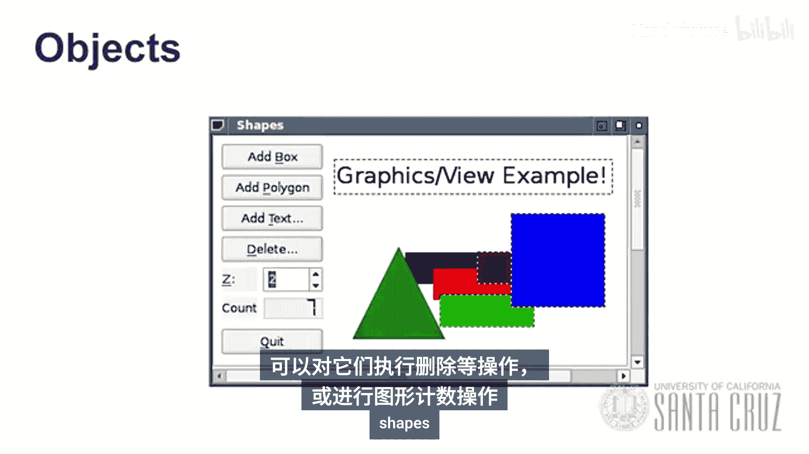
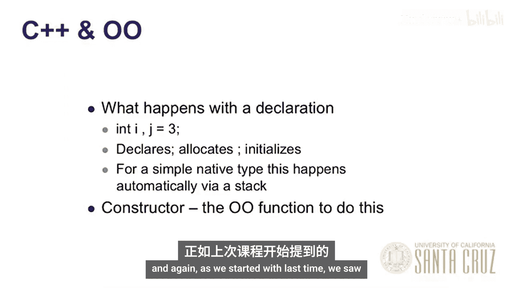
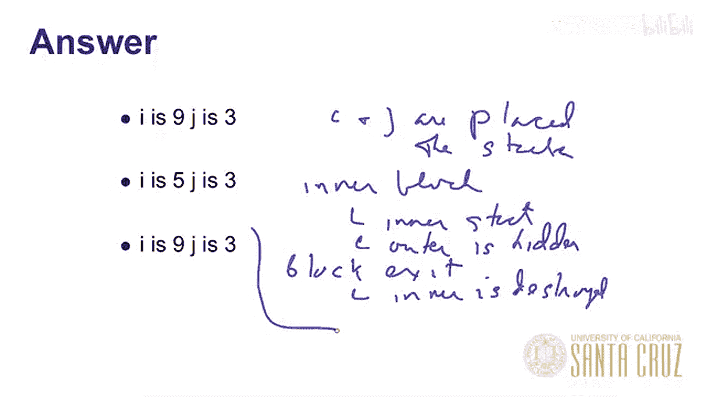

# 【加州大学】C++编程-｜-C-Plus-Plus-A-p21-P21_3-1-C++类_面向对象_03_01_02--BV1p2ejzREUQ_p21-

🎼うん。🎼，🎼あ。Today we're going to get deeper into the object oriented。Programming style。

So we're going to look at more C++ classes and how to build them in an object oriented manner。

We're going to look again at constructors and destructors， which are these critical。

Methods that both build and delocate。呃。It's the new extended data types。

And then we're going to discuss。Our next significant homework assignment。

 and that's a homework assignment based on graph theory， so again。All of you came in having。

A background in computer science， roughly at。Sophomore year level， at least。

And you may well have already seen standard graph theory algorithms， so this may be familiar to you。

In any case， I will review all that material， so even if you have forgotten it or haven't in the past had an adequate background we're going to really understand Dykestra's shortest path algorithm and that's going to be the basis for our second homework assignment。

Okay， objects。Objects could be anything。 So here in this little example。We're thinking of shapes。

Shapes could be boxes， polygons， tech shapes， there can be operations like delete on them。

 operations that involve counting the shapes。

And so if we wanted to build a windowing environment。What would be our set of widgets。

 What would be the operations， What would the user expect， the user of this package of routines。

 How would we。Properly design things and keep the internal details hidden the way。

 All of that is what you have to think about。When you're an object oriented C++ programmer。Again。

A best guideline to doing this thought process。Is to know what happens and。

The language for native types。So with native types， we have to understand。

 fully understand what happens when we declare something， even a simple object like an int。

 What does it mean to say int。 I commt J initialized to three。Well。

 we typically do that inside block scope block maybe inside the main function or maybe in one of the。

Auxiliary file scope functions。So we're declaring here， we're allocating， we're initializing。Now。

 for a simple native type， all this happens automatically。On stack。 On the stack。

We have to replicate that for our user to find types for our objects。 And again。

 as we started with last time， we saw we had a special method for doing this。

Call the constructor。All right。So just for review purposes in the C language or in basic C plus plus。

What is supposed to happen here？Where we have nested blocks。 So here's a main。

We have two declarations，Initialized to9， Jays initialized to three。We you going to。Print。

What goes to screen。 So that's what we're expecting you to do。

 This is going to be very similar to the kinds of exams I give。

 This is a question that I could readily put on our and are a final exam。And then secondarily。

We have。An internal block， It's not。Here's the internal block， the nested internal block。啊。

Not I actually would have preferred。And in thatic style， this is。Not。

You should reformat that if you're going to try the code so that the internal block。

iss indented so that you can visually， that's again a convention， but it makes it more readable。

 you can visily see the inner block and so in the inner block， there's a redecorlaration of Inai。

And we're asking what that prints versus the outer block。And the answer is。The inner block。

The outer block has nine and three。But the inner block has。But you might call I enter。Which got。

Was recalculated to be 5。 And J was left。 J just got passed in because there was no inner block J。

 So that's really J outer。And then over here we have outer again。

And when we go to the outer block and we print it， we see it value9 was retained。

So that should all be。In your knowledge base already。From an allocation point of view。I N J。

I placed on the stack。Inner block。I enter is on the stack。I outer is hidden。Then we have block exit。

I enter。Is destroyed。And then we return to the outer block。And we have， again， I 9 and Jane 3。

 which are the outer block。Variables that are still on the stack。

