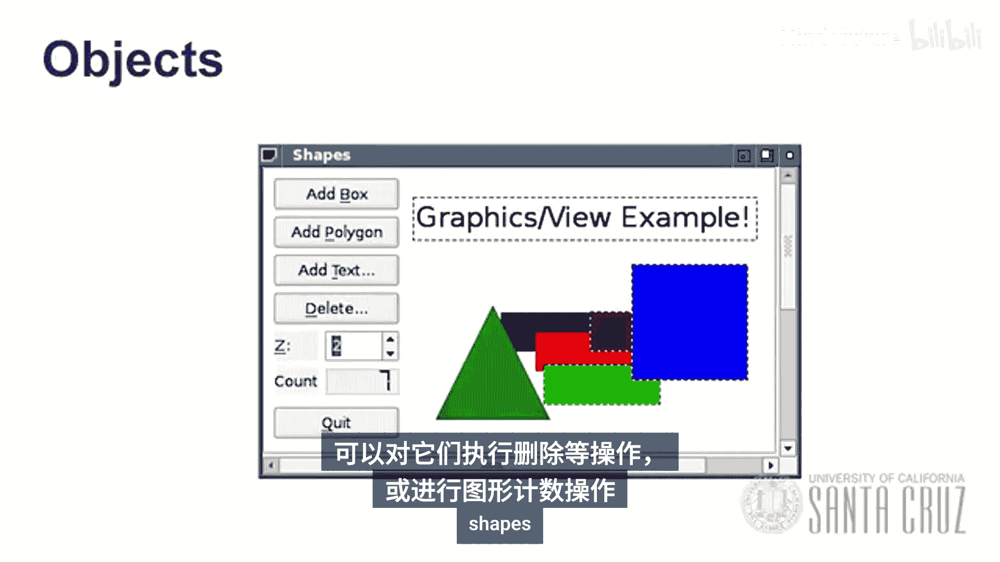
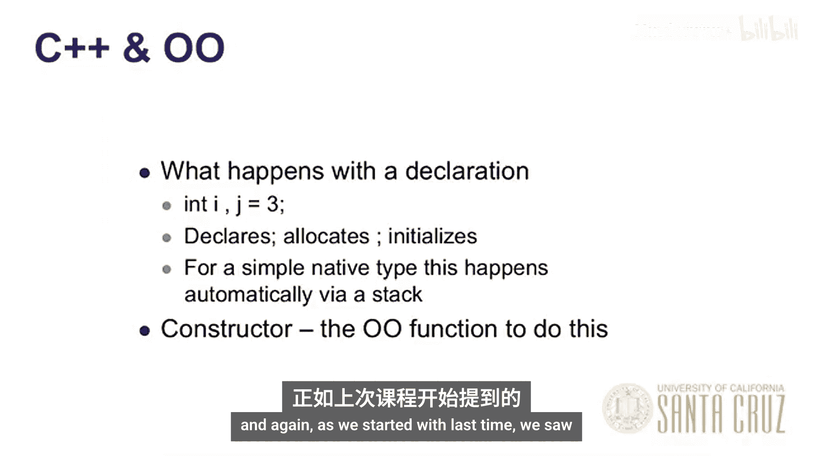
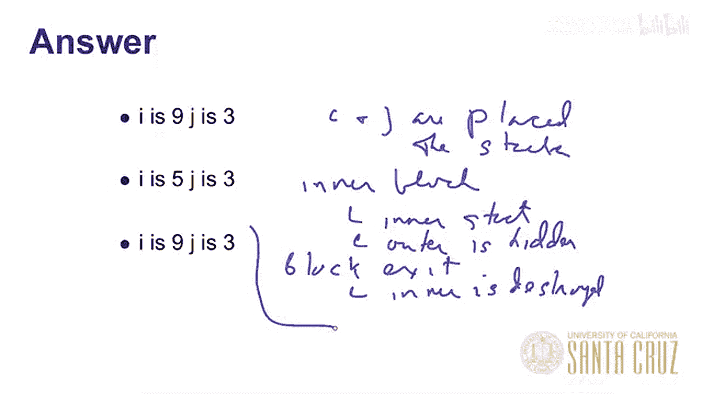

# C++编程：P21：面向对象编程深入

在本节课中，我们将深入学习面向对象编程风格。我们将探讨更多C++类的知识，以及如何以面向对象的方式构建它们。我们将再次审视构造函数和析构函数，这些是构建和释放新扩展数据类型的关键方法。最后，我们将讨论下一个重要的作业，这是一个基于图论的作业。

## 对象与设计思想

上一节我们介绍了面向对象的基本概念，本节中我们来看看如何具体思考对象设计。

对象可以是任何事物。在这个小例子中，我们考虑的是形状。形状可以是盒子、多边形、技术图形等。可以对它们执行操作，比如删除，或者涉及统计形状数量的操作。




如果我们想构建一个窗口环境，我们的控件集合应该是什么？应该有哪些操作？这个程序包的用户会期望什么？我们如何正确地设计事物并保持内部细节的隐藏？所有这些都是在成为面向对象C++程序员时必须思考的问题。

再次强调，进行这种思考过程的最佳指导原则是了解原生类型会发生什么。对于原生类型，我们必须完全理解声明某些内容时会发生什么，即使是一个简单的`int`对象。

## 原生类型的行为回顾

为了理解用户定义类型，我们首先需要回顾原生类型在代码块中的行为。

以下是一个包含嵌套代码块的示例：
```cpp
int main() {
    int i = 9;
    int j = 3;
    // 打印 i 和 j
    {
        int i = 5;
        // 打印 i 和 j
    }
    // 再次打印 i 和 j
}
```

以下是具体分析：
*   在外部代码块中，`i`被声明并初始化为9，`j`被声明并初始化为3。
*   在内部嵌套代码块中，重新声明了`i`并初始化为5。此时，外部代码块的`i`被隐藏。
*   内部代码块中的`j`没有重新声明，因此使用的是外部代码块的`j`。
*   当退出内部代码块时，内部声明的`i`被销毁。
*   回到外部代码块后，打印的`i`值恢复为9，`j`值仍为3。

从内存分配的角度看，`i`和`j`被放置在栈上。进入内部块时，`i_inner`被放置在栈上，`i_outer`被隐藏。退出内部块时，`i_inner`被销毁。然后我们返回到外部块，栈上仍然存在值为9的`i`和值为3的`j`。





## 构造函数与析构函数

对于简单的原生类型，所有这些（声明、分配、初始化）都是自动发生的。在栈上，我们必须为用户定义的类型（即我们的对象）复制这种行为。

正如我们上次开始看到的，我们有一个特殊的方法来完成这个任务，称为构造函数。


构造函数负责对象的构建和初始化。相应地，析构函数负责在对象生命周期结束时释放资源。它们是管理对象生命周期的关键。

## 图论算法与作业介绍

接下来，我们将讨论基于图论的作业。所有同学都具备大约大二水平的计算机科学背景，可能已经见过标准的图论算法，因此这对你们来说可能很熟悉。

无论如何，我将复习所有这些材料。所以，即使你忘记了，或者过去没有足够的基础，我们也将真正理解迪杰斯特拉最短路径算法，这将是我们第二次作业的基础。


本节课中我们一起学习了面向对象编程的深入概念，回顾了变量在代码块中的作用域和生命周期，强调了构造函数和析构函数在管理用户定义类型中的关键作用，并介绍了即将进行的基于迪杰斯特拉最短路径算法的图论作业。理解这些基础对于构建健壮、可维护的C++程序至关重要。