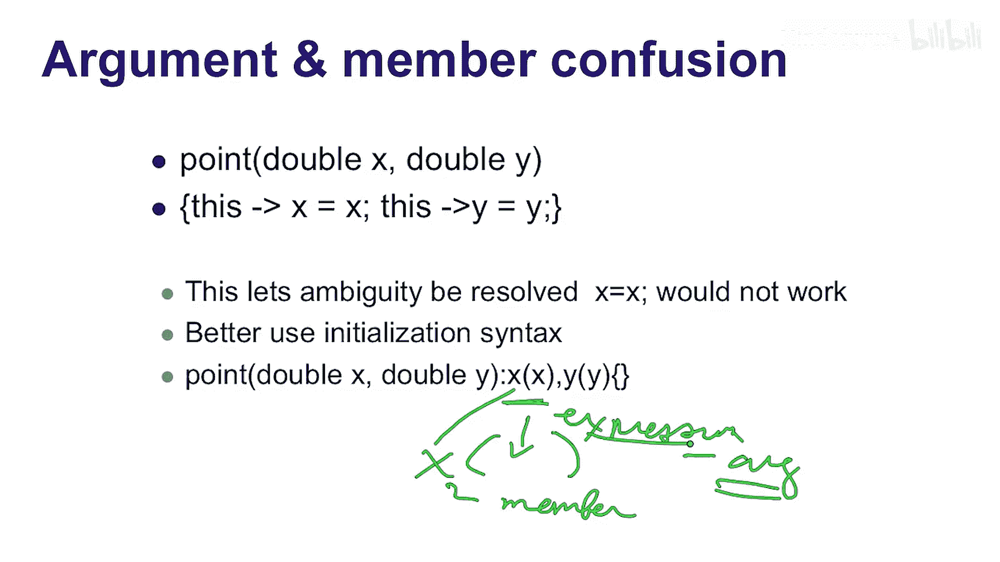

# 【加州大学】C++编程-｜-C-Plus-Plus-A-p22-P22_3-2-点及其构造函数_03_01_03--BV1p2ejzREUQ_p22-

So let's return to our object point。And let's again look at its constructor logic and we're going to see how to write that default constructor。

 so here's point。And critical to building new objects in the object oriented world is to write special。

Methods called constructor methods。And。Always important in construct methods is the default constructor and the default constructor is a constructor。

Whose signature。Is empty。Now notice the constructor always has the class name。

That's how you determine that this is a constructor。

And here's the empty signature Now notice in here it looks like I have two arguments， X and y。

 which I do， but that actually both arguments have default values。So this signature by itself。

Covers a lot of ground， it's a very useful what you might call abbreviation because what it's covering is。

A signature in which you could replace。You could use point with no arguments。Point with one argument。

And point with two arguments。In the no argument case， the point that was created。

So if we had declared something like point。Or。No arguments。

R is going to be created with internal representation x equals0 and y equals0。In this case。

 if we had a point Q。With one argument。It would invoke this constructor。And that would mean that。

You would have。Data value， 1。10。0。And then if you had the two argument case。

 you would have the data point 1。12。2。Now we're going to see and we're going to talk a lot more about constructors that there are other very important constructors。

 and almost always when you build a new object， you have to use the default constructor。

 but you also have to build something like a copy constructor and you frequently have one argument constructors which can also be used for conversion possibilities。

 you might even call them conversion constructors。All of those are very critical and should always be thought about when you create a new object like a point。

Now the other thing critical to this。That you might not have seen before is the use of。

Initializer lists syntax。Notice。At the actual semantics of this constructor。

 as found in the code body。They're empty， it looks like nothing gets executed， but that's not true。

Because this initialization happened， so instead of it being assignments inside of here。

And you could make these assignments， and we'll show that later in later lecture in this segment。

That you will be able to use the self referential point or this。

It'll be able to say something like this， arrow x equals x。

But you can't always do that and you can't always do that because there are special cases where。

 for example。The hidden representation is not mutable。

 could be a con value and you can't assign to a cont value。

 so you couldn't use semantics that were in here with assignment instead you must use initialization semantics。

 so it's very important to understand where initialization semantics。Are preferable。

And where they must be used。We'll go on to talk more about this。Again。

 remember that this pointer is self referential， we talked about that already。

 there's a key word this that has that as a special meaning。

 and again we'll see all of that in the next slide。

We now have three different constructors for point。Two of them。

 all three can be used to define the default constructor。 But the last one is the most。

The best use of C++。So here we're just using。Ordinary assignment。Here we're using。This pointer。

So this pointer is grabbing the member and the member。Is getting assigned。Here。

We're using initializer list。And initialize a list means that these values are initializations。

Because their initializations and not assignments， and here there were assignments。

It turns out that we have a far larger range of things we can do with this last and best way to do it。

So， this is。My preferred。If， for sample。We had a widget。

In which one of our hidden members that we needed to initialize was a kst。 So we had a kst。Int。

Special ones call it。And that was hidden away in private。It would have been illegal to use。

The construct style of one or two。Because that involves assignment。

Assignment means we're mutating the values stored in this item。But this is initialization。

An initialization， much like with the native types， if we have a constant int。Special。

And we assign it five， that means it's going to be five。Throughout the range of that declaration。

 throughout the scope of that declaration。We're telling the compiler can't be modified called K's correctness。

 that's a very good thing to do。That helps us and prevents us from writing buggy code。

So the same thing is going to be true with an object。

 remember everything in the native language we want to replicate in building objects。

 and we may also want to have the ability to have members that are con and members that are con means that we have to have the ability to initialize。

So as I say， initialization is preferable to assignment。And only in the constructors。

 only in the constructors， are you allowed to initializing syntax？Which makes sense。

That's the construct's job， the constructor is to build the object and initialize it。

Anytime we were to call PQ&R as a point。All would call the constructor void signature now of course。

 you'd have to write that default constructor， the all call the default constructor。

And you would only choose one of those， you can't write all three because you'd have an ambiguity。

And they would call instructor， the construct with the void signature。Now。

 just because you have a void constructor doesn't give you all your opportunities。

It's also useful to have multiple ways to initialize objects， multiple ways。

Let's look at initializing。Point。With this signature， this says。And。Two doubles。In my argument list。

And the argument name is going to be x， or the a name is x。

But X is going to be assigned to the member。So this is the X， that's the argument。And this is the X。

That's the member。Used to disambiguate。Otherwise。I could have said point。Dabo。😔，X，Y，z。Kma。

And then I wouldn't need disambiguation， I would say X， Y， Z。Is equal to x。Because。

I would know that that's the only thing in the range of the method。

That X would then have to be the self referential X。

 but once I have an argument that argument name takes precedence over the self referential name and the way you disambiguate it is through the use of pointer notation and the this pointer。

So that's very important to keep in mind， sometimes the use of this pointer is unavoidable。

So summarizing。That this pointer lets ambiguity be resolved because x equals x wouldn't work。

 it would just be assign x to the argument X and that nothing would happen to the self referential object。

 the X part of the object。But even better would be。To use initializing syntax。不。

And the reason why that's better。Is。We don't have the same ambiguity problem。

 this X andatics are clear。In the initializing syntax， this has to be。A member。

And this has to be some expression。Which can be the argument。

So this provides for the disambiguation automatically。And we don't have to we can avoid。

The use of this。They're semantically equivalent。

