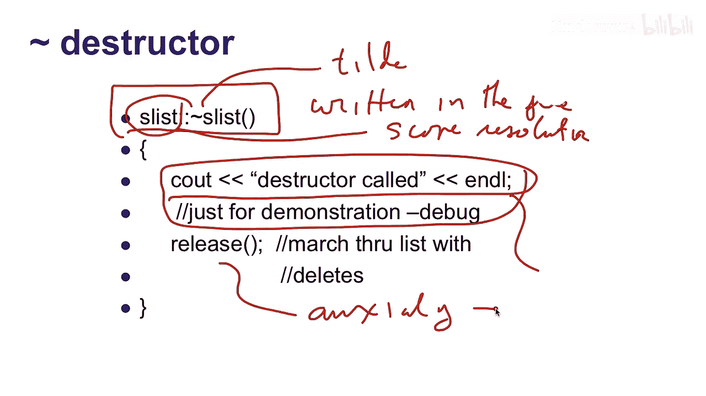

# 【加州大学】C++编程-｜-C-Plus-Plus-A-p23-P23_3-3-更多构造函数_03_01_04--BV1p2ejzREUQ_p23-

Constructors are very important they。Several functions。They initialize。

 we've been talking about initialization， they allocate。

Especially when we get the very complex widgets， widgets that require going to the heap and getting memory we'll see。

That there will be the use of new in those more complicated widgets。They also convert。

 so constructors of a single argument give you a prescription for what basically a static cast。

So if I have a prescription from an end type。To ap point。

It lets me take an integer value and convert it to a point or a double value。

 So anytime I have a signature of a single argument。That's a different type from。

Object being constructed。 I'm also providing。In C++ terms， a conversion operation。Also。

 the other thing we can find that good programmers will do is。When they have constructors。

 especially when they're debugging because they may want to avoid this for efficiency purposes。

They can put in checks for correctness by that， I mean。The constructors。

Can make sure that when they initialize state， when they give values to members。

 that those values represent legal values in the range that they want。

So if you're thinking of an experiment in which you are working with liquid water。

And you need to initialize its temperature。Well， we know in Fahrenheit that liquid water is between 32 degrees。

And 212 degrees below it freezes above， it boils。So if we were to assign a temperature to the liquid water widget。

And it was somehow out of that range。 We know we've given it an illegal initialization。

 So there's also the the possibilities in object oriented programming， using constructors to test。

Consistency coherence， the fact that legal values were provided in the initialization。Now。

You're coming from the sea community in the sea community when you wanted to manage the heap。 again。

 hopefully， this is review for you。 You use Malik， sometimes Calc。

 Malik was a memory allocator found in the C standard library。And。When you allocate it from Malck。

 youve got a certain number of bites off the heat。The operating system provided you the brights。

 Why did you do that， Well， you made， you may have needed something dynamically in a computation。

 The typical reason to use Calc or malic was I don't know how much data I'm going to process。

 I have a very large file。 The first entry to the file tells me how much data is sitting in the file。

 So it tells me I need to process。400000。Soal security numbers。

U now I need something that can store 400，000 social security numbers， well。

 that means I need a very large array。So dynamically， during the computation。

 by calling malik or calic， I can access the heap assigned to a pointer。

 which we can think of as a base pointer， that much memory and then use the dynamically allocated object。

 And then good programmers don't allow for memory leaks。 And so when I no longer need that。Memory。

 I would delocate it and the standard way I delocate。And C is to use free。

Free and malc and calic are replaced。A。Unless you're using much older style stuff。

 which you would have a special reason for with。The keywords new and delete and the keywords new and delete provide memory management operators。

 heat management built into the C++ system。Now， this heap is dynamically allocated memory。

 but unlike Java is not garbage collected automatically。 so you have to be。Very careful。

 more sophisticated than you would be in other languages where memory management involves automatic garbage collection。

 What's the upside to it， The downsides obvious， You can get memory leaks。

 and you have to do more complicated coding。 The upside is， you can be more efficient。

So here's some simple uses of going to the heap。We basically have。Two forms。

Two critical forms of the use of new and the symmetrical use of delete。

One is to get an array of items， which is going to be very often the case。So if we look at this。

We have a pointer type。 Its base pointer is char star pointer to cha。 and I want some。Dynaically。

Assigned value， size might be gotten from some other part of the computation。

 So maybe I have a text that has a million characters in it。 I need to process a million characters。

 sizes value is a million。 new is going to go to the heap。 Give me an address。

 that address is going to be the base address for the million characters， assigning tasks。

 if I only want a single。Only one is single。Element of that type initialized。

 Then I can do it with new event， and then。In this case， nine would be the value stored。

So this is one item， this is many items， and then if I delocate an array。

Corresponding to the two things up there。I need the special notation brackets for delocating an array。

 and I don't have brackets when it's a single element。Fairly simple。But something to keep in mind。

 you have to， you have to make sure that you use。These two items consistently。Now。

We've talked a lot about constructors。Why almost any kind of widget has some kind of construction that it needs。

 it needs it at a minimum initialization。However， destruction。Is much more trivial。

 typically destruction is。Has nothing to do with uninitialization。

 it has to do with retrieving largely memory for the object。

The memory for the object might have been automatically allocated on the stack。

 in which case we may not have an automatic， we may not need to write our own destructor。

 but anytime we're using new， we will immediately think about wanting a destructor anytime we use resources。

 system limited resources such as He memory we would want to call a destructor and the destructor has special syntax as well。

 and the critical part of the special syntax is。The tilda。So。If we had deal for point。

 it would be tilde point。And we can't overload the signature as we can。

 We can't have multiple We can have multiple constructors。

 but we can't have multiple de structuresors。 These structures don't get called with arguments。

So the destructor always has the empty or void argument list。And then。You have your semantics。

 and very typically that's going to involve some form of delete。What if you forget these structures。

 a lot of people forget these structures。When I was first doing C++ and this is now in the 1980s。

There was a colleague from another university who came around and gave a talk on his research。

 and he had also decided to use C++ he' had previously been using C and he liked all the new stuff。

So he had this very complicated set of routines。And he was dynamically allocating lots of memory throughout。

And。I was still a relative novice and I was。Worrying about memory leaks， so I asked them， well。

 what do you do about writing your D structures and making sure everything's working properly and he said。

 oh， I never worry about the D structures， I don't write them。

And that's okay if you don't worry about memory leaks， remember。

 memory leaks generally won't show up in your program malfunctioning。The memory。

Typically gets reallocated by the operating system when your process ends。

And most of these systems have that built in like a Uni system。However。

 if you're using large amounts of memory and you're frequently going to the operating system。

It can easily slow down what you're doing。So。You really want to。

 if you're a high quality C++ programmer， get into the habit。Of properly writing your des。

 That's just a very important and useful skill。So let's see。

A widget in which memory allocation is important。 It wasn't important in the way we defined point。

But here's a classical。Data structure we see in this slide， the section in the text。

 so if you want to reference the text。Go and look for a single list element in that text that's in page 168。

 and certainly you've all had。In your background， some programming of a single link list， so recall。

The case of a single list linked list。We typically have a header pointer。 We typically draw it。

 It's like a little train of。Moxes。With arrows。 and then。呃。

It would end with something we also call a no pointer。 So this would be canonically。

 if you study computer science， one of your classic。Expandable data structures。

 dynamic data structures。And there's a single en listist。You'll find that there are of course。

 other things， if you wanted， you could also have a DoubE linked list。

That has other navigational possibilities。 We'll see that when we take up the topic of the。

AStard template library that list in the standard template library is indeed a doubly linked list。So。

Constructor， here's the default constructor。The default constructor has the head point at zero。

 so that's in effect the empty list， there's no little box cars。To point at。Zero is an null pointer。

Now， if we start building a list。It'll turn out。That we want to call the D structure to。

Return or delete。The box cars。So the lead is going to call a special method。

 you might call it an auxiliary method， and that auxiliary method is going to race through the structure。

 and as it races through the structure， it's going to return each element back to the heap。

So conceptually， hopefully， you've seen this kind of notation。And you've done this kind of coding。

Previously。So here's the standard。This structure operation。For a singly linked list。

It's called prepend。What Prepen does is it puts an element on the front of the list。

On the front of the list。The underlying element here is going to be。呃。A character。And。We start by。

Building a new SL element， so that comes off the heap。When we use new， when we use the operation new。

Largely this will work， but if for some reason there is exhaustion， we will get an exception thrown。

In modern C++ 11， that exception is going to be a standard exception， bad allocation。

And that's going to unless it's handled。Cause an abort so you can either handle it or cause an abort。

then typically that's quite safe。Now， here。To do the prepen， we have to create a new header。

Update the header by adding the。New character into the data。

Position in the new list and then we update the head so if we had a list head。

That conceptually pointed at something where we had stored the character。Si。lowerercase A。

And then this was the null list， no pointer。So we'd have a single element list。

 and now we want to insert or prepen the character B。We would end up with H。Pointing at。

A new element， a new Sless element in which。The object the data being stored is the character B。

 and then this was pointing to what was in effect。The older S list。And that had A in it。

So that's prepen。And if my little boxes that I drew worked right， prepen would work right。

 I think I've tested this， you can test it。And see that it indeed works。

And now let's look at the D structure。Okay， we have our special。

Way of naming a destructor uses Tilde。Only used in de structuresors。Otherwise， we use the class name。

And we're assuming。This is written。In the file。So it's not inside the scope of the class。

 so that's why it's using scope resolution。And just for purposes of playing around with the stuff and seeing how it works。

I'm going to。Use this during the buggings， so I know when the de is called， so this is very useful。

If。You're having trouble having a good intuition about how this happens。It's very worth。

Writing that out so you can see dynamically when you run the program when the D structure will be invoked。

 this will get printed to your screen and you can try and figure out when this will be invoked and then there's this auxiliary function which I haven't shown you how to write yet。

Which should march through the list。Performing deletions。

