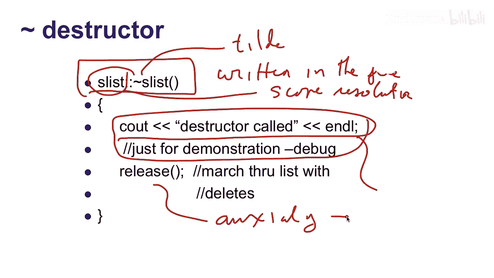

# C++编程：P23：更多构造函数


## 概述

在本节课中，我们将深入学习C++构造函数和析构函数的更多细节，特别是它们如何管理动态内存（堆内存）。我们将探讨构造函数的多重角色、`new`和`delete`操作符的使用，以及如何为包含动态内存的类编写正确的析构函数来避免内存泄漏。

## 构造函数的多重角色

上一节我们介绍了构造函数的基本概念。本节中我们来看看构造函数承担的几种重要功能。

构造函数非常重要。它们承担着多个功能。

**初始化**：构造函数负责初始化对象的状态。我们一直在讨论初始化。

**分配内存**：特别是当我们处理非常复杂的“部件”（widgets）时，那些需要从堆上获取内存的部件。我们将会看到，在这些更复杂的部件中会使用`new`。

**类型转换**：单参数构造函数提供了一种转换规则，本质上相当于一个静态类型转换（`static_cast`）。例如，如果有一个从`int`类型到`Point`类型的构造函数，它允许我将一个整数值转换为一个`Point`对象，或者将一个`double`值进行转换。因此，任何具有单参数签名的构造函数，只要其参数类型与正在构造的对象类型不同，在C++术语中，就同时提供了一种转换操作。

**正确性检查**：优秀的程序员在编写构造函数时，尤其是在调试阶段（尽管出于效率考虑可能最终会避免这样做），会加入正确性检查。这意味着构造函数可以确保在初始化状态、为成员赋值时，这些值代表的是合法且在其期望范围内的值。例如，如果你在处理液态水的实验，需要初始化其温度。我们知道，在华氏度下，液态水在32度到212度之间，低于此范围会结冰，高于此范围会沸腾。因此，如果我们给液态水部件分配一个超出此范围的温度，我们就知道进行了一次非法的初始化。在面向对象编程中，构造函数还提供了测试一致性、连贯性以及初始化值是否合法的可能性。

## 动态内存管理：从C到C++

你来自C语言社区。在C社区中，当你想要管理堆内存时（希望这对你来说是复习），你会使用`malloc`，有时是`calloc`。`malloc`是C标准库中的内存分配器。当你从`malloc`分配内存时，你从堆上获得一定数量的字节，这是操作系统提供给你的。你为什么要这样做？你可能在计算中需要动态的东西。使用`calloc`或`malloc`的典型原因是：我不知道要处理多少数据。我有一个很大的文件，文件的第一个条目告诉我文件中有多少数据。例如，它告诉我需要处理40万个社会保险号。那么我需要一个能存储40万个社会保险号的容器，这意味着我需要一个非常大的数组。因此，在计算过程中，通过调用`malloc`或`calloc`，我可以动态地从堆上分配内存，将其地址赋给一个指针（我们可以将其视为基指针），然后使用这个动态分配的对象。优秀的程序员不允许内存泄漏。所以当我不再需要那块内存时，我会释放它。在C语言中，释放的标准方式是使用`free`。

`free`、`malloc`和`calloc`在C++中已被取代。除非你使用非常古老的风格代码（你会有特殊理由这样做），否则它们被关键字`new`和`delete`所取代。`new`和`delete`关键字提供了内置在C++系统中的内存管理操作符，用于堆管理。这个堆是动态分配的内存，但与Java不同，它不会自动进行垃圾回收。因此你必须非常小心，相比其他具有自动垃圾回收机制的语言，你需要更复杂的编码。

它的缺点很明显：你可能会造成内存泄漏，并且必须进行更复杂的编码。它的优点是：你可以更高效。

## `new`和`delete`的基本用法

以下是使用堆内存的一些简单例子。我们基本上有两种关键形式来使用`new`，以及与之对称的`delete`用法。

一种是获取一个项目数组，这将是常见情况。让我们看看这个例子：

```cpp
char* text = new char[size];
```

我们有一个指针类型，其基指针是`char*`（指向字符的指针）。我想要一些动态分配的值。`size`可能来自计算的某个其他部分。例如，我可能有一个包含一百万个字符的文本，我需要处理这一百万个字符，`size`的值就是一百万。`new`会去堆上分配，给我一个地址，这个地址将成为这一百万个字符的基地址，并赋值给`text`。

如果我只想要该类型的单个元素并进行初始化，那么我可以这样做：

```cpp
int* ip = new int(9);
```

在这种情况下，`9`就是存储的值。

所以，第一种是多个项目（数组），第二种是单个项目。相应地，如果我释放一个数组，我需要使用特殊的括号符号来释放数组；如果是单个元素，则不需要括号。

```cpp
delete[] text; // 释放数组
delete ip;     // 释放单个元素
```

相当简单。但需要记住的是，你必须确保一致地使用这两种形式。

## 析构函数的重要性

我们已经讨论了很多关于构造函数的内容。几乎任何类型的部件都需要某种构造过程，至少需要初始化。然而，析构则简单得多。通常，析构与“反初始化”无关，而主要与回收对象的内存有关。对象的内存可能是在栈上自动分配的，这种情况下我们可能不需要编写自己的析构函数。但是，任何时候我们使用`new`，我们都应该立即考虑是否需要析构函数。任何时候我们使用系统有限的资源（如堆内存），我们都希望调用析构函数。析构函数也有特殊的语法，其关键部分是波浪号`~`。

例如，如果我们的类是`Point`，那么析构函数就是`~Point()`。我们不能像重载构造函数那样重载析构函数的签名。我们可以有多个构造函数，但不能有多个析构函数。析构函数调用时不带参数，因此析构函数总是具有空的或`void`参数列表。然后你编写它的语义，这通常涉及某种形式的`delete`操作。

如果你忘记了析构函数会怎样？很多人会忘记。当我最初在20世纪80年代使用C++时，有一位来自其他大学的同事来做研究报告，他也决定使用C++（他之前用C），并且喜欢所有的新特性。他有一套非常复杂的例程，在整个过程中动态分配了大量内存。我当时还是个相对的新手，很担心内存泄漏，所以我问他：“你如何处理编写析构函数并确保一切正常工作？”他说：“哦，我从不担心析构函数，我不写它们。”如果你不担心内存泄漏，这也许可以。记住，内存泄漏通常不会导致你的程序功能失常。内存通常在进程结束时由操作系统重新分配，大多数系统（如Unix系统）都内置了此功能。然而，如果你使用大量内存并且频繁地向操作系统申请，很容易减慢你的操作速度。因此，如果你想成为一名高质量的C++程序员，你真的应该养成正确编写析构函数的习惯。这是一项非常重要且有用的技能。

## 示例：单链表的内存管理

让我们看一个内存分配很重要的部件例子。在我们定义`Point`类的方式中，内存分配并不重要。但这里有一个经典的、在本幻灯片和教材章节中出现的数据结构。如果你想参考教材，请查阅第168页的单链表元素部分。当然，你们在背景知识中都有过单链表的编程经验。

回顾一下单链表的情况。我们通常有一个头指针。我们通常把它画成像一列小火车的盒子，带有箭头，最后以一个我们称为空指针的东西结束。这是计算机科学中的经典动态可扩展数据结构之一——单链表。当然，你还会发现其他结构，例如，你也可以有双向链表，它提供了其他的导航可能性。当我们学习标准模板库（STL）时，会看到STL中的`list`确实是一个双向链表。

以下是默认构造函数：

```cpp
SList::SList() : head(0) { }
```

默认构造函数让`head`指向`0`，这实际上就是空链表，没有“小车厢”可以指向。`0`就是空指针。

现在，如果我们开始构建一个链表，结果是我们需要调用析构函数来删除这些“车厢”。因此，析构函数会调用一个特殊的方法（你可以称之为辅助方法），这个辅助方法将遍历整个结构，在遍历过程中将每个元素释放回堆。

从概念上讲，希望你已经见过这种表示法，并且以前做过这种编码。

以下是标准的“前插”操作：

```cpp
void SList::prepend(char c) {
    SLink* new_link = new SLink(c);
    new_link->next = head;
    head = new_link;
}
```

“前插”做什么？它把一个元素放在链表的前端。这里的基础元素将是一个字符。我们首先构建一个新的`SLink`元素，这是从堆上分配的。当我们使用`new`操作符时，大部分情况下这会正常工作，但如果由于某种原因内存耗尽，将会抛出一个异常。在现代C++11中，这个异常将是一个标准异常`bad_alloc`。除非被处理，否则这将导致程序中止。所以你可以选择处理它或导致中止，通常这是相当安全的。

现在，为了执行前插，我们必须创建一个新的头节点，通过将新字符放入新链表的数据位置来更新头节点，然后我们更新`head`指针。如果我们有一个链表头`head`，它概念上指向存储了字符`'a'`的某个地方，然后这是空链表（空指针）。那么我们有一个单元素链表。现在，我们想要插入或前插字符`'b'`。我们最终会让`head`指向一个新的`SLink`元素，其中存储的数据对象是字符`'b'`，而这个新元素指向了实际上是旧的链表（其中包含`'a'`）。这就是前插。如果我画的小盒子正确，前插就会正确工作。我想我已经测试过这个，你可以测试它，看看它是否确实有效。

现在让我们看看析构函数：

```cpp
SList::~SList() {
    std::cout << "Destructor called" << std::endl;
    clear();
}
```

好的，我们有一种特殊的命名析构函数的方式，使用`~`。`~`只用于析构函数。其他情况下我们使用类名。我们假设这是在类外部（例如在`.cpp`文件中）编写的，所以它使用了作用域解析运算符`::`。只是为了试验这些东西并了解其工作原理，我将在调试期间使用这个输出，这样我就知道析构函数何时被调用。如果你对这种情况如何发生缺乏良好的直觉，这是非常有用的。写出这个非常值得，这样当你运行程序时，你可以动态地看到析构函数何时被调用，这将被打印到你的屏幕上。然后你可以尝试弄清楚这将在何时被调用。之后还有一个我还没有展示如何编写的辅助函数，它应该遍历链表执行删除操作。

## 总结



本节课中我们一起学习了C++构造函数和析构函数的进阶知识。我们明确了构造函数的三个核心角色：初始化对象、分配动态内存以及提供隐式类型转换。我们对比了C语言的`malloc/free`与C++的`new/delete`在堆内存管理上的区别，强调了后者与构造/析构函数的集成性。通过单链表的实例，我们深入探讨了如何为管理动态内存的类编写构造函数和至关重要的析构函数，以防止内存泄漏。记住，对于使用了`new`的类，编写对应的`delete`逻辑的析构函数是高质量C++编程的基本要求。