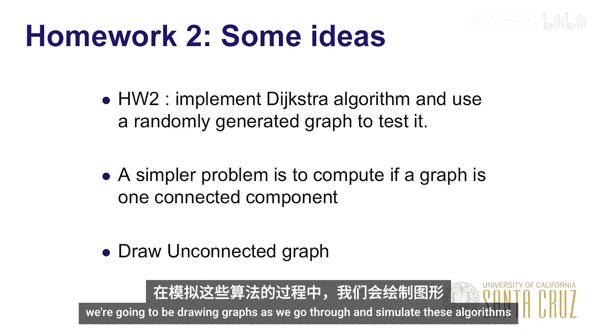
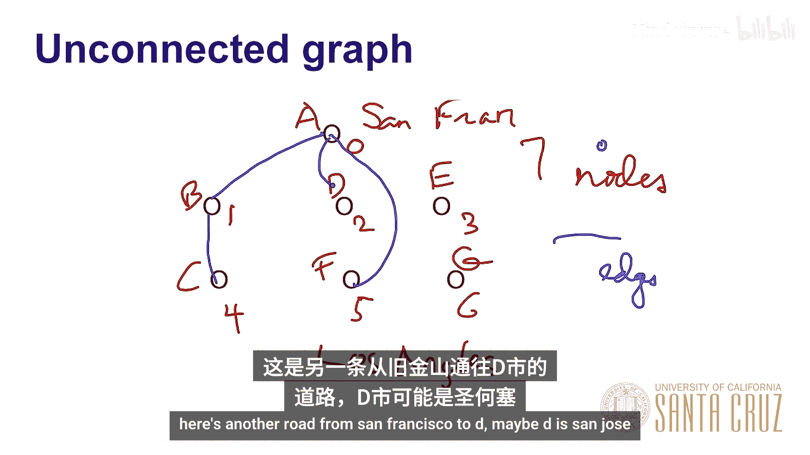
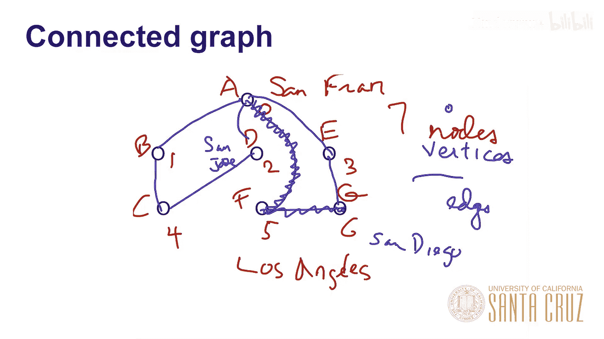
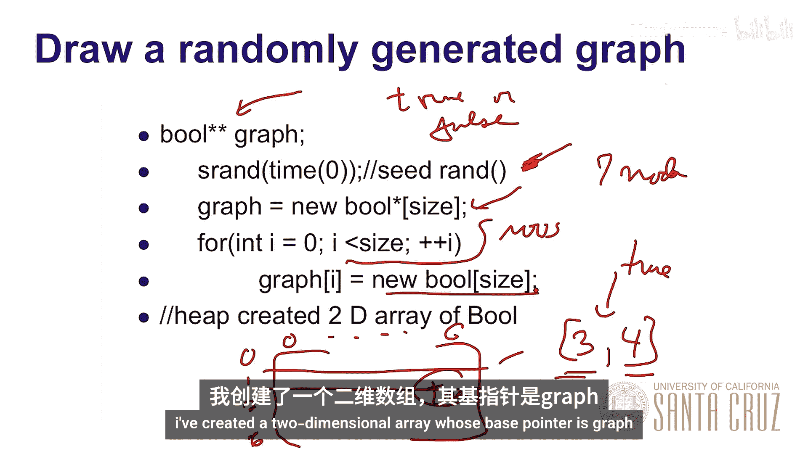
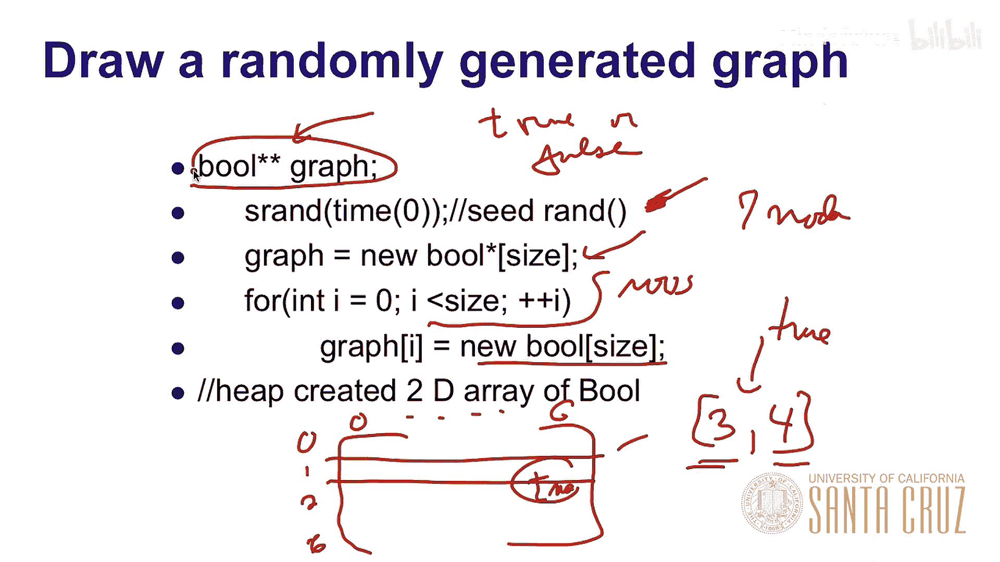
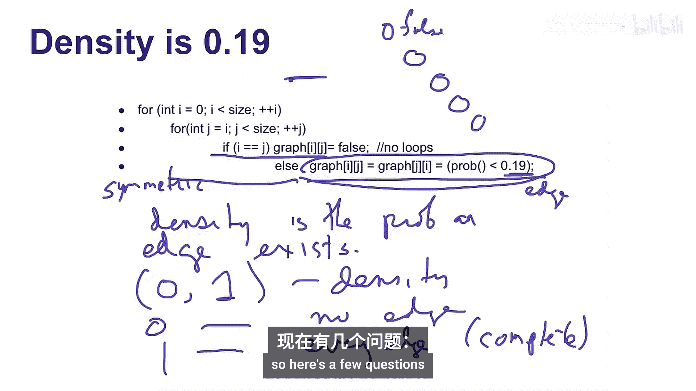
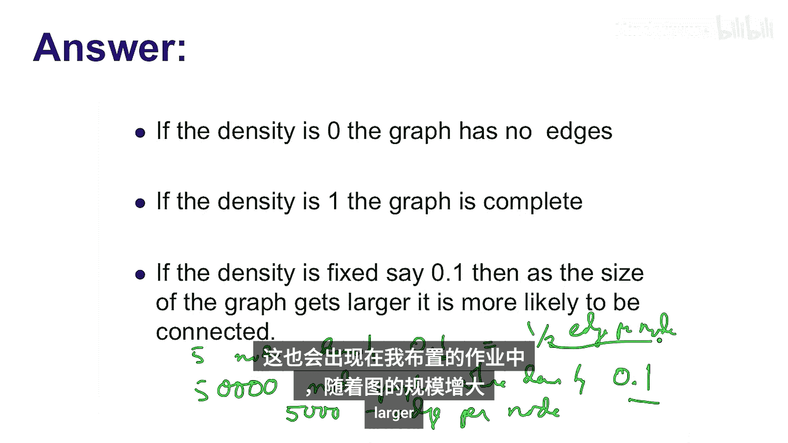

# 【加州大学】C++编程-｜-C-Plus-Plus-A-p24-P24_3-4-使用迪杰斯特拉算法_03_01_05--BV1p2ejzREUQ_p24-

So。Part of what the course is going to give you expertise in。Is algorithmic graph theory。

Because it's a very， very good subject because graphs themselves。A widgets。

 complicated widgets that have very different representations in many ways to try and implement and get efficient for particular different instances。

And so we can see a lot of the O0 ideas and a lot of the uses of C plus plus effectively when we try to implement these algorithms in C plus+。

 but also， it gives you some background。In doing further and more complicated programs as this course。

And its sequel progresses。And one of the classic algorithms in computational graph theory was invented by the very famous Dutch。

Mathematician computer scientist Edward Dextra， so we're going to see how to use Dyextra's algorithm and your homework is going to be to implement Dytra's algorithm and use it on a randomly generated graph。

 which you'll also have to implement。We'll also show you how to do a very similar but simpler problem based on an algorithm that I invented many。

 many years ago。Originally， I implemented in a much earlier programming language called PL1。

And it's the problem of finding out whether a graph is a simple one connected component graph。

And we're also going to have some drawing lessons we're going to be drawing graphs as we go through and simulate these algorithms。

So this is a set of ideas we're going to need to do the remaining homework in this class。

So here's an unconnected graph。And that unconnected graph。It's a graph of seven nodes。

We might label these nodes， zero， one， two， three， four， five， six。

That would be traditional C labeling， namely， we start from zero， we might label these nodes， A， B。

 C， D， you'll see all these labelings in the graph literature。

Or you might see them as nodes on a graph， maybe this is San Francisco。And this is Los Angeles。

All of these are possible。It's unconnected because we can't go from any node to any other node。

 we don't see any path。Between in this unconnected graph between San Francisco and Los Angeles。

 we just see nodes。Now， here's what we're going to show as a connected graph。

So I have left the same labeling。And now I'm going to add what are called edges。

So these blue lines are what we call as edges。The little circles are notess。

 little blue lines are edges。When you think of edges。Think of。Rhodes。

So here's a road from San Francisco going to Los Angeles。For us who are Californians。

 that might be 101。Here's another road from San Francisco to D， maybe D is San Jose。

Maybe this is San Diego。So again， you have familiarity in the ordinary world with graphs。

 they're basically just roadmaps。And there are roadmaps in which the cities are nos。

And the highways are。Edges。Now。I'll draw a few more edges。 If you look at this connected graph。

The reason it's connected is I can find a path between any two of the cities， any two of these nodes。

 or another term for nodes is vertices。So if I want a path。From。San Francisco to San Diego。

I'll use this。We'll wigggly line and show you here， oh， there's a path。

So that whole graph is connected and indeed a single component。

Now。How can I get？A computer to draw a graph。Drawing a graph by computer。

It's actually fairly efficient。And the critical thing will be， to generate。Using a representation。

For the graph， an internal representation。A。A number of vertices。

 we'll have to decide on the size of the graph。And then we'll have to decide what edges will be placed in the graph。

And this particular algorithm I'm going to show you that'll generate a randomly generated graph。Will。

Use the heap and create。A two dimensional representation of the graph。So let's see what that means。

The overall graph is going to be a pointer。That ultimately stores Boolean values。

 what are Boolean values are the values true or false？If I have a graph。That has edges。

 let's say they were like， what we just saw is zero to6。And I have true。In one of the matrix entries。

 So let's say in element 3，4。I've stored true。This is going to mean that the edge from vertex 3 to 4 exists。

That's what's being created by this little routine。The way it's created is。

I see the random number generator。I hopepe this is all review。

 otherwise you'll have to review how a pseudo random number generator works。

I create a graph in this case of the appropriate size。It's a graph that is has seven。Nos。And then。

For each node， I have to have a row， a Boolean row。So these are the rows。

That's what's being created here。And then these are all capable of storing a Boolean value。

 so the heatap。As allocated off the heap through this for loop。

 I created a two dimensional array whose base pointer is graph。

And now。I put edges in， and I'm going to put edges in according to a density。

 What do I mean by a density？Density。Is the probability and edge exists。

So that can be zero or it can be up to one。 That's what density， the range of densities there are。

0ero would mean。That I'm never going to put。If， if。If this had been 0。

 no probability would be greater than0， less than 0。 And so I'd never put in an edge。

 This is the act of putting an edge in。0 would lead to no edges。One would lead to every edge。

The term here is complete。 A graph that has all its edges， all its possible edges is called complete。

So。We have a for loop。The for loop marches through the two dimensional graph。If。I equals J。

 that means if it's on the diagonal， we automatically put in false。Otherwise。And this is symmetric。

 this turns out to be。The undirected graph。If the probability。In our case。

 we're looking at a density of 0。19。 So roughly one in five times I'm going to stick an edge it。

And probability is just some function I computing using the random number generator。

You may have to review that or you may have to look at the code that's online for the probability function。

That will generate。A randomly generated graph of the given density。 so here's a few questions。

Density is zero， the graph has no what。Density is one。 the graph is what。The sea word。

If density is fixed， say to some size and the graph gets larger。What can we say about it？

Likely it how likely it is to be connected。Take a second to look at that。Okay。

 as we just said already， zero means the calculation says no chance。

You're never going to stick an edge in。 One means you're always going to stick an edge in。

 so it's going to be a complete craft。And now if the density is 0。1。And we have a size that grows。

 So let's say we have。5 nodes。😔，Density is one。Point1， I should say， point1。

That means one/ tenth of a time in a phn graph， we're going to stick an edge。Well。

 that's not going to happen often， five nodes， that means roughly speaking。

 we're going to throw in an edge 50% of the time for that particular node。Well。

 that's not going to be connected。So it's very unlikely。Let's say we go to。呃。50，000 node graph。

Who density is 0。1。So if you're following me， a 50，000 node graph。And we have lots of 50。

000 old graphs in the real world， just think of the map of all the cities in the United States。

And if you're thinking about the map of all the city in the United States。

How many roads are there out of an individual city， Maybe there's 20 roads out of an individual city。

 that might even be a big city。 So a density of  point1 in a big map is not all that this would mean01。

Would mean that， on average。We're going to get。5000。Edges。Per node。

Here it was on average one half edge per node。One half inch per node for a small graph。

It's going to leave us unconnected。5000 edges out of a 50000 node graph is going to leave us with。

A humongous number of paths in that graph。 and is very likely to almost certainly。

With probability approaching one going to be connected。

So if you have a good intuition about what we've been talking about with these randomly generated graphs。

 and this going to come up in the homework I'm assigning you as the graphs get larger， namely。

 the number of vertices， the number of nodes in the graphs get larger。

 having a particular density makes it more and more likely that there are。

Pass between all the nodes。