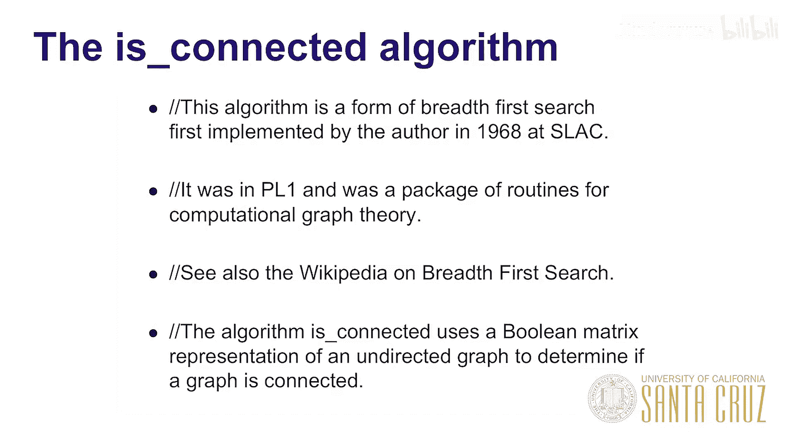
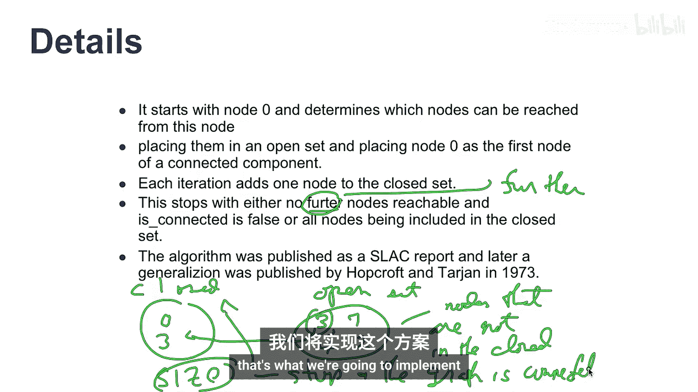
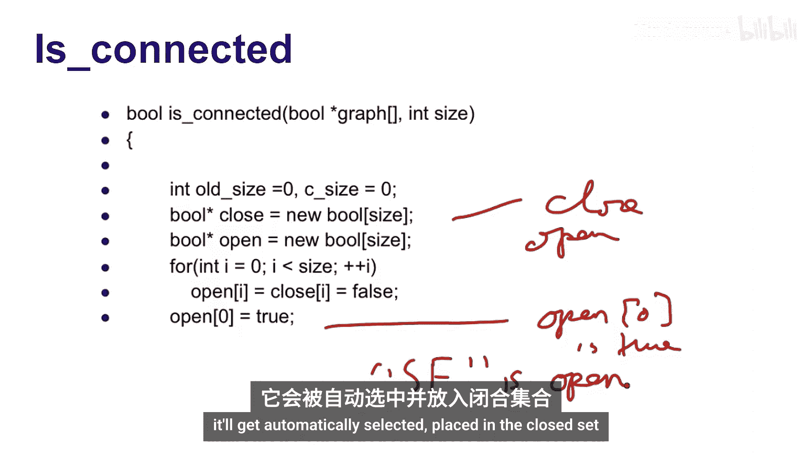
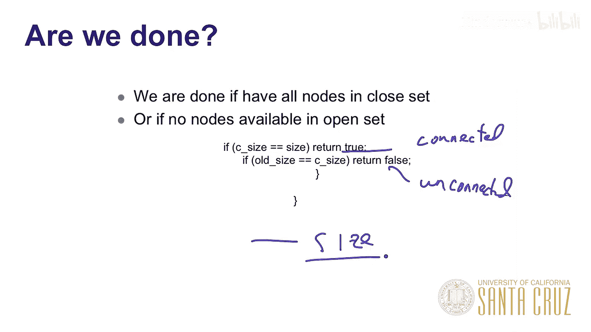

# 【加州大学】C++编程-｜-C-Plus-Plus-A-p25-P25_3-5-“is-connected”算法_03_01_06--BV1p2ejzREUQ_p25-

Okay， so。While I'm assigning you a homework problem， that's the true shortest path algorithm。

I'm going to show you some processing of handling the Iconive problem， they're related。

To some extent， you could in fact use Dyke'sster's shortest path algorithm。

And it's in one form to find whether a graph is connected or not。

But the simpler one should give you ideas about how to do the Ttra algorithm。

 and this goes back to my own work back in 1968 when I was a research graduate student research assistant at the Stanford Linear Accccelerator Center and I was being asked。

To use this very new programming language called PL1， which is more or less out of favor now。

 but still available。And the interesting thing about PL1 was it was an attempt to get a universal programming language。

PL1 was supposed to be IBM's ability to having to do away with special purpose languages and IBM was finding that it wanted to be a hardware in a company。

 not a software company， that wanted to sell big machines。

 which generally filled up lots of space and cost lots of money。

And software was an irritating expense。 And so the fact that they had to provide。

Machine language compilers。Macro preprocessors， cobal compilers， fortunetran compilers。

 sometimes alcoholgal compilers。That was just a lot of different software they were supporting。

 And they just felt， well， why can't we get a universal language and that will simplify our task And they tried。

 And the way they tried was， unfortunately， what I call the kitchen sink approach。

 So they took everything they had in all these different languages through them altogether。

 It was a lot of redundancy in。In this language， you could do things in a cobal manner or a forran manner。

 there wasn't an obvious PL1 manner to do things。And that's in a way why P1 didn't survive the object oriented revolution。

 Object orientation allows you to have a much simpler idea of what a kernel language is in our case C。

 and then expand it by letting the programmer add classes。Whenever they needed yet a new domain。

 a new set of widgets to work with。Now。The algorithm I'm going to describe goes back to work that I did and was documented in some reports at Slack。

 but later it was generalized in a very important way by Tarjent and Hopcroft then is a foundational algorithm called Breth first search。

 and you can certainly read about that。So this is also a vital algorithm that you should be familiar with。

 B first search and can find it in Wikipedia。

And what we're going to do in trying to find out whether a graph is connected is we're going to start arbitrarily with some node。

 and since everything in C starts at0 and we'll probably use a labeling system that says we'll have node0 up to node n -1 or up to node size -1。

We will assume that。 no0。Think of our map before San Francisco if I'm sitting in San Francisco。

 I've reached San Francisco， so San Francisco is automatically connected to San Francisco。

So we're going to have this。Initial set。And in that initial set will puts the node zero。

Then we will look from San Francisco and see where are the next， where are the adjacent。

Cities we can reach。And this will be what I would call a close set。

And in what I'm going to call an open set， I'm going to put nodes reachable from San Francisco。

So if I could reach node3 and node7。Those will be no in the open set now。

 what if there was no way out of San Francisco？Maybe there's been a huge earthquake and all roads have been busted。

What does that mean means the graph is disconnected， I can't get from San Francisco to San Diego。

I could stop。So if I have a close set automatically with the starting node。

 and if there's no edges out。Well， then the algorithm would stop and report that the graph is not connected。

However， if there are ways to get out of San Francisco， namely， I can go to Los Angeles or San Jose。

 as was in that early map I showed you， those notes。With their names， we would go into the open set。

And then each time I would go to the open set and pick off the next node， maybe in my algorithm。

 I'd pick the node with the lowest number。Take that note and drag it over。Place it in the closed set。

And look again for what。Places I can go from node three。And maybe I could go to node4。And no two。

 And they would become new entries in the open set。

 So the open set would contain node that can be reached from what was put in the closed set。

With the provisio that I don't need and I don't need to go back to something in a close set。

 If there's another way to get back to San Francisco， that's not of interest。

 So the open set will only have。Nodes。That。Are not en closeded， not in the close set。

The calculation will stop when one of two things happen。Either， this is。

And not talking about German there further。Either I can't reach all the nodes in which case。

The open set as exhausted。The close set has yet to contain。Size and nodes。All the nodes in the map。

So I'm not connected。Or all the nose。The set of nodes that are now in the close set are， in fact。

There are sides of them。And then we can stop。And that。Graph。Is connected。So that's our algorithm。

That's what we're going to implement。

We go back and we have our matrix representation of the graph。We have it as a boolean。

Matrix representation。We have the size of the graph。And we're going to keep track of。Close。😔。

And open。And here is where。Open。Of zero is true。That's like saying San Francisco。Is。

Originally in the open set。And it'll be the first since it'll be the only thing in the open set。

It'll get automatically selected， placed in the closed set。

So at this point， the open set has no zero on it。It could work if any other node is placed in it。

 there's nothing special about zero to determine whether the graph is connected or not。

Nothing is yet in the close set and each iteration will add one node to the close set and possibly many nodes to the open set。

 or maybe not。The open set doesn't get added to。 We're still going to the open set each time as long as there are entries in the open set。

 and we have yet not。Worked out whether the graph is connected。So add to close while the。

I'm keeping track of。Ssize。😔，It's the size of the clothes set？The old size is the sea size， We then。

Place something in the close set， meaning one element is placed in the close set。

 so we ought to increment it。The close set has that element being true。

And then we go and look for things in the open set， and we got to put into the open set。

Anything that's already in the open set that stays in the open set or anything that's newly reachable。

Recall。This is just our note， this is true。If。An edge。IJ in the graph。And this is just logical ore。

So this is the logical oil operation， so open is true， if open is already true or。

There is now a new edge that previously couldn't reach J， but now reaches J。

We are done if we have all the nodes in the closed set or if no nodes are available in the open set。

If all the。Here connected， we're connected。Here we're unconnected。

 and these are our termination cases。And keep in mind， how many iterations are we going to do。

 We're going to do no more iterations than。Size。Because in size， we either get a new node。Or we fail。

 And if we fail。Before then。We failed before size。 and if we keep getting a new node。

We get everything up to San Diego。And we're finished。

 so we only have to do this the size of the graph。So a fairly straightforward algorithm。Okay。

So I'm going to explain a lot more about the extra algorithm， how to implement it。

 how to do your homework。And that'll be in our next lecture。

