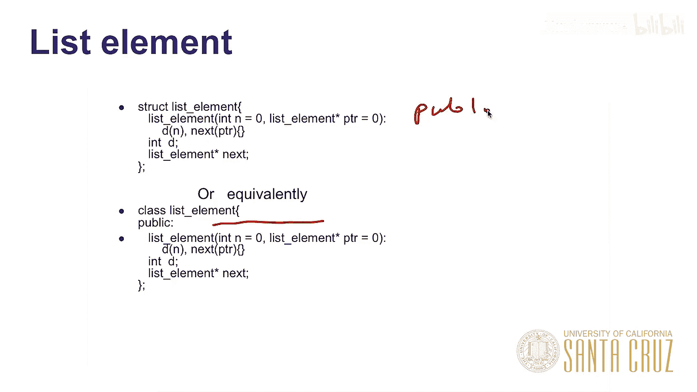
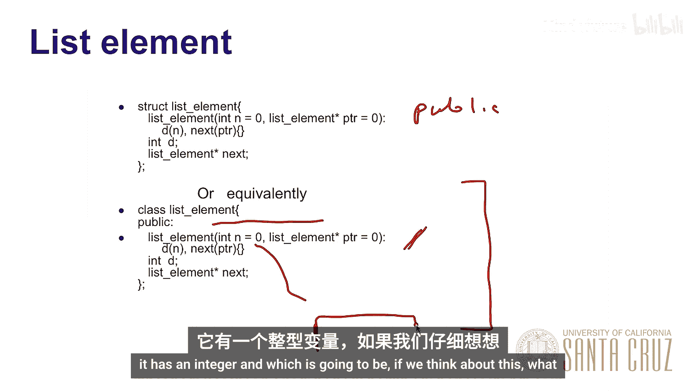
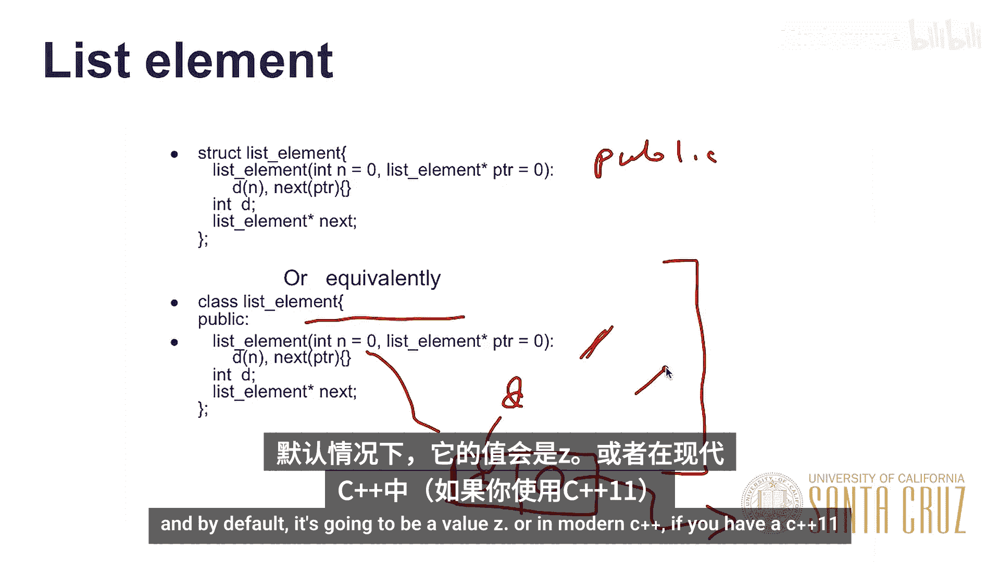
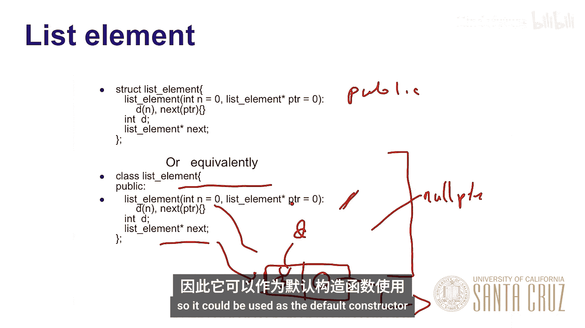
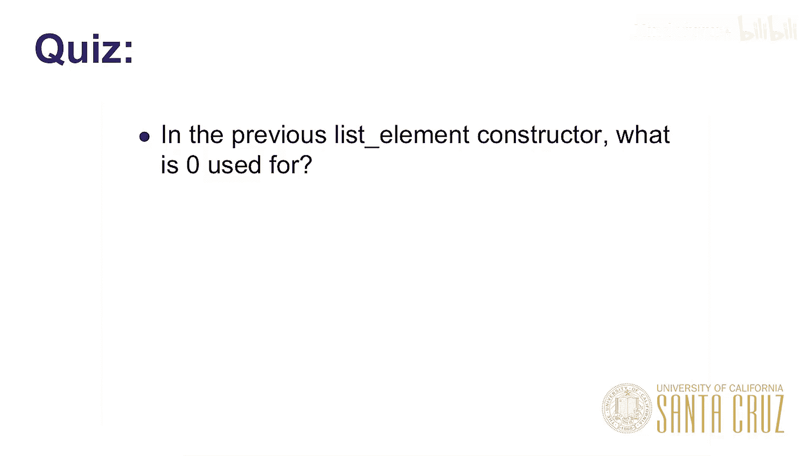
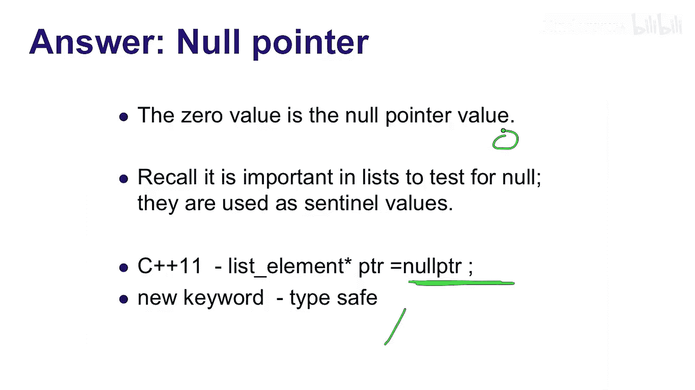

# 【加州大学】C++编程-｜-C-Plus-Plus-A-p26-P26_3-6-复杂聚合_列表_03_01_07--BV1p2ejzREUQ_p26-

Oh， welcome。Today's。lessonsson is about complex aggregates， we're going to focus on a list type。

 of course that's a very standard data structure。It's what we sometimes call a self referential data structure。

 and that a list is the head of a list followed by a list so。You use L in its own definition。

And it's a more interesting aggregate because in some sense， it's an unbounded。Aregate。

 you keep adding elements， so you need to be able to access memory。

This kind of memory is heap memory as opposed to stack memory for ordinary variables。So this。

Studying this has several benefits。 First off， the list data structure that we'll see today。

 which is a single pointer list。Is。In the standard template library。

So it's not like we need to create it ourselves， but order to understand。

What goes on in building these more complicated？A library based aggregates and how they can be used and what's sufficient about them。

 it'll be useful to do a simpler version ourselves。This will let us if we need to。

Create variations for ourselves because not everything is in the standard template library。

The second thing we're going to see is。More complicated constructors， constructors， again， that。

Use the heatap to allocate and then。Because it's very important。To properly manage these resources。

 not have memory leaks will also learn how to properly delocate and return resources。

 namely used destructors。So it' is a very， very central and important lesson and will pervade more of the advanced topics that we're going to do with the rest of the course。

So on this slide， we can see actually show it both in， let's say。The use of struck。

In more of an old style where again， struck is the。Agreggate。Type。Developed in C and then of course。

 Bjorn's Strstrip when he reinvented the language or extended the C language。Initially called it。

See with classes and then they more。Clever term C+ plus。So struck morphed into class。 again。

 this is review。 struckuck just means everything is by default public。 So here we don't have a。

Keyword public， it's just implicit。Uear。

But of course， nowadays， this is what we prefer， we tend not to use struck unless it's a very simple Plano data type S in C。

 then we might use struck。So here we have a public， we have a base。Simple constructor。

We see it has two defaults。It has。An integer and， which is going to be。 if we think about this。

 what were going to ultimately have as a struck element is something in which we're going to store。

Data。In this case， it's just going to be an endt， could be three。By default。

 we're going to store a 0 there， and we're going also have a pointer which conceptually is something like this。

 a memory address。 And by default， it's going to be a value Z or in modern C plus plus if you have a C plus plus 11。

You could as well call this the null pointer。 We'll see that。As well。

We're going to try and transition you in this class。

To the use of the most modern C+ plus constructs as well。So we have data and we have a next pointer。

And those are。呃。The two fields that get initialized and this constructor with its defaults。

 of course， allows us to have a number of signatures。 In fact， it it since it defaults。

 it would also be the empty signature。 so it could be used as the。

Default constructor。I'll take a second。And。In the previous list。Constructor。

 the list element constructor。What is0 used for。Take a second to think about that。

嗯。As we pointed out already， the answer is and this is very appointed。

PoinImportant answer the pointer is a zero value， which is the null pointer value。And here。

 as I stated。The newer practice is to use the keyword NULL， PR， null pointer。

And the reason for that is its improvement over an ordinary0。 The 0 is really an integer value。

 It can be cast， but it's really a 0 as historically a。Integer。

 so to use it as a base type for other things is basically to work with conversions。呃。Also。

 just to keep in mind， there is a macro。Called null。 So that's also conventionally seen。

 And this is an improvement over。Both older practices。

