# 【加州大学】C++编程-｜-C-Plus-Plus-A-p27-P27_3-7-列表_03_01_08--BV1p2ejzREUQ_p27-

Let's more generally look at。The list， which makes use of。The specific list element。

What we want to think about in the list and again lists。Really important to think pictorialally。

So for a list， you tend to have。Some kind of。Header pointer。That's the head of the list。

You also might have a cursor。 A cursor is just something that tells you where you are in the list。

 So you can imagine that a list is。Something like this。

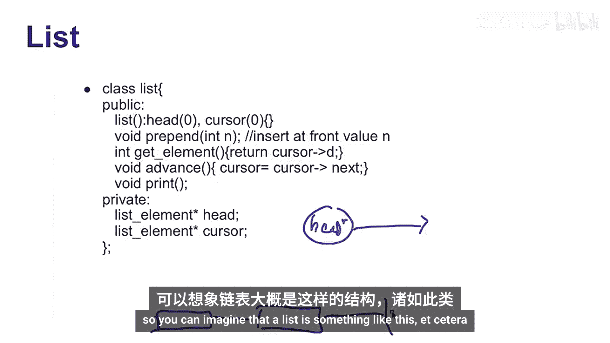

Et cetera。

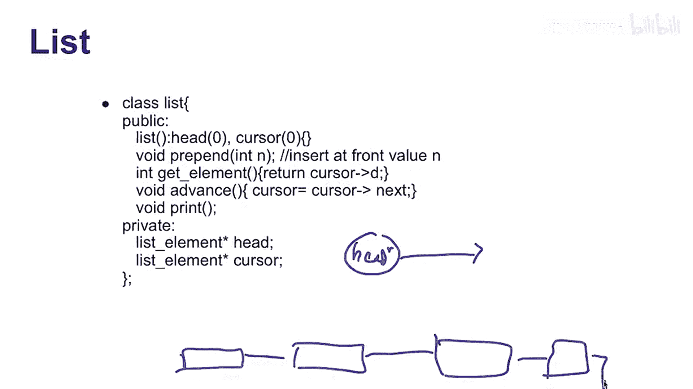

Sometimes we draw as an electrical engineering， a little ground diagram。

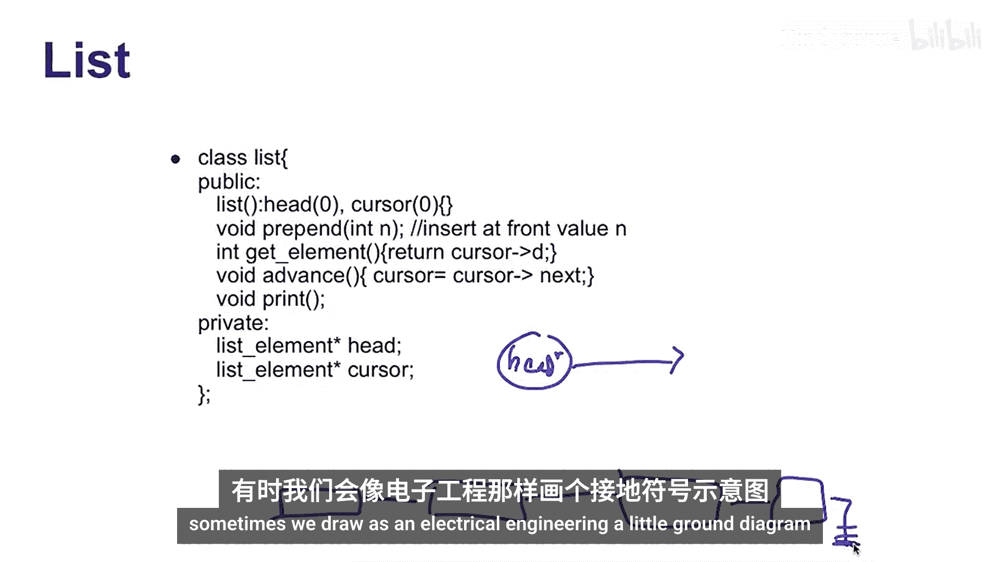

We have a head。So conceptually， this is our list。It has data。In the first elements。

And then it points to next all along the line。

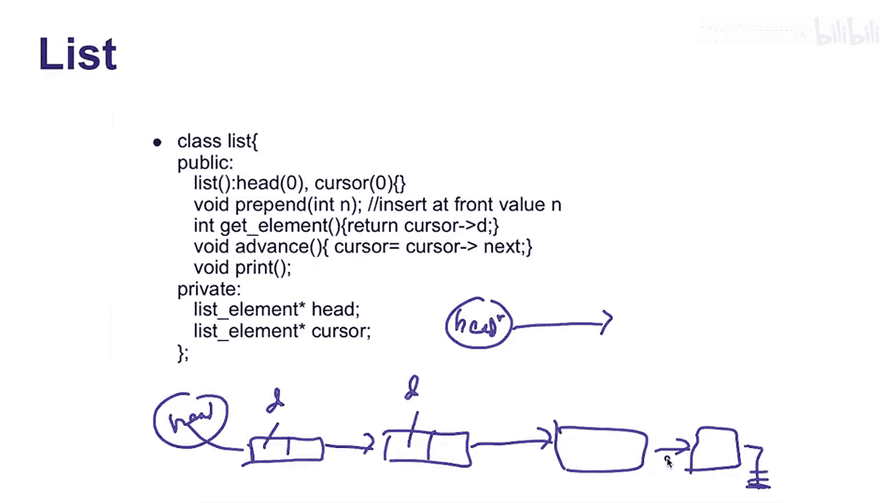

If we do interesting processing of the list， then frequently when we。

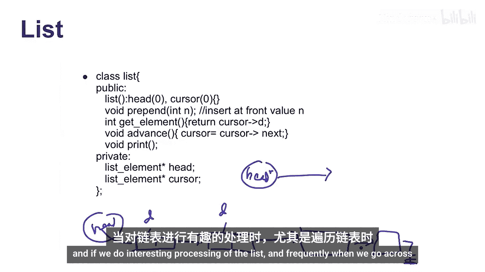

Go across the list when we crawl across the list。We'll either do it through iteration or recursion。

 and most frequently we want some cursor to tell us where we are。For example。

 we might want to do a find algorithm， let's say we want to see if in our list。

 we have a friend we're looking up the friend。Is John in our list？

Maybe there's data associated with John， so we do a search element by element。

For John's personal data until we find John， and when we find John。

 the cursor is pointing at John and we can stop。Maybe we'll continue the search later on from the cursor。

 So an extra cursor sitting there rather than restarting at the end of the list。

Can add to the efficiency of your operations， also we're going to see the notion of a cursor is generalized。

In the standard template library， some of you should already be using the standard template library。

 for example， I've recommended earlier。That vector is a really important。

 maybe the most important container class in the standard template library and is very easy to use for anybody who's already。

Familiar with C， it just replaces in most instances。An ordinary C array。

So in the use of the standard template library， there is a generalization of what you might call a cursor and those are called iterators and the standard template library is all based on the use of iterators I say we'll talk about extensively later on。

Again， everybody out there should know what that is。Let me hear what you're saying， oh。

 there's somebody。Saying it's the default constructor。 It's a default constructor， because。

Its signature again， is void。And it。Creates a cursor that's empty。 again， this is older code。

 It'll work on most of your compilers。But， I might prefer。In the newer standard where it's available。

So just use nu pointer。Now I'm going to have a number of methods。

A number of member functions that's going to make。The functionality of a list available。

 So one of the things about a list is a standard operation is inserting at the front。

 So we have a list。 We decide to manufacture a new element。

And we want that new element put on the front。So we're going to see how to write the code。

For creating an element and sticking it on the front。If we want to get an element。

 the cursor is pointing at some element， so get element is just return cursor D D is a data type。

So D is an end。Again， later on， I'm just going to give you some thought about this。

In the standard template library， this is going to be。A template。And as a template。

 it's going to be able to instantiate。Regardless of type。

 and so instead of int in the standard template bar。

 you're going to find that that's going to be replaced by if you want to think of it， a meta notion。

 the meta notion of type so that it can be used to generate containers for arbitrary values。

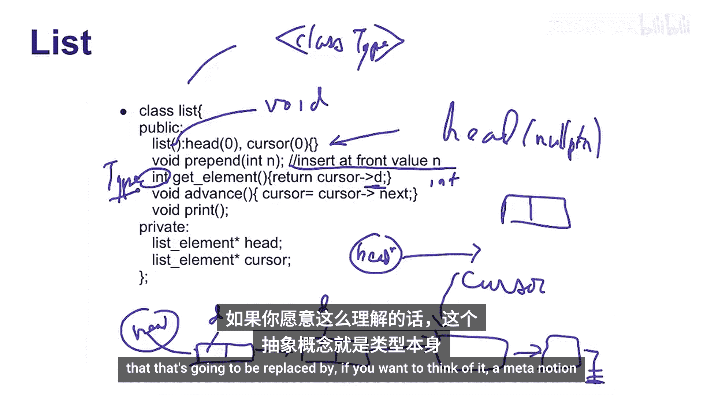

Here's advance， advance is very simple， it's your basic list operation。If I'm sitting at the cursor。

This is next。I look at next。Assign it。The cursor's next value to the current cursor。

 so that means cursor moves over to here。And we'll also see how to do a print。

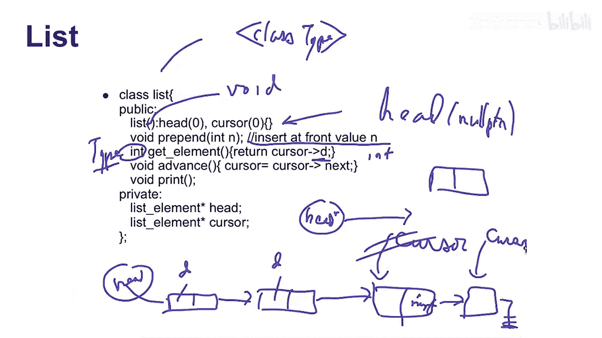

So let's look at prepen。Remember what we want to do。There's two cases， now this is also again。

 idiomatic。

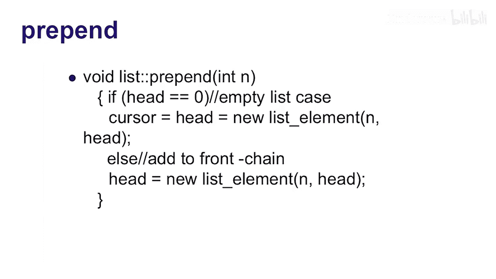

So。If this is review for you or new for you， it's really important。To absorb it。

 because once you absorb this kind of idiom you can do。

Far more complicated things because most of the things involved in aggregates involve ideas of this kind。

So we typically have two important cases the。Simst case。

The simplest case is where we have an empty list， what's an empty list？An empty list。As a pointer。

 a head pointer。That。

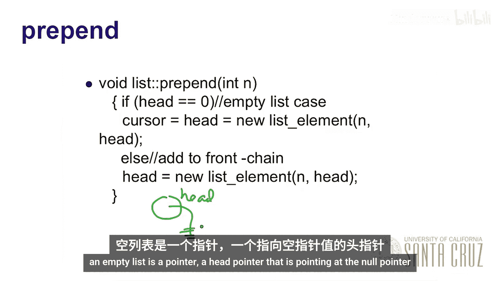

Is pointing at the nu pointer value or the zero value。So we can test it again。

If you want to be consistent with C11。

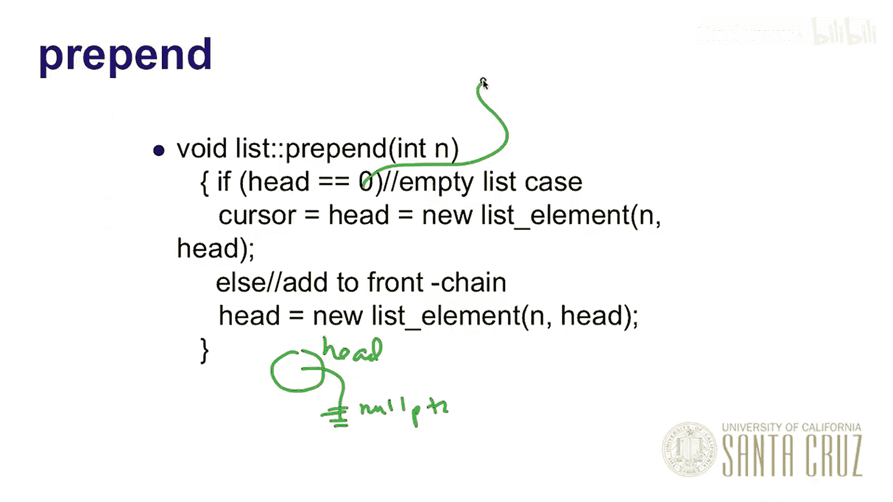

Li better type safety， just tested against no pointer。 that's the empty list case。

If it's the empty list。We have to create the list。So the list wasn't around。

So we create it by going to by using new， again new is the key word that lets us get to the heap。

It says， get me a list element。Whose value， this is your data value。

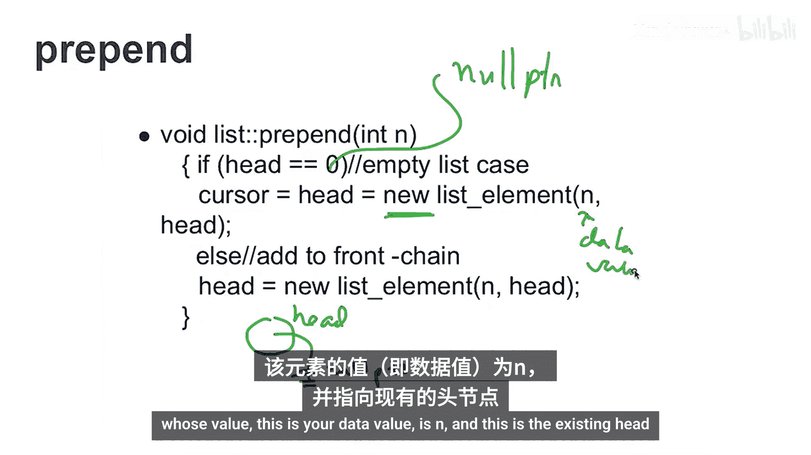

Iszen。And this is the existing head。So now。We replace head with the existing head。

 which actually had a value of。And we also start to cursor there。So at the end of this operation。

This transforms into。We get this off the heap。An is stored there。The old。Csor， which is again。

 an nu pointer is here。

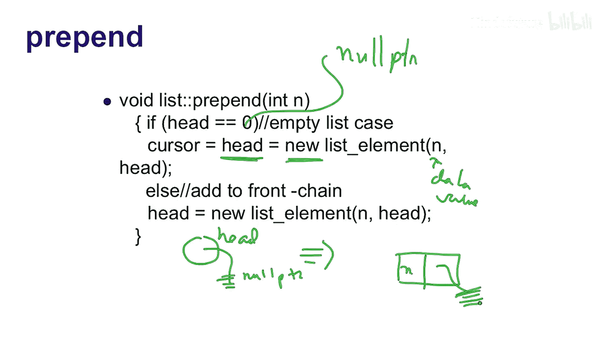

And now， what was head。Is pointing there。And what was cursor。Dispointing there。

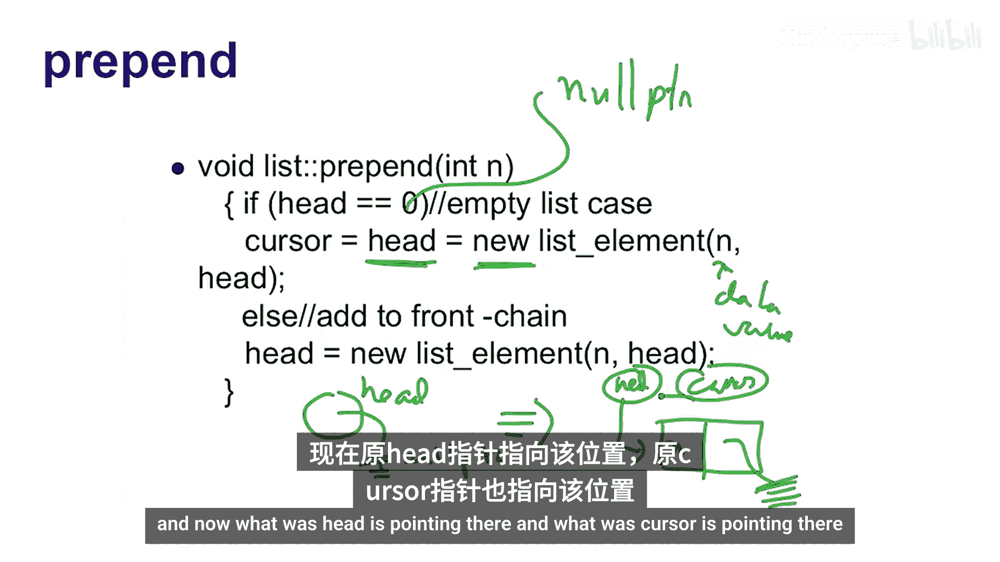

So that's。The啊。Simple case。But it needs to be checked on and done and then the general cases there's a free existing。

West。And all we need to do there is we need to。The cursors left alone。And in the general case。

We just replace the old head。By the value of the new list element。So let's look at that case。

 let's just draw it quickly， maybe I'll get rid of。

 let me get rid of this so I can draw it again properly。T blue。So in the second case。We have。Head。

They have some general list。We have a cursor。Which could be pointing anywhere in the west。

Now we manufacture the new element。never。And it has this value H stored in it， Well H is just。

Pointing there。And then the real H。Is now assigned。

The address first to what's now the new first element。

Now I hope by now you're getting used to my terrible handwriting。But。Okay。Anyway。

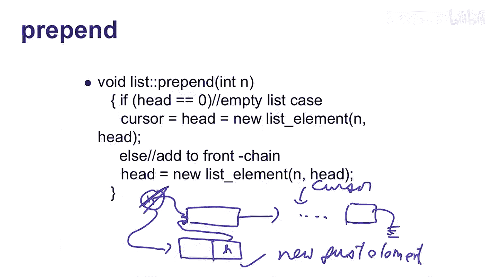

Everybody should be able to draw this diagrams， it's really important when you are dealing with these kind of complex aggregates conceptually to know what they're doing。

Very helpful。 So that's prepen。And let's take a quick quiz on that。

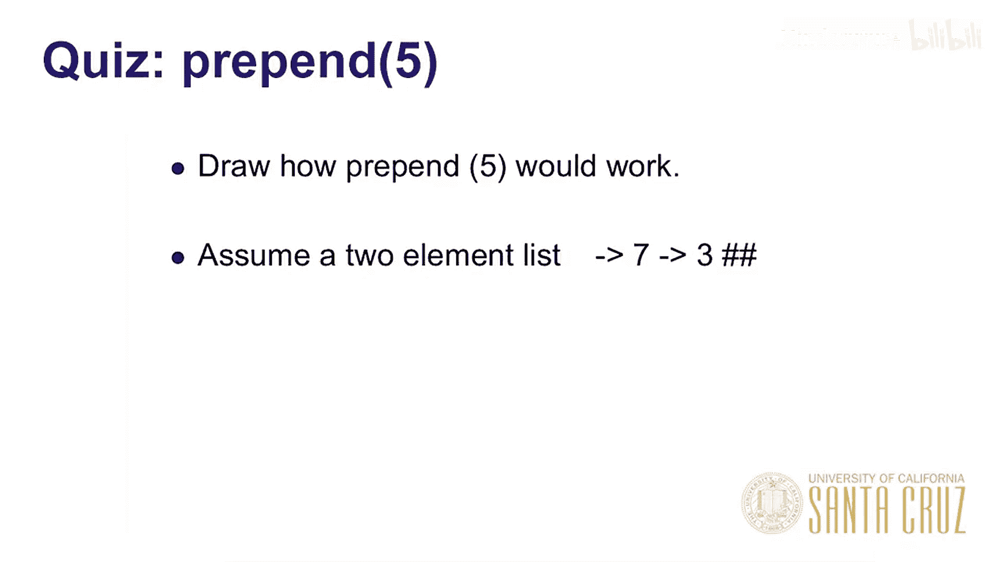

For yourself， draw how prepend a five would work if you had an element that would have value 5。

 how would that work？

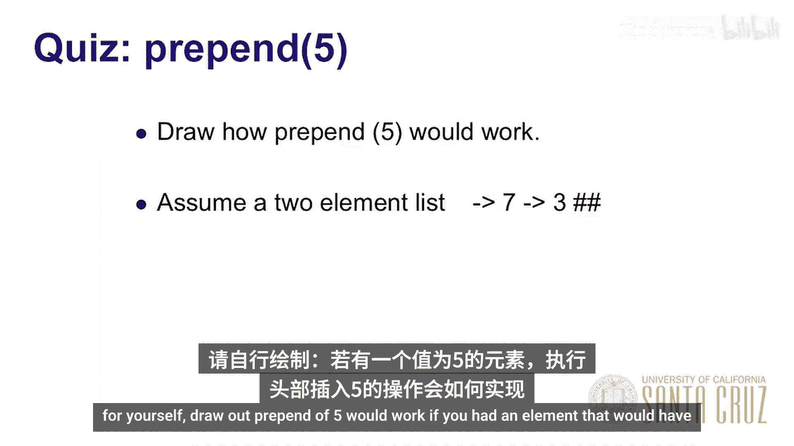

And in that， assume there's a preexisting list。That had two elements。Take a second。Okay。

Let me get back and see what they are， they're seven and three and null on it so let me draw it。

So here's the existing list。With its head。We now create a new element。Data element 5。

And we're creating it with the old head。So the old head is really this address。

And then we break that connection。And assigned that address。Using the fact that new returns。

 new returns， the address on the heap where you manufactured that list element。

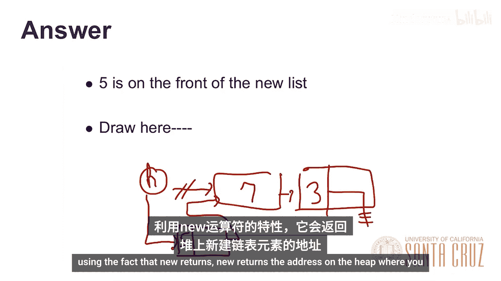

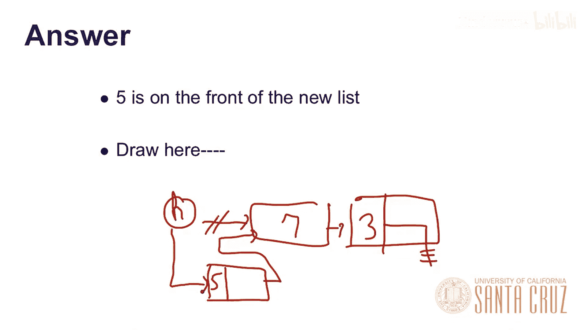