# C++编程：P27：列表基础概念与操作

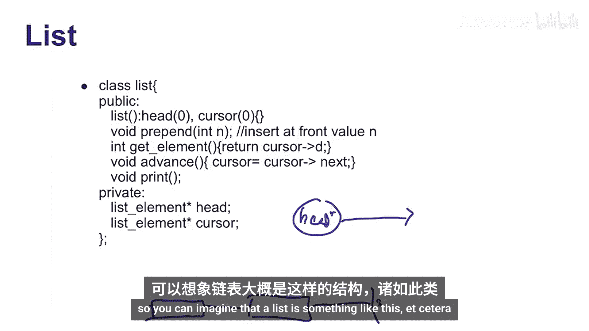

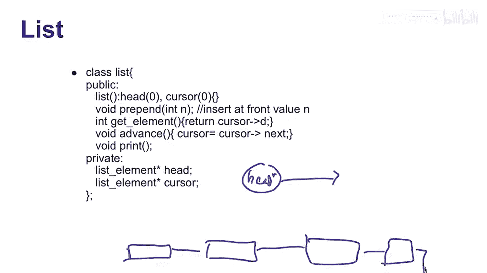

在本节课中，我们将学习链表（List）这一数据结构的基础概念。我们将了解链表的基本构成，包括头指针和游标，并学习如何在链表前端插入新元素。理解这些概念对于掌握更复杂的数据结构和算法至关重要。

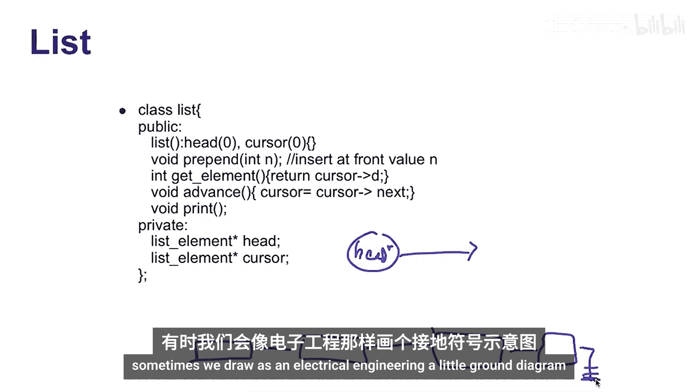

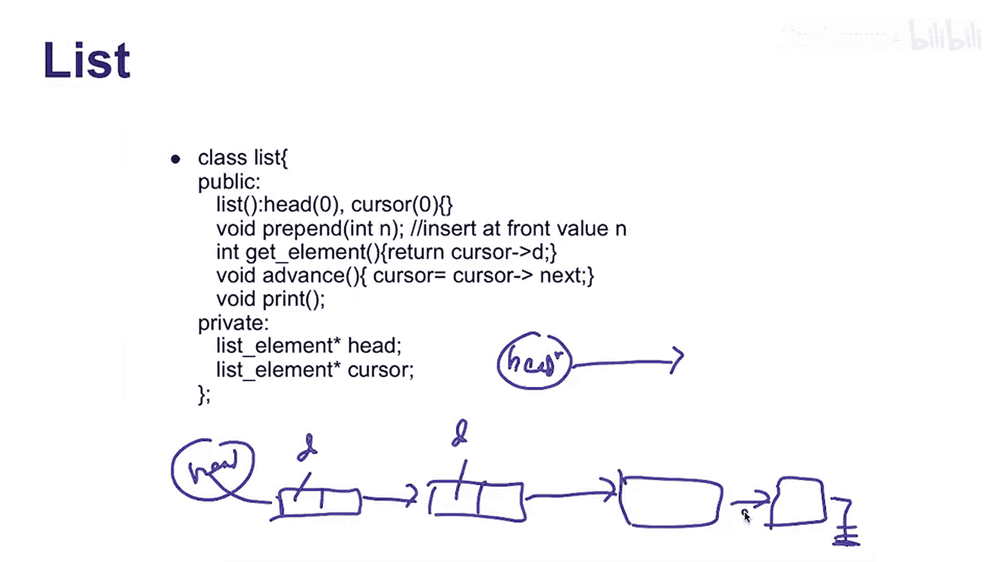

---

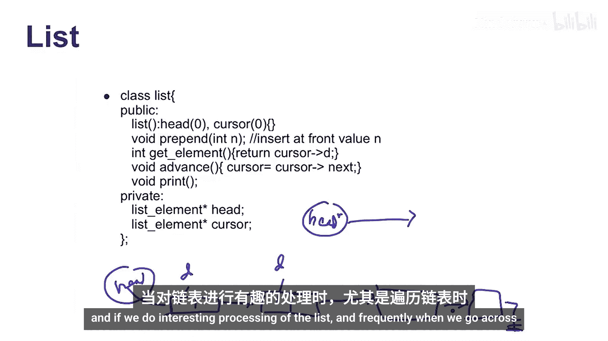

## 链表的基本结构

上一节我们介绍了链表的重要性，本节中我们来看看链表的具体构成。

链表通常包含一个**头指针**，它指向链表的第一个元素。此外，链表还可能包含一个**游标**，用于指示当前在链表中的位置。游标可以帮助我们高效地进行遍历和搜索操作。

链表在概念上可以这样表示：

```
头指针 -> [数据 | 下一个指针] -> [数据 | 下一个指针] -> ... -> [数据 | nullptr]
```

有时，我们会用一个类似电气工程中的接地符号来表示链表的末尾（空指针）。

## 游标与迭代器

如果我们需要对链表进行遍历或搜索，通常会通过迭代或递归的方式“爬过”链表。在这个过程中，游标用来告诉我们当前的位置。

例如，假设我们想在一个存储朋友信息的链表中查找“John”。我们会从链表头部开始，逐个元素检查数据，直到找到“John”。此时，游标就指向了包含“John”数据的节点，我们可以停止搜索。之后，我们也可以从这个游标位置继续后续操作，而不是每次都从链表头部重新开始，这能提高操作效率。

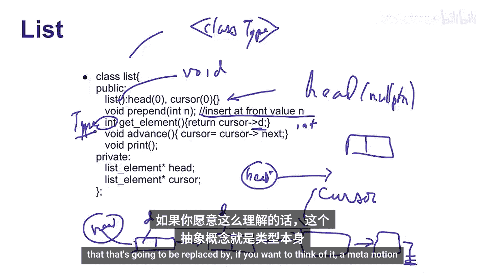

游标的概念在C++标准模板库中被推广为**迭代器**。STL广泛使用迭代器来操作各种容器。例如，`vector`是STL中一个非常重要的容器类，它本质上替代了普通的C风格数组，并且其操作严重依赖于迭代器。我们将在后续课程中详细讨论迭代器。

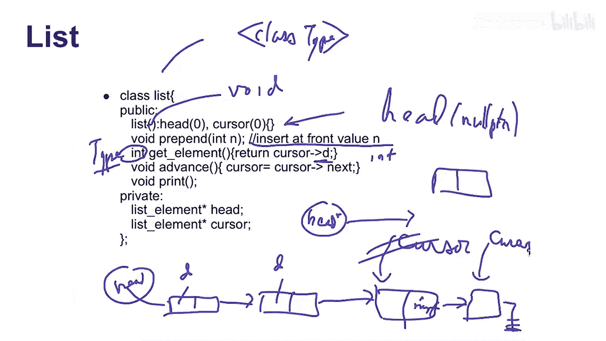

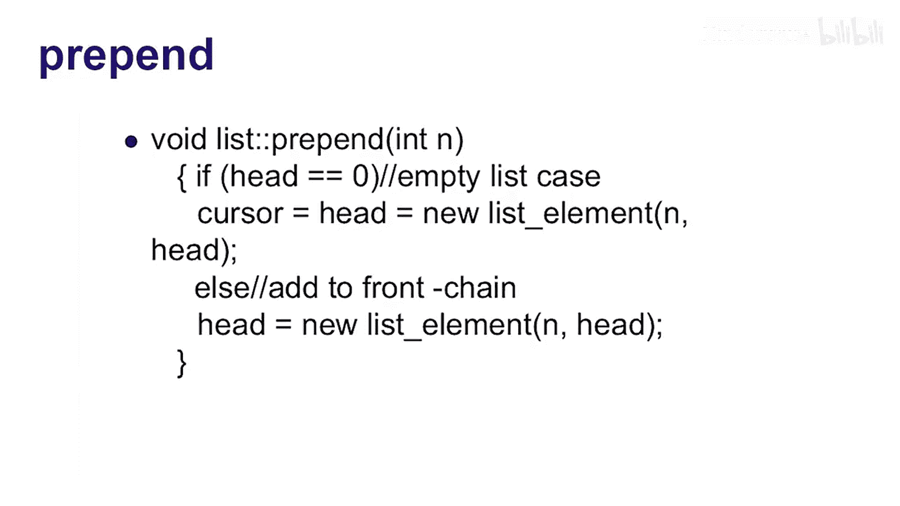

## 链表类的基本方法

现在，我们来看看如何实现一个链表类，并为其定义一些基本的成员函数（方法），以实现链表的功能。

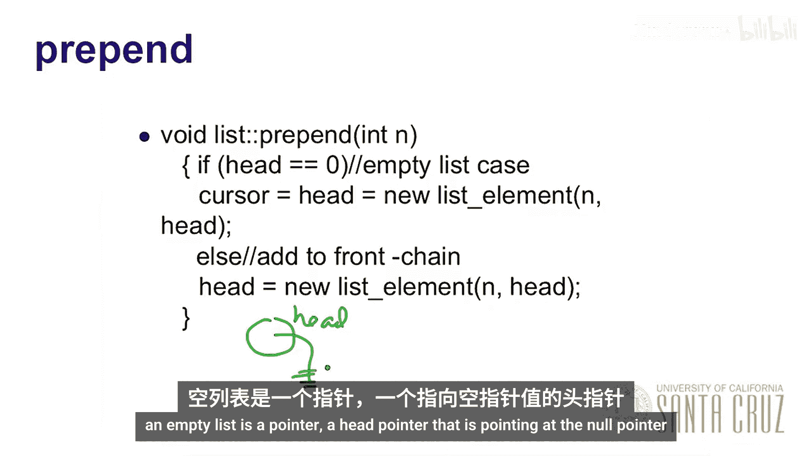

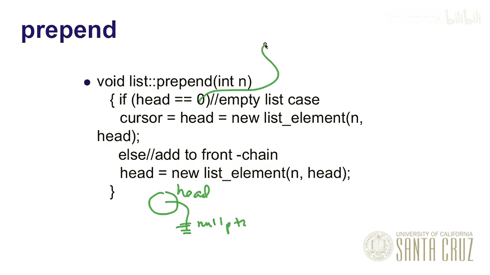

以下是链表类可能包含的一些核心方法：

*   **默认构造函数**：其签名为`void`，用于创建一个空的游标（即空链表）。在较旧的代码中，可能使用`0`或`NULL`，但在新标准中，更推荐使用`nullptr`以获得更好的类型安全。
*   **`prepend`（前端插入）**：这是一个标准操作，用于在链表头部插入一个新元素。
*   **`get_element`（获取元素）**：当游标指向某个元素时，此方法返回该元素的数据。数据可以是`int`等类型。在STL中，这通常通过模板实现，以便能容纳任意类型的数据。
*   **`advance`（前进）**：这是链表的基本操作。如果游标当前指向一个节点，此操作将游标移动到下一个节点。其核心逻辑是：`cursor = cursor->next`。
*   **`print`（打印）**：用于遍历并打印链表中的所有元素。

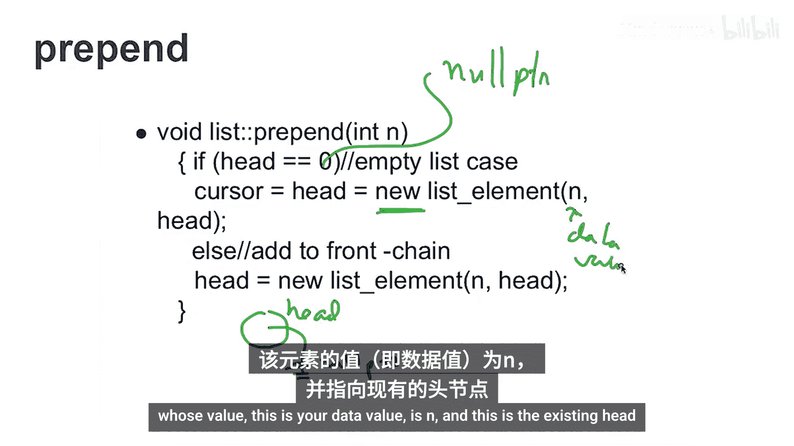

## 实现前端插入操作

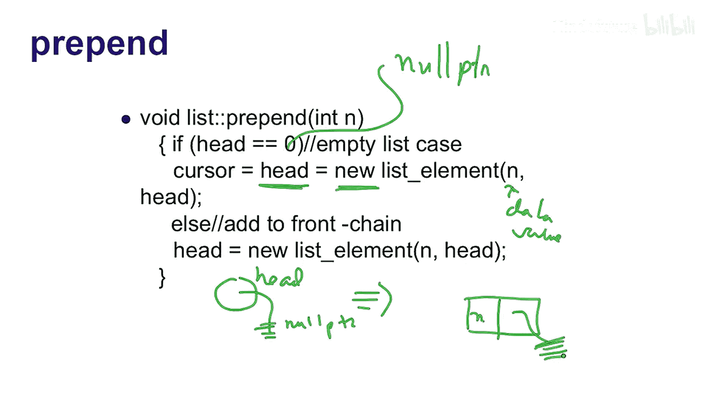

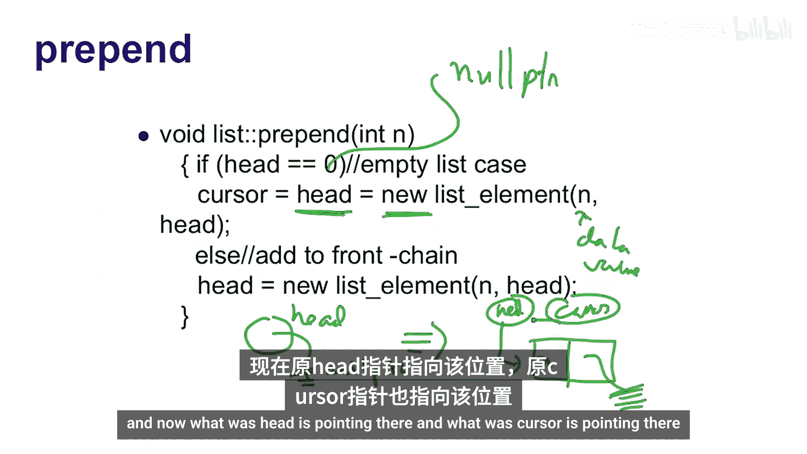

让我们重点看看`prepend`操作的实现。理解这个操作的模式非常重要，因为许多涉及聚合数据结构的复杂操作都基于类似的思想。

实现`prepend`时，通常需要考虑两种情况：

1.  **链表为空的情况**：这是最简单的情况。一个空链表意味着头指针指向`nullptr`。我们可以通过测试`head == nullptr`来判断（在C++11及以后，使用`nullptr`更安全）。
    *   如果链表为空，我们需要创建链表。使用`new`关键字在堆上分配一个新的链表元素，并初始化其数据值。
    *   然后，将新元素的`next`指针指向原来的头指针（此时是`nullptr`）。
    *   接着，更新头指针，使其指向这个新创建的元素。
    *   最后，将游标也设置到这个新元素上。
    *   经过这些操作，一个空链表就变成了一个包含一个元素的链表。

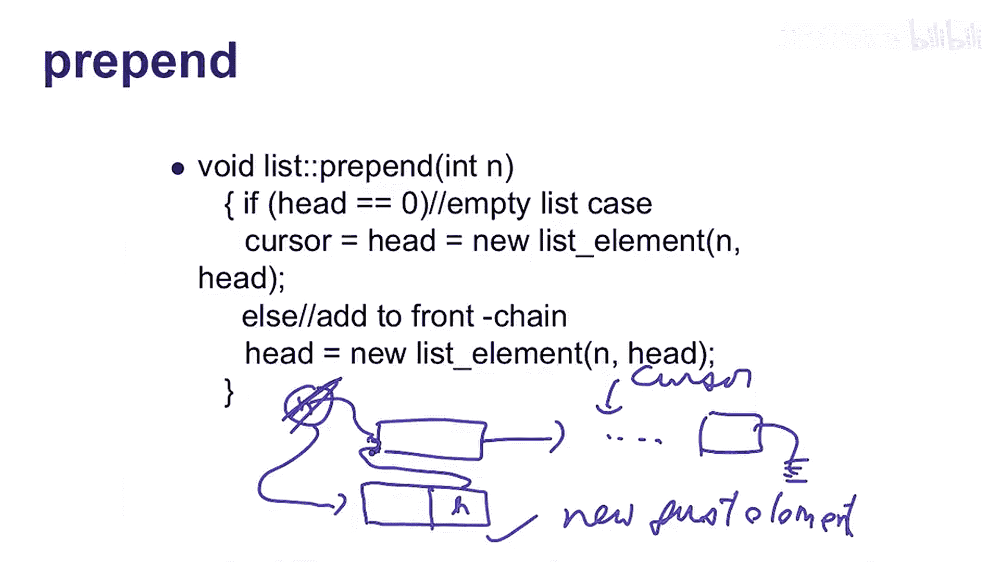

2.  **链表非空的情况**：这是更一般的情况。假设已存在一个链表，并且游标可能指向链表中的任意位置。
    *   我们同样使用`new`创建一个新的链表元素，并初始化其数据值。
    *   将这个新元素的`next`指针指向当前的头指针（即原链表的第一个元素）。
    *   然后，更新头指针，使其指向这个新元素。这样，新元素就被插入到了链表的最前端。
    *   在这个过程中，游标保持不变，仍然指向它原来指向的节点。

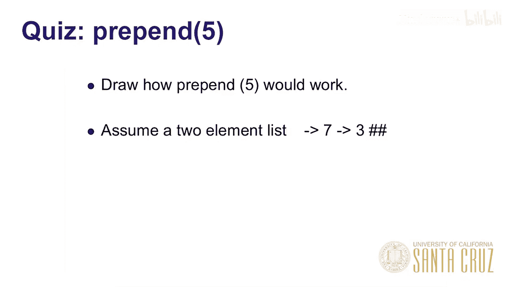


为了加深理解，请尝试自己画图分析：在一个已包含两个元素（例如值分别为7和3）的链表上，执行`prepend(5)`操作，每一步指针是如何变化的。

---

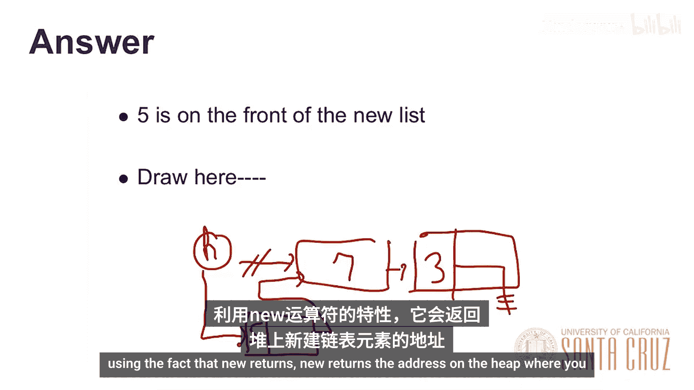

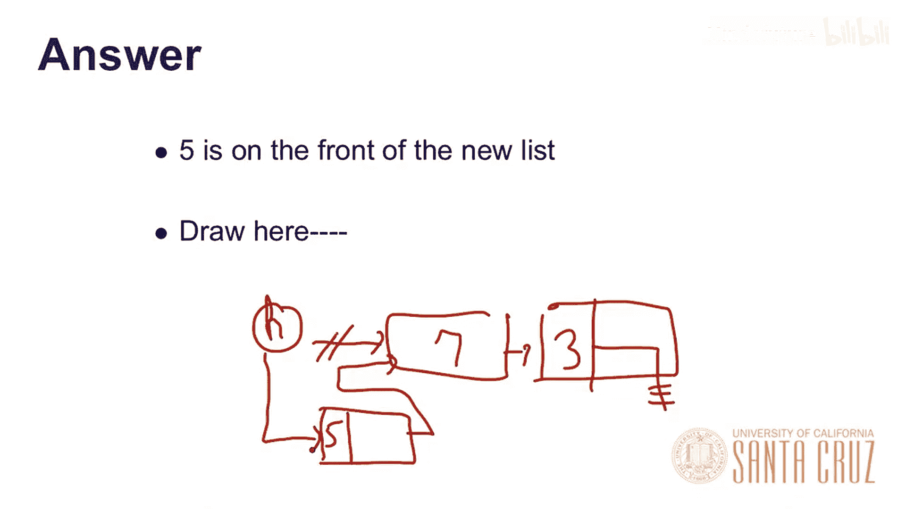

本节课中我们一起学习了链表的基础概念，包括其头指针和游标的构成，以及如何在链表前端插入新元素。我们还初步了解了游标与STL迭代器的联系。掌握这些基础是理解更高级数据结构和算法的关键。在接下来的课程中，我们将继续探索链表的其他操作和应用。