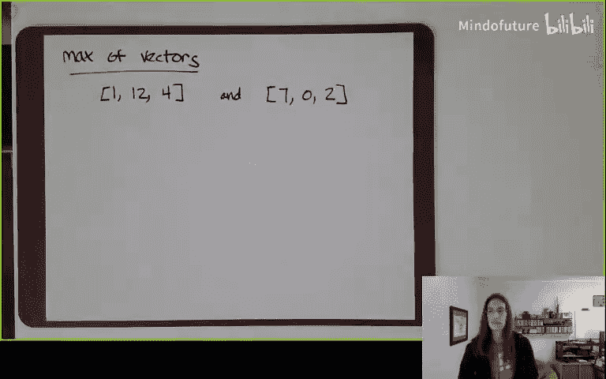

# 003：偏序、全序、Lamport时钟、向量时钟

在本节课中，我们将要学习分布式系统中事件排序的核心概念。我们将从回顾“先于发生”关系开始，然后深入探讨偏序与全序的区别。接着，我们将介绍两种逻辑时钟：Lamport时钟和向量时钟，它们用于捕获分布式系统中的因果关系，而无需依赖物理时间。

## 回顾“先于发生”关系

上一节我们介绍了分布式系统中事件排序的基础。本节中，我们来看看如何形式化地描述这种排序关系。

“先于发生”关系定义了分布式执行中事件的因果顺序。其定义基于以下三种情况：

以下是“先于发生”关系的三种情况：
1.  如果事件A和事件B在同一个进程中，并且A在B之前发生，则 A → B。
2.  如果事件A是消息发送，事件B是对应消息的接收，则 A → B。
3.  该关系具有传递性：如果 A → C 且 C → B，则 A → B。

通过这个定义，我们可以判断任意两个事件是否具有因果先后关系。如果两个事件既不满足 A → B，也不满足 B → A，则称这两个事件是**并发**的。

## 偏序与全序

理解了“先于发生”关系后，我们可以用数学语言来精确描述它。本节中，我们来看看偏序和全序这两个关键概念。

**偏序** 由一个集合 S 和一个二元关系 ≤ 组成，该关系满足以下三个性质：
*   **自反性**：对于所有 a ∈ S，有 a ≤ a。
*   **反对称性**：对于所有 a, b ∈ S，如果 a ≤ b 且 b ≤ a，则 a = b。
*   **传递性**：对于所有 a, b, c ∈ S，如果 a ≤ b 且 b ≤ c，则 a ≤ c。

在偏序中，并非集合中的每对元素都是可比较的。一个经典的例子是集合的包含关系。例如，集合 {a} 和 {b} 在包含关系下不可比较，因为 {a} 不是 {b} 的子集，{b} 也不是 {a} 的子集。

**全序** 是一种特殊的偏序，其中集合中的任意两个元素都是可比较的。自然数集及其通常的“小于等于”关系就是一个全序的例子。

现在，让我们将“先于发生”关系与偏序定义进行对比。它满足反对称性和传递性，但不满足自反性（一个事件不会“先于”自身发生）。因此，“先于发生”关系是一个**非自反偏序**。在分布式执行的上下文中，不可比较的事件正是那些并发的事件。

## Lamport 逻辑时钟

既然我们有了描述事件顺序的关系，下一步就是设计一种机制来实际计算它。本节中，我们来看看Leslie Lamport提出的第一种逻辑时钟。

Lamport时钟为每个事件分配一个整数值，旨在捕获因果顺序。其核心是**时钟条件**：如果事件 A 先于事件 B 发生（A → B），那么 A 的Lamport时钟值必须小于 B 的Lamport时钟值。我们称Lamport时钟**与因果关系一致**。

以下是Lamport时钟算法步骤：
1.  每个进程维护一个计数器，初始值为0。
2.  进程每发生一个事件（内部计算、发送消息、接收消息），就将自己的计数器加1，并将该值作为事件的时钟值。
3.  发送消息时，进程将当前的计数器值随消息一起发送。
4.  接收消息时，进程将自己的计数器值更新为 `max(本地计数器值, 接收到的消息中的时钟值) + 1`。

通过这个算法，我们可以为执行中的所有事件分配Lamport时间戳。重要的是，它保证了如果 A → B，则 `LC(A) < LC(B)`。

然而，反过来并不成立。即，`LC(A) < LC(B)` 并不能推出 A → B。这意味着Lamport时钟**不能完全表征因果关系**。尽管如此，它仍然非常有用：如果 `LC(A) ` 不小于 `LC(B)`，那么我们可以断定 A 不可能先于 B 发生。这是一种以较低开销（每个消息只附带一个整数）来排除某些因果可能性的有效方法。

## 向量时钟

Lamport时钟提供了部分信息，但我们能否做得更好？本节中，我们来看看一种更强力的逻辑时钟——向量时钟，它能完全捕获因果关系。

向量时钟的目标是同时满足以下两点：
1.  **与因果关系一致**：如果 A → B，则 `VC(A) < VC(B)`。
2.  **表征因果关系**：如果 `VC(A) < VC(B)`，则 A → B。

这里的小于号“<”是作用于向量的比较。向量时钟是一个数组，每个进程对应一个分量。

以下是向量时钟算法步骤：
1.  系统有 N 个进程。每个进程维护一个长度为 N 的向量，所有分量初始为0。第 i 个分量记录进程 i 已知的事件数。
2.  进程每发生一个事件，就将自己对应分量（向量中代表自己的位置）的值加1。
3.  发送消息时，进程将当前的整个向量随消息一起发送。
4.  接收消息时，进程将本地向量的每个分量更新为 `max(本地向量分量, 接收向量中对应分量)`。然后，再将代表自己的分量加1（因为接收本身也是一个事件）。

这里的“max”操作是逐分量进行的。向量之间的比较 `V < W` 定义为：对于所有分量 i，有 `V[i] ≤ W[i]`，并且至少存在一个分量 j，使得 `V[j] < W[j]`。

向量时钟比Lamport时钟携带了更多信息。例如，向量时钟 `[5, 0, 0]` 表示进程0知晓5个事件，而进程1和2尚未知晓任何事件（从进程0的视角看）。这种额外的信息使得向量时钟能够精确地推断出事件之间的“先于发生”关系。我们将在下一节课通过具体例子来详细演示向量时钟的运作和比较。

## 总结

本节课中我们一起学习了分布式系统事件排序的核心知识。我们首先回顾了“先于发生”关系，并将其定义为一种非自反偏序。然后，我们探讨了偏序与全序的区别。接着，我们介绍了Lamport时钟，它是一种与因果关系一致但无法完全表征因果关系的轻量级逻辑时钟。最后，我们引入了更强大的向量时钟，它通过维护一个向量来完全捕获事件间的因果关系，为后续实现分布式快照、因果一致性等高级概念奠定了基础。