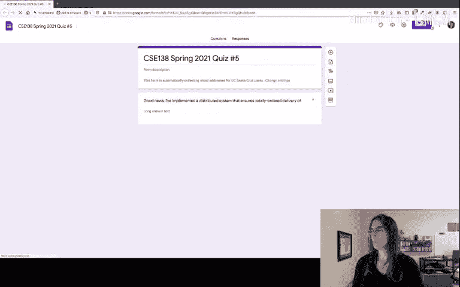
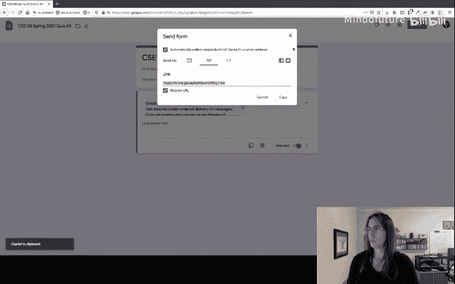
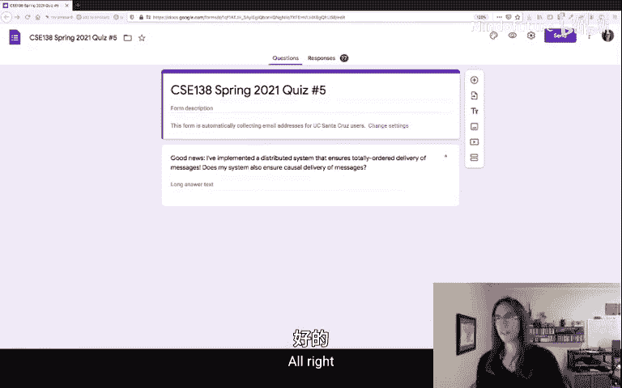

# 005：L5 - FIFO、因果、全序交付回顾与因果广播实现 🧩

在本节课中，我们将要学习分布式系统中的消息交付保证。我们将回顾三种重要的交付属性：FIFO交付、因果交付和全序交付。然后，我们将深入探讨如何实现一种特定的因果交付算法——因果广播。最后，我们会简要介绍因果关系的另一个重要应用：用于获取分布式系统全局一致状态的Chandy-Lamport快照算法。

## 交付属性回顾 📝

上一节我们介绍了分布式系统中的基本通信模型。本节中，我们来回顾一下三种核心的消息交付保证属性。理解这些属性对于设计可靠的分布式系统至关重要。

以下是三种交付属性的定义及其违规示例图：

*   **FIFO交付（先进先出交付）**：如果进程P1向进程P2发送了消息M1和M2，且M1的发送先于M2，那么P2必须按M1、M2的顺序交付它们。
    *   **违规示例**：P2先交付M2，后交付M1。
*   **因果交付**：如果消息M1的发送“先发生于”消息M2的发送，那么任何进程在交付M2之前，必须先交付M1。
    *   **违规示例（经典Alice-Bob-Carol场景）**：Carol先收到了Bob对Alice消息的回复，后才收到Alice的原始消息。
*   **全序交付**：如果某个进程按顺序M1、M2交付了一组消息，那么所有交付了这组消息的进程都必须以相同的顺序交付它们。
    *   **违规示例**：P2按M1、M2顺序交付，而P3按M2、M1顺序交付。

这些属性描述了执行（execution）的特征。一个执行可能满足其中一种或多种属性。它们之间的关系并非简单的层级嵌套。

所有可能的执行构成一个大集合。其中，满足FIFO交付的执行是它的一个子集。而满足因果交付的执行，又是FIFO交付执行的一个子集。这意味着，如果一个执行满足因果交付，它必然也满足FIFO交付。

全序交付与这两者的关系则不同。满足全序交付的执行与满足FIFO/因果交付的执行集合存在交集，但并不被它们包含。例如，可以存在一个执行，其中所有进程都以相同的错误顺序（如M2, M1）交付消息，这满足了全序交付（顺序一致），但违反了FIFO交付。

**注意**：“发送”是发送者的主动行为，“接收”是接收者的被动行为，而“交付”是接收者决定将已接收的消息提交给应用层处理的行为。在Lamport图中，我们通常用勾号（✓）表示消息被交付。

## 实现因果广播 🚀

上一节我们回顾了交付属性的概念。本节中，我们来看看如何实现一种能保证因果交付的算法——因果广播。

首先，我们需要明确几个通信模式：
*   **单播**：一个发送者，一个接收者。
*   **多播**：一个发送者，多个接收者。
*   **广播**：一个发送者，系统中的所有进程（通常包括发送者自身）都是接收者。

**因果交付**是我们希望系统具备的属性。**因果广播**则是一种算法，它能在所有消息都是广播消息的设定下，保证因果交付。我们经典的Alice-Bob-Carol问题中的消息就是广播消息，因此因果广播算法足以解决该问题。

实现因果广播的核心工具是**向量时钟**。我们将使用一个稍作修改的向量时钟算法：

1.  每个进程维护一个向量时钟 `VC`，初始值为全零。
2.  当进程 `P_i` 发送一个广播消息时：
    *   递增自身对应的时钟分量：`VC[i] = VC[i] + 1`
    *   将更新后的 `VC` 作为元数据附加在消息中一起发送。
3.  当进程 `P_j` **交付**一个来自 `P_i`、附带向量时钟 `VC_m` 的消息时：
    *   更新本地向量时钟为逐分量最大值：`VC = max(VC, VC_m)`（注意：这里不将“接收”本身计为一个事件）。

这个算法本身并不强制因果顺序。关键在于，进程的“邮件收发员”不能一收到消息就立即交付，而需要根据一个**可交付条件**来判断。

### 可交付条件

进程 `P` 在收到来自进程 `P_i`（其ID在向量时钟中对应索引 `i`）、附带向量时钟 `VC_m` 的消息 `M` 时，仅当满足以下条件才可立即交付：
1.  `VC_m[i] = VC[i] + 1` （消息中的发送者时钟分量恰好比接收者本地对应分量大1）
2.  对于所有 `k != i`，有 `VC_m[k] <= VC[k]` （消息中其他所有分量都不大于接收者本地对应分量）

**条件1** 确保了这是接收者期待的下一个来自 `P_i` 的消息。
**条件2** 确保了发送者在发送此消息时，所知晓的其他进程的消息，接收者都已经知晓（即已交付）。

如果不满足条件，消息必须被放入一个**延迟队列**中暂存，等待后续检查。

### 算法运行示例

让我们用Alice(`P1`)-Bob(`P2`)-Carol(`P3`)的例子来演示，初始向量时钟均为 `(0,0,0)`。

1.  Alice发送“丢失钥匙”消息，递增自身时钟为 `(1,0,0)` 并随消息发出。
2.  Bob收到并交付该消息，更新本地时钟为 `(1,0,0)`。然后发送“太好了！”回复，递增自身时钟为 `(1,1,0)` 并发出。
3.  Carol同时收到两个消息（假设Bob的消息先到）。
    *   检查Bob的消息 `VC_m = (1,1,0)`：
        *   条件1: `VC_m[2] (1) == VC[2] (0) + 1` ✔️
        *   条件2: `VC_m[1] (1) <= VC[1] (0)` ❌ 失败！
        *   **结论**：消息被放入延迟队列。
    *   检查Alice的消息 `VC_m = (1,0,0)`：
        *   条件1: `VC_m[1] (1) == VC[1] (0) + 1` ✔️
        *   条件2: `VC_m[2] (0) <= VC[2] (0)` ✔️, `VC_m[3] (0) <= VC[3] (0)` ✔️
        *   **结论**：消息可以交付。Carol交付该消息，并更新本地时钟为 `(1,0,0)`。
4.  Carol交付Alice的消息后，重新检查延迟队列中Bob的消息 `(1,1,0)`：
    *   此时Carol的 `VC = (1,0,0)`。
    *   条件1: `VC_m[2] (1) == VC[2] (0) + 1` ✔️
    *   条件2: `VC_m[1] (1) <= VC[1] (1)` ✔️, `VC_m[3] (0) <= VC[3] (0)` ✔️
    *   **结论**：消息现在可以交付了。

通过这个机制，Carol总是先交付Alice的消息，再交付Bob的回复，从而保证了因果交付。

**关于活跃性**：算法需要确保延迟队列中的消息最终都能被交付，这涉及到系统通信的可靠性等更深层的“活跃性”保证，我们将在后续课程中讨论。

## 因果关系的应用：Chandy-Lamport快照算法简介 📸

上一节我们详细介绍了如何利用因果关系实现因果广播。本节中，我们来看看因果关系的另一个巧妙应用——获取分布式系统的一致性全局快照。

在分布式系统中，每个进程都有本地状态。但我们常常需要了解整个系统的**全局状态**，用于调试、检查点、死锁检测等。由于缺乏全局精确同步的时钟，我们不能简单地让所有进程在“同一时刻”记录自己的状态。

我们期望的快照应满足**一致性**：如果事件B被包含在快照中，且事件A先发生于B（`A -> B`），那么事件A也必须被包含在快照中。这避免了快照中出现“无因之果”的混乱局面。

Chandy-Lamport算法是解决这个问题的经典算法。在介绍算法前，需要定义**信道**的概念：信道 `C_{ij}` 是从进程 `P_i` 到 `P_j` 的一个单向、先进先出（FIFO）的消息传输通道。正在信道中传输的消息被认为是信道状态的一部分。

算法通过一个特殊的**标记消息**在系统中传播来协调快照的拍摄。其核心思想是：当进程第一次收到标记消息时，它记录自己的本地状态，并为其所有出站信道开始记录此后收到的消息（作为信道状态），然后将标记消息转发给所有邻居。通过标记消息的传播顺序和信道状态的记录，最终收集到的所有进程状态和信道中的消息集合，共同构成一个**一致的全局快照**。

由于时间关系，我们将在下一次课程中深入探讨该算法的详细步骤、正确性证明以及具体示例。

## 总结 🎯

本节课中我们一起学习了分布式系统中消息交付的核心概念。我们回顾了FIFO、因果和全序三种交付属性的定义及其关系。我们深入探讨了如何利用修改后的向量时钟算法来实现**因果广播**，从而在广播通信的场景下保证因果交付。最后，我们介绍了因果关系在**Chandy-Lamport全局快照算法**中的重要应用，该算法能够在不依赖全局时钟的情况下，获取分布式系统的一致性状态视图，为系统监控和调试提供了基础工具。理解这些基于因果关系的算法，是构建可靠、可理解的分布式系统的关键一步。