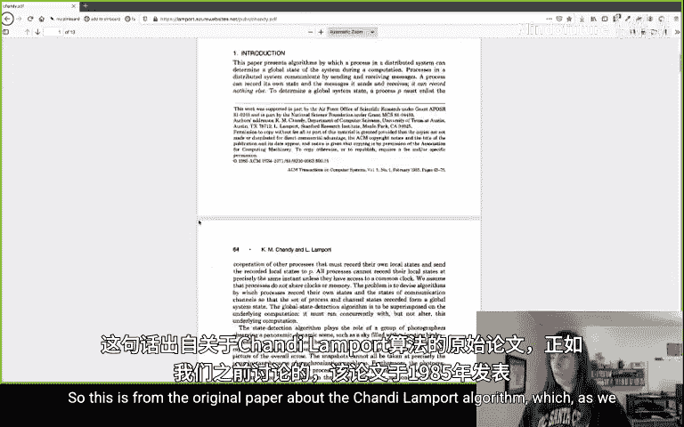

# 006：分布式快照算法

在本节课中，我们将要学习分布式系统中的快照算法，特别是经典的 **Chandy-Lamport 快照算法**。我们将了解该算法的工作原理、其核心假设、所生成快照的性质，并探讨分布式算法中“中心化”与“去中心化”设计的区别。

## 概述：什么是分布式快照？

在分布式系统中，一个“快照”记录了系统在某个时刻的全局状态。由于没有全局时钟，我们无法让所有进程在同一物理时刻“暂停”并记录状态。因此，我们需要一种算法，让各个进程独立记录自己的状态，并确保最终组合起来的全局状态在逻辑上是一致的。

一个**一致的快照**需要满足以下性质：如果事件 B 在快照中，并且事件 A 发生在事件 B 之前（记作 A → B），那么事件 A 也必须在快照中。这是我们衡量快照是否有意义的关键标准。

## Chandy-Lamport 快照算法详解

上一节我们介绍了快照一致性的概念，本节中我们来看看如何实际获取一个一致的快照。Chandy-Lamport 算法是第一个分布式快照算法，于1985年提出。它不依赖于向量时钟，其核心思想是通过发送特殊的**标记消息**来协调各个进程的状态记录。

### 算法核心步骤

算法可以由一个或多个进程发起，这些进程称为**发起者**。以下是算法的具体步骤：

**1. 发起者进程的操作：**
*   记录自身的本地状态。
*   向所有**出站信道**发送一条标记消息。
*   开始记录所有**入站信道**上接收到的应用消息。

**2. 当进程 Pi 在信道 Cki 上首次收到标记消息时：**
*   记录自身的本地状态。
*   将信道 Cki 的状态标记为“空”（因为标记消息之前没有其他应用消息在传输）。
*   向所有自身的出站信道发送标记消息。
*   开始记录所有**其他**入站信道上接收到的应用消息（即除了 Cki 之外的信道）。

**3. 当进程 Pi 在信道 Cki 上收到非首次标记消息时：**
*   停止记录信道 Cki 上的应用消息。此时，该信道上已记录的消息序列就构成了信道的快照状态。

### 算法示例与关键点

让我们通过一个简单的两进程例子来理解算法流程。假设进程 P1 是发起者。

1.  **P1 发起快照**：在事件 A 之后，P1 记录自身状态（包含事件 A），然后向 P2 发送标记消息（通过信道 C12），并开始记录从 P2 发来的消息（信道 C21）。
2.  **P2 收到标记消息**：当标记消息到达 P2 时（假设在事件 B 之后），这是 P2 首次见到标记消息。因此，P2 记录自身状态（包含事件 A 和 B），将信道 C12 标记为空，然后向 P1 回发一个标记消息（通过信道 C21），并开始记录其他入站信道（本例中没有其他信道）。
3.  **P1 收到返回的标记消息**：P1 收到来自 P2 的标记消息。由于 P1 已经见过标记消息（它自己发送的），因此进入“非首次”处理逻辑：停止记录信道 C21。如果在此期间有应用消息到达（例如事件 D），它会被记录为信道 C21 的状态。

最终，我们得到了进程 P1 和 P2 的状态，以及信道 C21 的状态（可能包含消息）。这个组合起来的全局状态就是一个一致的快照。

### 算法的关键假设

Chandy-Lamport 算法能够正确工作，依赖于以下几个重要的系统模型假设：

*   **FIFO 信道**：消息在信道中必须按发送顺序到达。这是防止快照不一致的关键。例如，它确保了标记消息一定会在其后发送的应用消息之前到达。
*   **可靠通信**：假设消息不会丢失、损坏或重复。
*   **进程无故障**：假设在算法执行期间，进程不会崩溃。

这些假设是该算法的局限性，但也是其能够在不暂停应用消息的情况下工作的前提。

## 算法性质与优势

上一节我们了解了算法步骤和假设，本节中我们来看看该算法具有哪些优良性质。

### 1. 快照的一致性
算法保证最终采集到的全局快照满足一致性定义。这是快照有意义的基本要求。

### 2. 可终止性
在满足上述假设（无消息丢失、无进程崩溃）的前提下，算法保证能够终止。每个进程最终都会收到所有必要的标记消息，从而完成自身状态和信道状态的记录。

### 3. 支持多发起者（去中心化）
这是 Chandy-Lamport 算法一个非常强大的特性。**多个进程可以同时独立地发起快照**，而算法依然能正常工作并产生一致的快照。这意味着进程之间不需要复杂的协调或选举来确定唯一的发起者。

**去中心化算法**（如 Chandy-Lamport）与**中心化算法**形成对比。中心化算法要求必须由唯一的一个进程来发起和控制流程，这通常需要额外的协调机制（如锁或领导者选举），增加了复杂性和潜在的性能瓶颈。Chandy-Lamport 算法的去中心化设计使其更健壮、更简单。

## 快照的用途

我们花费如此多精力学习快照算法，那么快照究竟有什么用呢？以下是几个主要应用场景：

*   **检查点**：用于系统容错。定期保存系统快照，当系统发生故障时，可以从最近的一个一致快照恢复，而不是从头开始。
*   **死锁检测**：死锁是一种“稳定属性”（即一旦为真，则始终保持为真）。通过分析一个一致的快照，可以判断系统在快照时刻是否处于死锁状态，并且由于稳定性，可以推断当前系统很可能仍处于死锁。
*   **稳定属性检测**：更一般地，快照可用于检测任何稳定属性，例如“某个资源已永久不可用”或“某个计算任务已确定完成”。

## 总结

本节课中我们一起学习了分布式系统中的快照概念与 Chandy-Lamport 快照算法。

我们首先明确了**一致快照**的定义。然后，深入剖析了 Chandy-Lamport 算法的工作流程，它通过**标记消息**在进程间传递，协调各进程记录自身状态和信道状态。我们了解到该算法依赖于 **FIFO 信道**、**可靠通信**和**进程无故障**的假设。

该算法的优势在于能产生一致快照、保证终止，并且是**去中心化**的，允许多个发起者同时工作而无需额外协调。最后，我们探讨了快照在**系统检查点**和**稳定属性检测**（如死锁检测）中的重要应用。

掌握 Chandy-Lamport 算法不仅是为了理解一种具体的快照技术，更是为了体会分布式系统中去中心化、协同工作的设计思想，这是构建健壮、可扩展分布式系统的基石。