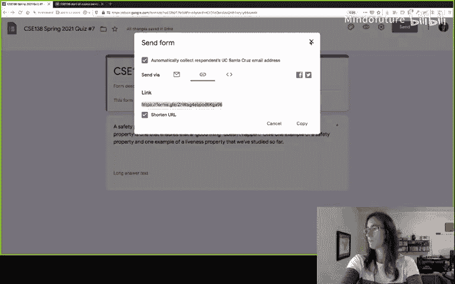

# 007：安全性与活性、故障模型、两将军问题

在本节课中，我们将首先回顾并深入探讨Chandy-Lamport快照算法的一些遗留问题。随后，我们将正式介绍分布式系统中的两个核心概念：**安全性**与**活性**。接着，我们会学习如何对系统故障进行分类，并理解**故障模型**的概念。最后，我们将通过经典的**两将军问题**来探讨在存在通信故障的系统中达成共识的固有困难。

## 回顾Chandy-Lamport快照算法

上一讲我们介绍了Chandy-Lamport全局快照算法。本节中，我们来解答一些关于该算法的常见疑问，以加深理解。

### 关于通信通道的假设

在Chandy-Lamport算法中，我们假设每个进程都与其他所有进程之间存在一个**通道**。这意味着任何进程都可以直接向其他进程发送消息，并且这些通道是**先进先出**的。

然而，在实际网络中，物理连接可能并非完全连通。算法要求的是底层的**通信图是强连通的**。只要网络是强连通的，即使没有直接的物理连接，进程也可以通过中间节点转发消息来“模拟”出与所有其他进程的直接通道。因此，算法依然可以工作。

### 快照的构成：进程状态与通道状态

Chandy-Lamport快照捕获了两部分信息：
1.  **进程状态**：每个进程在收到标记消息瞬间的本地状态。
2.  **通道状态**：每个进程在开始记录后，在其**入向通道**上收到的、在快照点之前发送的所有消息。

为什么需要记录通道状态（即“传输中”的消息）？考虑一个系统，其中只有一个令牌，用于控制对共享资源的访问。假设进程P1将令牌通过消息M发送给进程P2。如果在快照时刻，消息M仍在传输中（即已被P1发出但尚未被P2接收），那么：
*   根据P1的快照状态，它已不持有令牌。
*   根据P2的快照状态，它尚未收到令牌。

如果不记录通道状态，快照将显示“令牌消失了”，这违反了系统应始终保持“有且仅有一个令牌”的**不变性**。记录通道状态中的消息M，使我们能够推断出令牌的归属，从而保持快照的一致性。

## 安全性与活性

现在，让我们转向两个用于描述系统属性的核心概念：安全性与活性。

### 安全性属性

安全性属性可以通俗地理解为 **“坏事永远不会发生”** 。它规定了系统不允许出现的行为。

我们之前讨论过的许多消息传递保证都属于安全性属性：
*   **FIFO交付**：确保来自同一发送者的消息按发送顺序被接收。它排除了后发消息先到的“坏事”。
    *   `send(P1, m1); send(P1, m2)` 必须导致 `deliver(P2, m1)` 先于 `deliver(P2, m2)`。
*   **因果交付**：确保具有因果关系的消息按因果顺序被接收。它排除了结果先于原因被传递的“坏事”。
*   **全序交付**：确保所有进程以相同的顺序传递所有消息。

**安全性属性的一个关键特征是**：我们可以在一个**有限的执行片段**中指出该属性被违反的具体位置。

### 活性属性

活性属性则相反，它保证 **“好事最终会发生”** 。它规定了系统最终必须达成的行为。

一个典型的活性属性是 **“最终交付”** 或 **“可靠交付”** 。它保证，在满足一定条件（例如，发送者和接收者均未崩溃，且并非所有消息都丢失）下，一条被发送的消息最终会被接收方传递。

**活性属性的一个关键特征是**：无法在一个有限的执行片段中判断该属性被违反。因为即使好事尚未发生，也不意味着它将来不会发生。

### 安全性与活性的关系

单独的安全性属性或活性属性都是不充分的。
*   一个只满足FIFO交付（安全性）但从不实际传递任何消息（缺乏活性）的系统是毫无用处的。
*   一个保证消息最终会传递（活性）但传递顺序完全随机（不满足任何顺序安全性）的系统同样可能无法正常工作。

因此，设计一个实用的系统通常需要同时指定和满足相应的**安全性属性**和**活性属性**。

## 故障分类与故障模型

在设计容错系统时，我们需要明确系统可能遭遇哪些类型的故障，这引出了**故障模型**的概念。

### 故障类型

以下是几种经典的故障分类：
1.  **崩溃故障**：进程停止运行，不再发送或接收任何消息。
2.  **遗漏故障**：单个消息在发送或接收过程中丢失。
3.  **定时故障**：进程的响应过早或过晚（在异步网络模型中通常不考虑此类故障）。
4.  **拜占庭故障**：进程行为任意，可能发送错误信息或恶意信息。

### 故障模型

故障模型定义了系统设计时**假设可能发生**的故障类型集合。它决定了算法需要容忍哪些故障。

这些故障类型之间存在包含关系：
*   崩溃故障是遗漏故障的特例（所有涉及该进程的消息都丢失）。
*   遗漏故障又是拜占庭故障的特例（恶意进程可以故意表现为丢失消息）。

因此，故障模型也呈嵌套关系：
*   **崩溃故障模型**：只需容忍进程崩溃。
*   **遗漏故障模型**：需容忍消息丢失（自然也包含了崩溃故障）。
*   **拜占庭故障模型**：需容忍任意故障（包含了前两者）。

在本课程中，我们将主要关注**遗漏故障模型**，这是一个现实且具有足够挑战性的模型。

## 两将军问题

两将军问题是一个经典的思想实验，深刻揭示了在不可靠通信信道下达成协同的**根本性困难**。

### 问题描述

两位将军（Alice和Bob）各自率领军队驻扎在两座山头上，山谷中驻扎着敌军。任何一方单独进攻都会失败，只有同时进攻才能取胜。他们唯一的通信方式是派信使穿过山谷，但信使可能被敌军俘获（消息丢失）。

### 不可能性分析

假设Alice想提议在黎明进攻：
1.  Alice发送消息“黎明进攻？”给Bob。
2.  Bob收到后，必须回复“同意”。但此时Alice不知道Bob是否收到她的提议，所以她不能贸然进攻。
3.  Alice收到Bob的“同意”后，可以进攻了吗？不行，因为Bob不知道他的“同意”是否成功送达Alice。如果没送达，Bob知道Alice不会进攻，所以他也不能进攻。
4.  于是Alice需要发送“确认收到同意”……
5.  这个“确认的确认”链条可以无限延伸下去。

**结论**：在遗漏故障模型下，**无法**通过有限次消息交换，让任何一位将军**百分之百确信**对方会同时发起进攻。

### 实际应对方案

虽然理论上不可能完美解决，但实践中可以采用一些折中方案：
1.  **概率性确信**：Alice持续重复发送进攻提议。当Bob收到一条并回复后，如果Alice停止发送新消息，Bob在长时间收不到新消息后，可以以很高的概率确信Alice已收到回复并准备进攻。通过增加通信次数，可以无限接近（但无法达到）100%的确定性。
2.  **共同知识**：如果Alice和Bob在分离之前就当面商定好了进攻时间，那么这个时间就成为双方的“共同知识”。共同知识意味着“每个人都知道P，每个人都知道每个人都知道P，……以至无限”。在分布式系统中，仅通过可能丢失的消息无法在事后建立共同知识。

两将军问题及其变体是理解许多分布式共识算法（如TCP握手、原子提交协议等）背后逻辑的基础。

## 总结

本节课中我们一起学习了：
1.  澄清了Chandy-Lamport快照算法中关于通道和快照构成的细节。
2.  正式定义了**安全性属性**（坏事不发生）和**活性属性**（好事终发生），并理解了它们相辅相成的关系。
3.  学习了故障的四种主要类型：崩溃、遗漏、定时和拜占庭故障，并理解了**故障模型**的嵌套概念。
4.  通过**两将军问题**，探讨了在不可靠通信条件下实现确定性的协同动作所面临的根本性限制，以及实际中的概率性解决方案。

这些概念为我们后续深入学习容错算法和共识协议奠定了重要的理论基础。