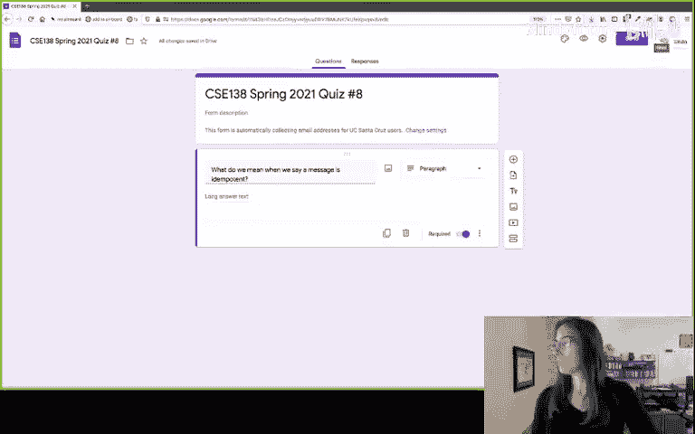
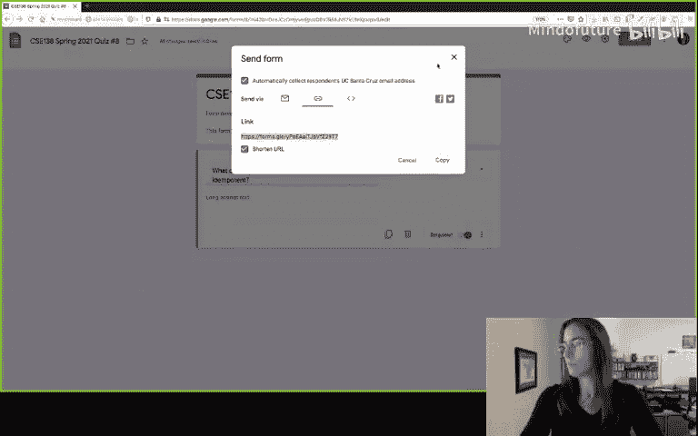
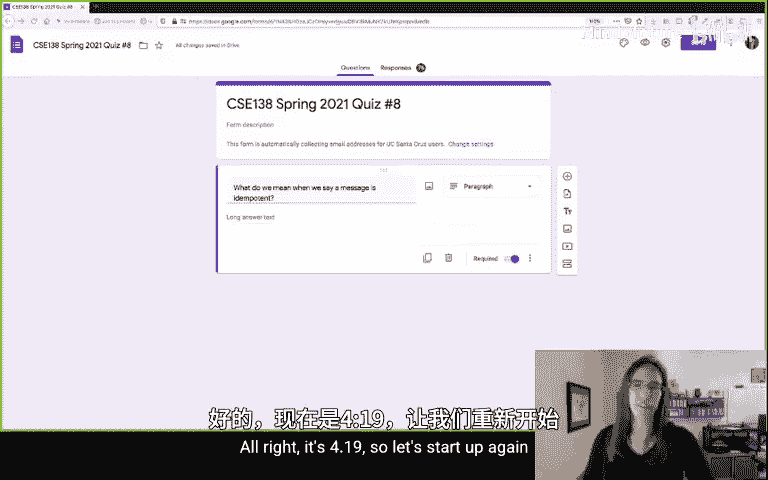

# 008：容错形式、可靠交付与可靠广播 🎯

在本节课中，我们将要学习分布式系统中的容错形式、可靠交付的实现方法、幂等性概念以及可靠广播协议。我们将从回顾故障分类开始，逐步深入探讨如何在异步网络模型中实现可靠的消息传递。

## 故障分类回顾 🔍

上一节我们介绍了故障的分类方法，本节中我们来看看这些分类的更多细节。故障可以分为以下几类：

*   **崩溃故障**：进程停止运行。
*   **遗漏故障**：进程未能发送或接收消息。崩溃故障是遗漏故障的一个子集。
*   **拜占庭故障**：进程可能以任意方式出错，包括发送错误或恶意消息。遗漏故障是拜占庭故障的一个子集。

需要指出的是，这个分类并非绝对。例如，某些拜占庭故障可以被“降级”处理。

*   **可检测的拜占庭故障**：如果消息被篡改，但我们可以通过校验和或错误纠正码等技术检测到，那么我们可以简单地丢弃这条消息，将其视为遗漏故障。这比无法检测的篡改要容易处理得多。

因此，在设计系统时，明确声明系统能够容忍哪一类故障（即选择**故障模型**）至关重要。在本课程中，我们将主要关注**遗漏故障模型**，因为它比崩溃模型更贴近现实。

## 容错的形式 🛡️

仅仅说一个系统“容忍某种故障”是不够的，我们还需要明确在故障发生时，系统的行为会发生何种变化。这涉及到系统的**安全性**和**活性**属性。

*   **安全性**：坏事永远不会发生。
*   **活性**：好事最终会发生。

一个正确的程序需要同时满足其安全性和活性属性。在发生故障时，程序的行为可能有以下几种形式：

*   **屏蔽容错**：在故障发生时，程序继续保持安全性和活性。这是最理想的情况。
*   **故障安全容错**：在故障发生时，程序保持安全性，但可能丧失活性。例如，一个消息队列为了保证消息顺序（安全性），在出现网络分区时可能停止投递消息（丧失活性）。
*   **非屏蔽容错**：在故障发生时，程序保持活性，但可能丧失安全性。例如，系统继续投递消息，但允许消息暂时失序。
*   **完全失效**：在故障发生时，程序既丧失安全性，也丧失活性。

在实际系统中，**故障安全容错**是最常见的选择，即优先保证安全性。

## 实现可靠交付 ⚙️

上一节我们定义了可靠交付，本节中我们来看看如何实现它。可靠交付（在遗漏模型中）的定义是：如果进程P1向进程P2发送消息M，且P1和P2均未崩溃，**并且并非所有消息都丢失**，那么P2最终将投递M。

以下是实现可靠交付的一个基本思路：

1.  发送方将消息放入发送缓冲区。
2.  设置一个超时计时器。
3.  每当超时触发，就重新发送缓冲区中的消息。
4.  当发送方收到接收方对该消息的确认后，才将消息从缓冲区中删除。

这个方法确保了消息至少被传递一次，因此也被称为**至少一次交付**。但它带来了一个新问题：接收方可能收到重复的消息。

## 幂等性概念 🔄

重复的消息是否构成问题，取决于消息本身的性质。

*   **幂等操作**：执行多次的效果与执行一次相同。例如，`set x = 3` 这个操作就是幂等的，无论执行多少次，x的最终值都是3。
*   **非幂等操作**：执行多次的效果与执行一次不同。例如，`increment x` 这个操作就不是幂等的，执行两次会使x增加2。

在分布式系统中，**幂等性**至关重要。因为通过重传来实现可靠交付（至少一次交付）是常见做法，所以设计幂等的消息或操作可以简化对重复消息的处理。

那么，我们能实现**恰好一次交付**吗？严格来说，在异步分布式系统中，这是不可能的。当系统声称提供“恰好一次”语义时，通常意味着以下两种情况之一：
1.  消息本身就是幂等的，因此重复投递没有影响。
2.  系统在接收端进行了去重处理，尝试过滤掉重复的消息。

## 实现可靠广播 📢

广播是指一个进程发送消息，所有进程都接收该消息。**可靠广播**的定义是：如果一个正确的进程投递了广播消息M，那么所有正确的进程最终都会投递M。这里的“正确进程”含义取决于故障模型（例如，在崩溃模型中指未崩溃的进程）。

假设我们已有基本的单播（点对点）通信原语，如何在其上构建可靠广播呢？一个简单的想法是发送者向每个进程单独发送单播消息。但这无法处理发送者在发送过程中崩溃的情况。

以下是实现可靠广播（在崩溃模型中）的一个经典算法：

1.  当进程收到一个广播消息M时（无论是从原始发送者还是其他进程），它首先将M转发给所有其他进程（除了它收到消息的那个来源进程）。
2.  完成转发后，它才将消息M投递给自己的上层应用。
3.  每个进程需要记录已经投递过的消息ID，对于已投递的消息，不再重复投递或转发。

这个算法的核心思想是：**通过让接收者帮助转发，来确保即使原始发送者崩溃，消息也能传播到所有正确的进程**。这个过程自然也会产生重复消息，因此需要上述的去重机制。

## 核心思想总结 💡

从可靠交付和可靠广播的实现中，我们可以提炼出一个分布式系统容错的核心模式：**容错通常需要通过制造副本来实现**。

*   为了容忍消息丢失（可靠交付），我们通过重传制造消息的多个副本。
*   为了容忍进程崩溃导致广播中断（可靠广播），我们通过接收者转发来制造消息的多个副本。
*   为了容忍进程崩溃导致数据丢失，我们需要将数据复制到多个进程上，即**数据复制**。这是复制技术最重要的目的，我们将在接下来的课程中详细讨论。

## 本节课总结 📚

本节课中我们一起学习了：
1.  故障分类的细节与可检测拜占庭故障的概念。
2.  容错的不同形式：屏蔽容错、故障安全容错等，并理解在故障中优先保持安全性是常见选择。
3.  如何通过“重传直到确认”的机制实现可靠交付（至少一次交付）。
4.  幂等性概念及其对处理重复消息的重要性，并理解了“恰好一次交付”在实践中的真实含义。
5.  如何通过“接收者转发”的算法在单播原语上实现可靠广播。
6.  认识到“制造副本”是实现容错（应对消息丢失、进程崩溃、数据丢失）的一个根本且强大的技术。