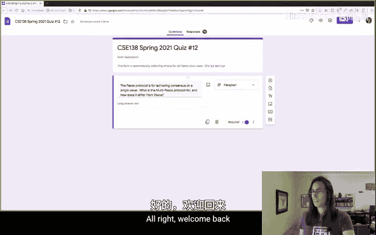

# 012：Paxos与共识总结，主被动复制

在本节课中，我们将继续讨论Paxos共识算法，并对其进行总结。我们将探讨“提案者竞争”问题，介绍Multi-Paxos优化，并简要讨论Paxos的容错性及其他共识协议。最后，我们将介绍主被动复制的概念及其应用。

---

## 继续讨论Paxos：提案者竞争

上一节我们介绍了Paxos算法的基本流程。本节中，我们来看看当存在多个提案者时可能出现的问题。

考虑一个场景：有三个接受者（A1, A2, A3）和两个提案者（P1, P2）。
*   提案者P1首先发送编号为5的Prepare请求给A1和A2，并收到了Promise回复。
*   同时，提案者P2发送编号为6的Prepare请求给A2和A3，A2和A3也回复了Promise。
*   随后，P1进入第二阶段，发送编号为5的Accept请求给接受者们。A1会接受，但A2因为已经承诺了编号6，会忽略编号更低的请求。因此，P1无法获得多数接受者的接受，最终超时。
*   同样，P2发送编号为6的Accept请求时，A2可能已经承诺了P1发出的更高编号（例如7）的Prepare请求，导致P2的请求也被忽略。

这种情况被称为“提案者竞争”。两个提案者都成功完成了第一阶段，但在第二阶段却因为对方的干扰而无法达成共识，导致算法可能永远无法终止。

一个自然的想法是：为什么不让系统只有一个提案者呢？这样不就可以避免竞争了吗？原因在于：
1.  **容错性**：唯一的提案者如果崩溃，整个系统将无法提出新值。
2.  **领导者选举本身是共识问题**：要选举出唯一的提案者（领导者），这本身就需要一个共识算法来解决，而共识算法（如Paxos）本身就可能无法终止。因此，将问题简化为“只有一个提案者”并没有从根本上解决非终止性问题。

Paxos选择了保证**安全性**（一致性和有效性），而牺牲了**活性**（终止性）。这是异步分布式系统中共识算法的固有局限（FLP不可能定理）。

---

## Multi-Paxos：优化序列值共识

我们之前讨论的Paxos用于就**单个值**达成共识。但在许多实际场景中（如全序广播），我们需要就一个**值序列**达成共识。如果对序列中的每个值都运行一次完整的Paxos（两阶段），消息开销会非常大。

以下是Multi-Paxos的优化思路：
1.  对于第一个值，仍然需要运行完整的Paxos（第一阶段Prepare + 第二阶段Accept）。
2.  一旦某个提案者成功完成了一次完整的两阶段，并得到了多数接受者的支持，它就可以在后续的共识中**跳过第一阶段**，直接为后续的值重复执行第二阶段（Accept）。
3.  只要这个提案者没有崩溃，且没有其他提案者用更高的编号“打断”它，它就可以持续高效地确定序列中的后续值。
4.  如果出现了新的提案者并成功完成了更高编号的Prepare阶段，那么原提案者的“领导地位”将被取代，系统会回退到完整的Paxos流程。

这种优化被称为**Multi-Paxos**。它本质上是一种“领导权”的隐含形式，旨在大多数时间内只有一个活跃的提案者，从而减少消息延迟。批处理（将多个值打包在一个Accept请求中）是另一种常见的优化手段。

---

## Paxos的容错性

Paxos被设计为能够容忍进程崩溃故障。其容错能力取决于接受者集群的规模。

*   **接受者容错**：Paxos要求提案者必须与**多数派**的接受者进行通信。对于一个由N个接受者组成的集群，它可以容忍 **`F < N/2`** 个接受者同时崩溃。通常表述为需要 **`2F + 1`** 个节点来容忍F个故障。
    *   例如：3个节点可容忍1个故障，5个节点可容忍2个故障。
*   **提案者容错**：只需要有一个提案者存活即可提出新值。因此，要容忍F个提案者故障，需要至少 **`F + 1`** 个提案者。
*   **消息丢失（遗漏故障）**：Paxos对偶尔的消息丢失具有鲁棒性。超时重传机制可以处理此类问题。在最坏情况下，消息丢失可能导致活锁（非终止），但这并不违反Paxos的安全保证（一致性）。在容错分类中，Paxos在遗漏故障下属于**安全但不活跃**的协议。

---

## 其他共识协议简介

除了Paxos，还有其他重要的共识协议，它们通常针对**序列值共识**（即状态机复制）进行了优化，并显式集成了领导者选举机制。

以下是几个著名的协议：
1.  **Raft**：由Diego Ongaro和John Ousterhout于2014年提出。其核心设计目标是**易于理解**和实现。Raft明确地将共识过程分解为领导者选举、日志复制和安全性等模块，逻辑清晰，已成为学习和实践的热门选择。
2.  **Viewstamped Replication (VSR)**：由Brian Oki和Barbara Liskov于1988年提出。它是许多现代共识协议（包括Raft）的思想先驱，同样采用了视图（View）和领导者的概念。
3.  **Zab (ZooKeeper Atomic Broadcast)**：是Apache ZooKeeper协调服务使用的共识协议，专注于实现原子广播（全序广播）。ZooKeeper常用于集群的元数据管理与协调。

这些协议与Paxos（特别是Multi-Paxos）在本质上解决的是相同的问题，但它们在具体设计、术语和工程实现上各有特点。2014年的论文《*There Is More Consensus in Egalitarian Parliaments*》对Paxos、VSR和Zab进行了比较分析。

---

## 主动复制 vs. 被动复制

这是实现复制服务（如我们作业中的键值存储）的两种策略，与“主从备份”或“链式复制”等具体架构是正交的。

假设一个客户端向复制组发起一个写操作（例如 `deposit(50)`）：

**主动复制（状态机复制）**
*   **流程**：主副本接收请求后，将**操作本身**（如 `deposit(50)`）广播给所有副本。每个副本**独立执行**该操作，更新自身状态，然后回复确认。主副本收到多数确认后，再回复客户端。
*   **优点**：当状态更新很大时（例如更新一个巨大的数据集），广播操作比广播整个新状态更节省带宽。
*   **缺点**：如果操作执行成本很高，或者操作结果依赖于本地不确定状态（如本地随机数），则所有副本执行可能产生不一致结果。

**被动复制（主从更新）**
*   **流程**：主副本接收请求后，**自己执行**该操作，计算出新的状态。然后它将**完整的新状态**（或状态差异）广播给其他副本。其他副本直接安装新状态，然后回复确认。主副本收到多数确认后，再回复客户端。
*   **优点**：操作只执行一次，适用于计算成本高或具有非确定性的操作。
*   **缺点**：当状态很大时，传输整个状态的网络开销很大。

**选择依据**：
*   使用**主动复制**，当操作确定且状态大。
*   使用**被动复制**，当操作昂贵或非确定。

**状态机复制** 是指一组副本以相同的顺序执行相同的操作序列，从而经过相同的状态序列。无论是通过共识协议（如Raft、Multi-Paxos）确定操作顺序，还是通过主从架构广播操作，只要保证所有副本执行顺序一致，都属于状态机复制的范畴。

---

## 关于作业3的补充说明

在作业3中，我们需要实现因果一致性。规范中定义了两个条件，其中第一个条件实质上是 **“读己之写”** 一致性。

**“读己之写”违规示例**：
1.  客户端C向副本R1发送写操作 `set(“x”, 3)`，并收到成功确认。
2.  随后，客户端C向副本R2发送读操作 `get(“x”)`。
3.  如果R2返回一个旧值（例如2），则违反了“读己之写”。

**如何保证**：
客户端必须在请求中携带并传递**因果元数据**。
1.  当R1处理完 `set(“x”, 3)` 后，在回复给客户端的确认中，需要包含反映此次写入的因果元数据。
2.  客户端发起 `get(“x”)` 请求时，必须将之前收到的因果元数据一并发送给R2。
3.  R2看到这个因果元数据后，便知道自己可能尚未看到 `x=3` 这个写入。它不能立即返回本地旧值，而必须等待从R1或其他副本同步到足够新的数据（满足因果依赖）后，才能返回正确的值 `3`。

因此，实现因果一致性的关键在于：**服务器通过回复传递因果元数据，客户端通过后续请求传递因果元数据**，从而在整个系统中跟踪和尊重操作的因果顺序。

---

## 总结

本节课中我们一起学习了：
1.  **Paxos中的提案者竞争问题**：多个提案者可能导致活锁，解释了为何Paxos无法保证终止性。
2.  **Multi-Paxos优化**：为了高效达成序列值共识，可以在首次完整运行后，由领导者仅执行第二阶段。
3.  **Paxos的容错能力**：可容忍少数派接受者崩溃，对消息丢失具有鲁棒性。
4.  **其他共识协议**：了解了Raft、VSR、Zab等协议，它们通常为序列共识和领导者选举而设计。
5.  **主被动复制**：区分了广播操作（主动）和广播状态（被动）两种复制策略及其适用场景。
6.  **作业3要点**：重温了因果一致性与“读己之写”的关系，强调了因果元数据在客户端与服务器间传递的重要性。