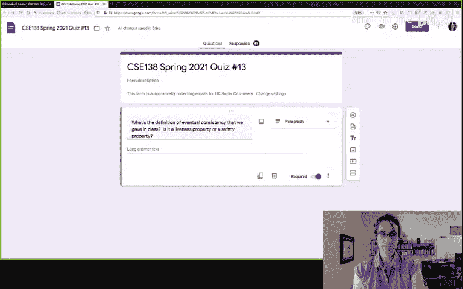
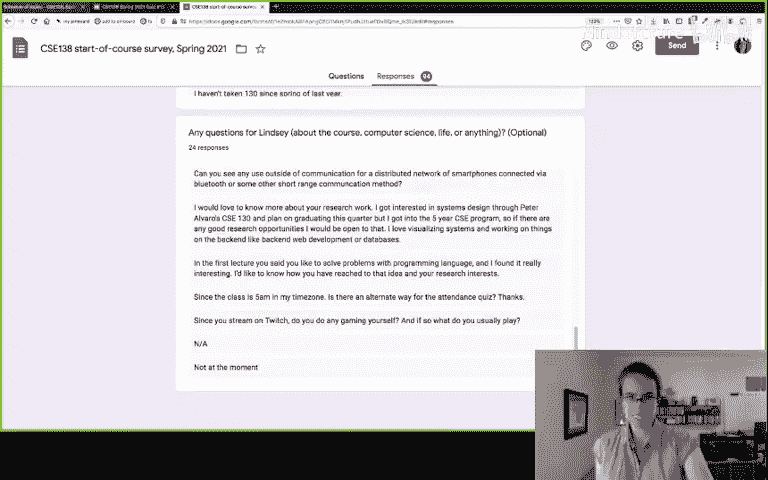

# 013：最终一致性、可用性与冲突解决

在本节课中，我们将学习分布式系统中的最终一致性概念，探讨它与强一致性的区别，并了解在网络分区发生时，系统如何在一致性与可用性之间做出权衡。我们还将讨论应用特定的冲突解决机制，并介绍著名的CAP理论。

## 课程概述与安排

在深入今天的主题之前，我们先简要说明一下本季度剩余时间的课程安排。

以下是近期需要关注的事项：
*   **编程作业三**：已发布数周，将于明天之后的一周截止。请确保你的小组已取得实质性进展。
*   **阅读作业**：请在**下周二**之前阅读**亚马逊Dynamo论文**。这是本课程的首次阅读作业，论文链接已在课程网站上更新。建议预留数小时来阅读这篇学术论文，无需理解每个细节，但需把握其核心思想。
*   **课程中期调查**：已重新开放，填写可获得少量课程学分，请尚未完成的同学尽快完成。
*   **客座演讲**：**25日（周二）**，我们将有幸邀请到来自Twitch和亚马逊网络服务的前员工Cyrus Hall，为我们讲解实用的分布式系统设计。

现在，让我们进入今天的核心内容。

## 从强一致性到最终一致性

上一节我们介绍了如何通过主备复制或链式复制来实现副本间的强一致性。强一致性最终依赖于共识算法。然而，共识算法代价高昂，需要大量消息传递，甚至可能无法终止。

考虑一个典型的全序异常示例：两个客户端并发地向不同副本写入，导致副本状态最终不一致。即使使用向量时钟，我们也能判断这两个写入事件是并发的，无法确定顺序。这表明，问题不在于违反因果一致性，而在于违反了全序交付。

因此，我们常常希望找到一种方法，使得更新的到达顺序不再重要，从而避免使用共识算法。在许多场景下，更新的顺序确实无关紧要。

## 最终一致性与强收敛

如果两个客户端更新的是不同的键（例如 `X` 和 `Y`），那么无论更新以何种顺序到达副本，副本的最终状态（即键值对的集合）都是相同的。但这并不是强一致性，因为在此期间，客户端可能读取到不一致的状态。

我们称这种属性为**最终一致性**。其非正式定义是：如果客户端停止提交更新，那么所有副本最终将达成一致。这是一个**活性属性**，因为它无法在有限执行中被违反，只能尚未被满足。

最终一致性与我们之前讨论的安全性属性（如读己之写、FIFO、因果、强一致性）不属于同一范畴。然而，我们可以用一个安全性属性来区分“最终一致”和“最终不一致”的情况，即**强收敛**。

**强收敛**的定义是：所有已交付相同**集合**更新的副本，必须具有等价的状态。这里的关键词是“集合”，而非“顺序”。强收敛是一个**安全性属性**。

**强最终一致性**是最终一致性（活性）和强收敛（安全）的结合。它是一个混合了安全性和活性的属性。

## 应用特定的冲突解决

当多个客户端并发更新同一个键时，我们如何实现强收敛？副本可以保存所有并发更新的值。例如，两个副本可能分别保存了 `X: [3, 4]` 这样的集合。这实现了强收敛，但将冲突解决的负担转移给了客户端。

客户端读取时，会获得多个值，需要自行决定如何解决冲突。解决方式取决于具体的应用逻辑。

以亚马逊购物车为例：假设你的笔记本电脑添加了一本书，手机同时添加了一个搅拌机。两个更新并发到达不同的副本。当某个服务（客户端）查询购物车内容时，可能会得到两个购物车集合：`{书}` 和 `{搅拌机}`。此时，合理的冲突解决方式是取这两个集合的**并集**，得到一个包含 `{书, 搅拌机}` 的购物车。亚马逊Dynamo论文中实际讨论了这种合并策略。

## 网络分区、可用性与CAP理论

**网络分区**是指网络中的部分节点无法与其他节点通信。我们可以用**遗漏故障模型**来描述它：跨越分区的消息被视为丢失。这与**数据分片**（有意将数据分布到不同机器）不同，网络分区是一种需要应对的故障。

**可用性**通常被定义为“每个请求都能收到响应”，这是一个活性属性。在实践中，我们还要求响应在合理的时间内完成。

考虑一个主备复制系统，当主节点与备份节点之间发生网络分区时，主节点面临两难选择：
1.  **等待分区恢复后再响应客户端**：这保证了强一致性，但牺牲了可用性（客户端可能长时间等待）。
2.  **立即响应客户端，稍后异步复制**：这保证了可用性，但牺牲了一致性（数据可能丢失或备份不一致）。

更一般地，假设有两个副本 `R1` 和 `R2` 之间发生分区，但一个客户端能同时访问两者。客户端向 `R1` 写入后，立即从 `R2` 读取。`R2` 要么返回旧值（违反一致性），要么等待与 `R1` 通信（违反可用性）。这是一个根本性的权衡。

这个著名的权衡就是 **CAP理论**（一致性、可用性、分区容错性）。其核心是：在存在网络分区的情况下，无法同时实现完美的一致性和完美的可用性，必须有所取舍。CAP常被误解为“三选二”，但实际上，分区容错性是必须接受的现实，我们只能在一致性和可用性之间优先保障其中一项。不同的系统会根据其需求调整这个优先级。

## 测试与混沌工程

在完成作业三时，测试分布式系统是一大挑战。例如，要测试“读己之写”属性，需要模拟消息延迟的场景。在本地测试中，消息传递通常很快，难以触发边界情况。

**混沌工程**是一种通过故意向系统中注入故障（如延迟、丢弃消息、使机器崩溃）来测试其容错性的方法。目的是暴露系统中潜在的、在正常条件下难以发现的缺陷。Netflix是推广这一实践的知名公司。

由于容错系统会刻意掩盖故障，使得其中的缺陷更难被发现。混沌工程通过主动制造“混乱”，帮助我们验证系统在真实故障下的行为是否符合预期。对于想深入此领域的同学，可以了解Peter Alvaro关于**溯源驱动故障注入**的研究，该工作旨在更智能地选择故障注入点，以更快地发现缺陷。

## 课程总结

本节课我们一起学习了分布式系统中的几个核心概念：
*   **最终一致性**：一个活性属性，确保在更新停止后，副本最终会一致。
*   **强收敛**：一个安全性属性，要求交付相同更新集合的副本状态等价。
*   **强最终一致性**：最终一致性与强收敛的结合。
*   **应用特定冲突解决**：当并发更新发生时，由应用逻辑决定如何合并数据，例如购物车的并集操作。
*   **网络分区与可用性**：分区是不可避免的故障，需要在一致性和可用性之间做出权衡。
*   **CAP理论**：阐述了在网络分区存在时，一致性与可用性不可兼得的根本性权衡。
*   **测试挑战与混沌工程**：介绍了通过故意注入故障来测试和提升分布式系统鲁棒性的方法。

这些概念将为你阅读和理解亚马逊Dynamo论文奠定重要的基础。Dynamo系统正是优先考虑可用性和最终一致性，并采用向量时钟和应用级冲突解决机制的典型代表。我们将在后续课程中继续探讨论文中的其他细节。