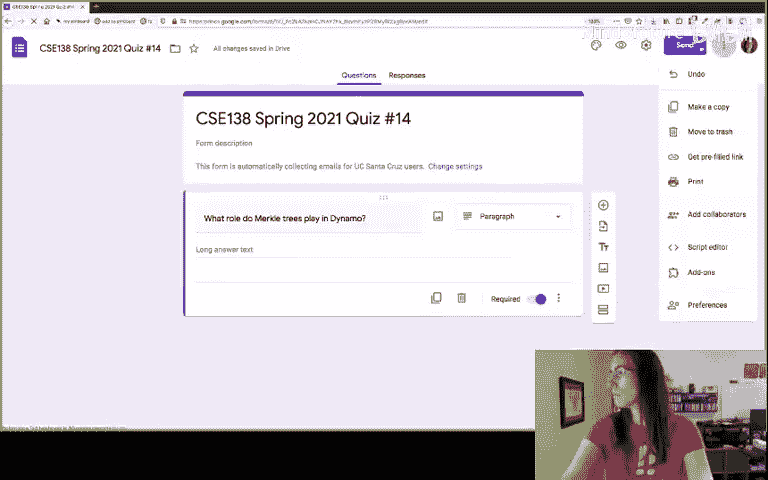
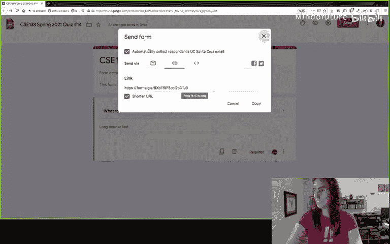
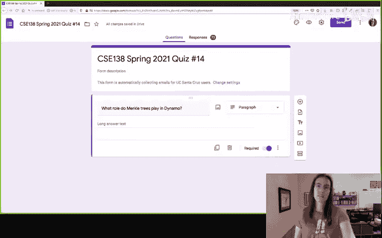

# 014：Dynamo - Merkle树、法定一致性、尾部延迟

在本节课中，我们将深入探讨亚马逊Dynamo论文中的核心概念。我们将回顾一些已学过的思想，并介绍几个新的重要主题，包括反熵、Merkle树、流言协议、法定一致性和尾部延迟。

## 旧概念回顾

上一讲我们讨论了可用性、网络分区和最终一致性等概念。本节中，我们来看看这些概念在Dynamo系统设计中的具体体现。

### 可用性与网络分区

可用性意味着每个请求都会收到响应。在Dynamo的设计中，高可用性是首要目标，即使在网络分区的情况下，系统也优先响应客户端请求，而非等待所有副本达成一致。

网络分区是指网络中的一部分机器暂时无法与另一部分机器通信。Dynamo的设计明确考虑了对网络分区的容忍。

### 最终一致性

最终一致性是一种活性属性，它指出如果更新停止到达，那么所有副本最终将达成一致。Dynamo为了获得高可用性和分区容忍性，选择放松对强一致性的要求，采用了最终一致性模型。

需要注意的是，Dynamo并未提供强最终一致性（一种包含安全性属性的模型）。最终一致性这一术语实际上由Doug Terry等人在90年代中期的Bayou系统中提出。

### 应用层冲突解决

当副本状态不一致时，Dynamo允许应用提供自定义的冲突解决逻辑。例如，购物车服务可以采用集合并集作为解决策略。

以下是Dynamo处理冲突的两种方式：
*   **应用特定机制**：例如，购物车合并。
*   **最后写入获胜（LWW）**：如果未提供应用特定机制，则默认采用此策略。

值得注意的是，论文中提到购物车实现存在一个缺陷：已删除的商品可能会重新出现在购物车中。这揭示了在采用合并等冲突解决策略的复制系统中，删除操作比添加操作更为复杂。

## 新概念探讨

在回顾了旧概念后，本节我们将聚焦于Dynamo论文中引入的几个新机制。

### 反熵与流言协议

在最终一致性系统中，副本可能处于不一致状态。Dynamo需要机制来发现并修复这些不一致。它使用两种相似的机制来处理不同类型的状态冲突。

反熵用于解决**应用状态**（即存储的键值对数据）的冲突。由于应用状态可能非常庞大，直接传输全部数据进行比对成本高昂。

流言协议用于解决**视图状态**（即集群中各节点对“哪些节点存活”的认知）的冲突。视图状态通常很小，只是一个节点列表。

虽然“反熵”和“流言”在广义上是同义词，但在Dynamo论文的语境中，它们分别指代上述两种不同的同步过程。

### Merkle树（哈希树）

为了高效地比对庞大的应用状态并最小化网络传输开销，Dynamo采用了Merkle树。

Merkle树是一种数据结构，其中每个叶子节点是数据块（如键值对）的哈希值，每个非叶子节点是其子节点哈希值的哈希。最终，一个根哈希值代表了整个数据集的状态摘要。

当两个副本需要同步时，它们首先比较Merkle树的根哈希。如果根哈希相同，则说明数据一致。如果不同，则沿着树向下比较子节点的哈希，从而快速定位到具体差异的数据块，只需传输少量哈希值而非全部数据。

`根哈希 = Hash( Hash(数据块A) + Hash(数据块B) )`

这种方法极大地减少了在反熵过程中需要传输的数据量。

### 法定一致性

在像主备复制这样的策略中，客户端只与特定的主节点通信。而在Dynamo中，客户端可以联系任何或所有副本，没有节点扮演特殊角色。这引入了法定数量系统的概念。

在法定数量系统中，可以配置三个参数：
*   **N**：副本总数。
*   **W**：写入法定数。一次写入操作必须收到至少W个副本的确认才算成功。
*   **R**：读取法定数。一次读取操作必须收到至少R个副本的响应才算完成。

Dynamo论文建议的常见配置是设置 `W + R > N`（例如，N=3， W=2， R=2）。这保证了每个读取操作所联系的副本集合，一定会与每次写入操作所联系的副本集合存在交集。因此，读取总能获取到至少一份最新的写入数据，避免了陈旧的读取，尽管客户端可能仍需处理来自不同副本的冲突值。

选择合适的W和R值是一种权衡：较低的W使写入更快但耐久性风险更高；较低的R使读取更快但可能读到旧数据。

### 尾部延迟

延迟是指从发起请求到收到响应所需的时间。在评估系统性能时，平均延迟可能具有误导性。

考虑一个系统，大多数请求在1毫秒内完成，但极少数的请求需要100毫秒。其平均延迟可能仍然很低（例如3毫秒），但这掩盖了那些极慢请求对用户体验的严重影响。

尾部延迟关注的是延迟分布的高分位点，例如第99.9百分位延迟（每1000个请求中第二慢的那个）。Dynamo论文特别强调了对尾部延迟的优化，因为改善长尾请求的响应时间，对于提供稳定、可预测的用户体验至关重要，即使平均延迟变化不大。

## 总结

本节课我们一起学习了亚马逊Dynamo论文中的关键设计思想。我们回顾了可用性、网络分区和最终一致性如何塑造其架构，并深入探讨了用于状态同步的反熵机制与高效的Merkle树、用于管理成员信息的流言协议、提供灵活一致性权衡的法定数量系统，以及衡量系统响应稳定性的重要指标——尾部延迟。这些概念共同构成了一个为高可用性而设计、容忍网络分区、并最终保持一致的分布式存储系统的核心。